# 5.6 时序逻辑电路

## 1. 时序逻辑电路概述

时序逻辑电路的特点是输出不仅取决于当前输入，还取决于电路的历史状态（具有记忆功能）。

**时序电路的一般结构**：
$$Y(t_n) = F[X(t_n), Q(t_n)]$$
$$Q(t_{n+1}) = G[X(t_n), Q(t_n)]$$

其中 $X$ 为输入，$Y$ 为输出，$Q$ 为状态。

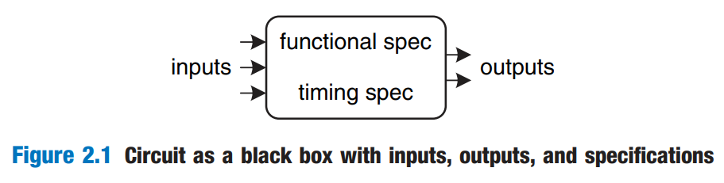
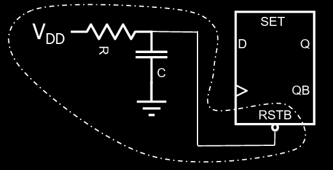
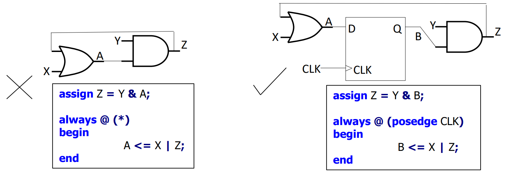

**分类**：
- **同步时序电路**：所有触发器共用一个时钟信号
- **异步时序电路**：触发器使用不同的时钟信号

### 1.1 异步时序电路的概念与特点

异步时序电路中，各触发器的时钟并不完全共用，后级触发器以**前级触发器的输出（或其反相）**作为自己的时钟信号，因此状态的更新是"逐级传播"的。

**与同步时序电路的区别**：

| 特性 | 同步时序电路 | 异步时序电路 |
|------|------------|------------|
| 时钟 | 所有触发器共用同一时钟 | 触发器采用不同的时钟节拍 |
| 状态更新 | 同一时钟沿统一更新 | 前级输出驱动后级，逐级翻转 |
| 结构 | 逻辑较复杂 | 简单，易于实现 |
| 速度 | 快，各级同时动作 | 慢，延迟逐级累积 |
| 竞争冒险 | 较少 | 存在，可能产生毛刺 |

**异步计数器分析要点**（以上升沿/下降沿触发为例）：
- 最低位触发器直接接收外部计数脉冲，在每个有效沿翻转；高位触发器的时钟来自低位的某个输出端
- 做加法计数时，若触发器为**上升沿**触发，后级时钟取自前级的 $\overline{Q}$；若为**下降沿**触发，后级时钟取自前级的 $Q$（减法计数则相反）
- 由于低位的翻转总要经过一段时间（自身翻转延迟）后才驱动高位，导致**传播延迟逐级累积**：级数越多，总延迟越大，各计数器状态的稳定越慢，计数过程中可能出现毛刺或短暂错误状态

**异步时序电路设计要点**：
- 正确选择各级触发器的时钟来源与边沿极性，保证翻转次序符合计数规律
- 需评估延迟累积，最高计数频率 $f_{max}$ 受各级传播延迟之和限制，级数增加时上限快速下降
- 因存在毛刺，异步输出不宜直接作为后续敏感时序电路的输入，必要时加同步/滤波处理

## 2. 时序逻辑电路分析方法

### 2.1 分析步骤

1. **写出驱动方程**：根据逻辑图写出每个触发器输入端的逻辑表达式
2. **写出状态方程**：将驱动方程代入触发器的特性方程，得到状态方程
3. **写出输出方程**：根据逻辑图写出输出表达式
4. **列状态表**：列出所有现态和输入组合下的次态和输出
5. **画状态图**：用圆圈和箭头表示状态转换关系
6. **画时序图**：画出时钟、输入、输出和状态的波形图
7. **分析逻辑功能**：总结电路的功能描述

### 2.2 分析示例

**示例**：分析一个由两个 JK 触发器构成的同步时序电路。

**驱动方程**：
$$J_0 = 1, \quad K_0 = 1$$
$$J_1 = Q_0, \quad K_1 = Q_0$$

**状态方程**（代入 JK 触发器特性方程 $Q_{n+1} = J\overline{Q_n} + \overline{K}Q_n$）：

$$Q_0^{n+1} = 1 \cdot \overline{Q_0^n} + \overline{1} \cdot Q_0^n = \overline{Q_0^n}$$

$$Q_1^{n+1} = Q_0^n \cdot \overline{Q_1^n} + \overline{Q_0^n} \cdot Q_1^n = Q_0^n \oplus Q_1^n$$

**状态表**：

| $Q_1^n$ | $Q_0^n$ | $Q_1^{n+1}$ | $Q_0^{n+1}$ |
|---------|---------|------------|------------|
| 0 | 0 | 0 | 1 |
| 0 | 1 | 1 | 0 |
| 1 | 0 | 1 | 1 |
| 1 | 1 | 0 | 0 |

这是一个 4 进制计数器（模 4 计数器）。

## 3. 状态图与状态表

**状态图**：用图形表示状态之间的转换关系。
- 圆圈表示状态
- 箭头表示状态转换方向
- 箭头旁标注输入/输出

**状态表**：用表格形式列出所有状态转换关系。

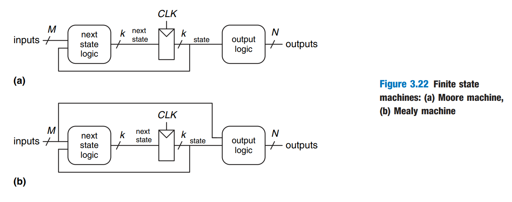
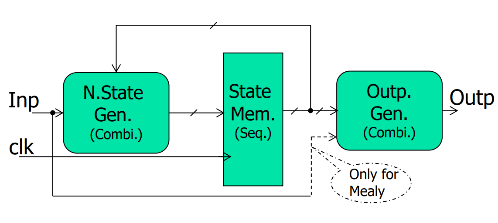
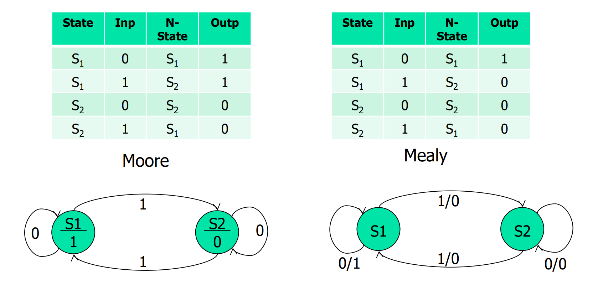
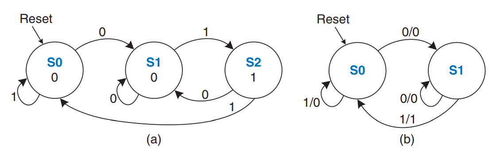
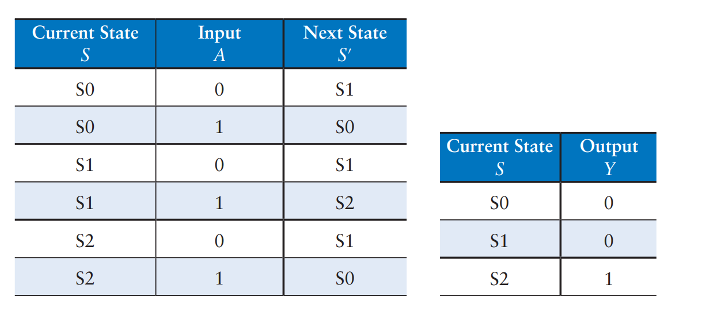
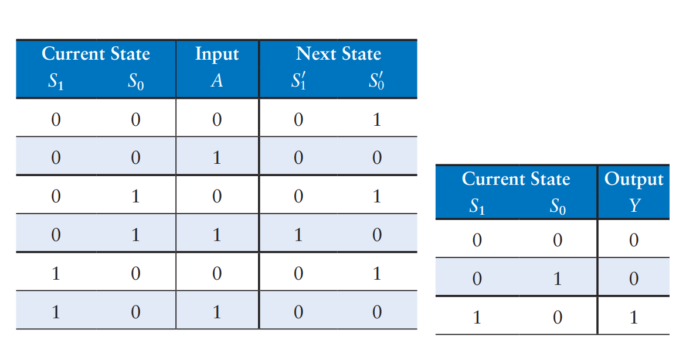
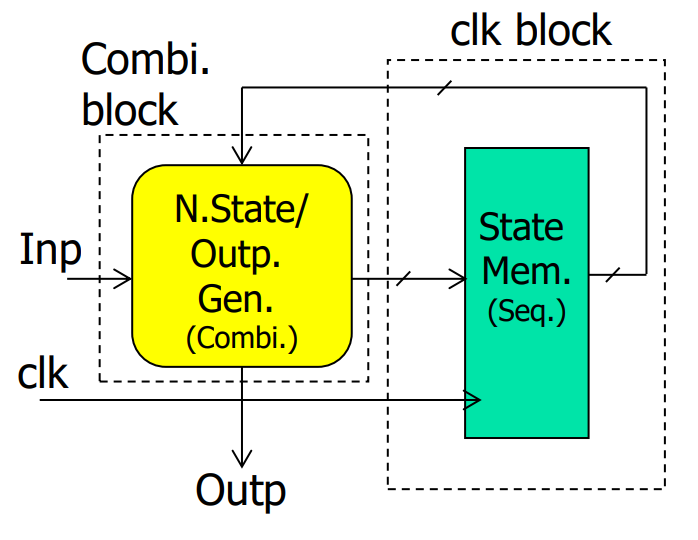
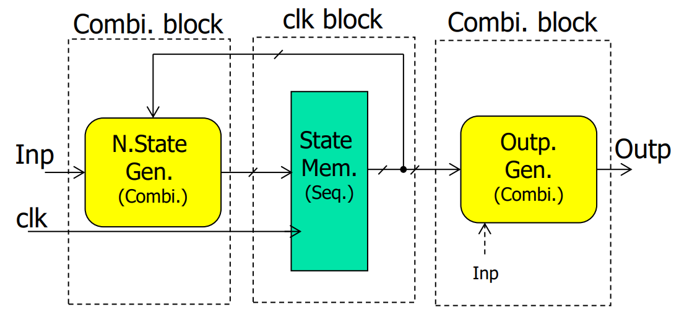

## 4. 同步时序电路设计方法

### 4.1 设计步骤

1. **逻辑抽象**：确定输入、输出变量和状态数
2. **画原始状态图/状态表**：根据设计要求画出状态图
3. **状态化简**：合并等价状态，减少状态数
4. **状态编码**：为每个状态分配二进制代码
5. **选择触发器类型**：通常选用 JK 或 D 触发器
6. **求驱动方程和输出方程**：根据状态表和触发器特性
7. **画逻辑图**：根据驱动方程和输出方程画出电路
8. **验证**：检查设计是否正确

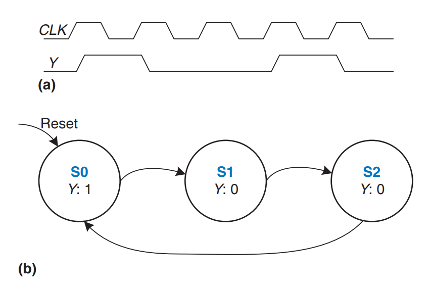
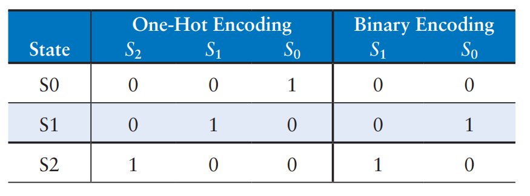
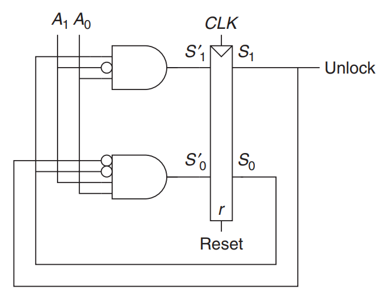
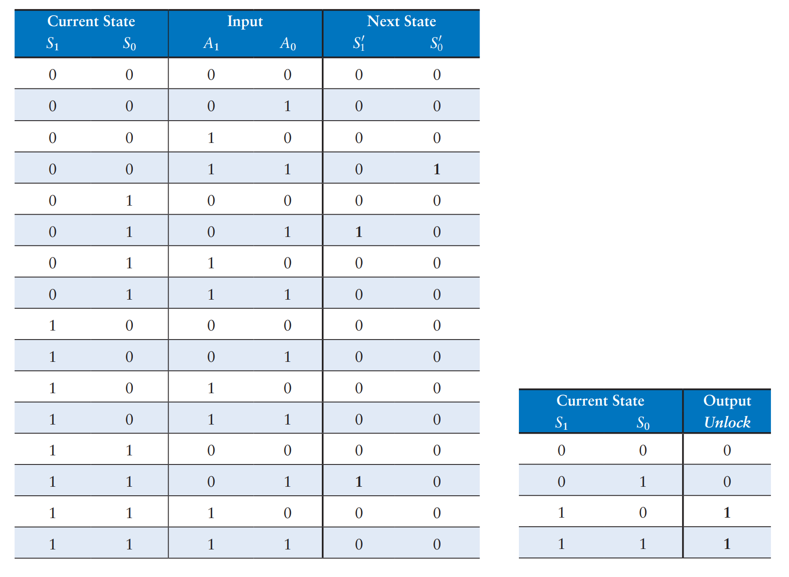
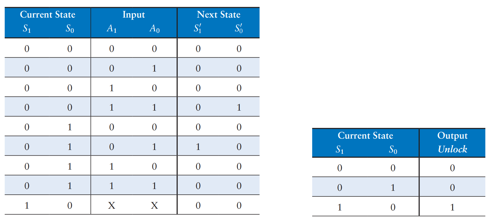
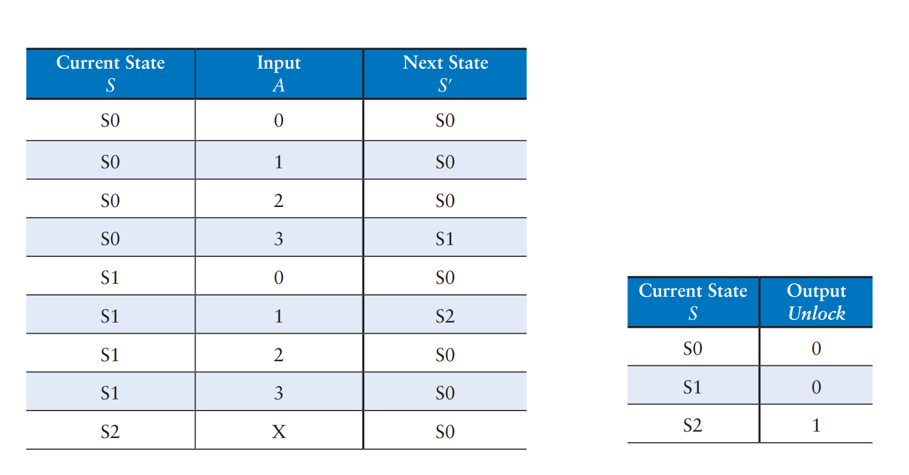

### 4.2 状态化简

**等价状态**：两个状态在相同输入下，输出相同且次态等价（或相同），则这两个状态等价，可以合并。

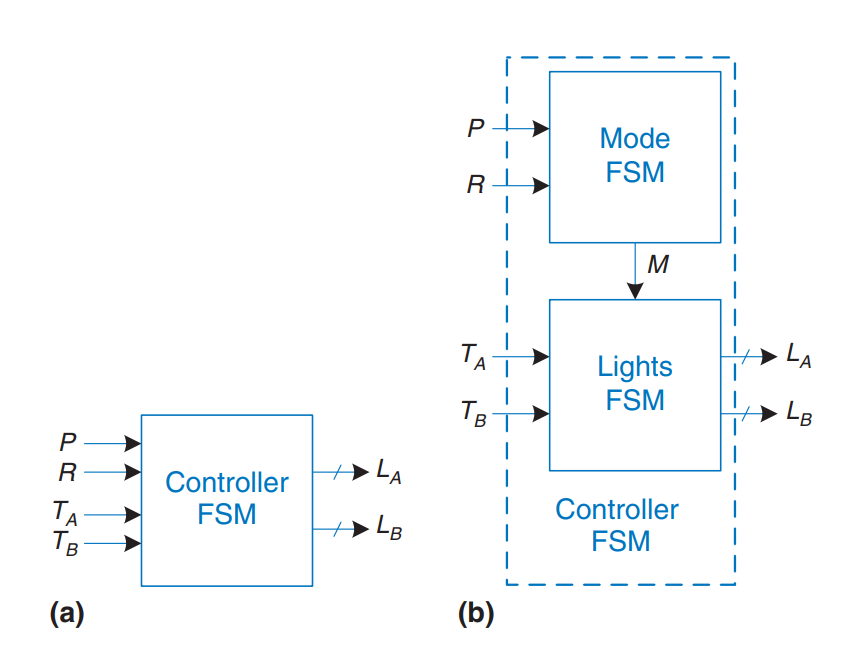
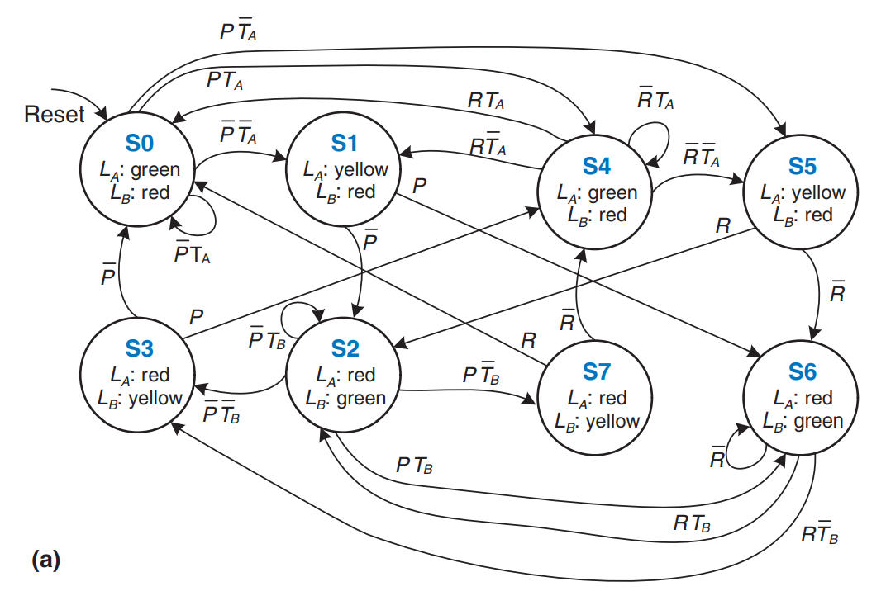
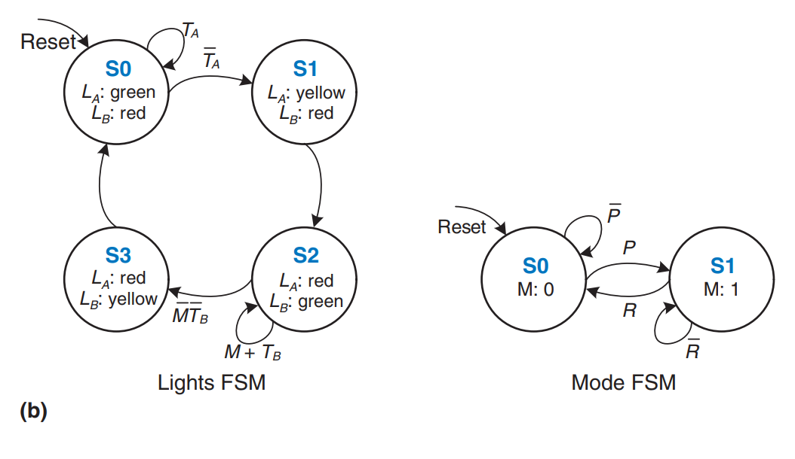

## 5. 计数器

计数器是一种时序逻辑电路，用于对脉冲进行计数，是触发器最广泛的应用之一。

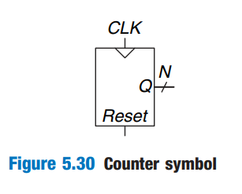

### 5.1 异步计数器（行波计数器）

异步计数器中，触发器的时钟不是全部共用的，前级触发器的输出作为后级触发器的时钟。

**2 位异步加法计数器**：
- 使用两个 T 触发器（或 J=K=1 的 JK 触发器）
- 外部时钟接第一个触发器（最低位）
- 第一个触发器的输出接第二个触发器的时钟

**2 位异步加法计数器工作过程**：

| 时钟 | $Q_1$ | $Q_0$ | 说明 |
|-----|-------|-------|------|
| 初始 | 0 | 0 | 初始状态 |
| 1↓  | 0 | 1 | $Q_0$ 翻转，$Q_0$ 上升沿不触发 $Q_1$ |
| 2↓  | 1 | 0 | $Q_0$ 翻转，$Q_0$ 下降沿触发 $Q_1$ 翻转 |
| 3↓  | 1 | 1 | $Q_0$ 翻转，$Q_0$ 上升沿不触发 $Q_1$ |
| 4↓  | 0 | 0 | $Q_0$ 翻转，$Q_0$ 下降沿触发 $Q_1$ 翻转 |

**3 位异步加法计数器**：可以计数 0~7（8 个状态）

**3 位异步减法计数器**：将前级的反相输出作为后级时钟，可实现减法计数

**BCD 计数器（十进制计数器）**：计数范围 0000~1001，当计数到 1010 时通过与非门产生复位信号，使所有触发器清零。

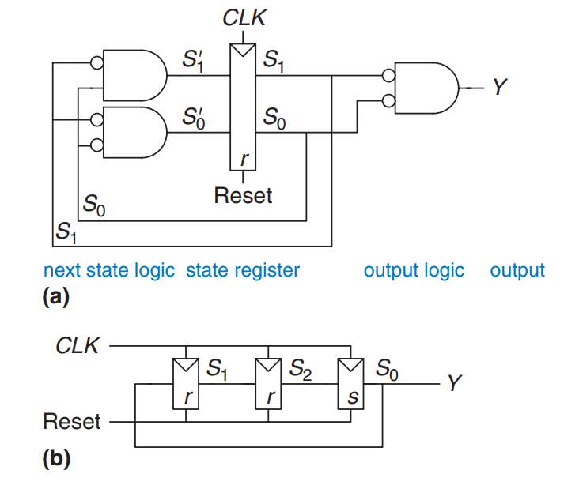
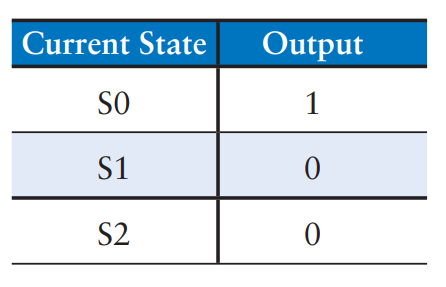
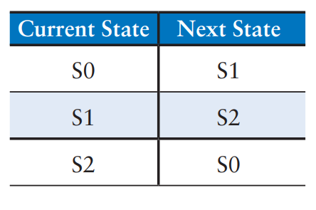

**异步计数器特点**：
- 结构简单，易于实现
- 称为"行波计数器"，因为时钟脉冲像波一样依次流过各触发器
- 传输延迟累积，速度较慢
- 存在竞争冒险，可能产生毛刺

### 5.2 同步计数器

同步计数器中所有触发器共用同一时钟脉冲，时钟同时到达所有触发器。

**同步计数器的优点**：
- 速度比异步计数器快
- 所有触发器同时翻转，减少竞争冒险
- 更适合高速应用

**4 位同步加法计数器**：
- 使用四个 JK 触发器
- J0=K0=1（总是翻转）
- J1=K1=Q0
- J2=K2=Q0·Q1
- J3=K3=Q0·Q1·Q2

**4 位二进制同步加法计数器状态方程**：
$$Q_0^{n+1} = \overline{Q_0^n}$$
$$Q_1^{n+1} = Q_0^n \oplus Q_1^n$$
$$Q_2^{n+1} = (Q_0^n \cdot Q_1^n) \oplus Q_2^n$$
$$Q_3^{n+1} = (Q_0^n \cdot Q_1^n \cdot Q_2^n) \oplus Q_3^n$$

**4 位同步减法计数器**：
- 与加法计数器类似，但进位逻辑改为借位逻辑
- J1=K1=Q0'
- J2=K2=Q0'·Q1'
- 或使用加/减控制信号实现双向计数

**4 位同步加/减计数器**：
- 有一个模式控制信号 M
- 当 M=0 时，做加法计数
- 当 M=1 时，做减法计数
- J1=K1=(M·Q0')+(M'·Q0)

**4 位同步 BCD 十进制计数器**：
- 计数序列：0000→0001→...→1001→0000
- 当计数到 1001（9）后，下一个时钟使其回到 0000，而不是 1010

### 5.3 环形计数器

环形计数器是移位寄存器的一种应用，将最后一位输出反馈到第一位输入。

**4 位环形计数器**：
- 初始状态：1000（一个 1，其余 0）
- 每次移位，1 循环移动
- 状态序列：1000→0100→0010→0001→1000...
- 优点：状态译码简单，不需要额外的译码电路
- 缺点：状态利用率低（n 个触发器只利用 n 个状态，而不是 2^n 个）

### 5.4 约翰逊计数器（扭环形计数器）

约翰逊计数器是环形计数器的改进，将最后一位的反相输出反馈到第一位输入。

**4 位约翰逊计数器**：
- 状态数：2n = 8 个状态
- 状态序列：0000→1000→1100→1110→1111→0111→0011→0001→0000...
- 特点：状态利用率比环形计数器高（2n 个状态），译码仍较简单

### 5.5 二进制计数器

**n 位二进制计数器**的计数范围：$0 \sim 2^n - 1$

**4 位二进制计数器时序图**：

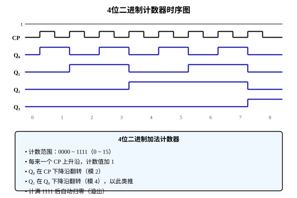

### 5.6 十进制计数器

十进制计数器（BCD 计数器）从 0000 计数到 1001，然后回到 0000。

### 5.7 任意进制计数器

集成计数器通常具有固定的计数模数（如 74LS160 为十进制、74LS161/74LS163 为十六进制）。当需要构成模数为 $N$（$N$ 不等于其原生的模 $M$）的计数器时，可利用其清零端或置数端，通过接入少量门电路实现，常用方法有**置零法（复位法）**与**置数法（置位法）**。

#### 5.7.1 置零法（复位法，异步清零）

**思路**：计数器从全 0 状态开始正常计数，当计数到达某一数值时产生清零信号，利用**异步清零端**立即把输出拉回全 0，从而跳过部分状态，实现模 $N$。

**关键特点**：
- 异步清零在清零信号一出现便**立即生效**，无需等待时钟沿
- 选做清零的状态为计数值 $N$（从 0 起计），到达后瞬时清零，因此会短暂出现一个"过渡状态 $N" ，该状态为毛刺，不计入有效计数
- 清零信号需能唯一地区分计数值 $N$，通常取为 1 的各位相与后再反相驱动 $\overline{CR}$

**设计步骤**：
1. 确定所需模数 $N$，选择清零值 $X = N$
2. 写出清零值 $X$ 的二进制编码，把取 1 的位用与门相连
3. 与门输出接到计数器的异步清零端（低电平有效用与非门、高电平有效用与门）
4. 加电后预置或自然进入计数，验证每 $N$ 个输入脉冲循环一次

**算例：用 74LS161（4 位二进制，模 16）构成七进制计数器**
- 目标：计数序列 $0000 \to 0001 \to \cdots \to 0110 \to 0000$（0～6，共 7 个状态），即 $N = 7$
- 选清零值 $X = 7 = (0111)_2$，即 $Q_3Q_2Q_1Q_0 = 0111$
- 清零时 $Q_3Q_2Q_1Q_0$ 中取 1 的位为 $Q_2 Q_1 Q_0$，故清零信号 $\overline{CR} = \overline{Q_2 Q_1 Q_0}$，用三输入与非门对 $Q_2Q_1Q_0$ 相与后接到 $\overline{CR}$
- 工作过程：从 0000 依次计数，计到 0111 的瞬间 $Q_2Q_1Q_0=111$，与非门输出低电平触发异步清零，计数器立即回到 0000，并输出一个短暂的脉冲
- 结果：每接收 7 个输入脉冲循环一次，即构成模 7（七进制）计数器；由于 0～6 内 $Q_2Q_1Q_0$ 不会同时为 111，故不会误触发清零

#### 5.7.2 置数法（置位法，同步预置）

**思路**：利用**同步置数端**，在计数器计数到某一结束值时产生置数信号，下一个时钟上升沿把数据输入端 $D_3D_2D_1D_0$ 的预置数据装入，从而跳回起始值，实现模 $N$。

**关键特点**：
- 同步置数在时钟**上升沿**才生效，行为规范、无毛刺
- 与清零不同，置数可将起始值设为任意数，通常用于从非 0 状态开始计数的场合
- 置数结束值 $C$ 与起始值 $D$ 应满足 $(C - D) \bmod M + 1 = N$

**设计步骤**：
1. 确定模数 $N$，选择起始值 $D$ 与结束值 $C$
2. 写出结束值 $C$ 的二进制编码，用门电路检测到 $C$ 时产生置数信号（低电平有效接到 $\overline{LD}$）
3. 在数据输入端 $D_3D_2D_1D_0$ 置入起始值 $D$
4. 验证：到达 $C$ 时产生置数信号，下一时钟沿装入 $D$，重复循环

**算例：用 74LS160（十进制，模 10）以置数法构成十进制计数器**
- 74LS160 本身即为十进制计数器，计数序列 $0000\to1001\to0000$，直接使用即可
- 采用置数法验证：取起始值 $D = 0000$，计到 $1001$（9）时 $Q_3=Q_0=1$，置数信号 $\overline{LD}=\overline{Q_3 Q_0}$，下一个时钟沿装入 0000，回到 0，实现模 10

**算例：用 74LS160 以置数法构成五进制计数器（0～4）**
- 取起始值 $D = 0000$，结束值 $C = 0100$（4），$(4-0)+1=5$ 即模 5
- 当计到 $0100$ 时 $Q_2 = 1$，置数信号 $\overline{LD} = \overline{Q_2}$，即 $Q_2=1$ 时拉低置数端
- 下一个时钟沿把 $D=0000$ 装入，计数器回到 0，从而跳过了 5～9，实现 0～4 的五进制计数

**两种方法对比**：
- **清零法**：结构简单，但清零状态瞬间有毛刺，计数输出在清零瞬间不干净
- **置数法**：置数严格发生在时钟沿，输出规范、无毛刺，但需额外在数据输入端设好预置值

### 5.8 集成计数器

**74LS160**：同步十进制计数器（异步清零、同步置数）
**74LS161**：同步 4 位二进制计数器（异步清零、同步置数）
**74LS163**：同步 4 位二进制计数器（同步清零、同步置数）
**74LS193**：同步 4 位二进制加/减计数器（双时钟）

**74LS161 功能表**：

| $\overline{CR}$ | LD | CT$_P$ | CT$_T$ | CP | 功能 |
|----------------|----|--------|--------|----|------|
| 0 | × | × | × | ↑ | 异步清零 |
| 1 | 0 | × | × | ↑ | 同步置数 |
| 1 | 1 | 1 | 1 | ↑ | 计数 |
| 1 | 1 | 0 | × | × | 保持（CO=0） |
| 1 | 1 | × | 0 | × | 保持 |

## 6. 寄存器

寄存器是由多个触发器组成的存储元件，用于存储二进制数据。n 位寄存器由 n 个触发器组成，可以存储一个 n 位的二进制字。

寄存器中可以进行数据的移位操作，允许数据在寄存器内部从一个触发器转移到另一个触发器。

### 6.1 寄存器概述

**基本概念**：
- 触发器是 1 位存储单元
- 多个触发器组成寄存器
- n 位寄存器可以存储 n 位二进制数据

**移位寄存器**：允许数据在寄存器内部移位的寄存器称为移位寄存器，有 4 种工作模式。

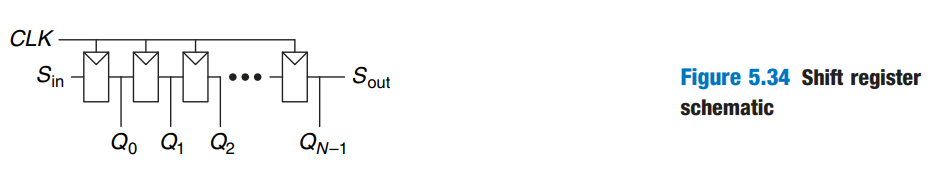
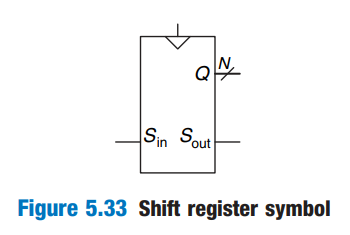

### 6.2 移位寄存器的 4 种工作模式

移位寄存器的工作模式根据数据输入和输出方式分为：
1. **串入串出（Serial-In Serial-Out, SISO）**
2. **串入并出（Serial-In Parallel-Out, SIPO）**
3. **并入串出（Parallel-In Serial-Out, PISO）**
4. **并入并出（Parallel-In Parallel-Out, PIPO）**

### 6.3 串入串出移位寄存器（SISO）

串入串出移位寄存器中，数据以串行方式一位一位输入，同样以串行方式一位一位输出。

**工作过程**（以 4 位为例）：
- 初始状态：所有触发器清零 Q3Q2Q1Q0 = 0000
- 数据输入：从 Din 输入，先输入最低位
- 第一个时钟：Q3=1, Q2=0, Q1=0, Q0=0
- 第二个时钟：Q3=1, Q2=1, Q1=0, Q0=0
- 第三个时钟：Q3=1, Q2=1, Q1=1, Q0=0
- 第四个时钟：Q3=1, Q2=1, Q1=1, Q0=1

**特点**：
- 4 位数据需要 4 个时钟周期才能完全移入
- 同样需要 4 个时钟周期才能完全移出
- 可用于信号延迟

### 6.4 串入并出移位寄存器（SIPO）

串入并出移位寄存器中，数据以串行方式一位一位输入，但以并行方式同时输出所有位。

**工作过程**：
- 数据一位一位串行输入
- 输入期间，输出保持禁用
- 当所有数据都加载完成后，输出使能，所有数据同时并行输出

**特点**：
- 需要 4 个时钟周期加载 4 位数据
- 速度与串入串出相同
- 用途：串行到并行转换

**应用**：接收器中，在数模转换前将串行数据转换为并行数据

### 6.5 并入串出移位寄存器（PISO）

并入串出移位寄存器中，数据以并行方式同时输入，但以串行方式一位一位输出。

**工作模式**：
1. **加载模式**（Shift/Load = 0）
   - 并行输入门打开
   - 数据 B0-B3 同时加载到触发器
2. **移位模式**（Shift/Load = 1）
   - 并行输入门关闭
   - 数据从左向右逐位移位输出

**特点**：
- 可以在加载和移位之间切换
- 用途：并行到串行转换

**应用**：发送器中，在模数转换后将并行数据转换为串行数据

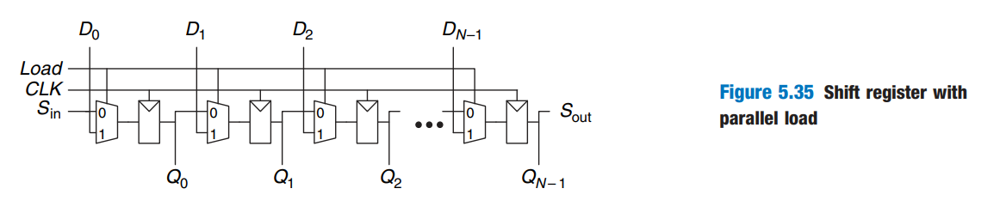

### 6.6 并入并出移位寄存器（PIPO）

并入并出移位寄存器中，数据以并行方式同时输入，同时以并行方式同时输出。

**工作过程**：
- 4 位数据 B0-B3 同时施加到 D0-D3
- 时钟边沿触发，所有数据同时加载
- 输出也同时出现

**特点**：
- 只需要一个时钟脉冲加载数据
- 速度最快
- 最简单的寄存器类型

### 6.7 移位寄存器的应用

**主要应用**：
1. **数据存储**：存储二进制数据
2. **数据传输**：通过移位操作进行数据移动
3. **数据处理**：对数据进行操作
4. **计数器实现**：构成特殊计数器

**具体应用**：
- **并串转换**：发送器中，将并行数据转换为串行数据传输
- **串并转换**：接收器中，将串行数据转换为并行数据
- **序列发生器**：结合门电路生成特定的 0-1 序列
- **计数器**：实现环形计数器、约翰逊环形计数器
- **时间延迟**：串入串出寄存器用于信号延迟

### 6.8 环形计数器（Ring Counter）

环形计数器是移位寄存器的特殊应用，将最后一位输出反馈到第一位输入。

**结构**：
- N 位移位寄存器
- 最后一个 D 触发器输出连接到第一个 D 触发器输入
- 不使用外部数据输入

**工作过程**（3 位为例）：
- 初始状态：Q2Q1Q0 = 001
- 第一个时钟：Q2Q1Q0 = 100
- 第二个时钟：Q2Q1Q0 = 010
- 第三个时钟：Q2Q1Q0 = 001（循环）

**特点**：
- 状态数等于触发器个数
- 每 N 个时钟循环一次
- 可用于顺序脉冲发生器

### 6.9 约翰逊环形计数器（Johnson Ring Counter）

约翰逊环形计数器（也称为扭环计数器、开关尾环计数器）是环形计数器的改进，将最后一位的反相输出反馈到第一位输入。

**结构**：
- N 位移位寄存器
- 最后一个 D 触发器的反相输出连接到第一个 D 触发器输入

**工作过程**（3 位为例）：
- 初始状态：Q2Q1Q0 = 000
- 第 1 个时钟：Q2Q1Q0 = 100
- 第 2 个时钟：Q2Q1Q0 = 110
- 第 3 个时钟：Q2Q1Q0 = 111
- 第 4 个时钟：Q2Q1Q0 = 011
- 第 5 个时钟：Q2Q1Q0 = 001
- 第 6 个时钟：Q2Q1Q0 = 000（循环）

**特点**：
- N 位约翰逊计数器有 2N 个状态
- 每 2N 个时钟循环一次
- 状态利用率比环形计数器高

### 6.10 常用集成移位寄存器

**74LS164**：8 位串入并出移位寄存器
- 串行输入：2 个（可与运算）
- 并行输出：8 个
- 异步清零
- 同步移位

**74LS165**：8 位并入串出移位寄存器
- 并行输入：8 个
- 串行输出：1 个
- 异步加载
- 同步移位

**74LS194**：4 位双向移位寄存器
- 并行输入/输出：4 个
- 串行输入：左移、右移各 1 个
- 功能：左移、右移、并行置数、保持
- 模式选择：S1S0 = 00（保持），01（右移），10（左移），11（置数）

## 7. 序列信号发生器

**设计方法**：
1. 确定序列长度 $M$，选择 $n$ 位移位寄存器（$2^{n-1} < M \le 2^n$）
2. 画出状态转换图
3. 确定反馈逻辑
4. 画逻辑图

**m 序列（最长线性反馈移位寄存器序列）**：周期为 $2^n - 1$ 的伪随机序列。

## 8. 顺序脉冲发生器

顺序脉冲发生器产生一组在时间上依次出现的脉冲信号。

**实现方式**：
- 计数器 + 译码器
- 移位寄存器（环形计数器）

## 9. 时序分析

### 9.1 建立时间与保持时间约束

时序电路的正确工作必须满足以下时序约束：

**建立时间约束**：
$$T_{clk} \geq T_{clk-to-Q} + T_{logic} + T_{setup}$$

**保持时间约束**：
$$T_{hold} \leq T_{clk-to-Q} + T_{logic}$$

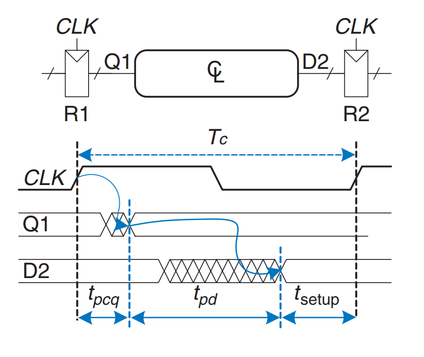
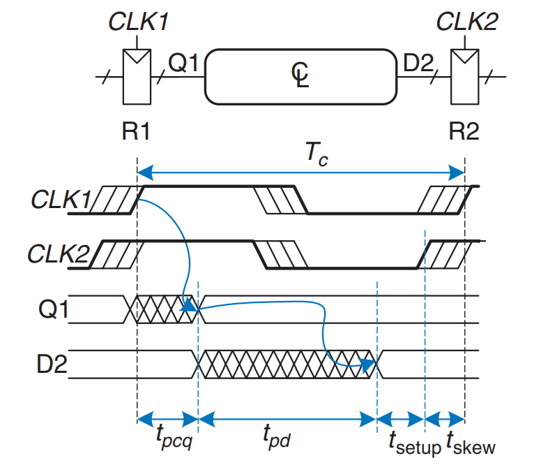
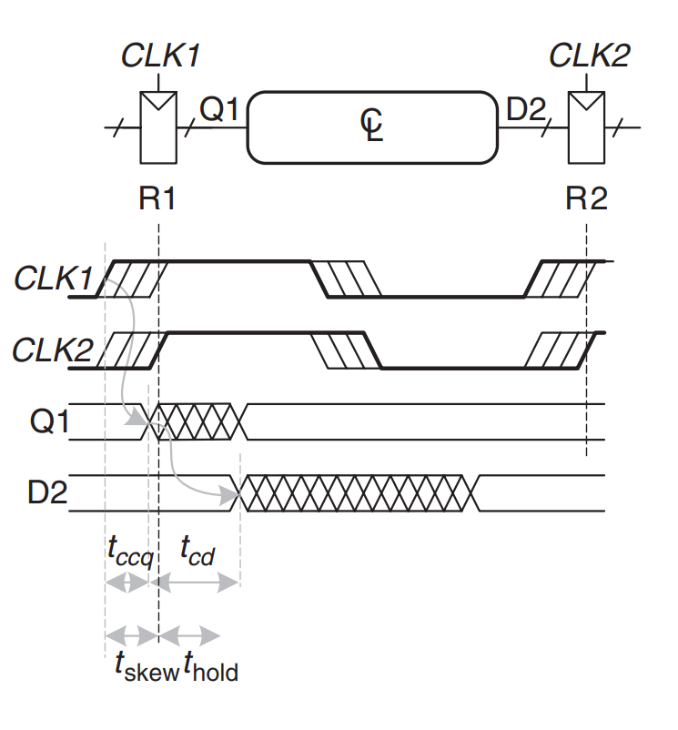
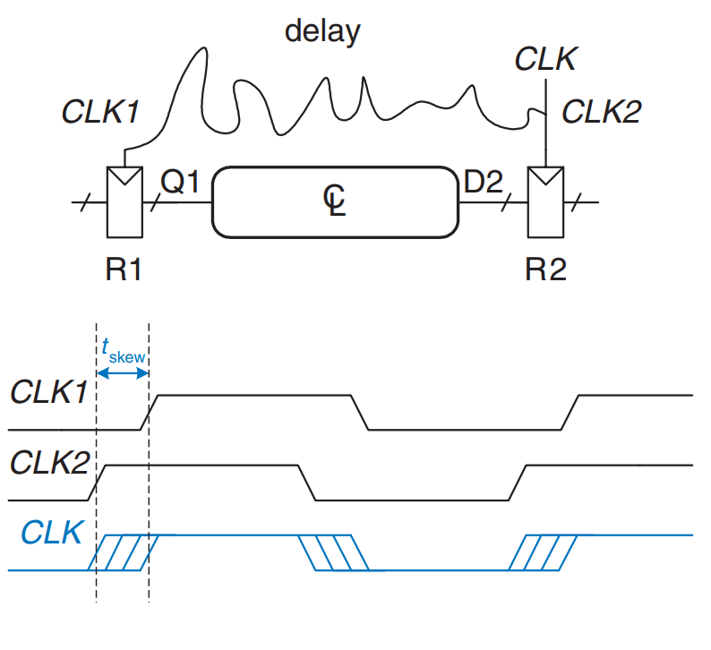

其中 $T_{clk}$ 为时钟周期，$T_{clk-to-Q}$ 为触发器传输延迟，$T_{logic}$ 为组合逻辑延迟，$T_{setup}$ 为建立时间，$T_{hold}$ 为保持时间。

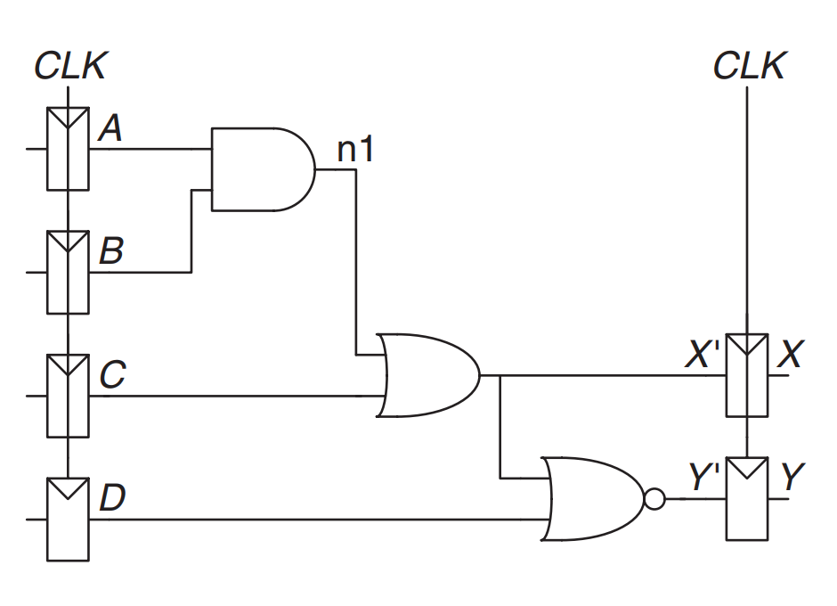
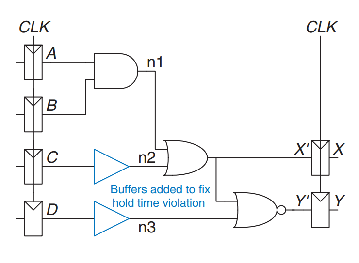
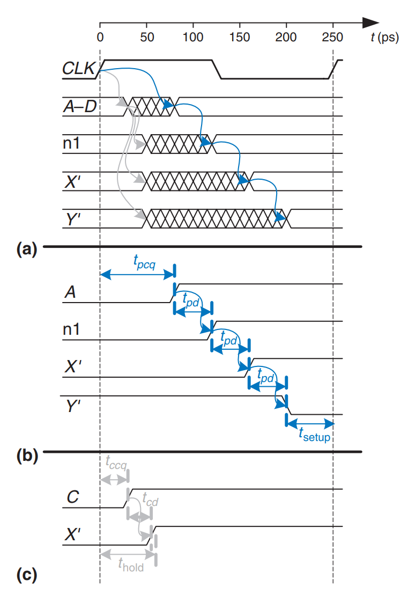
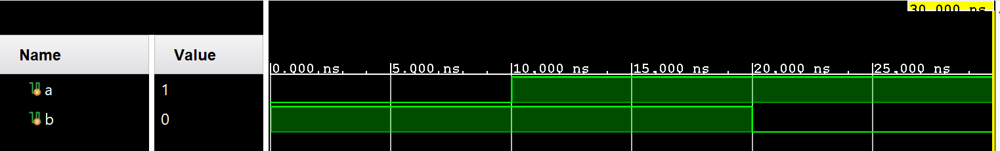
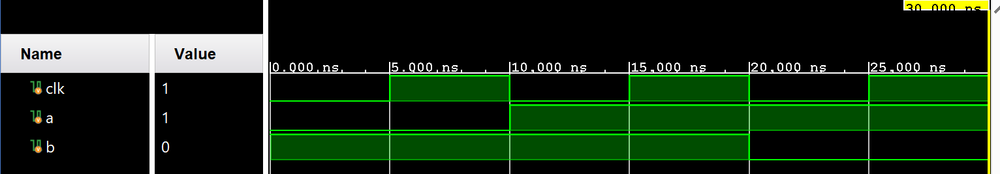
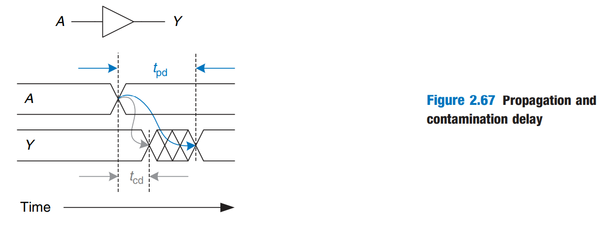
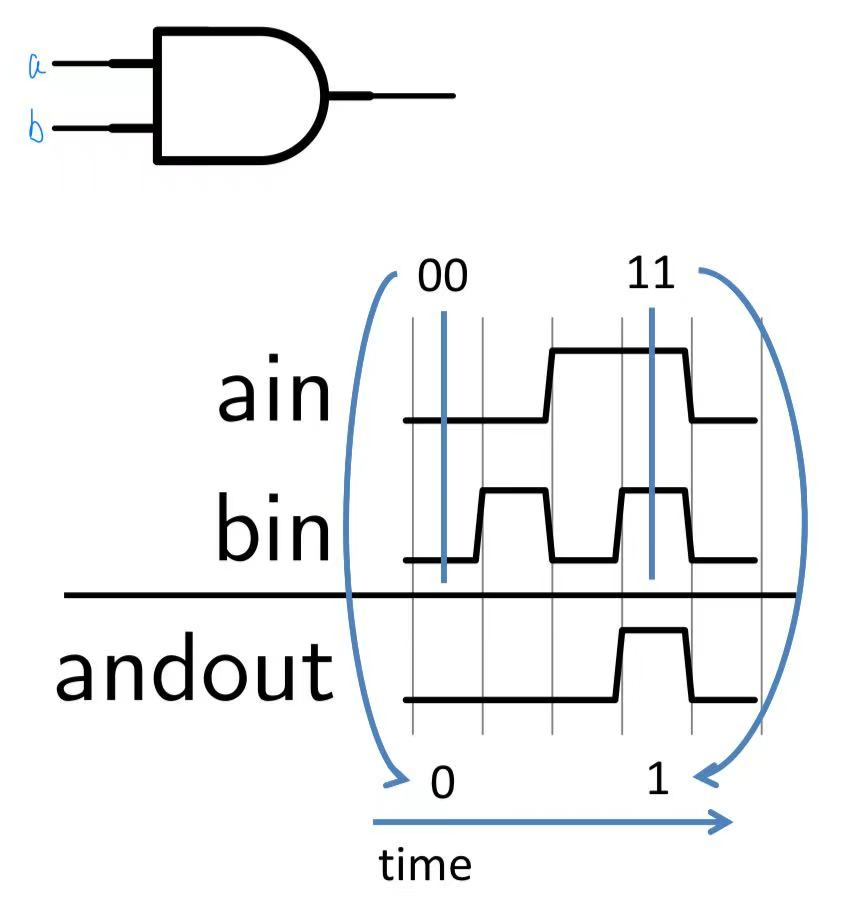
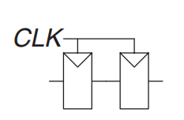
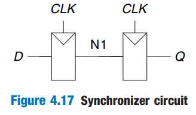
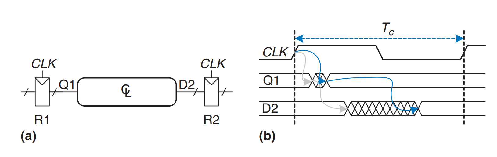
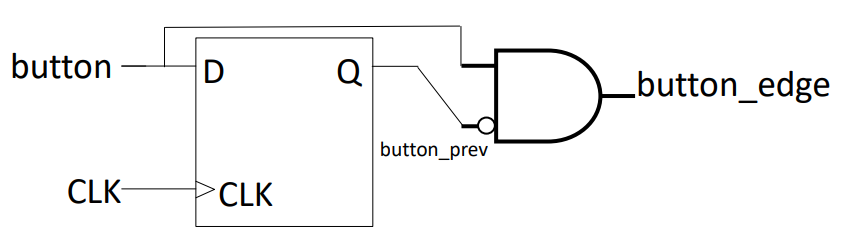

### 9.2 最高工作频率

$$f_{max} = \frac{1}{T_{clk(min)}} = \frac{1}{t_{CO(max)} + t_{logic(max)} + t_{su}}$$

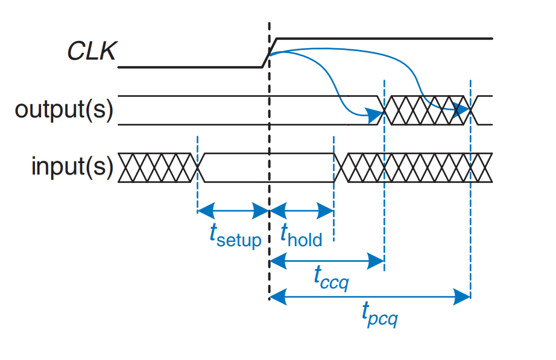
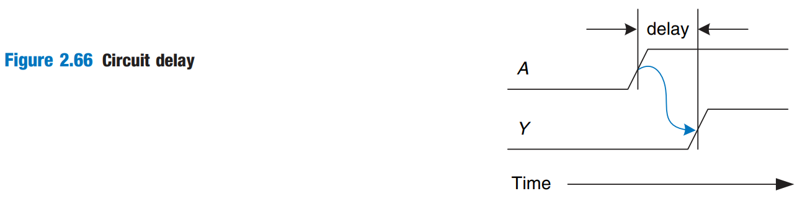
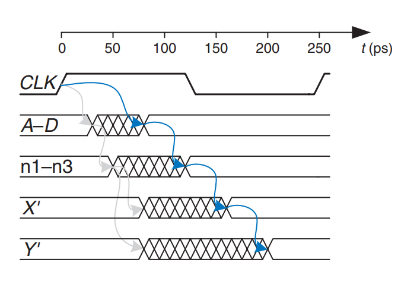
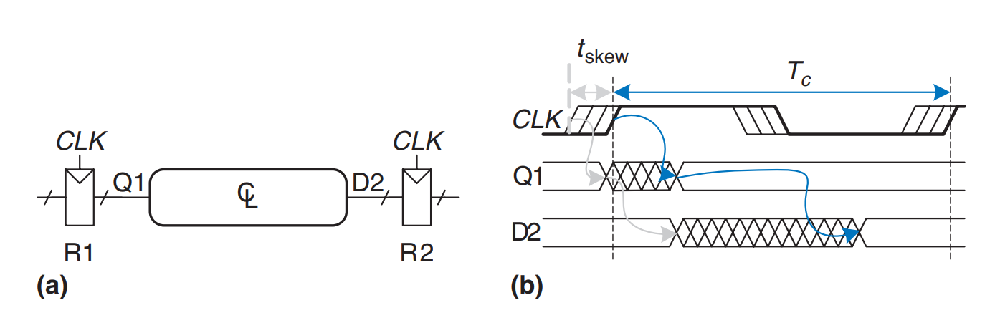