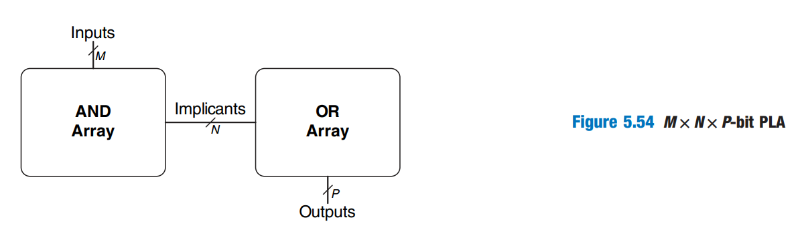
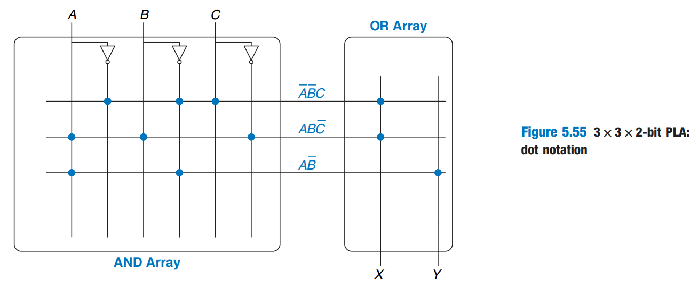
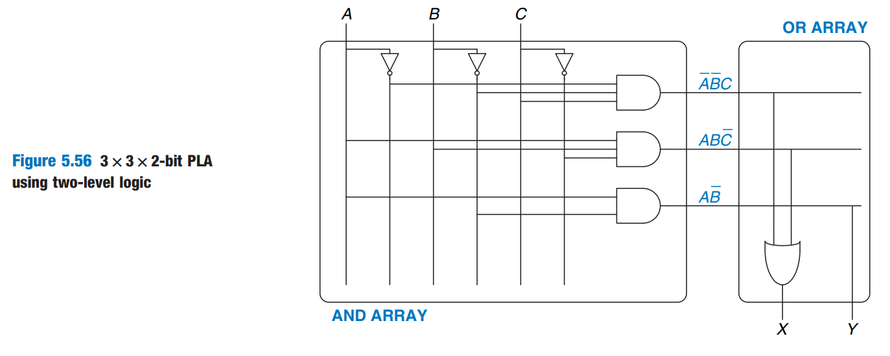
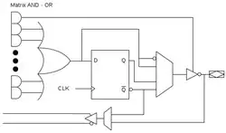
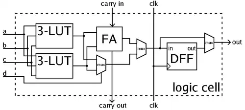
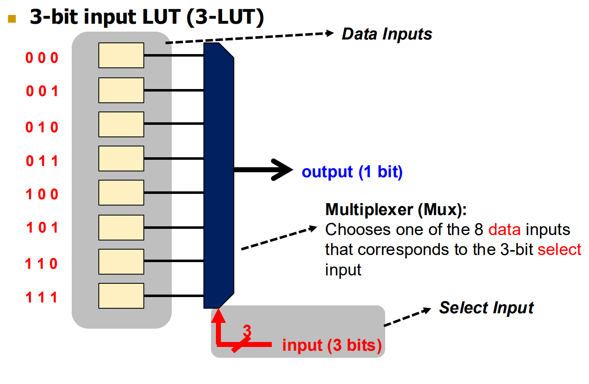
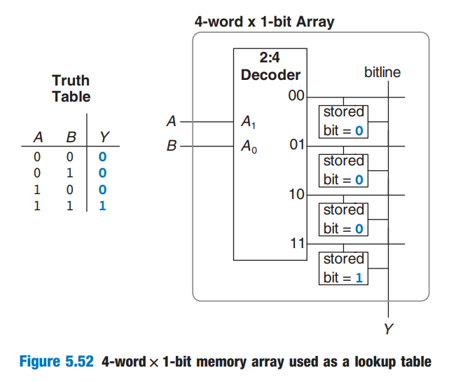

# 5.8 可编程逻辑器件

## 1. PLD 基本结构

可编程逻辑器件（Programmable Logic Device, PLD）的基本结构由**与阵列**和**或阵列**组成，实现"与或"逻辑表达式。


**PLD 的表示方法**：
- 与阵列：产生输入变量的乘积项
- 或阵列：将乘积项相加得到输出

**PLD 中的连接方式**：
- **固定连接**：不可改变
- **可编程连接**：用户可编程决定是否连接
- **断开连接**：无连接

## 2. PLA（Programmable Logic Array）

PLA 的与阵列和或阵列均可编程。

**特点**：
- 灵活度高
- 可实现的逻辑函数复杂
- 与阵列产生的乘积项数量有限
- 价格较高

**PLA 结构**：
- 输入缓冲器：产生互补输入
- 可编程与阵列：产生乘积项
- 可编程或阵列：实现"或"运算
- 输出缓冲器：可包含三态或寄存器







## 3. PAL（Programmable Array Logic）

PAL 的与阵列可编程，或阵列固定。

**特点**：
- 速度比 PLA 快
- 结构简单，成本低
- 每个输出对应固定的乘积项数量
- 有多种输出结构（寄存器输出、三态输出等）

**PAL 常用输出结构**：
- 专用输出结构
- 可编程 I/O 结构
- 寄存器输出结构
- 异或输出结构

## 4. GAL（Generic Array Logic）

GAL 在 PAL 基础上增加了输出逻辑宏单元（OLMC），可配置为多种输出模式。

**特点**：
- 电可擦除（EEPROM 工艺）
- 输出可配置（寄存器、组合逻辑、三态等）
- 可重复编程
- 与 PAL 兼容

**OLMC 的配置**：
- 寄存器模式
- 组合逻辑模式
- 三态输出模式
- 反馈模式

## 5. CPLD（Complex Programmable Logic Device）

CPLD 由多个 PAL/GAL 模块通过互联矩阵连接而成。



**CPLD 结构特点**：
- 基于乘积项（Product-Term）架构
- 全局互联矩阵
- 可预测的时序延迟
- 适合实现复杂的组合逻辑

**CPLD 内部结构**：
1. **逻辑块（Logic Block）**：包含多个宏单元（MC）
2. **互联矩阵**：连接各逻辑块
3. **I/O 控制块**：管理输入/输出引脚
4. **全局时钟网络**：提供低抖动时钟分配

## 6. FPGA（Field-Programmable Gate Array）

FPGA 基于查找表（Look-Up Table, LUT）架构，具有更高的逻辑密度和灵活性。



**FPGA 基本结构**：
1. **可配置逻辑块（CLB）**：实现逻辑功能的核心单元
2. **可编程互联资源**：连接各逻辑块
3. **可编程 I/O 块（IOB）**：连接芯片内部和外部引脚
4. **块 RAM（BRAM）**：嵌入式存储
5. **DSP 切片**：数字信号处理单元
6. **时钟管理单元（CMT）**：锁相环（PLL）等

**查找表（LUT）**：
- $k$ 输入 LUT 可以实现任意 $k$ 输入逻辑函数
- 由 $2^k$ 位 SRAM 组成
- 通过查表方式实现逻辑功能

**常见的 FPGA 系列**：
- Xilinx：Spartan、Artix、Kintex、Virtex 系列
- Intel (Altera)：Cyclone、Arria、Stratix 系列
- Lattice：ECP、Mach 系列
- 国产：复旦微、紫光同创、安路科技等

### 6.4 FPGA 查找表（LUT）原理

查找表（Look-Up Table, LUT）是FPGA实现组合逻辑的核心元件。

**工作原理**：
- 一个K输入LUT由 $2^K$ 位SRAM存储单元和一个多路选择器组成
- SRAM存储单元预先写入真值表的所有输出值
- 输入信号作为地址选择对应的存储单元输出
- 例如4输入LUT可以实现任意4输入布尔函数





**LUT容量**：
- 现代FPGA通常使用4输入或6输入LUT
- 多个LUT可以通过FPGA的互联资源组合实现更复杂的逻辑函数
- LUT也可以配置为分布式RAM或移位寄存器

## 7. CPLD 与 FPGA 架构区别

| 特性 | CPLD | FPGA |
|------|------|------|
| 基本单元 | 乘积项宏单元 | 查找表（LUT）+ 触发器 |
| 逻辑密度 | 较低（几百到几千宏单元） | 较高（数万到数百万 LUT） |
| 时序延迟 | 可预测（固定延迟） | 与布局布线有关 |
| 存储容量 | 小 | 大（嵌入式 RAM） |
| 适用场景 | 简单逻辑、控制逻辑 | 复杂数字系统、信号处理 |
| 编程方式 | 非易失（Flash） | 通常为 SRAM 配置（易失） |
| 功耗 | 通常较低 | 较高（取决于设计） |
| 价格 | 较低 | 较高 |

## 8. HDL 硬件描述语言基础

### 8.1 Verilog HDL 基础

**模块结构**：
```verilog
module module_name (
    input  wire a,
    input  wire b,
    output wire y
);
    // 逻辑描述
    assign y = a & b;
endmodule
```

**数据类型**：
- `wire`：线网类型，用于组合逻辑
- `reg`：寄存器类型，用于时序逻辑
- `integer`：整数类型
- `parameter`：参数常量

### 8.2 VHDL 基础

**实体和结构体**：
```vhdl
entity and_gate is
    port (
        a : in  std_logic;
        b : in  std_logic;
        y : out std_logic
    );
end entity;

architecture rtl of and_gate is
begin
    y <= a and b;
end architecture;
```

## 9. 组合逻辑 HDL 描述

**Verilog 组合逻辑描述**：

**assign 语句**：
```verilog
assign y = (a & b) | (c & d);
```

**always 块（组合逻辑）**：
```verilog
always @(*) begin
    case (sel)
        2'b00: y = a;
        2'b01: y = b;
        2'b10: y = c;
        2'b11: y = d;
    endcase
end
```

## 10. 时序逻辑 HDL 描述

**D 触发器**：
```verilog
always @(posedge clk or negedge rst_n) begin
    if (!rst_n)
        q <= 1'b0;
    else
        q <= d;
end
```

**计数器**：
```verilog
always @(posedge clk or negedge rst_n) begin
    if (!rst_n)
        count <= 4'b0;
    else if (en)
        count <= count + 1'b1;
end
```

**阻塞赋值与非阻塞赋值**：

在 `always` 块中给变量赋值有两种方式：**阻塞赋值**（`=`）与**非阻塞赋值**（`<=`），理解两者的区别是掌握 Verilog 时序建模的关键。

| 对比项 | 阻塞赋值 `=` | 非阻塞赋值 `<=` |
|------|------|------|
| 更新时机 | 立即更值，语句按书写顺序执行 | 边沿后统一更值，同块内语句同时生效 |
| 读取结果 | 读到的通常是刚写入的新值 | 读到的是边沿前的旧值 |
| 常用场景 | 组合逻辑（如 `always @(*)`） | 时序逻辑（如 `always @(posedge clk)`） |
| 综合结果 | 组合电路 | 触发器/寄存器 |

一个实用规则是：**写组合逻辑用 `=`，写时序逻辑一律用 `<=`**。以同步计数器为例（时序逻辑用 `<=`），代码简洁且可综合：

```verilog
module sync_counter (
    input  wire       clk,
    input  wire       rst_n,
    input  wire       en,
    output reg [3:0]  count
);
    always @(posedge clk or negedge rst_n) begin
        if (!rst_n)          // 异步复位清零
            count <= 4'b0;
        else if (en)         // 使能时计数
            count <= count + 1'b1;
    end
endmodule
```

若将上式中的 `<=` 误写成 `=`，仿真时可能出现本应在同一时钟沿更新的多个变量按先后顺序覆盖的现象，从而推导出与真实触发器行为不符的结果。因此"非阻塞用于时序、阻塞用于组合"是最基础的安全写法，也是后续 RTL 设计的通用约定。

## 11. FSM 的 HDL 实现

**Moore 型状态机**：
```verilog
always @(posedge clk or negedge rst_n) begin
    if (!rst_n)
        state <= IDLE;
    else
        state <= next_state;
end

always @(*) begin
    case (state)
        IDLE:   if (start) next_state = RUN;
                else       next_state = IDLE;
        RUN:    if (done)  next_state = DONE;
                else       next_state = RUN;
        DONE:   next_state = IDLE;
        default: next_state = IDLE;
    endcase
end

assign output = (state == DONE);
```

## 12. 仿真与综合基础

**仿真（Simulation）**：
- 功能仿真：验证逻辑功能正确性
- 时序仿真：验证时序约束满足情况

**testbench 编写基础**：

testbench（测试平台，也叫激励模块）是一个**无端口模块**，用于给被测设计（DUT）产生输入激励并观测输出。它通常只用于仿真，**不需要也一般不参与综合**。

**testbench 的典型组成**：
- 时钟生成：用 `always` 周期性翻转
- 复位生成：在 `initial` 中先有效若干拍再释放
- 激励施加：在 `initial` 中用 `#延迟` 按时间给输入赋值
- 结果观测：用 `$display`/`$monitor` 打印到终端，或生成波形文件查看

以被测模块为半加器为例，最小可仿真的完整 testbench 如下：

```verilog
`timescale 1ns/1ps

// 被测模块：半加器（simulation only 的 DUT）
module half_adder (
    input  wire a, b,
    output wire s, c
);
    assign s = a ^ b;   // 和
    assign c = a & b;   // 进位
endmodule

// 测试平台（无端口）
module tb_half_adder;
    reg  a, b;          // 给 DUT 的输入用 reg 驱动
    wire s, c;          // DUT 输出用 wire 连接

    half_adder dut (.a(a), .b(b), .s(s), .c(c));   // 实例化 DUT

    initial begin
        a = 1'b0; b = 1'b0; #10;   // 逐项施加激励
        a = 1'b0; b = 1'b1; #10;
        a = 1'b1; b = 1'b0; #10;
        a = 1'b1; b = 1'b1; #10;
        $display("test finished at %0t", $time);
        $finish;                    // 结束仿真
    end

    // 任一监视信号变化时自动打印一行
    initial $monitor($time, " a=%b b=%b -> s=%b c=%b", a, b, s, c);
endmodule
```

几个要点：
- `$display`：仿真执行到该语句时打印一次；`$monitor`：被监视的信号发生任何变化时自动打印一次
- `$time`：当前仿真时刻；`#10` 表示延迟 10 个时间单位（由 `` `timescale `` 决定）
- `reg` 用于在过程块（`always`/`initial`）中驱动激励，`wire` 用于接收模块输出
- 上述内容可直接在 iverilog、ModelSim、Vivado/Quartus 中进行仿真

**综合（Synthesis）**：
- 将 HDL 代码转换为门级网表
- 优化逻辑结构和面积
- 映射到目标器件的资源

**EDA 工具流程**：
1. 设计输入（HDL 代码）
2. 功能仿真
3. 逻辑综合
4. 布局布线
5. 时序分析
6. 配置/编程

### 12.3 综合（Synthesis）流程

综合是将HDL代码转换为门级网表的过程：

**RTL综合步骤**：
1. **解析（Parsing）**：检查HDL语法，构建抽象语法树
2. **转换（Translation）**：将HDL描述转换为通用布尔方程
3. **逻辑优化（Logic Optimization）**：通过布尔代数化简、资源共享、常数传播等方式优化
4. **工艺映射（Technology Mapping）**：将优化后的逻辑映射到目标工艺库（如LUT、触发器、进位链等）
5. **时序优化（Timing Optimization）**：根据时序约束调整关键路径

**常用综合工具**：
- Synopsys Design Compiler（ASIC）
- Xilinx Vivado（FPGA）
- Intel Quartus Prime（FPGA）
- Yosys（开源）

**HDL 进阶方向**：

本节只介绍了 Verilog 的入门骨架：模块与端口、`assign`/`always` 块、`wire`/`reg`、时序逻辑中 `<=` 与组合逻辑中 `=` 的区分、最小 testbench。更完整的语法体系与设计方法——**参数化模块（`parameter`）、层次化实例化与端口连接、数据类型细化（`logic`、数组、结构体）、SystemVerilog 扩展、复杂状态机与功能验证**——属于《芯片设计》第 6 章的内容，尤其推荐前往 [6.5 RTL 设计（Verilog/SystemVerilog）](../芯片设计/6.5-RTL设计.md) 深入研读。