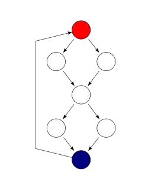

# 11.2 形式验证深入

## 1. 引言

随着数字集成电路设计复杂度的持续攀升，传统的基于仿真的验证方法正面临日益严峻的挑战。现代SoC中的控制逻辑往往包含数千个状态、跨多个时钟域的握手协议以及复杂的中断处理机制，单纯依赖测试向量驱动的仿真验证已难以企及**数学意义上的完备性**。研究表明，对于具有 $N$ 个状态变量的设计，其状态空间规模为 $2^N$，若 $N=100$，则状态数已超过可观测宇宙中的原子总数（约 $10^{80}$），仿真无论如何施加激励都无法遍历。

形式验证（Formal Verification）通过**数学推理**的方法证明设计满足既定性质，从根本上摆脱了对测试向量的依赖，是数字IC验证方法学中不可或缺的关键组成部分。本章将系统介绍形式验证的原理、算法、工具和工程实践，与上一章UVM仿真验证方法学形成互补，共同构建完整的数字验证知识体系。

## 2. 形式验证概述

### 2.1 形式验证的定义

形式验证是指利用**数学方法**严格证明硬件设计满足其规约（Specification）的验证技术。其核心思想可形式化表达为：

$$\text{Verify: } \quad M \models \varphi$$

其中：
- $M$：被验证系统的形式化模型（如Kripke结构、状态迁移系统）
- $\varphi$：待验证的性质（Property），用时序逻辑公式表达
- $\models$：满足关系（Satisfiability），即"模型 $M$ 满足性质 $\varphi$"

与传统仿真验证的本质区别在于：
- **仿真验证**：检查 $M$ 在某些特定输入向量 $v_1, v_2, \dots, v_k$ 下是否满足 $\varphi$，即 $M, v_i \models \varphi$
- **形式验证**：证明 $M$ 在**所有可能输入序列**下都满足 $\varphi$，即 $\forall v : M, v \models \varphi$

### 2.2 形式验证 vs 仿真验证

| 对比维度 | 仿真验证 | 形式验证 |
|----------|----------|----------|
| 验证原理 | 输入测试向量，观察输出 | 数学证明性质成立 |
| 完备性 | 不完备，依赖覆盖率 | 数学完备（在抽象模型内） |
| 测试向量 | 必需，且需精心设计 | 不需要 |
| 反例能力 | 提供具体波形 | 提供最小反例（最短路径） |
| 状态空间覆盖 | 极小部分 | 全部（在抽象范围内） |
| 计算复杂度 | 线性于仿真时间 | 指数级于状态变量数 |
| 适用规模 | 任意规模 | 中小规模模块为主 |
| 调试信息 | 波形、日志 | 反例、不变式、证明 |
| 验证对象 | RTL/网表/门级 | RTL/网表/门级 |
| 工程成熟度 | 极成熟 | 成熟，仍在演进 |
| 典型工具 | VCS/Xcelium/Questasim | VC Formal/JasperGold/Formality |

**互补关系**：

$$\text{验证完备性} = \underbrace{\text{仿真覆盖率}}_{\text{动态}} \times \underbrace{\text{形式验证覆盖率}}_{\text{静态}}$$

仿真擅长发现"已知未知"的bug，形式验证擅长发现"未知未知"的边界bug。

### 2.3 形式验证的分类

按照验证目标的不同，形式验证主要分为三大类：

| 类别 | 验证目标 | 典型应用 | 工具示例 |
|------|----------|----------|----------|
| **等价性检查**（Equivalence Checking） | 两个设计在功能上是否等价 | RTL vs 综合、RTL vs RTL、网表 vs 网表 | Formality, Conformal, Equivalence Checker |
| **模型检查**（Model Checking） | 设计是否满足给定性质（性质验证） | 控制逻辑、协议、状态机 | VC Formal, JasperGold, Questa Formal |
| **定理证明**（Theorem Proving） | 通过构造数学证明验证复杂性质 | 算法正确性、复杂协议 | Coq, HOL Light, Isabelle/HOL |

此外还有：

- **符号仿真**（Symbolic Simulation）：用符号变量代替具体值进行仿真
- **断言验证**（Assertion-Based Verification）：基于断言的验证方法，可与形式验证结合
- **形式覆盖率分析**（Formal Coverage）：度量形式验证的完备性

### 2.4 形式验证的应用场景

形式验证在芯片开发流程中的典型应用：

```
设计规格 ──► 形式化规约（SVA/PSL）
              │
              ▼
RTL设计 ──► 等价性检查（RTL vs RTL） ──► 模型检查（属性验证）
              │                              │
              ▼                              ▼
综合 ──► 等价性检查（RTL vs 门级） ──► 形式签核
              │                              │
              ▼                              ▼
布局布线 ──► 等价性检查（门级 vs 门级） ──► 流片
```

典型应用包括：

- **控制逻辑验证**：仲裁器、FIFO、状态机、缓存一致性协议
- **协议验证**：AXI、PCIe、CHI、AMBA等总线协议属性
- **数据通路验证**：乘法器、ALU、浮点单元
- **复位逻辑验证**：复位释放、异步复位同步
- **死锁/活锁检测**：资源争用、协议死锁
- **安全验证**：信息流、隔离、机密性
- **网表等价性**：综合、布局布线、ECO后的等价性

## 3. 等价性检查（Equivalence Checking）

### 3.1 等价性检查原理

等价性检查用于验证两个设计在功能上完全等价。给定两个设计 $D_1$（参考设计，Golden）和 $D_2$（待验证设计，Revised），需要证明：

$$\forall \text{input } x : D_1(x) = D_2(x)$$

即对于任意合法输入 $x$，两个设计产生相同输出。

**关键概念**：

- **比较点**（Compare Point）：两个设计中对应的输出端口、内部寄存器、黑盒输出
- **等价点**（Equivalence Point）：在比较点上验证相等的逻辑锥
- **逻辑锥**（Logic Cone）：以一个比较点为顶点，向后展开到输入/寄存器所形成的组合逻辑

```
           输入/寄存器（DFF）          输入/寄存器（DFF）
              │  │  │                   │  │  │
              ▼  ▼  ▼                   ▼  ▼  ▼
            ┌─────────┐               ┌─────────┐
            │ 组合逻辑 │  (Golden)      │ 组合逻辑 │  (Revised)
            │  D1     │               │  D2     │
            └────┬────┘               └────┬────┘
                 │                          │
                 └──────────┬───────────────┘
                            ▼
                     比较点 (Compare Point)
                     验证：D1(x) == D2(x)?
```

### 3.2 RTL-to-RTL等价性检查

**应用场景**：

- 功能ECO（Engineering Change Order）后的等价性
- 优化重写（如流水线重定时、寄存器复制）
- 时钟门控插入
- 代码重构

**关键挑战**：

RTL-to-RTL等价性检查的难点在于两个RTL可能存在：

1. **状态编码差异**：同一状态机使用不同的状态编码
2. **寄存器重定时**（Retiming）：寄存器位置移动
3. **流水线差异**：流水级数不同
4. **数据通路变换**：位宽调整、运算重排

数学表达：

$$D_1 \equiv D_2 \iff \forall s_0 \in S_0, \forall x \in X : T_1(s_0, x) = T_2(s_0, x)$$

其中 $S_0$ 为可达初始状态集，$T_i$ 为状态迁移函数。

### 3.3 RTL-to-Gate等价性检查

**应用场景**：综合后验证，确保综合过程未改变功能。

**流程**：

```
RTL ──┐
      ├──► 等价性检查工具 ──► 等价 / 不等价（反例）
网表 ─┘
```

**关键步骤**：

1. **读入设计**：读入RTL和门级网表
2. **映射对比点**：将RTL的寄存器/输出与网表中的对应点匹配
3. **逻辑锥展开**：从每个比较点向后展开组合逻辑
4. **BDD/SAT求解**：用BDD或SAT求解器验证两个逻辑锥的等价性
5. **报告结果**：等价或提供不等价反例

**典型命令（Synopsys Formality）**：

```tcl
# Formality脚本示例
read_sverilog -r golden.sv
set_top r:/WORK/golden_top

read_db std_cell.db
read_verilog -n revised.v
set_top n:/WORK/revised_top

match
verify
```

### 3.4 Gate-to-Gate等价性检查

**应用场景**：

- ECO后的网表验证
- 布局布线后的网表与综合网表对比
- 工艺库替换后的等价性

### 3.5 等价性检查工具

| 工具 | 厂商 | 特点 |
|------|------|------|
| **Formality** | Synopsys | 业界主流，RTL/Gate等价性 |
| **Conformal** | Cadence | Logic Equivalence Checking（LEC） |
| **Formality Ultra** | Synopsys | 支持低功耗、ECO |
| **Equivalence Checker** | Siemens EDA（Mentor） | 高性能LEC |
| **SymbiYosys** | open-source | 开源，基于Yosys |

### 3.6 常见不等价原因分析

| 原因类别 | 具体表现 | 排查方法 |
|----------|----------|----------|
| **未映射点** | 寄存器/输出在两设计中未对应 | 检查match报告，手动建立对应 |
| **黑盒差异** | 黑盒功能不同 | 确认黑盒版本一致 |
| **未约束信号** | X态/复位值差异 | 添加约束、检查复位逻辑 |
| **多余逻辑** | Revised中存在Golden没有的逻辑 | 检查综合脚本、冗余逻辑 |
| **数据通路优化** | 算术运算优化导致差异 | 启用DC Ultra等高级优化 |
| **时钟域差异** | 跨时钟域逻辑处理不同 | 检查CDC逻辑、同步器 |
| **状态机优化** | 状态编码不同 | 启用FSM提取、检查编码 |

### 3.7 等价性检查流程与脚本示例

**完整Formality流程脚本**：

```tcl
# ============================================
# Formality等价性检查脚本
# Golden: RTL设计
# Revised: 综合后网表
# ============================================

set_app_var svrand_issue_3325_2013_postponed true
set_app_var hdlin_ignore_parallel_case_check true

# ---------- 读入Golden（RTL）----------
read_sverilog -r { 
    ../rtl/fifo_ctrl.sv
    ../rtl/arbiter.sv
    ../rtl/top_module.sv
}
set_top r:/WORK/top_module

# ---------- 读入Revised（网表）----------
read_db -tech_library { ./lib/saed32.lib }
read_verilog -n { ../syn/output/top_module_netlist.v }
set_top n:/WORK/top_module

# ---------- 设置约束 ----------
# 指定黑盒
set_constant r:/WORK/top_module/scan_mode 0
set_constant n:/WORK/top_module/scan_mode 0

# 指定时钟
set_clock_group -name clk_dft -async { clk scan_clk }

# ---------- 匹配比较点 ----------
match

# 检查未匹配点
report_unmatched_points > unmatched.rpt

# ---------- 验证 ----------
set verification_timeout_limit 0
verify

# ---------- 报告 ----------
report_pass_points > pass_points.rpt
report_failing_points > failing_points.rpt
report_aborted_points > aborted_points.rpt
report_unverified_points > unverified.rpt

# 退出
exit
```

**运行命令**：

```bash
fm_shell -f run_fm.tcl | tee fm.log
```

## 4. 模型检查（Model Checking）

### 4.1 模型检查原理

模型检查是形式验证的核心方法之一，其基本思想是将设计建模为一个状态迁移系统，并验证该系统是否满足给定时序逻辑性质。

**Kripke结构**：

设计被形式化为Kripke结构 $M = (S, S_0, R, L)$，其中：

- $S$：状态集合（有限）
- $S_0 \subseteq S$：初始状态集合
- $R \subseteq S \times S$：状态迁移关系，要求 $\forall s \in S, \exists s' \in S : (s, s') \in R$（全性）
- $L : S \to 2^{AP}$：标记函数，将每个状态映射到一组原子命题（AP）的真值

**模型检查问题**：

$$M, s_0 \models \varphi \quad ?$$

即从初始状态 $s_0$ 出发，模型 $M$ 是否满足性质 $\varphi$。

```
┌─────────────────────────────────────────────┐
│                Kripke结构示例                 │
│                                              │
│    S0 ────► S1 ────► S2                      │
│    │                  │                      │
│    │      AP={req}    │      AP={ack,req}    │
│    ▼                  ▼                      │
│    S3 ◄──── S4 ◄──── S5                      │
│           │                                  │
│           │      AP={idle}                   │
│           ▼                                  │
│    S6 ────► S0  (循环回初始)                  │
│                                              │
│    性质 φ: G(req -> F ack)                  │
│    "一旦req有效，最终必有ack"                 │
└─────────────────────────────────────────────┘
```

Kripke结构可视化示例如下，每个状态带有原子命题标记，并通过迁移关系连接起来：


### 4.2 时序逻辑

时序逻辑用于描述系统在时间维度上的性质。主要有两类：

#### 4.2.1 线性时序逻辑（LTL）

LTL将时间视为**线性序列**，每个状态只有一个后继。LTL公式语法：

$$\varphi ::= p \mid \neg \varphi \mid \varphi \wedge \varphi \mid \mathbf{X} \varphi \mid \mathbf{G} \varphi \mid \mathbf{F} \varphi \mid \varphi \mathbf{U} \varphi$$

**算子含义**：

| 算子 | 名称 | 语义 | SVA对应 | 含义 |
|------|------|------|---------|------|
| $\mathbf{X} \varphi$ | neXt | $\pi \models \mathbf{X}\varphi \iff \pi[1..] \models \varphi$ | `nexttime` | 下一时刻满足 $\varphi$ |
| $\mathbf{G} \varphi$ | Globally | $\pi \models \mathbf{G}\varphi \iff \forall i \geq 0 : \pi[i..] \models \varphi$ | `always` | 所有时刻满足 $\varphi$ |
| $\mathbf{F} \varphi$ | Finally | $\pi \models \mathbf{F}\varphi \iff \exists i \geq 0 : \pi[i..] \models \varphi$ | `s_eventually` | 某时刻满足 $\varphi$ |
| $\varphi_1 \mathbf{U} \varphi_2$ | Until | $\exists j \geq 0 : \pi[j..] \models \varphi_2 \wedge \forall 0 \leq i < j : \pi[i..] \models \varphi_1$ | `until_with` | 直到 $\varphi_2$ 成立前 $\varphi_1$ 始终成立 |

**典型LTL性质**：

- **安全性**（Safety）：$\mathbf{G}(p \to \neg q)$ —— "p成立时q不成立"
- **活性**（Liveness）：$\mathbf{G}(p \to \mathbf{F} q)$ —— "p成立则最终q成立"
- **公平性**（Fairness）：$\mathbf{GF} p$ —— "p无限多次成立"

#### 4.2.2 计算树逻辑（CTL）

CTL将时间视为**树形分支**，每个状态可能有多个后继，可表达"存在路径"或"所有路径"的性质。

**CTL语法**：

$$\varphi ::= p \mid \neg \varphi \mid \varphi \wedge \varphi \mid \mathbf{E}\mathbf{X}\varphi \mid \mathbf{E}\mathbf{G}\varphi \mid \mathbf{E}\varphi_1\mathbf{U}\varphi_2 \mid \mathbf{A}\mathbf{X}\varphi \mid \mathbf{A}\mathbf{G}\varphi \mid \mathbf{A}\varphi_1\mathbf{U}\varphi_2$$

**路径量词**：

- $\mathbf{A}$（All）：所有路径满足
- $\mathbf{E}$（Exists）：存在路径满足

**典型CTL公式**：

| 公式 | 含义 |
|------|------|
| $\mathbf{AG} \varphi$ | 所有路径上所有状态都满足 $\varphi$（不变性） |
| $\mathbf{EF} \varphi$ | 存在路径可达到满足 $\varphi$ 的状态（可达性） |
| $\mathbf{AF} \varphi$ | 所有路径最终都达到满足 $\varphi$ 的状态（必然性） |
| $\mathbf{EG} \varphi$ | 存在路径一直满足 $\varphi$（保持性） |
| $\mathbf{A}(p \mathbf{U} q)$ | 所有路径上 $p$ 一直成立直到 $q$ 成立 |

#### 4.2.3 LTL vs CTL对比

| 对比维度 | LTL | CTL |
|----------|-----|-----|
| 时间模型 | 线性 | 分支 |
| 路径量词 | 隐含全称 | 显式A/E |
| 表达能力 | 不相交于CTL | 不相交于LTL |
| 表达"存在路径" | 不能 | 能（E算子） |
| 表达"任意路径" | 能 | 能（A算子） |
| 模型检查复杂度 | $O(2^{|\varphi|} \cdot |S|)$（指数于公式） | $O(|\varphi| \cdot (|S|+|R|))$（线性于公式） |
| 在SVA中支持 | 是（通过SVA） | 否 |
| 在硬件验证中应用 | 广泛（SVA） | 较少（理论分析） |

### 4.3 属性规约（Property Specification）

#### 4.3.1 SVA（SystemVerilog Assertions）基础

SVA是SystemVerilog内建的断言语言，是工业界事实标准的属性描述语言。

**SVA断言分类**：

| 类型 | 关键字 | 触发方式 | 适用场景 |
|------|--------|----------|----------|
| 立即断言（Immediate） | `assert` | 过程执行 | 过程块中的即时检查 |
| 并发断言（Concurrent） | `assert property` | 时钟驱动 | 协议、时序属性 |
| 覆盖断言（Cover） | `cover property` | 时钟驱动 | 覆盖率统计 |

**基础算子**：

| 算子 | 含义 | LTL对应 |
|------|------|---------|
| `##n` | 延迟n个时钟周期 | $\mathbf{X}^n$ |
| `##[a:b]` | 延迟a到b个周期 | - |
| `[*n]` | 重复n次 | - |
| `[=n]` | 非连续重复n次 | - |
| `|->` | 非重叠蕴含 | - |
| `|=>` | 重叠蕴含 | - |
| `not` | 否定 | $\neg$ |
| `and/or` | 与/或 | $\wedge / \vee$ |
| `until_with` | 直到 | $\mathbf{U}$ |
| `s_eventually` | 最终 | $\mathbf{F}$ |

#### 4.3.2 SVA并发断言

```systemverilog
// ========== SVA并发断言示例 ==========

// 1. 简单安全性：req有效时，ack必须在1~3周期内有效
property p_req_ack;
    @(posedge clk) disable iff (!rst_n)
    $rose(req) |-> ##[1:3] ack;
endproperty
a_req_ack : assert property (p_req_ack);

// 2. 活性：一旦valid有效，最终必须得到ready响应
property p_valid_ready;
    @(posedge clk) disable iff (!rst_n)
    $rose(valid) |-> s_eventually ready;
endproperty
a_valid_ready : assert property (p_valid_ready);

// 3. 互斥性：grant0和grant1不能同时有效
property p_mutex_grant;
    @(posedge clk) disable iff (!rst_n)
    not (grant0 && grant1);
endproperty
a_mutex : assert property (p_mutex_grant);

// 4. FIFO满标志正确性：当且仅当写指针+1等于读指针时，full有效
property p_fifo_full;
    @(posedge clk) disable iff (!rst_n)
    (wr_ptr + 1'b1 == rd_ptr) == full;
endproperty
a_fifo_full : assert property (p_fifo_full);

// 5. AXI写响应正确性：BVALID必须在AWVALID和WVALID之后
sequence s_aw_handshake;
    @(posedge clk) $rose(awvalid) ##1 awready;
endsequence

sequence s_w_handshake;
    @(posedge clk) $rose(wvalid) ##1 wready;
endsequence

property p_axi_bvalid;
    @(posedge clk) disable iff (!rst_n)
    s_aw_handshake and s_w_handshake |-> ##[1:5] bvalid;
endproperty
a_axi_bvalid : assert property (p_axi_bvalid);

// 6. 状态机死锁检测：不能在S_WAIT状态停留超过100周期
property p_no_deadlock;
    @(posedge clk) disable iff (!rst_n)
    (state == S_WAIT) |-> ##[1:100] (state != S_WAIT);
endproperty
a_no_deadlock : assert property (p_no_deadlock);

// 7. 覆盖断言：统计协议握手发生次数
cover property (@(posedge clk) disable iff (!rst_n)
    (valid && ready)) $display("Covered: handshake at time %0t", $time);
```

#### 4.3.3 PSL（Property Specification Language）

PSL是IEEE 1850标准定义的属性规约语言，与SVA功能类似，但语法和语义略有不同。

```psl
// PSL示例
vunit fifo_properties (fifo_dut) {
    // 默认时钟
    default clock = (posedge clk);

    // 满标志正确性
    assert always (wr_ptr + 1 == rd_ptr) -> full;

    // 不下溢
    assert always !(rd_en && empty);

    // 公平性：只要req持续有效，最终得到grant
    assert always eventually! (req -> grant);
}
```

### 4.4 模型检查算法

#### 4.4.1 显式状态遍历

最朴素的模型检查方法，显式枚举所有可达状态并检查性质。

**算法步骤**：

1. 从初始状态集 $S_0$ 开始
2. 使用广度优先搜索（BFS）/深度优先搜索（DFS）枚举所有可达状态
3. 对每个状态检查是否满足性质

**复杂度**：$O(|S| \cdot |R|)$，其中 $|S|$ 为状态数，$|R|$ 为迁移数。

**问题**：状态空间爆炸。对于 $n$ 个状态变量，$|S| = 2^n$。

显式状态遍历通常基于设计的**控制流图**（CFG）展开，控制流图既刻画了程序/设计的控制结构，也决定了可遍历的状态迁移关系：



#### 4.4.2 符号模型检查（BDD-based）

符号模型检查使用**二元决策图**（BDD）隐式表示状态集合和迁移关系，能够处理更大规模的状态空间。

二元决策图以紧凑的图形化结构表示布尔函数，同一布尔函数可被规范化表示为唯一的BDD：


**核心思想**：

- 状态集合 $S$ 用特征函数 $\chi_S(\vec{x})$ 表示
- 迁移关系 $R$ 用特征函数 $\chi_R(\vec{x}, \vec{x}')$ 表示
- 像集计算：$\chi_{\text{post}(S)}(\vec{x}') = \exists \vec{x} : \chi_S(\vec{x}) \wedge \chi_R(\vec{x}, \vec{x}')$

**前向可达性分析**：

$$S_{i+1} = S_i \cup \text{Post}(S_i)$$

迭代直到 $S_{i+1} = S_i$（不动点），得到所有可达状态 $\text{Reach}(S_0)$。

**安全性检查**：

$$\text{Safe} \iff \text{Reach}(S_0) \cap \text{Bad} = \emptyset$$

其中 $\text{Bad}$ 为违反性质的状态集合。

**CTL模型检查算法**（局部计算）：

```
Check(φ):
    case φ = p (atomic):      return {s | p ∈ L(s)}
    case φ = ¬ψ:              return S \ Check(ψ)
    case φ = ψ1 ∧ ψ2:         return Check(ψ1) ∩ Check(ψ2)
    case φ = EX ψ:            return Pre∃(Check(ψ))
    case φ = EG ψ:            return GFP(λX. Check(ψ) ∩ Pre∃(X))
    case φ = ψ1 EU ψ2:        return LFP(λX. Check(ψ2) ∪ (Check(ψ1) ∩ Pre∃(X)))
```

其中 LFP/GFP 分别为最小/最大不动点。

#### 4.4.3 有界模型检查（BMC, SAT-based）

BMC将模型检查问题转换为**布尔可满足性问题**（SAT），在有限步长 $k$ 内验证性质。

**核心思想**：

将"长度为 $k$ 的路径上性质 $\varphi$ 不成立"编码为布尔公式：

$$\llbracket M, \varphi \rrbracket_k = \llbracket M \rrbracket_k \wedge \llbracket \neg \varphi \rrbracket_k$$

其中：
- $\llbracket M \rrbracket_k$：长度为 $k$ 的路径约束（初始状态 + $k$ 步迁移）
- $\llbracket \neg \varphi \rrbracket_k$：性质 $\varphi$ 在 $k$ 步内不成立的约束

如果上述公式可满足，则找到了长度为 $k$ 的反例；否则需要增大 $k$ 重试。

**路径展开**：

$$\llbracket M \rrbracket_k = I(s_0) \wedge \bigwedge_{i=0}^{k-1} T(s_i, s_{i+1})$$

其中 $I$ 为初始条件，$T$ 为迁移关系。

**LTL的BMC编码**（带循环回放）：

$$\llbracket \neg \varphi \rrbracket_k^l = \bigvee_{l=0}^{k-1} \left( \bigwedge_{i=0}^{k-1} (l \neq i) \wedge T(s_{k-1}, s_l) \wedge \llbracket \neg \varphi \rrbracket_{k,l}^{loop} \right)$$

**BMC算法**：

```
BMC(M, φ, K_max):
    for k = 0 to K_max:
        formula = encode(M, ¬φ, k)
        result = SAT_Solve(formula)
        if result == SAT:
            return Counterexample(extract_path(result))
    return "Unknown (bound reached)"
```

**对比表**：

| 算法 | 优点 | 缺点 | 适用场景 |
|------|------|------|----------|
| 显式状态遍历 | 简单直观 | 状态爆炸 | 小规模设计 |
| 符号模型检查（BDD） | 处理大规模状态空间 | BDD变量序敏感，可能爆炸 | 中等规模 |
| 有界模型检查（BMC/SAT） | 反例短，易调试 | 仅证明有限步内无错 | 找bug、找短反例 |
| $k$-归纳（k-Induction） | 可证明性质 | 需要合适的不变式 | 完整性证明 |
| IC3/PDR | 高效证明 | 实现复杂 | 大规模安全性证明 |

### 4.5 反例生成（Counterexample）

当性质违反时，模型检查器生成**最小反例**，即违反性质的最短状态序列。

**反例结构**：

```
S0 → S1 → S2 → ... → Sk
│                       │
└─────(循环回放)────────┘
```

**反例分类**：

| 类型 | 形式 | 对应性质 |
|------|------|----------|
| 有限反例 | $s_0 \to s_1 \to \dots \to s_k$（到达坏状态） | 安全性 |
| 循环反例 | $s_0 \to \dots \to s_l \to \dots \to s_k \to s_l$（无穷循环） | 活性 |

**反例在工具中的呈现**：

```
Counterexample Trace:
+-----+-----+-----+-----+-----+-----+
| Clk | req | ack | grant | state  |
+-----+-----+-----+-----+-----+-----+
|  0  |  0  |  0  |  0  | IDLE   |  ← Initial state
|  1  |  1  |  0  |  0  | WAIT   |  ← req asserted
|  2  |  1  |  0  |  0  | WAIT   |  ← No ack!
|  3  |  1  |  0  |  0  | WAIT   |  ← Still no ack!
| ... | ... | ... | ... | ...    |
+-----+-----+-----+-----+-----+-----+
Violation: Property "req -> eventually ack" failed
```

### 4.6 模型检查工具

| 工具 | 厂商 | 特点 | 适用场景 |
|------|------|------|----------|
| **VC Formal** | Synopsys | 集成于Verdi调试环境，App丰富 | 综合应用 |
| **JasperGold** | Cadence | 易用，可视化好 | 控制逻辑、协议 |
| **Questa Formal** | Siemens EDA | 集成Questa仿真平台 | 仿真+形式混合 |
| **SymbiYosys** | Open Source | 基于Yosys，开源 | 学习研究 |
| **NuSMV** | FBK-IRST | 学术研究工具 | 教学 |
| **ABC** | UC Berkeley | 综合与验证 | 学术研究 |

## 5. 定理证明（Theorem Proving）

### 5.1 定理证明原理

定理证明（Theorem Proving）通过**构造数学证明**来验证设计的正确性。与模型检查不同，定理证明不依赖状态空间遍历，而是通过逻辑推理逐步证明性质成立。

**基本框架**：

给定公理集合 $\Gamma$ 和待证目标 $\varphi$，需要构造证明序列：

$$\Gamma \vdash \varphi$$

即从公理和已证定理出发，使用推理规则，逐步推导出 $\varphi$。

### 5.2 高阶逻辑（HOL）

高阶逻辑（Higher-Order Logic）允许对**命题和谓词**进行量化，表达能力远强于一阶逻辑。

**HOL的特点**：

- 可量化谓词：$\forall P. P(x) \to Q(x)$
- 可量化函数：$\exists f. \forall x. f(x) = g(x)$
- 类型系统强，避免悖论

**硬件描述中的HOL示例**：

```hol
(* 一个加法器的形式化定义 *)
DEFINE adder(a:bool, b:bool, cin:bool) =
    (sum = a XOR b XOR cin,
     cout = (a AND b) OR (b AND cin) OR (a AND cin));

(* 验证目标：n位行波进位加法器与行为级加法等价 *)
GOAL: FORALL (a:n_word) (b:n_word):
    ripple_adder(a, b, 0) = (a + b)
```

### 5.3 定理证明器

#### 5.3.1 Coq

Coq是基于**归纳构造演算**（Calculus of Inductive Constructions）的交互式定理证明器。

```coq
(* Coq证明示例：一个简单的加法器正确性 *)
Require Import Arith.

(* 定义n位加法器 *)
Fixpoint ripple_carry_adder (a b : list bool) (cin : bool) 
    : list bool * bool :=
    match a, b with
    | [], [] => ([], cin)
    | a::at, b::bt =>
        let (sum, cout) := full_adder a b cin in
        let (rest, fcout) := ripple_carry_adder at bt cout in
        (sum :: rest, fcout)
    end.

(* 定理：加法器正确性 *)
Theorem adder_correct :
    forall (a b : nat),
    nat_of_bool_list (fst (ripple_carry_adder 
        (bool_list_of_nat a) (bool_list_of_nat b) false))
    = (a + b) mod (2 ^ n).
Proof.
    induction a, b; simpl.
    (* 逐步证明... *)
Qed.
```

#### 5.3.2 HOL Light

HOL Light是经典的高阶逻辑证明器，由剑桥大学开发。

```ocaml
(* HOL Light证明示例 *)
let FULL_ADDER_CORRECT = prove
 (`!a b cin.
        SUM(a,b,cin) = (a <=> b <=> cin) /\
        CARRY(a,b,cin) = ((a /\ b) \/ (b /\ cin) \/ (a /\ cin))`,
  REPEAT GEN_TAC THEN REWRITE_TAC[SUM; CARRY] THEN
  BOOL_TAC);;
```

#### 5.3.3 Isabelle/HOL

Isabelle/HOL是功能强大的通用定理证明器。

```isabelle
(* Isabelle/HOL证明示例 *)
theory FullAdder
  imports Main
begin

definition full_adder :: "bool ⇒ bool ⇒ bool ⇒ bool × bool" where
  "full_adder a b cin = (
    let sum = a ≠ b ≠ cin in
    let cout = (a ∧ b) ∨ (b ∧ cin) ∨ (a ∧ cin)
    in (sum, cout))"

theorem full_adder_correct:
  assumes "bitval a + bitval b + bitval cin < 4"
  shows "fst (full_adder a b cin) ⟷ (bitval a + bitval b + bitval cin) mod 2 = 1"
proof -
  (* 证明过程 *)
qed

end
```

### 5.4 定理证明在IC验证中的应用

定理证明在以下场景中具有独特价值：

| 应用领域 | 验证目标 | 工具 |
|----------|----------|------|
| **浮点单元** | IEEE 754正确性 | HOL Light, Coq |
| **加密算法** | AES/RSA实现正确性 | Coq, EasyCrypt |
| **微处理器** | 指令集正确性 | Isabelle/HOL |
| **缓存一致性协议** | 协议不变式 | Coq, TLA+ |
| **存储管理单元** | 虚拟地址映射正确性 | HOL4 |
| **编译器验证** | CompCert（C编译器） | Coq |
| **网络协议** | TCP/IP栈正确性 | Coq, Isabelle |

### 5.5 优缺点

| 优点 | 缺点 |
|------|------|
| 表达能力极强，可验证任意复杂性质 | 需要专业训练，学习曲线极陡 |
| 不受状态空间规模限制 | 自动化程度低，需大量人工介入 |
| 证明可机检，确保绝对正确 | 开发周期长，成本高 |
| 可处理参数化设计（任意位宽） | 工程化困难，难大规模应用 |

## 6. 符号仿真（Symbolic Simulation）

### 6.1 符号仿真原理

符号仿真是一种**混合静态-动态**验证方法。与传统仿真使用具体值不同，符号仿真使用**符号变量**作为输入，通过符号传播得到输出的符号表达式。

**核心思想**：

将输入表示为符号变量 $x_1, x_2, \dots, x_n$，仿真过程中每个信号值表示为这些符号变量的布尔函数 $f(x_1, \dots, x_n)$。

**示例**：

对于电路 $y = (a \wedge b) \vee c$，符号仿真得到：

$$y = (x_a \wedge x_b) \vee x_c$$

而非某个具体值（0或1）。

### 6.2 与传统仿真的区别

| 维度 | 传统仿真 | 符号仿真 |
|------|----------|----------|
| 输入值 | 具体值（0/1） | 符号变量 |
| 输出值 | 具体值 | 布尔表达式 |
| 一次仿真覆盖 | 单一输入向量 | 整个输入空间 |
| 计算复杂度 | 线性于周期数 | 指数级（表达式增长） |
| 适用规模 | 任意 | 中小规模 |

### 6.3 符号变量的传播

符号仿真中，符号变量通过逻辑门传播：

| 门类型 | 输入 | 输出符号表达式 |
|--------|------|----------------|
| AND | $a, b$ | $a \wedge b$ |
| OR | $a, b$ | $a \vee b$ |
| NOT | $a$ | $\neg a$ |
| XOR | $a, b$ | $a \oplus b$ |
| MUX | $s, a, b$ | $(s \wedge a) \vee (\neg s \wedge b)$ |

**复杂度问题**：随着仿真深度增加，符号表达式可能指数增长，导致状态爆炸。

### 6.4 BDD在符号仿真中的应用

为避免表达式爆炸，使用**二元决策图**（BDD）作为符号表达式的紧凑表示。

**BDD的特性**：

- 规范化表示（同函数同BDD）
- 自动化简（删除冗余节点、合并同构子图）
- 支持布尔运算（AND、OR、NOT等）
- 时间复杂度与BDD大小成正比（但BDD大小可能指数级）

**BDD的例子**：

函数 $f = (x_1 \wedge x_2) \vee (x_3 \wedge x_4)$ 的BDD：

```
        x1
       /  \
      0/    \1
      x2    x2
     / \    / \
    0/  \1 0/  \1
    T   x3 T   x3
        /\      /\
       /  \    /  \
      T   x4  T   x4
          /\      /\
         T  F    F  T
```

其中 T = True，F = False。

## 7. 断言验证（Assertion-Based Verification, ABV）

### 7.1 SVA断言深入

#### 7.1.1 立即断言（Immediate Assertion）

立即断言在过程块中**立即执行**，不带时钟：

```systemverilog
always @(posedge clk) begin
    // 立即断言：检查当前时刻条件
    assert (req || !grant) else $error("grant without req!");
    
    // 带消息的立即断言
    assert (state != ILLEGAL) 
        else $fatal(1, "Entered illegal state: %0d", state);
end
```

#### 7.1.2 并发断言（Concurrent Assertion）

并发断言与时钟同步，描述**时序性质**：

```systemverilog
// 并发断言：跨时钟周期检查
property p_handshake;
    @(posedge clk) disable iff (!rst_n)
    valid |-> ##[1:10] ready;
endproperty

assert_handshake : assert property (p_handshake)
    $info("Handshake OK at %0t", $time);
else
    $error("Handshake timeout at %0t", $time);
```

**序列（Sequence）**：

```systemverilog
// 序列定义
sequence s_burst;
    ##1 wr_en [*4];  // 4次连续写
endsequence

// 序列使用
property p_burst_complete;
    @(posedge clk) disable iff (!rst_n)
    s_burst |-> ##5 burst_done;
endproperty
```

#### 7.1.3 覆盖断言（Cover Assertion）

覆盖断言用于**统计性质被覆盖的情况**：

```systemverilog
// 覆盖断言：统计握手发生次数
cover_handshake : cover property (@(posedge clk)
    valid && ready)
    $display("Handshake covered at %0t", $time);

// 覆盖特定序列
cover_burst : cover sequence (@(posedge clk)
    $rose(req) ##1 ack ##1 req ##1 ack);
```

### 7.2 断言与形式验证的结合

#### 7.2.1 断言作为形式验证的属性

SVA断言可作为形式验证工具的输入：

```systemverilog
module my_dut (
    input logic clk, rst_n,
    input logic req,
    output logic grant
);

    // 属性定义（可同时被仿真和形式验证使用）
    property p_req_grant;
        @(posedge clk) disable iff (!rst_n)
        req |-> ##[1:3] grant;
    endproperty

    // 仿真中作为断言
    a_req_grant : assert property (p_req_grant);
    
    // 形式验证中作为待证性质
    // 工具会读取这些断言并尝试证明
    
    // 假设（约束输入行为）
    property p_req_stable;
        @(posedge clk) disable iff (!rst_n)
        $rose(req) |-> req [*3];
    endproperty
    assume_req_stable : assume property (p_req_stable);
    
    // 覆盖点
    cover_grant : cover property (@(posedge clk) grant);

endmodule
```

#### 7.2.2 断言驱动的形式验证流程

```
┌──────────────────────────────────────────────────────────┐
│            断言驱动的形式验证流程                          │
│                                                          │
│  ┌─────────────┐    ┌──────────────┐    ┌────────────┐  │
│  │ 编写SVA断言  │───►│ 形式验证工具 │───►│ 证明结果    │  │
│  │ (assert)    │    │ (VC Formal)  │    │            │  │
│  └─────────────┘    └──────┬───────┘    └─────┬──────┘  │
│         ▲                  │                  │         │
│         │                  │                  ▼         │
│         │           ┌──────▼───────┐    ┌────────────┐  │
│         │           │ 添加假设      │    │ 反例分析    │  │
│         │           │ (assume)     │    │ 调试         │  │
│         │           └──────────────┘    └────────────┘  │
│         │                                                │
│         └──────────── 修改断言/设计 ◄──────────────────┘│
│                                                          │
│  退出条件：所有assert证明成立 或 不可证明（debug）         │
└──────────────────────────────────────────────────────────┘
```

### 7.3 断言质量度量

| 度量 | 说明 | 计算 |
|------|------|------|
| **断言密度** | 单位代码的断言数量 | $\frac{N_{assert}}{N_{LOC}}$ |
| **证明率** | 形式验证证明成立的断言比例 | $\frac{N_{proved}}{N_{assert}} \times 100\%$ |
| **覆盖断言比例** | 覆盖断言被覆盖比例 | $\frac{N_{covered}}{N_{cover}} \times 100\%$ |
| **反例数** | 触发反例的断言数 | $N_{cex}$ |
| **形式覆盖率** | 形式验证覆盖的状态/迁移比例 | - |

### 7.4 SVA实战示例

```systemverilog
// ========== AXI4协议SVA断言集 ==========

module axi4_sva (
    input logic clk, rst_n,

    // 写地址通道
    input logic        awvalid,
    input logic        awready,
    input logic [31:0] awaddr,

    // 写数据通道
    input logic        wvalid,
    input logic        wready,
    input logic        wlast,

    // 写响应通道
    input logic        bvalid,
    input logic        bready,
    input logic [1:0]  bresp,

    // 读地址通道
    input logic        arvalid,
    input logic        arready,

    // 读数据通道
    input logic        rvalid,
    input logic        rready,
    input logic        rlast
);

    // ========== 写地址通道 ==========

    // 1. VALID信号不能在READY之前撤销
    property p_aw_valid_stable;
        @(posedge clk) disable iff (!rst_n)
        $rose(awvalid) && !awready |=> awvalid;
    endproperty
    a_aw_valid_stable : assert property (p_aw_valid_stable);

    // 2. VALID/READY握手后地址保持
    property p_aw_addr_stable;
        @(posedge clk) disable iff (!rst_n)
        (awvalid && awready) |=> $stable(awaddr);
    endproperty
    a_aw_addr_stable : assert property (p_aw_addr_stable);

    // 3. 一次握手必须有响应
    property p_b_after_aw;
        @(posedge clk) disable iff (!rst_n)
        $rose(awvalid) && $rose(awready) |->
        ##[1:100] bvalid;
    endproperty
    a_b_after_aw : assert property (p_b_after_aw);

    // ========== 写数据通道 ==========

    // 4. 写数据必须有LAST
    property p_w_last;
        @(posedge clk) disable iff (!rst_n)
        $rose(wvalid) |-> ##[1:256] (wvalid && wlast);
    endproperty
    a_w_last : assert property (p_w_last);

    // 5. 响应必须是OKAY或SLVERR或DECERR
    property p_bresp_valid;
        @(posedge clk) disable iff (!rst_n)
        bvalid |-> (bresp inside {2'b00, 2'b10, 2'b11});
    endproperty
    a_bresp_valid : assert property (p_bresp_valid);

    // ========== 假设（约束环境）==========

    // 6. 假设：master在复位后5周期内开始操作
    property p_reset_recovery;
        @(posedge clk) !rst_n |=> !awvalid [*5];
    endproperty
    assume_reset : assume property (p_reset_recovery);

    // 7. 覆盖：所有响应类型都被覆盖
    cover_okay : cover property (@(posedge clk)
        bvalid && bresp == 2'b00);
    cover_slverr : cover property (@(posedge clk)
        bvalid && bresp == 2'b10);
    cover_decerr : cover property (@(posedge clk)
        bvalid && bresp == 2'b11);

endmodule
```

## 8. 形式验证的应用

### 8.1 控制逻辑验证

#### 8.1.1 仲裁器（Arbiter）验证

```systemverilog
module arbiter #(
    parameter N = 4
)(
    input  logic             clk, rst_n,
    input  logic [N-1:0]     req,
    output logic [N-1:0]     grant,
    input  logic             release
);

    // ========== 形式验证断言 ==========

    // 1. 互斥性：同一时刻只能有一个grant
    property p_mutex;
        @(posedge clk) disable iff (!rst_n)
        $onehot0(grant);
    endproperty
    a_mutex : assert property (p_mutex);

    // 2. 活性：req持续有效，最终得到grant（公平性）
    generate
        for (genvar i = 0; i < N; i++) begin : gen_fairness
            property p_fairness;
                @(posedge clk) disable iff (!rst_n)
                (req[i] && !release) [*100] |->
                s_eventually grant[i];
            endproperty
            a_fairness : assert property (p_fairness);
        end
    endgenerate

    // 3. 请求响应：grant只能给有效req的请求
    property p_grant_valid;
        @(posedge clk) disable iff (!rst_n)
        |grant |-> (grant & req) == grant;
    endproperty
    a_grant_valid : assert property (p_grant_valid);

    // 4. 无幽灵grant：无req时无grant
    property p_no_ghost_grant;
        @(posedge clk) disable iff (!rst_n)
        (req == 0) |-> (grant == 0);
    endproperty
    a_no_ghost : assert property (p_no_ghost_grant);

    // 5. 复位后状态
    property p_reset_state;
        @(posedge clk) !rst_n |-> (grant == 0);
    endproperty
    a_reset : assert property (p_reset_state);

endmodule
```

#### 8.1.2 FIFO验证

```systemverilog
module async_fifo #(
    parameter DEPTH = 16,
    parameter DW = 32,
    parameter AW = $clog2(DEPTH)
)(
    input  logic             wr_clk, wr_rst_n,
    input  logic             rd_clk, rd_rst_n,
    input  logic             wr_en,
    input  logic [DW-1:0]    wr_data,
    input  logic             rd_en,
    output logic [DW-1:0]    rd_data,
    output logic             full,
    output logic             empty
);

    logic [AW:0] wr_ptr, rd_ptr;
    logic [AW:0] wr_ptr_gray, rd_ptr_gray;
    logic [AW:0] wr_ptr_sync, rd_ptr_sync;

    // ========== 形式验证断言 ==========

    // 1. 满标志正确性
    // 异步FIFO：wr_ptr和rd_ptr_gray比较，相差1个时为满
    property p_full_correct;
        @(posedge wr_clk) disable iff (!wr_rst_n)
        full == (wr_ptr_gray == {~rd_ptr_sync[AW:AW-1], 
                                  rd_ptr_sync[AW-2:0]});
    endproperty
    a_full : assert property (p_full_correct);

    // 2. 空标志正确性
    property p_empty_correct;
        @(posedge rd_clk) disable iff (!rd_rst_n)
        empty == (rd_ptr_gray == wr_ptr_sync);
    endproperty
    a_empty : assert property (p_empty_correct);

    // 3. 不上溢：空时不能读
    property p_no_underflow;
        @(posedge rd_clk) disable iff (!rd_rst_n)
        empty |-> !rd_en || rd_data == 0;
    endproperty
    a_no_underflow : assert property (p_no_underflow);

    // 4. 不下溢：满时不能写
    property p_no_overflow;
        @(posedge wr_clk) disable iff (!wr_rst_n)
        full |-> !wr_en;
    endproperty
    a_no_overflow : assert property (p_no_overflow);

    // 5. 指针回绕：从最大值回到0
    property p_ptr_wrap;
        @(posedge wr_clk) disable iff (!wr_rst_n)
        (wr_ptr == 2**AW - 1 && wr_en && !full) |=>
        (wr_ptr == 0);
    endproperty
    a_ptr_wrap : assert property (p_ptr_wrap);

    // 6. 数据保持：写入的数据最终被读出（先进先出）
    // 这个性质较难直接表达，需要辅助不变式
    property p_fifo_order;
        @(posedge wr_clk) disable iff (!wr_rst_n)
        (wr_en && !full) |-> 
        s_eventually @(posedge rd_clk) (!empty && rd_en);
    endproperty
    a_fifo_order : assert property (p_fifo_order);

endmodule
```

#### 8.1.3 状态机验证

```systemverilog
module traffic_light_fsm (
    input  logic clk, rst_n,
    input  logic emergency,
    output logic [1:0] light  // 0:RED, 1:GREEN, 2:YELLOW
);

    typedef enum logic [1:0] {
        S_RED    = 2'b00,
        S_GREEN  = 2'b01,
        S_YELLOW = 2'b10
    } state_e;

    state_e state, next_state;
    logic [3:0] timer;

    // ========== 形式验证断言 ==========

    // 1. 不可达状态检测：2'b11 是非法状态
    property p_no_illegal_state;
        @(posedge clk) disable iff (!rst_n)
        state != 2'b11;
    endproperty
    a_no_illegal : assert property (p_no_illegal_state);

    // 2. 死锁检测：不能停留在同一非终态超过20周期
    property p_no_deadlock;
        @(posedge clk) disable iff (!rst_n)
        (state == S_RED) |-> ##[1:20] (state != S_RED);
    endproperty
    a_no_deadlock : assert property (p_no_deadlock);

    // 3. 紧急情况下必须进入RED
    property p_emergency_red;
        @(posedge clk) disable iff (!rst_n)
        emergency |=> state == S_RED;
    endproperty
    a_emergency : assert property (p_emergency_red);

    // 4. 状态转换合法性
    property p_legal_transition;
        @(posedge clk) disable iff (!rst_n)
        (state == S_GREEN && !emergency) |=> 
            (state == S_GREEN || state == S_YELLOW);
    endproperty
    a_legal_trans : assert property (p_legal_transition);

    // 5. 复位后状态
    property p_reset_state;
        @(posedge clk) !rst_n |-> state == S_RED;
    endproperty
    a_reset : assert property (p_reset_state);

endmodule
```

### 8.2 协议验证

#### 8.2.1 AXI协议属性验证

```systemverilog
// AXI4协议关键属性验证
module axi_protocol_check (
    input logic clk, rst_n,
    input logic awvalid, awready,
    input logic wvalid, wready,
    input logic bvalid, bready,
    input logic arvalid, arready,
    input logic rvalid, rready,
    input logic rlast,
    input logic [7:0] awlen, arlen
);

    // ========== AXI4关键属性 ==========

    // 1. VALID信号必须保持直到READY响应
    property p_awvalid_stable;
        @(posedge clk) disable iff (!rst_n)
        (awvalid && !awready) |=> awvalid;
    endproperty
    a_awvalid_stable : assert property (p_awvalid_stable);

    property p_wvalid_stable;
        @(posedge clk) disable iff (!rst_n)
        (wvalid && !wready) |=> wvalid;
    endproperty
    a_wvalid_stable : assert property (p_wvalid_stable);

    // 2. 写事务必有响应
    property p_b_response;
        @(posedge clk) disable iff (!rst_n)
        (awvalid && awready) |->
        s_eventually bvalid;
    endproperty
    a_b_response : assert property (p_b_response);

    // 3. 读数据末尾必须有RLAST
    property p_rlast_at_end;
        @(posedge clk) disable iff (!rst_n)
        (arvalid && arready) |->
        ##[1:arlen+1] (rvalid && rlast);
    endproperty
    a_rlast : assert property (p_rlast_at_end);

    // 4. 写数据长度必须与AWLEN匹配
    property p_wlen_match;
        @(posedge clk) disable iff (!rst_n)
        (awvalid && awready) |-> 
        ##[1:awlen+1] (wvalid && wlast);
    endproperty
    a_wlen : assert property (p_wlen_match);

    // 5. 一次突发中地址不能跳变（INCR除外）
    // 简化版本：禁止VALID撤销
    property p_no_burst_interleave;
        @(posedge clk) disable iff (!rst_n)
        (awvalid && !awready) |=> awvalid;
    endproperty
    a_no_interleave : assert property (p_no_burst_interleave);

endmodule
```

#### 8.2.2 PCIe协议验证

```systemverilog
// PCIe协议关键属性（简化版）
module pcie_protocol_check (
    input logic clk, rst_n,
    // TLP字段
    input logic [31:0] tlp_header,
    input logic [9:0]  tlp_length,
    input logic         tlp_valid,
    // 流控
    input logic [5:0]   fc_credit,
    input logic         fc_update
);

    // ========== PCIe关键属性 ==========

    // 1. TLP长度合法性：1~1024 DW（Data Word）
    property p_tlp_length_valid;
        @(posedge clk) disable iff (!rst_n)
        tlp_valid |-> (tlp_length >= 1 && tlp_length <= 1024);
    endproperty
    a_tlp_length : assert property (p_tlp_length_valid);

    // 2. 流控正确性：发送TLP前必须有足够credit
    property p_credit_check;
        @(posedge clk) disable iff (!rst_n)
        tlp_valid |-> fc_credit >= tlp_length;
    endproperty
    a_credit : assert property (p_credit_check);

    // 3. Credit不能为负
    property p_credit_nonneg;
        @(posedge clk) disable iff (!rst_n)
        fc_credit >= 0;
    endproperty
    a_credit_nonneg : assert property (p_credit_nonneg);

    // 4. 流控更新后credit单调不降
    property p_credit_increase;
        @(posedge clk) disable iff (!rst_n)
        fc_update |=> $past(fc_credit) <= fc_credit;
    endproperty
    a_credit_inc : assert property (p_credit_increase);

endmodule
```

### 8.3 数据通路验证

数据通路验证通常使用**字级模型检查**或**定理证明**：

```systemverilog
module alu #(
    parameter DW = 32
)(
    input  logic [DW-1:0] a, b,
    input  logic [3:0]    op,
    output logic [DW-1:0] result,
    output logic          zero, neg, overflow, carry
);

    // ========== 形式验证策略 ==========

    // 1. 加法正确性（针对op=0）
    property p_add_correct;
        @(posedge clk)
        (op == 4'b0000) |-> 
        result == (a + b);
    endproperty
    a_add : assert property (p_add_correct);

    // 2. 减法正确性（针对op=1）
    property p_sub_correct;
        @(posedge clk)
        (op == 4'b0001) |->
        result == (a - b);
    endproperty
    a_sub : assert property (p_sub_correct);

    // 3. AND/OR/XOR正确性
    property p_and_correct;
        @(posedge clk)
        (op == 4'b0010) |-> result == (a & b);
    endproperty
    a_and : assert property (p_and_correct);

    // 4. Zero标志正确性
    property p_zero_correct;
        @(posedge clk)
        (result == 0) == zero;
    endproperty
    a_zero : assert property (p_zero_correct);

    // 5. 溢出标志正确性（有符号加法）
    property p_overflow_correct;
        @(posedge clk)
        (op == 4'b0000) |-> 
        overflow == ((a[DW-1] == b[DW-1]) && 
                     (result[DW-1] != a[DW-1]));
    endproperty
    a_overflow : assert property (p_overflow_correct);

endmodule
```

### 8.4 模块级与系统级形式验证

| 验证层次 | 范围 | 特点 | 典型工具 |
|----------|------|------|----------|
| 模块级 | 单个IP/模块 | 状态空间小，可证明完整性质 | VC Formal, JasperGold |
| 子系统级 | 多个模块 | 需要合理抽象，黑盒化 | VC Formal, JasperGold |
| 系统级 | 整个SoC | 主要做接口属性验证 | VC Formal（系统级App） |
| 协议级 | 协议接口 | 协议属性完备验证 | VC Formal, JasperGold |

## 9. 形式验证的收敛性

### 9.1 状态空间爆炸问题

模型检查的根本挑战是**状态空间爆炸**：

$$|S| = 2^{n_v}$$

其中 $n_v$ 为状态变量数。例如：

| 状态变量数 $n_v$ | 状态数 $|S|$ | 仿真可遍历？ | 形式验证可处理？ |
|------------------|--------------|--------------|------------------|
| 10 | $10^3$ | 是 | 是 |
| 30 | $10^9$ | 是 | 是 |
| 50 | $10^{15}$ | 否 | 较难 |
| 100 | $10^{30}$ | 否 | 需要抽象 |
| 200 | $10^{60}$ | 否 | 极难 |

### 9.2 收敛性提升技术

#### 9.2.1 归纳不变式（Inductive Invariant）

归纳不变式是状态空间中**始终成立**的性质：

$$\text{Invariant } I : S \to \text{Bool}, \quad \text{s.t.} \begin{cases} I(s_0) & \text{(初始成立)} \\ I(s) \wedge R(s, s') \Rightarrow I(s') & \text{(迁移保持)} \end{cases}$$

如果能找到合适的归纳不变式 $I$，且 $I \Rightarrow \varphi$，则证明 $\varphi$ 成立。

```systemverilog
// 归纳不变式示例：FIFO指针关系
// 不变式：|wr_ptr - rd_ptr| <= DEPTH（mod DEPTH+1）
// 即：写入数量 - 读出数量 ∈ [0, DEPTH]

property p_invariant;
    @(posedge clk) disable iff (!rst_n)
    // 数量关系不变式
    (wr_count - rd_count) >= 0 && 
    (wr_count - rd_count) <= DEPTH;
endproperty
assume_invariant : assume property (p_invariant);
```

#### 9.2.2 假设（Assumption）设置

通过 `assume` 约束输入行为，缩小需要验证的状态空间：

```systemverilog
// 假设：req每100周期最多有效一次
property p_req_rate;
    @(posedge clk) disable iff (!rst_n)
    $rose(req) |-> !req [*100];
endproperty
assume_rate : assume property (p_req_rate);

// 假设：写数据必须按字对齐
property p_data_align;
    @(posedge clk) disable iff (!rst_n)
    wr_en |-> (addr[1:0] == 2'b00);
endproperty
assume_align : assume property (p_data_align);
```

**假设的层次**：

| 假设来源 | 性质 | 可信度 |
|----------|------|--------|
| 协议规范 | 输入必须符合协议 | 高 |
| 上游模块保证 | 上游模块已验证的不变式 | 高 |
| 验证计划约束 | 验证范围限定 | 中 |
| 工程简化假设 | 为可处理性而引入 | 低，需谨慎 |

#### 9.2.3 黑盒化（Blackboxing）

将设计中不影响待证性质的模块作为黑盒处理，仅保留其接口：

```
┌────────────────────────────────────────┐
│                Top Module              │
│  ┌────────┐  ┌────────┐  ┌────────┐   │
│  │ Mod A  │──│ Mod B  │──│ Mod C  │   │
│  │ (验证) │  │(黑盒化)│  │ (验证) │   │
│  └────────┘  └────────┘  └────────┘   │
└────────────────────────────────────────┘
```

#### 9.2.4 抽象（Abstraction）

通过数据通路简化、状态合并等方式减小状态空间：

- **数据通路抽象**：将32位数据通路抽象为符号变量
- **计数器抽象**：将计数器简化为几个关键值
- **状态合并**：将等价状态合并

**抽象-精化（Abstraction-Refinement）**：

```
1. 构造抽象模型 M_abs
2. 在M_abs上验证性质φ
   - 若成立：可能成立（需精化）
   - 若不成立：得到抽象反例
3. 检查反例是否在原始模型M上成立
   - 成立：真实反例，bug确认
   - 不成立：抽象过度，精化M_abs，重试
```

#### 9.2.5 分割（Decomposition）

将大型验证问题分解为多个小型子问题：

- **组合分割**：按模块分解
- **属性分割**：按性质分组验证
- **时间分割**：分阶段验证

#### 9.2.6 $k$-归纳（k-Induction）

$k$-归纳是数学归纳法的扩展：

**Base case**：在初始的 $k$ 步内性质成立
$$\forall 0 \leq i < k : \text{Reach}(i) \models \varphi$$

**Inductive step**：若性质在连续 $k$ 步成立，则在第 $k+1$ 步也成立
$$\left(\bigwedge_{i=0}^{k-1} \varphi(s_i)\right) \wedge \bigwedge_{i=0}^{k-1} R(s_i, s_{i+1}) \Rightarrow \varphi(s_k)$$

```systemverilog
// $k$-归纳的SVA形式（伪代码）
// 需要工具支持k-induction模式
property p_k_inductive;
    @(posedge clk) disable iff (!rst_n)
    // 假设过去k步性质成立
    (state == S_OK)[*k] |=> (state == S_OK);
endproperty
```

### 9.3 验证计划制定

| 阶段 | 内容 | 输出 |
|------|------|------|
| 1. 属性分析 | 从spec提取所有可形式化属性 | 属性清单 |
| 2. 模块评估 | 评估模块是否适合形式验证 | 可行性分析 |
| 3. 抽象策略 | 确定抽象层级、黑盒化方案 | 抽象方案 |
| 4. 假设管理 | 列出所有需要假设的输入约束 | 假设清单 |
| 5. 不变式构造 | 设计辅助不变式 | 不变式集 |
| 6. 工具配置 | 设置BMC深度、超时等参数 | 配置文件 |
| 7. 执行与调试 | 运行验证，分析反例 | 报告 |
| 8. 完备性评估 | 检查形式覆盖率，确认无遗漏 | 签核报告 |

## 10. 形式验证与仿真的结合

### 10.1 混合验证策略

形式验证与仿真各有优劣，实际项目中通常结合使用：

```
┌──────────────────────────────────────────────────────┐
│                混合验证策略                           │
│                                                      │
│   ┌──────────┐         ┌──────────────┐             │
│   │ 仿真验证 │◄────────┤ 形式验证      │             │
│   │          │  反例   │              │             │
│   │ UVM环境  │  复现   │ SVA断言      │             │
│   │ 随机激励  │         │ 模型检查      │             │
│   │ 覆盖率    │         │ 等价性检查    │             │
│   └────┬─────┘         └──────┬───────┘             │
│        │                       │                    │
│        └─────────┬─────────────┘                    │
│                  ▼                                   │
│         ┌────────────────┐                          │
│         │  验证签核       │                          │
│         │ (Sign-off)     │                          │
│         └────────────────┘                          │
└──────────────────────────────────────────────────────┘
```

### 10.2 形式验证补充仿真盲区

| 验证目标 | 仿真擅长 | 形式验证擅长 |
|----------|----------|--------------|
| 数据通路功能 | ✓ | 部分 |
| 控制逻辑边界 | 弱 | ✓ |
| 死锁/活锁检测 | 弱 | ✓ |
| 协议完备性 | 弱 | ✓ |
| 状态机可达性 | 弱 | ✓ |
| 复杂激励场景 | ✓ | × |
| 多模块交互 | ✓ | 部分 |
| 数据通路正确性 | ✓ | 部分 |

### 10.3 仿真生成反例供形式验证分析

形式验证的反例可作为仿真的种子，帮助复现bug：

```systemverilog
// 形式验证反例转化为仿真激励
class formal_counterexample_seq extends uvm_sequence #(txn);
    task body();
        // 反例：req保持有效5周期，无ready响应
        repeat(5) begin
            txn = txn::type_id::create("txn");
            start_item(txn);
            assert(txn.randomize() with {
                req == 1;
                ready_timeout == 5;
            });
            finish_item(txn);
        end
    endtask
endclass
```

### 10.4 验证方法学选择指南

| 场景 | 推荐方法 | 原因 |
|------|----------|------|
| 小型控制模块（<100状态变量） | 形式验证为主 | 可证明完整性质 |
| 数据通路为主（ALU/MAC） | 仿真为主，形式验证补充 | 形式验证难处理大位宽 |
| 大型SoC系统验证 | 仿真为主，形式验证关键接口 | 形式验证状态爆炸 |
| 协议接口验证 | 形式验证 + 仿真 | 协议属性清晰适合形式 |
| 寄存器访问验证 | 仿真（UVM RAL） | 通用方法 |
| 网表等价性 | 等价性检查 | 仿真不可行 |
| 复位/低功耗控制 | 形式验证 | 控制逻辑复杂 |
| 算法验证（浮点/加密） | 定理证明 | 复杂数学性质 |

**决策流程**：

```
开始
  │
  ▼
是否网表等价性？──── 是 ──► 等价性检查
  │否
  ▼
状态变量数 < 100？
  │是
  ▼
是否控制逻辑为主？──── 是 ──► 形式验证
  │否
  ▼
仿真 + 形式验证（关键属性）
```

## 11. 小结

形式验证作为数字IC验证方法学的重要支柱，为设计正确性提供了**数学层面**的保障。本章核心内容总结如下：

| 知识领域 | 核心要点 | 关键概念/工具 |
|----------|----------|---------------|
| 形式验证基础 | 数学证明设计正确性 | Kripke结构、时序逻辑 |
| 等价性检查 | 验证两设计功能等价 | Formality, Conformal |
| 模型检查 | 验证设计满足性质 | LTL/CTL, BDD, BMC, SAT |
| 定理证明 | 构造数学证明 | Coq, HOL Light, Isabelle |
| 符号仿真 | 符号变量传播 | BDD |
| 断言验证 | SVA描述性质 | assert/assume/cover |
| 控制逻辑验证 | 仲裁器/FIFO/FSM | 互斥性、活性、可达性 |
| 协议验证 | AXI/PCIe属性 | 握手、响应、流控 |
| 收敛性技术 | 应对状态爆炸 | 不变式、抽象、黑盒化、k-归纳 |
| 仿真+形式混合 | 互补优势 | 混合验证策略 |

**形式验证核心流程**：

```
规格分析 → 属性规约 → 模型构建 → 模型检查 → 反例分析 → 收敛
   │         │          │          │           │         │
   ▼         ▼          ▼          ▼           ▼         ▼
 功能点     SVA/PSL    RTL/网表   BDD/SAT    调试       签核
 时序性质   断言       Kripke     归纳       修复      完备性
```

**最佳实践建议**：

1. **早期介入**：在设计阶段就考虑形式验证的属性描述，将SVA断言嵌入RTL代码
2. **合理假设**：通过 `assume` 限定输入空间，但需确保假设合理，否则验证失效
3. **抽象先行**：对大型设计先进行抽象，再逐步精化
4. **不变式构造**：投入精力构造归纳不变式，是证明复杂性质的关键
5. **混合验证**：将形式验证与仿真验证结合，互为补充
6. **覆盖率驱动**：使用形式覆盖率度量形式验证的完备性
7. **工具链整合**：将形式验证纳入CI/CD流程，自动化执行
8. **知识积累**：建立形式验证属性库、不变式库，提升复用效率

**形式验证发展趋势**：

- **AI辅助属性生成**：利用大模型自动从spec提取SVA断言
- **云端分布式形式验证**：利用云计算资源加速大规模验证
- **跨层次形式验证**：从架构级到门级的端到端形式验证
- **形式验证与机器学习结合**：学习好的抽象策略、不变式模板
- **开源工具成熟**：SymbiYosys、AmpRTL2等开源工具逐步完善

形式验证的学习需要扎实的数学基础（数理逻辑、自动机理论、算法分析）和丰富的工程实践经验。建议读者在掌握本章理论的基础上，通过实际项目练习SVA断言编写、工具使用和反例分析，逐步建立形式验证的工程能力。与上一章UVM仿真方法学相结合，方能构建完整的数字IC验证知识体系，应对复杂芯片设计的验证挑战。
