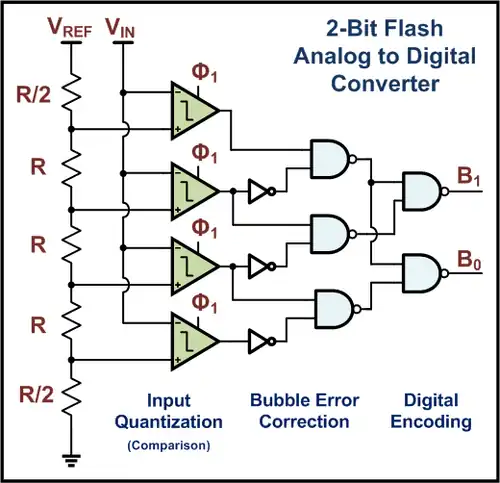
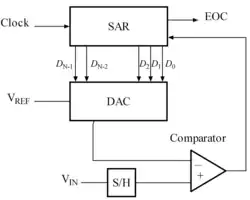
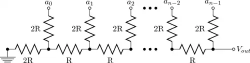

# 15.1 数据转换器IC设计

## 引言

数据转换器是连接模拟世界与数字世界的核心桥梁。在自然界中，温度、压力、声音、图像等物理量均为连续变化的模拟信号，而现代信号处理、计算与存储却几乎全部依赖离散的数字系统。模数转换器（Analog-to-Digital Converter, ADC）与数模转换器（Digital-to-Analog Converter, DAC）承担着两类信号之间的相互转换，是混合信号SoC中不可或缺的关键IP核。

随着通信、多媒体、医疗电子、汽车雷达与人工智能等应用的快速发展，对数据转换器在分辨率、采样率、功耗、面积等维度上的要求日益严苛。在先进工艺节点下，器件本征增益下降、电源电压降低、匹配特性变差，使数据转换器的设计面临前所未有的挑战；与此同时，先进工艺带来的高速数字逻辑与高密度存储能力，也为数字辅助校准、后台校准等技术提供了新的机遇。

本章系统介绍数据转换器IC设计的核心内容，涵盖架构对比、高速比较器、SAR ADC、Pipeline ADC、ΣΔ ADC、DAC实现、校准技术以及时间交织ADC等关键主题，为读者建立完整的数据转换器IC设计知识体系。

---

## 一、数据转换器IC设计概述

### 1.1 数据转换器在SoC中的地位

在现代SoC中，数据转换器承担"数字世界与模拟世界的桥梁"角色，其典型应用与指标需求如下：

| 应用领域 | 典型ADC规格 | 典型DAC规格 | 关键挑战 |
|---------|------------|------------|---------|
| 无线通信 | 12~16位, 100MS/s~1GS/s | 12~14位, 500MS/s~2GS/s | 线性度、带宽、功耗 |
| 音频处理 | 16~24位, 48~192kS/s | 16~24位, 48~192kS/s | SNR、THD+N |
| 医疗影像 | 14~16位, 20~80MS/s | — | 动态范围、低噪声 |
| 汽车雷达 | 8~12位, 1~5GS/s | — | 带宽、时间交织 |
| 数据采集 | 16~24位, 1k~1MS/s | — | 精度、INL/DNL |
| 视频显示 | 8~12位, 100~500MS/s | 10~12位, 500MS/s~2GS/s | 毛刺、建立时间 |

数据转换器在SoC中的典型占比：

| 指标 | 占比 | 说明 |
|------|------|------|
| 模拟面积 | 30%~60% | ADC/DAC中模拟部分占据主导 |
| 功耗 | 20%~50% | 高速转换器功耗显著 |
| 设计周期 | 30%~50% | 模拟迭代与版图匹配耗时 |

### 1.2 设计指标回顾

数据转换器的性能由一系列静态与动态指标衡量。

**（1）分辨率（Resolution, N）**

$$N = \log_2(2^N) \quad \text{（位）}$$

**（2）采样率（Sampling Rate, $f_s$）**

单位时间内的采样次数，单位为 Samples/s（S/s）。Nyquist采样定理要求：

$$f_s \geq 2 f_{in,max}$$

**（3）信号噪声比（SNR）**

理想N位ADC的量化噪声SNR：

$$SNR_{ideal} = 6.02N + 1.76 \quad \text{(dB)}$$

**（4）有效位数（ENOB）**

考虑实际噪声与失真后的等效位数：

$$ENOB = \frac{SNDR - 1.76}{6.02}$$

其中 $SNDR$ 为信号噪声失真比。

**（5）无杂散动态范围（SFDR）**

$$SFDR = 20\log_{10}\left(\frac{|V_{signal}|}{|V_{spur,max}|}\right) \quad \text{(dBc)}$$

**（6）积分非线性（INL）与微分非线性（DNL）**

$$DNL_k = \frac{V_{k+1} - V_k}{V_{LSB}} - 1$$

$$INL_k = \sum_{i=0}^{k-1} DNL_i$$

其中 $V_{LSB} = V_{FS}/2^N$ 为最小分辨电压。

**（7）总谐波失真（THD）**

$$THD = 20\log_{10}\left(\frac{\sqrt{\sum_{k=2}^{K} V_k^2}}{V_1}\right) \quad \text{(dB)}$$

### 1.3 ADC架构对比

不同ADC架构在速度、精度、功耗、面积等方面具有显著差异，适用于不同应用场景：

| ADC架构 | 分辨率范围 | 采样率范围 | 功耗 | 面积 | 典型应用 |
|---------|----------|----------|------|------|---------|
| **Flash（全并行）** | 4~8位 | 1~20 GS/s | 极高 | 极大 | 高速示波器、光通信 |
| **SAR** | 8~16位 | 1k~100 MS/s | 极低 | 小 | 便携设备、传感器 |
| **Pipeline** | 10~16位 | 10~500 MS/s | 中~高 | 中 | 通信、视频、成像 |
| **ΣΔ** | 16~24位 | 1k~10 MS/s | 低~中 | 中 | 音频、精密测量 |
| **Time-Interleaved** | 8~14位 | 1~100 GS/s | 极高 | 极大 | 高速采样、雷达 |
| **Two-Step/Subranging** | 8~12位 | 100M~1 GS/s | 中 | 中 | 通信中速段 |



**架构选择原则**：

- 高速低精度 → Flash 或 Time-Interleaved
- 中速中精度 → Pipeline 或 SAR
- 高精度低速 → ΣΔ
- 低功耗中精度 → SAR（先进工艺下优势显著）

### 1.4 DAC架构对比

| DAC架构 | 分辨率范围 | 采样率范围 | 功耗 | 面积 | 典型应用 |
|---------|----------|----------|------|------|---------|
| **电阻串（R-String）** | 4~10位 | 1k~100 MS/s | 低 | 中 | 低速、高单调性 |
| **R-2R梯形** | 8~16位 | 1k~50 MS/s | 中 | 小 | 通用、精密 |
| **电流舵（Current Steering）** | 8~16位 | 100M~10 GS/s | 高 | 大 | 高速通信、视频 |
| **开关电容（SC）** | 8~16位 | 1k~100 MS/s | 低 | 中 | 嵌入式SAR DAC |
| **ΣΔ DAC** | 16~24位 | 1k~10 MS/s | 低 | 中 | 音频 |

---

## 二、高速比较器设计

### 2.1 比较器在ADC中的核心作用

比较器是ADC中实现"量化"功能的核心模块，其性能直接决定ADC的分辨率与速度。在不同ADC架构中，比较器的使用方式不同：

| ADC架构 | 比较器数量 | 比较器位数 | 关键要求 |
|---------|----------|-----------|---------|
| Flash ADC | $2^N-1$ | N位 | 低失调、高速 |
| SAR ADC | 1 | N位 | 低噪声、低回踢 |
| Pipeline ADC | 每级少量 | 每级少量 | 中等精度 |
| ΣΔ ADC | 1（量化器） | 1~3位 | 高速、低迟滞 |

### 2.2 连续时间比较器

连续时间比较器由开环高增益放大器构成，输出在连续时间内跟踪输入差值。其典型结构为差分对放大级联级：

```
                  VDD
                   │
              ┌────┴────┐
              │         │
        IN+ ─→ M1    M2 ←─ IN-
              │         │
              └────┬────┘
                   │
                  ISS
                   │
                  GND
```

**传递特性**：

$$V_{out} = A_v \cdot (V_{IN+} - V_{IN-})$$

**优点**：响应连续，无时钟馈通。

**缺点**：增益有限时分辨率受限；速度受负载电容限制。

### 2.3 离散时间比较器

离散时间比较器在时钟控制下完成比较，典型结构为预放大级 + 锁存级：

```
   Vin+ ─→ [预放大级] ─→ [锁存级] ─→ Q
   Vin- ─→
              ↑
            CLK
```

**两阶段工作**：

1. **复位/预放大阶段**（CLK低）：预放大级放大输入差值
2. **再生/锁存阶段**（CLK高）：正反馈锁存级将差值快速放大到逻辑电平

**优势**：可通过预放大降低输入失调，再生级提供高速判决。

### 2.4 钟摆比较器（Latched Comparator）

钟摆比较器（StrongARM Latch）是最经典的动态比较器结构，由交叉耦合的CMOS反相器构成正反馈锁存：

```
           VDD
         │     │
         M3   M4
          │   │
        ┌─┴───┴─┐
        │       │
   ┌────┤ 交叉  ├────┐
   │    │ 耦合  │    │
   M5   │       │   M6
   │    └───────┘    │
   │       │         │
   └──┬────┴────┬────┘
      M1       M2
      ↑         ↑
    Vin+      Vin-
      │         │
     CLK       CLK
```

**工作原理**：

1. **复位阶段**（CLK=0）：M5、M6关断，输出节点预充电至 $V_{DD}$
2. **比较阶段**（CLK=1）：M5、M6导通，差分对M1、M2根据 $V_{in+} - V_{in-}$ 决定放电速度，交叉耦合的M3、M4正反馈将输出锁定

**再生时间常数**：

$$\tau_{regen} = \frac{C_L}{g_{m,3,4}}$$

**分辨率时间**：

$$t_{res} = \tau_{regen} \cdot \ln\left(\frac{V_{DD}}{\Delta V_{in} \cdot A_{pre}}\right)$$

**优点**：动态功耗低（无静态电流），速度快。

**缺点**：输入失调较大；存在显著回踢噪声。

### 2.5 双尾比较器（Double-Tail Latched Comparator）

双尾比较器在StrongARM结构基础上引入两级尾电流，提高预放大增益并降低失调：

```
        VDD
         │
        M4  ← 上尾管（PMOS）
         │
     ┌───┴───┐
     │       │
    M3      M2  ← 交叉耦合对
     │       │
     └───┬───┘
         │
        M5  ← 下尾管（NMOS）
         │
     ┌───┴───┐
     │       │
    M1+     M1-  ← 输入对
     │       │
        GND
```

**优势**：

- 预放大与再生分离，输入对管尺寸可独立优化
- 输入失调比StrongARM降低约30%~50%
- 回踢噪声显著降低

**分辨率时间**：

$$t_{res,DT} \approx t_{pre} + t_{regen}$$

其中 $t_{pre}$ 为预放大时间，$t_{regen}$ 为再生时间。

### 2.6 再生比较器（Regenerative Comparator）

再生比较器基于交叉耦合反相器对（Cross-Coupled Inverter Pair）形成 bistable 锁存：

```
        ┌─────┐         ┌─────┐
   Q  ─→│ INV ├─┬─────→ │ INV ├─┐
        └─────┘ │       └─────┘ │
        ↑       └───────────────┘
        └───────────────────────┘
```

**再生方程**：

$$\frac{d\Delta V}{dt} = \frac{g_m}{C_L} \cdot \Delta V$$

解为指数增长：

$$\Delta V(t) = \Delta V_0 \cdot e^{t/\tau_{regen}}$$

### 2.7 比较器非理想效应

**（1）失调电压（Offset）**

比较器输入失调电压主要由器件失配引起：

$$\sigma_{V_{os}} \approx \frac{A_{VT}}{\sqrt{W \cdot L}}$$

其中 $A_{VT}$ 为阈值失配系数（典型值 2~5 mV·μm）。

**（2）回踢噪声（Kickback Noise）**

钟摆比较器在再生阶段，输出节点的电压跳变通过 $C_{GD}$ 耦合回输入端，干扰前级电路：

$$V_{kickback} \approx \frac{C_{GD}}{C_{GD} + C_{in}} \cdot \Delta V_{out}$$

**（3）亚稳态（Metastability）**

当输入差值极小时，比较器输出在判决时间内无法达到逻辑电平，称为亚稳态。亚稳态发生概率：

$$P_{meta} = \frac{V_{LSB}}{V_{DD}} \cdot e^{-t_{res}/\tau_{regen}}$$

**（4）分辨率时间（Resolution Time）**

分辨率时间是输入差值从初始值 $\Delta V_{in}$ 放大到逻辑阈值 $V_{logic}$ 所需时间：

$$t_{res} = \tau_{regen} \cdot \ln\left(\frac{V_{logic}}{\Delta V_{in} \cdot A_{pre}}\right)$$

输入越小，分辨率时间越长，呈对数发散。

### 2.8 比较器优化技术

**预放大级（Pre-Amplifier）**：

在锁存级前加入1~3级预放大，提高有效输入差值：

$$A_{total} = A_{pre,1} \cdot A_{pre,2} \cdot \cdots \cdot A_{latch}$$

**失调校准（Offset Calibration）**：

| 校准方法 | 原理 | 优点 | 缺点 |
|---------|------|------|------|
| 输入失调存储 | 比较器短接输入，将失调存储在电容上 | 简单 | 占用比较时间 |
| 输出失调存储 | 在输出节点存储失调 | 速度快 | 校准范围有限 |
| 数字辅助校准 | DAC注入校准电流/电压 | 灵活、精度高 | 需要数字逻辑 |

**降低回踢噪声**：

- 在输入与锁存级之间加入隔离级（如源极跟随器）
- 使用双尾结构
- 增加输入电容 $C_{in}$

---

## 三、SAR ADC IC实现

### 3.1 SAR ADC架构与工作原理

逐次逼近型ADC（Successive Approximation Register ADC）通过二分搜索算法实现模数转换，结构简洁、功耗低，是中速中精度应用的主流架构。



```
   Vin ─→ [S/H] ─→ [比较器] ─→ [SAR逻辑] ─→ D[N-1:0]
                 ↑       ↑
                 │       │
              [CDAC] ────┘
```

**二分搜索算法**：

1. 采样阶段：采样输入 $V_{in}$ 到CDAC
2. 第1位判决：MSB置1，CDAC输出 $V_{DAC} = V_{FS}/2$，比较 $V_{in}$ 与 $V_{DAC}$
3. 根据比较结果决定MSB值，再决定下一位
4. 重复N次完成N位转换

**转换时间**：

$$T_{conv} = N \cdot T_{cmp} + T_{sample}$$

其中 $T_{cmp}$ 为单次比较时间，$T_{sample}$ 为采样时间。

### 3.2 CDAC（电容DAC）设计

#### 3.2.1 二进制加权CDAC

二进制加权CDAC由 $N$ 个电容组成，电容值按2的幂次递减：

$$C_k = 2^{N-k} \cdot C_u, \quad k = 1, 2, \ldots, N$$

总电容：

$$C_{total} = \sum_{k=1}^{N} C_k + C_u = (2^N + 1) \cdot C_u$$

**优点**：结构简单，与SAR逻辑直接对应。

**缺点**：MSB电容为 $2^{N-1} C_u$，随分辨率增加指数增长，面积与功耗开销巨大。

**版图匹配**：

电容阵列采用共质心（Common Centroid）布局 + Dummy电容：

$$\sigma(\Delta C / C) \approx \frac{A_C}{\sqrt{W \cdot L}}$$

其中 $A_C$ 为电容失配系数（典型值 0.5%~1%·μm）。

#### 3.2.2 分段CDAC（Split Capacitor）

为缓解高分辨率CDAC的电容指数增长问题，将MSB段与LSB段采用"桥接电容"耦合：

```
   MSB段（高N1位）              LSB段（低N2位）
   C_M, C_{M-1}, ... C_1       C_L, ..., C_1
        │                            │
        └──────── C_bridge ──────────┘
```

**桥接电容值**：

$$C_{bridge} = \frac{C_{u,M} \cdot C_{u,L}}{C_{u,M} - C_{u,L}}$$

当 $C_{u,M} = 2^{N_2} C_{u,L}$ 时，$C_{bridge} = C_{u,L}$。

**优势**：电容总面积从 $O(2^N)$ 降为 $O(2^{N_1} + 2^{N_2})$。

**劣势**：桥接电容对失配敏感，需仔细匹配。

#### 3.2.3 C-2C结构

C-2C结构使用单位电容 $C_u$ 与 $2C_u$ 交替连接，电容值固定，匹配性好：

```
   Vin ─ C ─ C ─ C ─ ... ─ C ─ VDAC
        │   │   │         │
        2C  2C  2C       2C
        │   │   │         │
       bit bit bit       bit
       N-1 N-2 N-3        0
```

**优点**：所有电容均为 $C_u$ 或 $2C_u$，匹配性好，面积小。

**缺点**：寄生电容对精度影响显著，速度比二进制加权慢。

#### 3.2.4 CMOS开关电容考虑

**底板采样（Bottom-Plate Sampling）**：

为降低开关时钟馈通与沟道电荷注入，采用底板采样技术：

```
   Vin ──┬── R_on ──┬── Vc
         │          │
        φs         φsb（先关断）
         │          │
        GND        GND
```

底板开关（$\phi_{sb}$）先于顶板开关（$\phi_s$）关断，使沟道电荷注入到低阻抗地端，对采样电容影响最小。

**开关电阻**：

$$R_{on} = \frac{1}{\mu C_{ox} (W/L) (V_{GS} - V_{TH})}$$

**采样噪声（kT/C）**：

$$\sigma_{sample} = \sqrt{\frac{kT}{C_s}}$$

对于N位ADC，要求：

$$\sqrt{\frac{kT}{C_s}} < \frac{V_{FS}}{2^{N+1} \sqrt{12}}$$

即 $C_s > 12 \cdot kT \cdot 2^{2N+2} / V_{FS}^2$。

### 3.3 SAR逻辑设计

#### 3.3.1 同步SAR逻辑

同步SAR逻辑使用全局时钟驱动每一位转换：

```
   CLK ─→ [N位移位寄存器] ─→ [SAR控制] ─→ CDAC开关
                                     ↓
                                 [比较器输出] → 数据寄存器
```

**特点**：

- 每位转换时间固定为1个时钟周期
- 总转换时间 $T_{conv} = N \cdot T_{CLK}$
- 时钟频率 $f_{CLK} = N \cdot f_s$

#### 3.3.2 异步SAR逻辑（Asynchronous SAR）

异步SAR逻辑在每次比较完成后立即触发下一位，无需等待全局时钟：

```
   START ─→ [D触发器] ─→ [比较器] ─→ [Ready信号]
                              ↓              │
                              └───[反相延迟]─┘
                                              ↓
                                          下一位判决
```

**优势**：

- 转换速度由比较器自身速度决定，非固定时钟周期
- 不同位判决时间可不同（小差值时较长，大差值时较短）
- 平均转换速度比同步SAR提升 30%~50%

**劣势**：

- 设计复杂度增加
- 需要额外的"完成检测"电路
- 时钟抖动分析更复杂

### 3.4 比较器与CDAC的协同设计

SAR ADC性能取决于比较器与CDAC的协同：

| 协同参数 | 设计要点 |
|---------|---------|
| 比较器输入电容 | 应远小于CDAC最小单位电容 $C_u$ |
| CDAC建立时间 | 应小于比较器判决时间 |
| 比较器噪声 | 应小于1 LSB量化噪声 |
| 比较器失调 | 可通过校准消除 |

**比较器噪声预算**：

$$\sigma_{cmp}^2 < \frac{V_{LSB}^2}{12}$$

### 3.5 SAR ADC的非理想效应

**（1）电容失配（DNL/INL影响）**

电容失配直接传递到DAC输出，造成DNL/INL误差：

$$\sigma_{DNL} \approx \frac{\sqrt{2^N - 1}}{2^N} \cdot \frac{\sigma(\Delta C)}{C} \cdot 2^N \cdot V_{LSB}$$

$$\sigma_{INL,max} \approx \frac{\sigma(\Delta C)}{C} \cdot 2^{N-1} \cdot V_{LSB}$$

**（2）比较器噪声**

比较器输入噪声导致判决不确定，等效为量化噪声叠加：

$$SNR_{noise} = 20\log_{10}\left(\frac{V_{FS}/(2\sqrt{2})}{\sqrt{\sigma_q^2 + \sigma_{cmp}^2}}\right)$$

**（3）采样开关非理想性**

- **开关电阻非线性**：CMOS开关导通电阻随输入电压变化，引入谐波失真
- **时钟馈通**：开关时钟通过 $C_{GD}$ 耦合到采样节点
- **沟道电荷注入**：开关关断时沟道电荷注入采样电容

### 3.6 设计实例（10位1MS/s SAR ADC）

**规格定义**：

| 参数 | 指标 |
|------|------|
| 分辨率 | 10位 |
| 采样率 | 1 MS/s |
| 电源电压 | 1.2 V |
| SNR | ≥ 60 dB |
| ENOB | ≥ 9.5位 |
| DNL/INL | < ±0.5 LSB |
| 功耗 | < 1 mW |

**设计选择**：

- **架构**：异步SAR
- **CDAC**：分段结构，MSB 5位 + LSB 5位 + 桥接电容
- **单位电容**：$C_u = 50$ fF（满足kT/C噪声 < 1/4 LSB）
- **比较器**：双尾动态比较器 + 输入失调校准
- **采样开关**：底板采样 + CMOS互补开关

**关键计算**：

- 量化噪声：$V_{LSB} = 1.2/1024 \approx 1.17$ mV
- kT/C噪声要求：$C_s > 12 \cdot kT \cdot 2^{22} / 1.2^2 \approx 0.6$ pF
- 比较器噪声预算：$\sigma_{cmp} < 0.3$ mV
- 总电容：$C_{total} \approx 32 C_u \times 2 + C_{bridge} \approx 3.4$ pF

---

## 四、流水线ADC（Pipeline ADC）设计

### 4.1 流水线ADC架构与工作原理

流水线ADC将N位转换分解为多级低分辨率子转换，每级处理若干位，级间通过余量放大器级联：

```
   Vin ─→ [级1] ─→ [级2] ─→ ... ─→ [级M] ─→ D[N-1:0]
            ↓       ↓                ↓
          D1,D2   D3,D4            DM
```

**每一级结构**：

```
   Vin ─→ [SHA] ─→ [Sub-ADC] ─→ 数字码
            │       ↓
            │   [Sub-DAC]
            ↓       │
          [求和] ←──┘
            ↓
        [余量放大]
            ↓
          Vres → 下一级
```

**关键模块**：

- **SHA（Sample-and-Hold Amplifier）**：采样保持
- **Sub-ADC**：子区间ADC（通常2~4位）
- **MDAC（Multiplying DAC）**：实现Sub-DAC + 求差 + 余量放大

**吞吐率**：

Pipeline ADC每周期输出一个采样，吞吐率为 $f_{clk}$；但单次转换延迟为 $M$ 个周期（流水线深度）。

### 4.2 MDAC（Multiplying DAC）设计

#### 4.2.1 1.5位/级结构

最常用的Pipeline级为1.5位/级结构，每级实际输出2位，但其中1位为冗余位用于数字校正：

**Sub-ADC判决阈值**：

$$V_{res} = \begin{cases} 2V_{in} + V_{ref} & V_{in} < -V_{ref}/4 \\ 2V_{in} & -V_{ref}/4 \leq V_{in} \leq V_{ref}/4 \\ 2V_{in} - V_{ref} & V_{in} > V_{ref}/4 \end{cases}$$

**数字输出**：

| 输入范围 | 数字码 $D_1 D_0$ | 余量放大倍数 |
|---------|------------------|------------|
| $V_{in} < -V_{ref}/4$ | 00 | 2× |
| $-V_{ref}/4 \leq V_{in} \leq V_{ref}/4$ | 01 | 2× |
| $V_{in} > V_{ref}/4$ | 10 | 2× |

#### 4.2.2 余量放大器（Residue Amplifier）

余量放大器将本级残差放大2倍，传递给下一级：

$$V_{res} = 2 \cdot (V_{in} - D \cdot V_{ref}/2)$$

**精度要求**：

余量放大器增益误差 $\epsilon_g$ 引起的等效输入误差：

$$\sigma_{INL,gain} = \frac{\epsilon_g}{2} \cdot V_{ref}$$

要求 $\epsilon_g < 2^{-(N+1)}$，对高分辨率Pipeline ADC极其严苛。

#### 4.2.3 增益精度要求

| ADC分辨率 | 余量放大器增益精度 | 实现方式 |
|---------|------------------|---------|
| 8位 | 0.4% | 简单运放 |
| 10位 | 0.1% | 高增益运放 |
| 12位 | 0.025% | 增益自举或校准 |
| 14位+ | < 0.006% | 必须校准 |

### 4.3 数字校正（Digital Correction）

#### 4.3.1 冗余位原理

通过在每级加入冗余位，使Sub-ADC的失调误差被下一级吸收：

$$\text{每级有效位数} = k \text{位}, \quad \text{每级实际位数} = k + 0.5 \text{位}$$

冗余范围：

$$|\Delta V_{sub-ADC}| < \pm \frac{V_{ref}}{2^{k+1}}$$

#### 4.3.2 数字校正算法

将每级的输出码按位错位相加，利用冗余位消除级间失调：

```
   级1:  D1,0 D1,1   ←   有效位 + 冗余位
   级2:    D2,0 D2,1
   级3:      D3,0 D3,1
   ...
                错位相加
                ↓
          最终N位输出
```

**校正公式**：

$$D_{out} = \sum_{i=1}^{M} D_i \cdot 2^{-\sum_{j=1}^{i-1} k_j}$$

### 4.4 流水线ADC的非理想效应

**（1）余量放大器有限增益**

有限增益 $A_{actual} = A_{ideal}(1 - \epsilon)$ 引入增益误差，表现为INL。

**（2）比较器失调**

Sub-ADC比较器失调在冗余范围内可被吸收，超出范围则出现失码。

**（3）SHA的热噪声**

SHA的kT/C噪声直接进入信号路径：

$$\sigma_{SHA} = \sqrt{\frac{kT}{C_s}}$$

要求 $\sigma_{SHA} < V_{LSB}/\sqrt{12}$。

**（4）运放有限带宽与建立误差**

$$\epsilon_{settling} = e^{-T_s/(2\tau)}$$

其中 $\tau = 1/(2\pi f_{UGF})$，$f_{UGF}$ 为运放单位增益带宽。

### 4.5 设计实例（12位100MS/s Pipeline ADC）

**规格**：

| 参数 | 指标 |
|------|------|
| 分辨率 | 12位 |
| 采样率 | 100 MS/s |
| SNR | ≥ 70 dB |
| SFDR | ≥ 80 dB |
| 功耗 | < 100 mW |

**架构选择**：

- **级数**：1.5位/级 × 10级 + 2位末级
- **第一级MDAC**：增益4×，运放增益 > 90 dB
- **后续级**：逐级缩小电容，降低功耗
- **数字校正**：每级1.5位冗余
- **SHA**：第一级前采用专用SHA，提升带宽

**关键参数**：

- 第一级采样电容：$C_s = 2$ pF（满足kT/C噪声 < 1/4 LSB）
- 运放单位增益带宽：$f_{UGF} > 5$ GHz
- 比较器失调：< ±100 mV（被冗余吸收）

---

## 五、ΣΔ ADC设计

### 5.1 过采样技术原理

#### 5.1.1 过采样率OSR

过采样率（OverSampling Ratio, OSR）定义为采样频率与Nyquist频率之比：

$$OSR = \frac{f_s}{2 f_B}$$

其中 $f_B$ 为信号带宽。

#### 5.1.2 量化噪声分布

N位量化器的量化噪声功率：

$$P_q = \frac{\Delta^2}{12} = \frac{V_{LSB}^2}{12}$$

均匀分布在 $[0, f_s/2]$ 频带内，功率谱密度：

$$S_q(f) = \frac{P_q}{f_s/2} = \frac{\Delta^2}{6 f_s}$$

**过采样对SNR的改善**：

信号带内量化噪声功率：

$$P_{q,in-band} = \int_0^{f_B} S_q(f) df = \frac{\Delta^2}{12} \cdot \frac{1}{OSR}$$

对应SNR：

$$SNR_{OSR} = 6.02N + 1.76 + 10\log_{10}(OSR) \quad \text{(dB)}$$

每过采样2倍，SNR提升3 dB（0.5位ENOB）。

### 5.2 噪声整形（Noise Shaping）

#### 5.2.1 一阶ΣΔ调制器

一阶ΣΔ调制器结构：

```
   Vin ─(+)─→ [积分器] ─→ [量化器] ─→ Y
              ↑                ↓
              └───[DAC]────────┘
```


**线性化模型**：

$$Y(z) = z^{-1} X(z) + (1 - z^{-1}) E(z)$$

**信号传递函数（STF）**：

$$STF(z) = z^{-1}$$

**噪声传递函数（NTF）**：

$$NTF(z) = 1 - z^{-1}$$

噪声在直流处为零，高频被放大——噪声整形。

**带内噪声功率**：

$$P_{q,1st} = \frac{\Delta^2}{12} \cdot \frac{\pi^2}{3} \cdot \frac{1}{OSR^3}$$

对应SNR：

$$SNR_{1st} = 6.02N + 1.76 - 5.17 + 30\log_{10}(OSR) \quad \text{(dB)}$$

每过采样2倍，SNR提升9 dB（1.5位ENOB）。

#### 5.2.2 二阶ΣΔ调制器

二阶ΣΔ调制器使用两级积分器：

$$Y(z) = z^{-2} X(z) + (1 - z^{-1})^2 E(z)$$

$$NTF(z) = (1 - z^{-1})^2$$

**带内噪声功率**：

$$P_{q,2nd} = \frac{\Delta^2}{12} \cdot \frac{\pi^4}{5} \cdot \frac{1}{OSR^5}$$

对应SNR：

$$SNR_{2nd} = 6.02N + 1.76 - 12.9 + 50\log_{10}(OSR) \quad \text{(dB)}$$

每过采样2倍，SNR提升15 dB（2.5位ENOB）。

#### 5.2.3 高阶ΣΔ调制器（稳定性考虑）

L阶ΣΔ调制器：

$$NTF(z) = (1 - z^{-1})^L$$

**理想SNR**：

$$SNR_{Lth} = 6.02N + 1.76 + 10\log_{10}\left(\frac{2L+1}{\pi^{2L}}\right) + (2L+1) \cdot 10\log_{10}(OSR)$$

**稳定性问题**：

L ≥ 3 时，单环结构容易出现不稳定（量化器输入饱和），需要：

- 限制NTF最大增益：$|NTF(e^{j\omega})|_{max} < 1.5$
- 采用前馈（Feedforward）结构降低积分器输出摆幅
- 多位量化器降低量化噪声

**NTF设计方法**：Butterworth高通或逆向Chebyshev高通。

### 5.3 ΣΔ调制器拓扑

#### 5.3.1 单环结构

单环ΣΔ调制器使用一个反馈环包含所有积分器：

```
   Vin ─→ [积分器1] ─→ [积分器2] ─→ ... ─→ [积分器L] ─→ [量化器] ─→ Y
                                       ↓
                                  [反馈DAC] ──── 反馈到各级输入
```

**优点**：结构简单，对元件失配不敏感。

**缺点**：高阶时稳定性差。

#### 5.3.2 MASH（级联）结构

MASH（Multi-stAge noise SHaping）将多个低阶（通常1阶或2阶）调制器级联，实现高阶噪声整形：

```
   Vin ─→ [1阶ΣΔ] ─→ Y1, E1 ─→ [1阶ΣΔ] ─→ Y2, E2 ─→ ... → Y
```

**输出组合**：

$$Y(z) = STF_1 \cdot Y_1(z) + (1 - z^{-1}) \cdot STF_2 \cdot Y_2(z) + \cdots$$

**优势**：每一级稳定（低阶），整体实现高阶噪声整形。

**劣势**：级间增益失配会泄漏一阶量化噪声，对匹配要求高。

| 拓扑 | 阶数 | 稳定性 | 失配敏感度 | 应用 |
|------|------|--------|-----------|------|
| 单环1阶 | 1 | 极稳定 | 低 | 教学 |
| 单环2阶 | 2 | 稳定 | 低 | 通用 |
| 单环3阶+ | ≥3 | 难稳定 | 中 | 高性能音频 |
| MASH 2-1 | 3 | 稳定 | 高 | 通信 |
| MASH 2-2 | 4 | 稳定 | 高 | 高精度 |

### 5.4 抽取滤波器（Decimation Filter）

ΣΔ调制器输出为高速低位（1~3位）数据流，需经过抽取滤波器降速到Nyquist速率：

```
   高速低位流 ─→ [CIC] ─→ [半带滤波器] ─→ [FIR补偿] ─→ 低位流（Nyquist速率）
                  ↓
              降速 R1倍           降速 R2倍
```

#### 5.4.1 CIC滤波器（Cascaded Integrator-Comb）

CIC滤波器由积分级与梳状级组成，无需乘法器：

```
   输入 ─→ [积分器]×N ─→ [↓R] ─→ [梳状器]×N ─→ 输出
```

**传递函数**：

$$H_{CIC}(z) = \left(\frac{1 - z^{-RM}}{1 - z^{-1}}\right)^N$$

其中 $R$ 为抽取因子，$M$ 为差分延迟，$N$ 为级数。

**优点**：无乘法器，适合硬件实现。

**缺点**：通带衰减严重，需要后续FIR补偿。

#### 5.4.2 半带滤波器（Half-Band Filter）

半带滤波器在 $f_s/4$ 处对称，约一半系数为零：

$$H(e^{j\pi/2}) = 0.5$$

**优势**：

- 计算量减半（一半系数为零）
- 适合2倍抽取

#### 5.4.3 FIR补偿滤波器

补偿CIC滤波器的通带衰减，实现平坦的通带响应：

$$H_{comp}(f) = \frac{1}{|H_{CIC}(f)|}, \quad f \in [0, f_B]$$

### 5.5 ΣΔ ADC的非理想效应

**（1）积分器泄漏**

积分器的有限直流增益 $A_{DC}$ 导致泄漏：

$$H_{int}(z) = \frac{1}{1 + \frac{1-z^{-1}}{A_{DC}}} \approx \frac{1}{1 - z^{-1}} \cdot \left(1 - \frac{1-z^{-1}}{A_{DC}}\right)$$

效果：噪声整形减弱，SNR下降。

**（2）比较器迟滞**

1位量化器的迟滞引入死区，造成谐波失真。

**（3）时钟抖动**

DAC反馈脉冲的抖动等效为加性噪声：

$$SNR_{jitter} = -20\log_{10}(2\pi f_{in} \sigma_t)$$

### 5.6 设计实例（16位音频ΣΔ ADC）

**规格**：

| 参数 | 指标 |
|------|------|
| 分辨率 | 16位 |
| 信号带宽 | 20 kHz |
| 采样率 | 5.12 MHz |
| OSR | 128 |
| SNR | ≥ 98 dB |
| THD | < -90 dB |

**设计选择**：

- **拓扑**：单环3阶 + 1位量化器 + 1位DAC
- **NTF**：Butterworth高通，最大增益 1.5
- **积分器**：开关电容结构，增益 > 60 dB
- **抽取**：CIC(4级, R=64) + 半带(R=2) + FIR

**关键计算**：

- 理论SNR：$6.02 \times 1 + 1.76 - 12.9 + 50 \times \log_{10}(128) \approx 100$ dB
- 电容匹配：4位精度即可（噪声整形对DAC失配不敏感）
- 时钟抖动：$\sigma_t < 100$ ps

---

## 六、DAC IC实现

### 6.1 电流舵DAC（Current Steering DAC）

电流舵DAC是高速DAC的主流架构，由电流源阵列 + 开关阵列组成：

```
   码字 D[N-1:0] ─→ [译码器] ─→ [开关阵列] ─→ Iout / IoutB
                                ↑
                          [电流源阵列]
```

#### 6.1.1 电流源阵列设计

**电流源匹配要求**：

对于N位DAC，电流源相对失配：

$$\frac{\sigma_I}{I} < \frac{1}{2^N \sqrt{2^{N+1}}}$$

对应INL < ±0.5 LSB的概率（良率 > 99.7%）。

**电流源尺寸**：

$$\sigma\left(\frac{\Delta I}{I}\right) = \frac{A_{ID}}{\sqrt{W \cdot L}}$$

例如12位DAC，$A_{ID} = 1\% \cdot \mu m$：

$$\sqrt{W \cdot L} > \frac{A_{ID} \cdot 2^N \sqrt{2^{N+1}}}{1} \approx 230 \text{ μm}$$

#### 6.1.2 二进制编码 vs 温度计编码

| 编码方式 | 实现 | 优点 | 缺点 |
|---------|------|------|------|
| **二进制编码** | $I_k = 2^{k} I_u$ | 简单，面积小 | 重大毛刺，DNL差 |
| **温度计编码** | $I_k = I_u$, 共$2^N-1$个 | 单调，毛刺小 | 面积大，译码复杂 |
| **分段编码** | 高位温度计 + 低位二进制 | 折中 | 设计复杂 |

**典型分段**：N位 = 5位温度计 + 5位二进制 + 2位辅助。

#### 6.1.3 分段架构（Segmented）

```
   D[N-1:M+1] ─→ [温度计译码] ─→ [高位电流单元]（2^(M+1)-1个）
   D[M:0]    ──→ [直接驱动]  ─→ [低位电流单元]（2^M个，二进制加权）
```

**分段比例选择**：

| 高位温度计位数 | 低位二进制位数 | 毛刺 | 面积 | 适用 |
|--------------|--------------|------|------|------|
| 6 | 6 | 小 | 中 | 12位 |
| 7 | 5 | 极小 | 大 | 12位高线性度 |
| 5 | 7 | 中 | 小 | 12位低成本 |

#### 6.1.4 电流源匹配技术

- **共质心布局**：消除线性梯度
- **伪单元（Dummy）**：消除刻蚀边缘效应
- **Q²随机化布局**：抑制二次梯度
- **校准**：测量并补偿每个电流源

### 6.2 开关电容DAC

开关电容DAC通过电荷重分配实现D/A转换，与SAR ADC中的CDAC同源：

$$V_{out} = V_{ref} \cdot \frac{\sum_{k} D_k C_k}{C_{total}}$$

**与SAR CDAC的关系**：SAR ADC中的CDAC本质是一个开关电容DAC，转换过程中CDAC在比较器输入端产生对应的电压。

### 6.3 电阻串DAC

电阻串DAC使用 $2^N$ 个相等电阻串联，通过开关选择抽头：



```
   Vref ─ R ─ R ─ R ─ ... ─ R ─ GND
         │   │   │         │
        SW  SW  SW        SW
         │   │   │         │
        00  01  10        11
              ↓
            Vout
```

**优点**：单调性保证，DNL = 0（理想情况下）。

**缺点**：分辨率受电阻数限制，8位需256个电阻，10位需1024个电阻。

### 6.4 DAC的非理想效应

**（1）失配引起的DNL/INL**

$$\sigma_{DNL} \approx \frac{\sigma(\Delta I)}{I_{LSB}} = \frac{\sigma(\Delta I)}{I_u}$$

$$\sigma_{INL,max} \approx \frac{\sigma(\Delta I)}{I_u} \cdot \sqrt{2^N}$$

**（2）毛刺（Glitch）**

DAC输出在码字切换瞬间产生的尖峰脉冲，主要由开关时序不对称引起。毛刺面积：

$$A_{glitch} = \int V_{glitch}(t) dt$$

**（3）时钟馈通**

开关时钟通过寄生电容耦合到输出，产生周期性纹波。

### 6.5 设计实例（12位500MS/s电流舵DAC）

**规格**：

| 参数 | 指标 |
|------|------|
| 分辨率 | 12位 |
| 更新率 | 500 MS/s |
| SFDR | ≥ 70 dB（@ 50 MHz输出） |
| 功耗 | < 200 mW |

**设计选择**：

- **架构**：6位温度计 + 6位二进制分段
- **电流源**：$I_u = 10$ μA，总输出电流 40.96 mA
- **开关**：差分电流开关，降低毛刺
- **校准**：后台校准补偿电流源失配

**关键计算**：

- 电流源尺寸：$W \cdot L > 200$ μm²（满足12位匹配）
- 输出阻抗：$R_{out} > 2^N \cdot R_L \approx 4$ MΩ
- 时钟抖动：$\sigma_t < 1$ ps

---

## 七、数据转换器的校准技术

### 7.1 前台校准（Foreground Calibration）

**原理**：在芯片正常工作前，进入校准模式测量并补偿误差。

**典型流程**：

1. 切断信号输入
2. 施加已知激励（如斜坡、阶跃）
3. 测量输出，计算误差参数
4. 将校准系数存入片上RAM
5. 转入正常工作模式，应用校准

**优点**：算法简单，精度高。

**缺点**：校准期间无法工作，需停机。

### 7.2 后台校准（Background Calibration）

**原理**：在正常工作期间，利用空闲通道或冗余位持续测量并更新校准系数。

**典型方法**：

- **基于冗余位的后台校准**：利用SAR/Pipeline ADC的冗余位空间
- **基于dummy通道的校准**：在时间交织ADC中加入冗余通道
- **基于统计的校准**：利用输入信号的统计特性估计误差

**优点**：实时校准，无需停机，可跟踪温度漂移。

**缺点**：算法复杂，需较多数字逻辑。

### 7.3 数字辅助校准

数字辅助校准利用片上数字逻辑完成校准计算，已成为先进工艺节点下的主流方案：

| 校准对象 | 数字辅助方法 |
|---------|------------|
| 比较器失调 | 测量零输入时的输出码，反推失调 |
| 电容失配 | 基于相关性测量，反推电容比 |
| MDAC增益 | 利用冗余位空间测量增益 |
| 电流源失配 | 顺序测量各电流源，更新查找表 |
| 时间交织失配 | 基于输入信号统计或辅助参考通道 |

### 7.4 比较器失调校准

**输入失调存储法**：

```
   阶段1（校准）: Vin+ ──→ 短接 ──→ Vin- ──→ 比较器 ──→ 失调存储到C_cal
   阶段2（工作）: Vin+ ──→ 比较器 ──→ Vin-，C_cal抵消失调
```

**校准精度**：

$$\sigma_{V_{os,calibrated}} \approx \frac{\sigma_{V_{os}}}{A_{cal}}$$

其中 $A_{cal}$ 为校准环路增益。

---

## 八、时间交织ADC（Time-Interleaved ADC）

### 8.1 时间交织原理

时间交织ADC通过多个子ADC并行工作，按时间错位采样，实现总采样率为各子ADC采样率之和：

```
   Vin ─→ [分相时钟] ─→ [子ADC1] ─┐
                       [子ADC2] ─┤
                       [子ADC3] ─┼─→ [输出复接] ─→ D[N-1:0]
                       ...       │
                       [子ADCM] ─┘
```

**总采样率**：

$$f_{s,total} = M \cdot f_{s,channel}$$

**分相时钟**：

$$\phi_k(t) = \phi\left(t - \frac{k T_s}{M}\right), \quad k = 0, 1, \ldots, M-1$$

**优势**：突破单通道ADC的速度限制，可达数十GS/s。

**劣势**：通道间失配引入杂散。

### 8.2 通道失配问题

#### 8.2.1 偏置失配（Offset Mismatch）

各通道直流偏置不同，产生频率为 $f_s/M$ 的整数倍的杂散：

$$f_{spur,offset} = k \cdot \frac{f_s}{M}, \quad k = 1, 2, \ldots$$

**校准**：测量各通道平均输出，减去偏置。

#### 8.2.2 增益失配（Gain Mismatch）

各通道增益不一致，产生与输入频率相关的杂散：

$$f_{spur,gain} = \pm f_{in} + k \cdot \frac{f_s}{M}$$

**校准**：测量各通道输出幅度，归一化。

#### 8.2.3 相位失配（Timing Skew）

各通道采样时刻偏差 $\Delta t_k$，产生杂散：

$$f_{spur,phase} = \pm f_{in} + k \cdot \frac{f_s}{M}$$

杂散幅度：

$$A_{spur,phase} \approx 2\pi f_{in} \cdot \sigma_t$$

**校准**：基于输入信号统计估计相位偏差，通过数字延迟线补偿。

#### 8.2.4 带宽失配（Bandwidth Mismatch）

各通道前端带宽不同，引入频率相关的增益与相位失配：

$$H_k(j\omega) = \frac{1}{1 + j\omega / \omega_{p,k}}$$

**校准**：通过自适应滤波器补偿各通道频率响应差异。

### 8.3 校准技术

| 失配类型 | 杂散频率 | 校准方法 |
|---------|---------|---------|
| 偏置 | $k f_s/M$ | 直流均值测量 |
| 增益 | $\pm f_{in} + k f_s/M$ | 输出幅度归一化 |
| 相位 | $\pm f_{in} + k f_s/M$ | 统计估计 + 数字延迟 |
| 带宽 | $\pm f_{in} + k f_s/M$ | 自适应滤波 |
| 综合 | 多个 | 联合后台校准 |

**典型校准流程**：

1. **前台粗校准**：测量各通道偏置与增益，初始化补偿系数
2. **后台细校准**：基于输入信号统计特性持续更新校准参数
3. **数字补偿**：对每通道输出应用偏置/增益/相位/带宽补偿

---

## 九、小结

数据转换器IC设计是模拟与数字交叉的综合性领域，要求设计者同时掌握模拟电路、数字逻辑与系统级思维。本章系统介绍了数据转换器IC设计的核心内容，回顾要点如下：

**核心内容回顾**：

| 章节 | 核心要点 |
|------|---------|
| **数据转换器概述** | SoC中的桥梁角色，主要指标（SNR、ENOB、SFDR、INL/DNL），ADC/DAC架构对比 |
| **高速比较器** | StrongARM、双尾、再生比较器；失调、回踢、亚稳态等非理想效应；预放大与校准优化 |
| **SAR ADC** | 二分搜索原理；CDAC（二进制加权、分段、C-2C）；同步/异步SAR逻辑；电容失配与噪声影响 |
| **Pipeline ADC** | 多级结构；1.5位/级MDAC；冗余位数字校正；余量放大器增益精度要求 |
| **ΣΔ ADC** | 过采样与噪声整形；1阶/2阶/高阶NTF；单环与MASH拓扑；CIC + 半带 + FIR抽取 |
| **DAC实现** | 电流舵分段架构；温度计/二进制编码折中；电阻串与开关电容DAC；毛刺与时钟馈通 |
| **校准技术** | 前台/后台校准；数字辅助校准；比较器失调存储法 |
| **时间交织ADC** | 多通道并行采样；偏置/增益/相位/带宽失配；后台校准 |

**设计原则总结**：

1. **架构优先**：根据分辨率、速度、功耗、面积的需求选择合适架构，权衡取舍
2. **噪声预算**：从系统级进行噪声、失配、抖动的预算分配，确保各模块留有裕量
3. **匹配至上**：版图匹配（共质心、Dummy、等间距）是高精度设计的基石
4. **数字辅助**：在先进工艺节点，数字校准已成为突破模拟瓶颈的关键手段
5. **协同设计**：比较器、DAC、逻辑、时钟需协同优化，避免局部最优而全局次优

数据转换器IC设计随着工艺演进与应用拓展持续发展。先进FinFET工艺下，低电源电压与高器件匹配性使SAR ADC受益匪浅；时间交织技术使采样率突破数十GS/s；数字辅助校准使高分辨率DAC在先进工艺下实现高线性度。掌握本章核心内容，读者将具备从事数据转换器IC设计的基础能力，能够在不同应用场景下做出合理的架构选择与电路实现。
