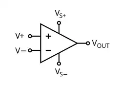

# 10.1 运算放大器设计

## 1. 引言

运算放大器（Operational Amplifier，简称运放）是模拟集成电路中最基本、应用最广泛的构建模块。从简单的信号放大到复杂的滤波器、数据转换器、锁相环等系统，运放的性能直接决定了整个模拟系统的品质。

与数字电路设计不同，模拟运放设计是一门融合了电路理论、器件物理和设计经验的综合性工程学科。设计者需要在增益、带宽、相位裕度、功耗、输出摆幅、噪声等多个相互制约的指标之间进行权衡，最终获得满足特定应用需求的最优解。

本章将系统介绍CMOS运算放大器的设计方法，从设计指标、经典拓扑结构到高级设计技术，为读者建立完整的运放设计知识体系。

## 2. 运放设计指标

### 2.1 主要设计指标

运放的设计指标是设计的出发点和验收标准，主要包括以下几个方面：

**小信号指标**：

| 指标 | 符号 | 定义 | 典型值 |
|------|------|------|--------|
| 直流开环增益 | $A_{v0}$ | 低频小信号增益 | 60~100 dB |
| 单位增益带宽 | $GBW$ 或 $f_T$ | 增益下降到0 dB的频率 | 1~500 MHz |
| 相位裕度 | $PM$ | 单位增益频率处的相位余量 | ≥60° |
| 增益裕度 | $GM$ | 相位为-180°处的增益余量 | ≥10 dB |
| 共模抑制比 | $CMRR$ | 差模增益与共模增益之比 | 60~100 dB |
| 电源抑制比 | $PSRR$ | 差模增益与电源增益之比 | 60~80 dB |
| 输入失调电压 | $V_{OS}$ | 输出为零时输入端的等效偏移 | 1~10 mV |

**大信号指标**：

| 指标 | 符号 | 定义 | 典型值 |
|------|------|------|--------|
| 摆率 | $SR$ | 输出电压最大变化速率 | 1~500 V/μs |
| 输出摆幅 | $V_{swing}$ | 输出电压的最大峰-峰值 | 接近电源电压 |
| 建立时间 | $t_s$ | 输出稳定到指定精度所需时间 | 10~100 ns |
| 全功率带宽 | $FPBW$ | 最大摆幅下不失真的最高频率 | $FPBW = SR/(2\pi V_p)$ |

**功耗与面积**：

- 静态功耗 $P_D = V_{DD} \cdot I_{DD}$
- 芯片面积（与晶体管总数和尺寸相关）

### 2.2 指标之间的权衡关系

运放设计中的各项指标往往相互矛盾，设计者需要在它们之间做出权衡：

- **增益 vs 带宽**：增益带宽积 $GBW \cdot A_{v0}$ 近似为常数，提高增益通常意味着牺牲带宽
- **带宽 vs 功耗**：更高的带宽需要更大的偏置电流，功耗随之增加
- **摆率 vs 功耗**：$SR = I/C$，提高摆率需要增大电流或减小补偿电容
- **输出摆幅 vs 增益**：Cascode结构增益高但输出摆幅小
- **噪声 vs 功耗**：低噪声需要大器件和大电流，面积和功耗增加

### 2.3 设计流程

运放设计的典型流程如下：

1. **明确设计规格**：根据系统需求确定各项指标
2. **选择电路拓扑**：根据指标特点选择合适的运放结构
3. **手算初步设计**：利用简化模型进行晶体管尺寸计算
4. **仿真验证**：使用SPICE进行直流、交流、瞬态、噪声等仿真
5. **迭代优化**：根据仿真结果调整参数，直到满足所有指标
6. **版图设计**：考虑匹配、寄生效应的版图实现
7. **后仿真验证**：提取寄生参数后的后仿真

## 3. 两级运算放大器

### 3.1 电路结构

两级运算放大器是最经典的CMOS运放结构，由以下部分组成：

- **第一级**：差分输入级（差分对 + 有源负载），提供高输入阻抗和高CMRR
- **第二级**：共源放大级，提供额外的电压增益
- **补偿网络**：密勒补偿电容 $C_C$，保证稳定性

典型的两级运放电路包含：
- M1、M2：NMOS差分输入对
- M3、M4：PMOS有源负载（电流镜）
- M5：尾电流源
- M6：PMOS共源放大管
- M7：NMOS电流源负载
- M8：偏置电路
- $C_C$：密勒补偿电容

下图是典型两级运放的内部模块框图，可直观看到差分输入级、中间放大级与输出级的分级结构：

### 3.2 小信号分析

**第一级增益**（差分输入级）：

$$A_{v1} = g_{m1} \cdot (r_{o2} \| r_{o4})$$

其中：
- $g_{m1}$：输入对管M1的跨导
- $r_{o2}$：NMOS负载管M2的输出电阻
- $r_{o4}$：PMOS负载管M4的输出电阻

**第二级增益**（共源放大级）：

$$A_{v2} = g_{m6} \cdot (r_{o6} \| r_{o7})$$

其中：
- $g_{m6}$：共源放大管M6的跨导
- $r_{o6}$：PMOS放大管M6的输出电阻
- $r_{o7}$：NMOS电流源M7的输出电阻

**总直流增益**：

$$A_{v0} = A_{v1} \cdot A_{v2} = g_{m1}(r_{o2} \| r_{o4}) \cdot g_{m6}(r_{o6} \| r_{o7})$$

对于长沟道器件，$r_o = 1/(\lambda I_D)$，代入可得：

$$A_{v0} = \frac{g_{m1}}{I_{D1}} \cdot \frac{g_{m6}}{I_{D6}} \cdot \frac{1}{(\lambda_2 + \lambda_4)(\lambda_6 + \lambda_7)} \cdot \frac{I_{D6}}{I_{D1}}$$

### 3.3 密勒补偿原理

密勒补偿是两级运放中最常用的频率补偿技术。

**补偿原理**：

在第二级的输入和输出之间连接补偿电容 $C_C$，利用密勒效应将其等效到第一级输出：

$$C_{Miller} = C_C(1 + |A_{v2}|) \approx C_C \cdot A_{v2}$$

这使得主极点频率大幅降低：

$$p_1 \approx -\frac{1}{R_1 \cdot C_C \cdot A_{v2}} = -\frac{1}{R_1 \cdot C_{Miller}}$$

其中 $R_1 = r_{o2} \| r_{o4}$ 为第一级输出电阻。

**零极点分离**：

密勒补偿的另一个重要效果是将非主极点推向更高频率。补偿后的两个极点为：

$$p_1 \approx -\frac{1}{R_1 \cdot C_C \cdot A_{v2}}$$

$$p_2 \approx -\frac{g_{m6} \cdot C_C}{C_1 \cdot C_2}$$

其中 $C_1$、$C_2$ 分别为第一级和第二级的输出节点电容。

**右半平面零点问题**：

密勒电容 $C_C$ 同时引入了一个右半平面（RHP）零点：

$$z_{RHP} = +\frac{g_{m6}}{C_C}$$

RHP零点对相位裕度有负面影响（既延迟相位又增加增益），需要消除或推到更高频率。

**消除RHP零点的方法**：

1. **串联调零电阻**：在 $C_C$ 支路串联电阻 $R_z$

$$R_z = \frac{1}{g_{m6}}$$

可将RHP零点移到左半平面或无穷远处。

2. **使用电压缓冲器**：在 $C_C$ 和地之间加入缓冲器，切断前馈通路。

### 3.4 频率响应与稳定性

**单位增益带宽**：

$$GBW = \frac{A_{v0} \cdot |p_1|}{2\pi} = \frac{g_{m1}}{2\pi C_C}$$

**相位裕度**：

$$PM = 180° - \arctan\left(\frac{GBW}{|p_2|}\right) - \arctan\left(\frac{GBW}{|p_3|}\right) - \cdots$$

对于两级运放，主要考虑前两个极点：

$$PM \approx 180° - \arctan\left(\frac{GBW}{|p_2|}\right)$$

为保证 $PM \geq 60°$，需要：

$$|p_2| \geq 2.2 \cdot GBW$$

代入 $p_2$ 的表达式，得到补偿电容的设计约束：

$$C_C \geq 0.44 \cdot (C_1 + C_2) \cdot \frac{g_{m1}}{g_{m6}}$$

下图为运放开环增益随频率的变化曲线，不同频率区间的滚降决定了 GBW、相位裕度等稳定性指标：

### 3.5 摆率分析

摆率（Slew Rate）表示运放输出电压的最大变化速率：

$$SR = \frac{I_5}{C_C}$$

其中 $I_5$ 是尾电流源M5的电流。

**摆率与带宽的关系**：

$$SR = \frac{I_5}{C_C} = \frac{I_5}{g_{m1}} \cdot 2\pi \cdot GBW$$

定义摆率效率：

$$\eta_{SR} = \frac{SR}{2\pi \cdot GBW} = \frac{I_5}{g_{m1}}$$

对于差分对，$g_{m1} = \sqrt{2\mu_n C_{ox}(W/L)_1 I_5}$，因此：

$$\eta_{SR} = \sqrt{\frac{I_5}{2\mu_n C_{ox}(W/L)_1}}$$

要提高摆率效率，可以减小输入对管的 $(W/L)$ 或增大尾电流。

### 3.6 两级运放设计步骤

**设计规格示例**：
- 电源电压：$V_{DD} = 3.3V$
- 直流增益：$A_{v0} \geq 80$ dB
- 单位增益带宽：$GBW \geq 50$ MHz
- 相位裕度：$PM \geq 60°$
- 摆率：$SR \geq 20$ V/μs
- 负载电容：$C_L = 5$ pF

**设计步骤**：

1. **确定补偿电容**：

$$C_C \geq \frac{2.2}{2.2} \cdot C_L = 0.44 \cdot 5\text{pF} \approx 2.2\text{pF}$$

取 $C_C = 3$ pF。

2. **确定尾电流**：

$$I_5 = SR \cdot C_C = 20 \times 10^6 \times 3 \times 10^{-12} = 60\text{ μA}$$

取 $I_5 = 80$ μA（留有余量）。

3. **确定输入对管跨导**：

$$g_{m1} = 2\pi \cdot GBW \cdot C_C = 2\pi \times 50 \times 10^6 \times 3 \times 10^{-12} \approx 0.94\text{ mA/V}$$

4. **确定输入对管尺寸**：

$$g_{m1} = \sqrt{2\mu_n C_{ox}(W/L)_1 I_5}$$

$$(W/L)_1 = \frac{g_{m1}^2}{2\mu_n C_{ox} I_5}$$

代入典型参数 $\mu_n C_{ox} = 170$ μA/V²，得 $(W/L)_1 \approx 33$。

5. **确定第二级参数**：

为保证 $|p_2| \geq 2.2 \cdot GBW$：

$$g_{m6} \geq 2.2 \cdot 2\pi \cdot GBW \cdot C_L = 2.2 \times 2\pi \times 50 \times 10^6 \times 5 \times 10^{-12} \approx 3.5\text{ mA/V}$$

6. **验证增益**：

计算各级增益，确保总增益满足80 dB要求。如不满足，需调整晶体管尺寸或电流。

## 4. 折叠Cascode运算放大器

### 4.1 电路结构

折叠Cascode运放是另一种常用的高性能运放拓扑，其特点是：

- **输入级**：差分输入对（通常为NMOS）
- **折叠结构**：输入对的电流被"折叠"到共栅管中
- **Cascode结构**：使用共栅管提高输出阻抗

电路组成：
- M1、M2：NMOS差分输入对
- M3、M4：PMOS电流源负载
- M5：尾电流源
- M6、M7：PMOS共栅管（Cascode管）
- M8、M9：NMOS共栅管（Cascode管）
- M10：PMOS电流源

### 4.2 增益分析

折叠Cascode运放的电压增益为：

$$A_v = g_{m1} \cdot R_{out}$$

其中 $R_{out}$ 为输出节点的等效阻抗。

**输出阻抗计算**：

对于NMOS支路（M8、M9组成的Cascode）：

$$R_{out,n} \approx g_{m8} \cdot r_{o8} \cdot r_{o9}$$

对于PMOS支路（M6、M7组成的Cascode）：

$$R_{out,p} \approx g_{m6} \cdot r_{o6} \cdot r_{o7}$$

总输出阻抗：

$$R_{out} = R_{out,n} \| R_{out,p}$$

因此，总增益为：

$$A_v \approx g_{m1} \cdot (g_{m8} r_{o8} r_{o9} \| g_{m6} r_{o6} r_{o7})$$

典型增益可达 60~80 dB。

### 4.3 频率特性

折叠Cascode运放的主要极点位于输出节点：

$$p_1 \approx -\frac{1}{R_{out} \cdot C_L}$$

单位增益带宽：

$$GBW = \frac{g_{m1}}{2\pi C_L}$$

由于没有密勒补偿电容，折叠Cascode的非主极点频率较高，通常具有较好的相位裕度。

### 4.4 优缺点分析

**优点**：

1. **高增益**：Cascode结构提供高输出阻抗，增益可达60~80 dB
2. **高带宽**：无需大补偿电容，带宽较宽
3. **良好的PSRR**：Cascode结构对电源噪声有良好的抑制
4. **单级实现**：无需额外的补偿网络，稳定性好

**缺点**：

1. **输出摆幅受限**：Cascode管需要额外的电压裕度
2. **噪声较大**：折叠点引入额外的噪声源
3. **功耗较高**：需要多个电流支路
4. **输入共模范围受限**：需要保证所有管子工作在饱和区

**输出摆幅分析**：

最大输出电压：

$$V_{out,max} = V_{DD} - V_{GS6} - V_{GS7} + V_{TH7}$$

最小输出电压：

$$V_{out,min} = V_{GS8} + V_{GS9} - V_{TH8}$$

输出摆幅：

$$V_{swing} = V_{out,max} - V_{out,min}$$

通常需要预留至少 $2V_{DS,sat}$ 的裕度。

### 4.5 与共源共栅Cascode的对比

| 特性 | 折叠Cascode | 共源共栅Cascode |
|------|-------------|-----------------|
| 结构 | 输入电流被折叠 | 输入电流直接流过 |
| 增益 | 高（60~80 dB） | 高（60~80 dB） |
| 带宽 | 较宽 | 较宽 |
| 输出摆幅 | 较小 | 略大 |
| 噪声 | 较大（折叠点噪声） | 较小 |
| 输入共模范围 | 受限 | 较宽 |
| 功耗 | 较高 | 较低 |
| 稳定性 | 好（单极点主导） | 好 |

## 5. Telescopic Cascode运算放大器

### 5.1 电路结构

Telescopic Cascode（套筒式Cascode）运放是速度最快的单级运放结构，其特点是：

- 输入对管和Cascode管串联（"套筒"结构）
- 电流从输入管直接流过Cascode管，没有折叠
- 通常使用NMOS输入对以获得更高的速度

电路组成：
- M1、M2：NMOS差分输入对
- M3、M4：NMOS共栅管（Cascode管）
- M5、M6：PMOS共栅管（Cascode负载）
- M7、M8：PMOS电流源负载
- M9：尾电流源

### 5.2 增益与带宽分析

**电压增益**：

$$A_v = g_{m1} \cdot R_{out}$$

输出阻抗：

$$R_{out} = R_{out,n} \| R_{out,p}$$

其中：

$$R_{out,n} \approx g_{m3} r_{o3} r_{o1}$$

$$R_{out,p} \approx g_{m5} r_{o5} r_{o7}$$

总增益：

$$A_v \approx g_{m1} (g_{m3} r_{o3} r_{o1} \| g_{m5} r_{o5} r_{o7})$$

**单位增益带宽**：

$$GBW = \frac{g_{m1}}{2\pi C_L}$$

由于Telescopic Cascode是单级运放，其主极点就是输出极点：

$$p_1 = -\frac{1}{R_{out} C_L}$$

非主极点位于内部节点，频率很高：

$$p_2 \approx -\frac{g_{m3}}{2\pi C_{gs3}}$$

因此Telescopic Cascode通常具有很好的相位裕度（接近90°）。

### 5.3 优点

1. **速度最快**：单级结构，极点频率高，建立时间短
2. **噪声最低**：没有折叠点，噪声源少
3. **功耗最低**：单条电流路径，无额外电流支路
4. **稳定性最好**：单极点主导，相位裕度接近90°
5. **PSRR好**：Cascode结构对电源噪声抑制能力强

### 5.4 缺点

1. **输出摆幅最小**：

$$V_{out,max} = V_{DD} - V_{GS5} - V_{GS7} + V_{TH7}$$

$$V_{out,min} = V_{GS1} + V_{GS3} - V_{TH1}$$

需要预留至少 $4V_{DS,sat}$ 的裕度，输出摆幅严重受限。

2. **输入共模范围受限**：

输入共模电压需要保证M1、M3、M5、M7都工作在饱和区，范围较窄。

3. **增益相对较低**：

虽然Cascode提高了输出阻抗，但由于是单级结构，增益通常低于两级运放。

### 5.5 适用场景

Telescopic Cascode运放适用于以下场景：

- **高速应用**：如高速ADC、高速比较器
- **低噪声应用**：如传感器接口、低噪声放大器
- **低功耗应用**：如便携式设备
- **中等增益要求**：50~60 dB增益即可满足的场合

不适用于：

- 需要大输出摆幅的场合
- 需要高直流增益（>80 dB）的场合
- 电源电压较低的场合（<2V）

## 6. 增益提升技术

### 6.1 增益提升（Gain Boosting）原理

增益提升技术通过引入辅助放大器来提高Cascode管的有效输出阻抗，从而大幅提升运放的直流增益。

**基本原理**：

在Cascode管的栅极加入辅助放大器，使Cascode管的漏极电压保持恒定，从而消除沟道长度调制效应的影响。

**输出阻抗提升**：

普通Cascode的输出阻抗：

$$R_{out,cascode} \approx g_m r_o^2$$

增益提升后的输出阻抗：

$$R_{out,boosted} \approx A_{aux} \cdot g_m r_o^2$$

其中 $A_{aux}$ 为辅助放大器的增益。

### 6.2 辅助放大器设计

辅助放大器通常采用简单的共源放大器结构，其设计要点：

1. **增益要求**：$A_{aux}$ 通常为10~40 dB
2. **带宽要求**：辅助放大器的带宽应足够宽，以保证主运放的稳定性
3. **相位裕度**：辅助放大器不应引入额外的稳定性问题

**辅助放大器参数**：

$$A_{aux} = g_{m,aux} \cdot r_{o,aux}$$

为保证稳定性，辅助放大器的主极点应远高于主运放的单位增益带宽：

$$f_{p,aux} > 3 \cdot GBW_{main}$$

### 6.3 增益提升后的增益表达式

**Telescopic Cascode增益提升**：

$$A_{v,boosted} = g_{m1} \cdot (A_{aux,n} \cdot g_{m3} r_{o3} r_{o1} \| A_{aux,p} \cdot g_{m5} r_{o5} r_{o7})$$

**折叠Cascode增益提升**：

$$A_{v,boosted} = g_{m1} \cdot (A_{aux,n} \cdot R_{out,n} \| A_{aux,p} \cdot R_{out,p})$$

典型增益提升效果：
- 未提升：60~70 dB
- 提升后：80~100 dB

### 6.4 稳定性考虑

增益提升技术引入了额外的极点，可能影响稳定性：

1. **辅助放大器带宽**：辅助放大器的带宽必须足够宽，否则会引入低频极点
2. **极点分裂**：增益提升会导致极点分裂，需要仔细分析
3. **补偿策略**：可能需要额外的补偿来保证稳定性

**稳定性条件**：

$$f_{p,aux} > \frac{GBW_{main}}{A_{aux}}$$

通常设计时取：

$$f_{p,aux} > 3 \cdot GBW_{main}$$

### 6.5 增益提升技术的优缺点

**优点**：
- 增益大幅提升（20~30 dB）
- 不影响输出摆幅
- 不影响带宽（如果辅助放大器设计得当）

**缺点**：
- 增加电路复杂度
- 增加功耗
- 可能引入稳定性问题
- 增加噪声

## 7. 轨到轨（Rail-to-Rail）输入级

### 7.1 传统差分对的输入共模范围限制

传统差分输入对的共模输入范围受到严格限制。

**NMOS差分对**：

输入共模范围上限：

$$V_{CM,max} = V_{DD} - V_{GS1} + V_{TH1}$$

输入共模范围下限：

$$V_{CM,min} = V_{GS5} + V_{TH1}$$

其中 $V_{GS5}$ 是尾电流源的漏源电压。

**PMOS差分对**：

输入共模范围上限：

$$V_{CM,max} = V_{GS5} - |V_{TH1}|$$

输入共模范围下限：

$$V_{CM,min} = V_{SS} + V_{GS1} - |V_{TH1}|$$

对于单电源供电（如 $V_{DD} = 3.3V$，$V_{SS} = 0V$），传统差分对的输入共模范围通常只有 $V_{DD}/2$ 附近的一个小范围。

### 7.2 PMOS+NMOS并联互补输入对

**基本原理**：

将NMOS差分对和PMOS差分对并联，两个差分对的输入共模范围互补，从而实现从 $V_{SS}$ 到 $V_{DD}$ 的全范围输入。

**电路结构**：
- NMOS差分对：覆盖输入范围的中下部
- PMOS差分对：覆盖输入范围的中上部
- 两个差分对的输出并联或分别处理

**输入共模范围**：

$$V_{CM,min} \approx V_{SS} + V_{DS,sat}$$

$$V_{CM,max} \approx V_{DD} - V_{DS,sat}$$

### 7.3 恒定跨偏置（Constant-gm）技术

**问题**：

在互补输入级中，当输入共模电压变化时，NMOS和PMOS差分对的工作状态会发生变化：
- 低输入电压：只有NMOS对工作，总跨导 $g_m = g_{m,n}$
- 中间输入电压：两个差分对都工作，总跨导 $g_m = g_{m,n} + g_{m,p}$
- 高输入电压：只有PMOS对工作，总跨导 $g_m = g_{m,p}$

总跨导的变化导致运放的增益带宽积 $GBW = g_m/(2\pi C_C)$ 随输入共模电压变化，这在精密应用中是不可接受的。

**恒定跨偏置电路**：

恒定跨偏置电路通过动态调整两个差分对的偏置电流，使总跨导保持恒定：

$$g_{m,total} = g_{m,n} + g_{m,p} = \text{constant}$$

**实现方法**：

1. **电流控制法**：使用电流镜和比较器检测输入共模电压，动态调整偏置电流
2. **开关切换法**：根据输入共模电压切换不同的偏置模式
3. **电阻反馈法**：使用电阻网络反馈调整偏置

### 7.4 电荷泵型轨到轨输入级

**基本原理**：

电荷泵型轨到轨输入级使用电荷泵电路为差分对提供恒定的尾电流，不受输入共模电压的影响。

**优点**：
- 实现简单
- 不需要复杂的检测电路
- 跨导变化小

**缺点**：
- 噪声较大
- 匹配性较差
- 需要额外的电荷泵电路

### 7.5 轨到轨输入级的比较

| 输入级类型 | 输入范围 | 跨导变化 | 复杂度 | 噪声 | 适用场景 |
|-----------|---------|---------|--------|------|---------|
| 单NMOS差分对 | 中等 | 小 | 低 | 低 | 通用运放 |
| 单PMOS差分对 | 中等 | 小 | 低 | 低 | 通用运放 |
| 互补差分对 | 轨到轨 | 大 | 中 | 中 | 低成本应用 |
| 恒定跨偏置 | 轨到轨 | 小 | 高 | 中 | 精密应用 |
| 电荷泵型 | 轨到轨 | 小 | 高 | 高 | 特殊应用 |

## 8. 运放设计实例

### 8.1 设计规格

设计一个用于12位ADC的运放，设计规格如下：

**电源与工艺**：
- 电源电压：$V_{DD} = 3.3V$
- 工艺：0.35μm CMOS
- 阈值电压：$V_{TH,n} = 0.7V$，$V_{TH,p} = -0.8V$
- 迁移率电容：$\mu_n C_{ox} = 170$ μA/V²，$\mu_p C_{ox} = 40$ μA/V²

**性能指标**：
- 直流增益：$A_{v0} \geq 80$ dB (10000 V/V)
- 单位增益带宽：$GBW \geq 50$ MHz
- 相位裕度：$PM \geq 60°$
- 摆率：$SR \geq 20$ V/μs
- 输出摆幅：$\geq 2.5V$（峰-峰值）
- 负载电容：$C_L = 5$ pF
- 功耗：$P_D \leq 5$ mW

### 8.2 拓扑选择

根据设计规格：
- 高增益（80 dB）→ 需要两级或Cascode结构
- 中等带宽（50 MHz）→ 两级运放可以满足
- 中等输出摆幅（2.5V）→ 两级运放可以满足

选择**两级密勒补偿运放**拓扑。

### 8.3 晶体管尺寸计算

**第一步：确定补偿电容**

为保证 $PM \geq 60°$，需要：

$$C_C \geq 0.44 \cdot C_L = 0.44 \times 5\text{pF} = 2.2\text{pF}$$

取 $C_C = 3$ pF（留有余量）。

**第二步：确定第二级偏置电流**

为保证 $|p_2| \geq 2.2 \cdot GBW$：

$$g_{m6} \geq 2.2 \times 2\pi \times 50\text{MHz} \times 5\text{pF} = 3.45\text{mA/V}$$

假设M6的过驱动电压 $V_{OV6} = 0.3V$：

$$I_6 = \frac{g_{m6} \cdot V_{OV6}}{2} = \frac{3.45 \times 0.3}{2} = 0.52\text{mA}$$

取 $I_6 = 0.6$ mA。

**第三步：确定第一级偏置电流**

由摆率要求：

$$I_5 = SR \cdot C_C = 20\text{V/μs} \times 3\text{pF} = 60\text{μA}$$

取 $I_5 = 80$ μA（留有余量）。

**第四步：确定输入对管尺寸**

由GBW要求：

$$g_{m1} = 2\pi \cdot GBW \cdot C_C = 2\pi \times 50\text{MHz} \times 3\text{pF} = 0.94\text{mA/V}$$

假设M1的过驱动电压 $V_{OV1} = 0.2V$：

$$(W/L)_1 = \frac{2I_{D1}}{\mu_n C_{ox} V_{OV1}^2} = \frac{2 \times 40\text{μA}}{170\text{μA/V}^2 \times 0.2^2} = 11.8$$

取 $(W/L)_1 = 12$，即 $W_1 = 12\text{μm}$，$L_1 = 1\text{μm}$。

验证跨导：

$$g_{m1} = \sqrt{2 \times 170 \times 12 \times 40} = 1.0\text{mA/V}$$

实际GBW：

$$GBW = \frac{g_{m1}}{2\pi C_C} = \frac{1.0\text{mA/V}}{2\pi \times 3\text{pF}} = 53\text{MHz} > 50\text{MHz} \quad \checkmark$$

**第五步：确定第二级放大管尺寸**

$$g_{m6} = \sqrt{2\mu_p C_{ox} (W/L)_6 I_6}$$

$$(W/L)_6 = \frac{g_{m6}^2}{2\mu_p C_{ox} I_6} = \frac{3.45^2}{2 \times 40 \times 0.6} = 247$$

取 $(W/L)_6 = 250$，即 $W_6 = 250\text{μm}$，$L_6 = 1\text{μm}$。

**第六步：确定电流源管尺寸**

M5（尾电流源）：

$$I_5 = 80\text{μA}$$

假设 $V_{OV5} = 0.2V$：

$$(W/L)_5 = \frac{2 \times 80}{170 \times 0.2^2} = 23.5$$

取 $(W/L)_5 = 24$。

M7（第二级电流源）：

$$I_7 = I_6 = 0.6\text{mA}$$

假设 $V_{OV7} = 0.3V$：

$$(W/L)_7 = \frac{2 \times 600}{170 \times 0.3^2} = 78.4$$

取 $(W/L)_7 = 80$。

**第七步：验证增益**

假设所有管子的 $\lambda = 0.1$ V⁻¹：

$$r_{o1} = r_{o2} = \frac{1}{\lambda I_D} = \frac{1}{0.1 \times 40\text{μA}} = 250\text{kΩ}$$

$$r_{o6} = r_{o7} = \frac{1}{0.1 \times 0.6\text{mA}} = 16.7\text{kΩ}$$

第一级增益：

$$A_{v1} = g_{m1}(r_{o2} \| r_{o4}) = 1.0 \times (250 \| 250) = 125\text{V/V}$$

第二级增益：

$$A_{v2} = g_{m6}(r_{o6} \| r_{o7}) = 3.45 \times (16.7 \| 16.7) = 28.8\text{V/V}$$

总增益：

$$A_{v0} = A_{v1} \times A_{v2} = 125 \times 28.8 = 3600\text{V/V} = 71\text{dB}$$

增益不满足80 dB要求，需要增加沟道长度 $L$ 以减小 $\lambda$。

取 $L = 2\text{μm}$，则 $\lambda \approx 0.05$ V⁻¹：

$$r_{o1} = r_{o2} = \frac{1}{0.05 \times 40\text{μA}} = 500\text{kΩ}$$

$$r_{o6} = r_{o7} = \frac{1}{0.05 \times 0.6\text{mA}} = 33.3\text{kΩ}$$

$$A_{v1} = 1.0 \times (500 \| 500) = 250\text{V/V}$$

$$A_{v2} = 3.45 \times (33.3 \| 33.3) = 57.5\text{V/V}$$

$$A_{v0} = 250 \times 57.5 = 14375\text{V/V} = 83\text{dB} > 80\text{dB} \quad \checkmark$$

### 8.4 仿真验证要点

完成手算设计后，需要使用SPICE进行仿真验证：

**直流仿真**：
- 验证所有管子工作在饱和区
- 测量直流增益、输出偏移电压
- 检查功耗是否满足要求

**交流仿真**：
- 测量开环增益和相位曲线
- 验证GBW和相位裕度
- 测量CMRR和PSRR

**瞬态仿真**：
- 测量摆率（SR）
- 测量建立时间
- 验证输出摆幅

**噪声仿真**：
- 测量输入等效噪声电压
- 测量1/f噪声和热噪声

**蒙特卡洛仿真**：
- 评估工艺偏差对性能的影响
- 验证良率

**工艺角仿真**：
- 在TT、FF、SS、FS、SF等工艺角下验证性能
- 确保在所有工艺角下都满足规格

## 9. 全差分运算放大器与共模反馈（CMFB）

### 9.1 全差分运放的定义与优点

前面介绍的两级、Cascode等运放都属于单端输出结构。**全差分运算放大器（Fully-Differential Amplifier）** 的输入和输出都是差分的，即包含两个互补的输出节点 $V_{out}^+$ 与 $V_{out}^-$，其有效输出定义为两者的差 $V_{out} = V_{out}^+ - V_{out}^-$。

相比于单端运放，全差分结构具有以下显著优点：

1. **更好的共模抑制**：输出以差分形式呈现，电源与衬底上的共模扰动在两个输出支路上近似相等、相互抵消，从而获得更高的 $CMRR$ 与 $PSRR$。
2. **输出摆幅倍增**：对给定电源电压，差分输出提供 $2 \times (V_{DD} - V_{SS})$ 的峰-峰值摆幅，等效于把信号摆幅扩大一倍，在低压应用中尤为关键。
3. **偶次谐波抑制**：理想的对称结构可抵消非线性中的偶次谐波分量，降低总谐波失真。
4. **抗耦合能力强**：差分体系对邻近信号线、开关时钟等产生的串扰更不敏感，因而常见于高精度ADC、开关电容电路等场合。

其代价是电路几乎完全对称（器件数量与面积约翻倍），并且必须额外引入共模反馈回路。

### 9.2 共模反馈的必要性

差分输出只约束差模分量 $V_{out}^+ - V_{out}^-$，却并不约束输出共模电平 $V_{out,cm} = (V_{out}^+ + V_{out}^-)/2$。而两个输出支路上的电流源/负载不可避免存在失配，漏电流或工艺偏差会使 $V_{out,cm}$ 缓慢漂移：

- 共模增益虽小但并非零，加上两点共模是"失控"的自由度；
- 一旦 $V_{out,cm}$ 漂到使负载管或尾电流源脱离饱和区，运放即失去增益甚至锁死。

因此必须通过**共模反馈（Common-Mode Feedback，CMFB）** 将输出共模电压稳定在设定值（通常为 $\frac{1}{2}(V_{DD}+V_{SS})$）。CMFB 的基本思路是：检测 $V_{out,cm}$，与参考电平 $V_{cm,ref}$ 比较，把误差信号送回放大器内部（常作用于负载或尾电流源）负反馈地把共模点拉回参考值。注意 CMFB 只调节共模，不应影响差模增益。

### 9.3 常用的共模检测方式

**电阻分压检测**：

在两个输出节点之间跨接两个相等的大电阻 $R_1=R_2$，中点 $V_{sense} = \frac{V_{out}^+ + V_{out}^-}{2}$ 即反映输出共模电平。

- 优点：实现简单、无开关噪声。
- 缺点：会加载输出节点，分流负载电流、降低增益，且电阻需足够大以减小损耗，占用面积；匹配精度有限。

**开关电容检测**：

利用电容与两相非交叠时钟 $\phi_1,\phi_2$ 采样两个输出节点的共模电平方差，再通过电荷再分配产生共模误差。

- 优点：无直流电流负载，不降低输出阻抗；在开关电容（SC）电路中可与采样电容自然结合。
- 缺点：依赖精确的时钟与电容匹配，存在开关噪声；对连续时间应用需额外时钟。

### 9.4 共模反馈的稳定性考虑

CMFB 与主放大器一样构成负反馈环路，存在自身上的环路稳定问题：

- 环路中的检测网络与误差放大器都会引入极点，若 CMFB 带宽不足或相位裕度过低，会出现共模振荡。
- 通常要求 CMFB 环路的单位增益带宽与相位裕度指标不低于差模环路，往往需要通过补偿电容或合理的节点分配来保证其稳定。
- 检测节点的阻抗高、寄生大时尤其要谨慎，必要时在 CMFB 回路中加入零点补偿。

## 10. 失调与失配分析

### 10.1 输入失调电压与失调电流

理想运放当两端短路时输出应为零，但由于制造偏差，实际运放需要额外的输入信号才能把输出拉到零，这一等效输入偏差即为**输入失调电压（Input Offset Voltage）$V_{OS}$**。如 2.1 节指标表所列，典型 CMOS 运放 的 $V_{OS}$ 为 1~10 mV，主要源于输入对管阈值电压与电流镜增益的不匹配。

类似地，**输入失调电流（Input Offset Current）$I_{OS}$** 定义为两个输入端偏置电流之差 $I_{OS} = |I_{B1} - I_{B2}|$。对 BJT 输入级，失调电流通常不可忽略；而 CMOS 输入级栅极漏电极小，$I_{OS}$ 往往可忽略。失调引入的系统误差表现为直流偏移与温漂，在精密放大、ADC比较器中常成为精度瓶颈。

### 10.2 失配的来源与 Pelgrom 失配模型

失调与失配的物理来源主要分两类：

- **工艺失配（工艺随机性）**：掺杂浓度的局部波动、氧化层厚度与界面电荷的随机起伏，导致阈值电压 $V_T$、跨导因子等本征参数不一致。
- **几何失配（版图误差）**：光刻、刻蚀、横向扩散等引起的尺寸偏差，以及应力、温度梯度带来的系统性差异。

Pelgrom 给出的经典失配模型表明，阈值电压失配的方差与器件面积成反比：

$$\sigma_{\Delta V_T} \propto \frac{1}{\sqrt{WL}}$$

即**增大器件面积 $WL$ 可减小失配**（失配的统计标准差按面积平方根下降）。同理，电流因子失配 $\sigma_{\Delta\beta}/\beta$ 随面积增大而减小。这一关系决定了精密设计中必须采用较大的晶体管，也解释了为何高匹配要求总是以面积和寄生为代价。此外，更低击穿、更先进节点往往并不意味着更小失配系数。版图层面（见 12.3 节）也可通过对称、共用质心等手法进一步抑制几何失配。

### 10.3 失调消除技术概述

在许多高精度应用中，静态失调无法仅靠增大面积消除，可借助动态技术把失调"搬移"出信号频带：

- **斩波（Chopping）**：用高频方波对输入信号进行调制，将信号搬到斩波频率附近，把低频的 $1/f$ 噪声与失调移到高频，再在输出端解调恢复，从而使等效失调被调制到高频并滤除。优点是不影响直流通路、性能稳定，代价是需要时钟与随之增大的波纹。
- **自动校零（Autozero）**：在采样相把失调电压存入采样电容，在校零相用它抵消工作中的失调，从而周期性地把失调"归零"。它在低频实现极低失调，代价是引入噪声折叠（kTC 噪声上变频）与斩波频率相关的带内扰动。

两者均以"采样-调制-补偿"的思路在时域/频域上消去低频失调与 $1/f$ 噪声，是精密运放中两类最重要的动态校准手段。

## 11. Class-AB 输出级

### 11.1 推挽结构与静态工作点

输出级需在负载上提供大电流摆幅，常见的两类极端是：

- **Class-A（AB 类前身/单管）**：输出管始终导通，静态电流大、功率效率低。
- **Class-AB（推挽结构）**：由一对互补管（上管驱动正向电流、下管吸收负向电流）构成推挽输出。两个输出管的静态工作点被设置在**低偏置（微导通）**状态，无信号时静态电流很小，从而显著降低静态功耗。

当大信号到来时，一侧管子被推向充分导通、提供大电流驱动负载，另一侧则趋于截止或轻度导通，从而在低静态功耗下实现大的抗输出电流能力，功率效率明显优于 Class-A。

### 11.2 无交越失真与低静态功耗的折中

推挽结构中，若完全没有静态偏置，互补管会依次"交替"导通，在过零附近出现输出不连续的**交越失真（Crossover Distortion）**。为此：

- **偏置过低**：静态电流接近零，交越失真严重，但静态功耗几乎为零；
- **偏置过高**：交越失真消除良好、线性度更好，但静态功耗增大，逐步退化为 Class-A。

因此，静态偏置点的选择本质是**在线性度（交越失真）与静态功耗之间折中**：工程上通常取一个能使两管轻微导通、跨导连续的最小偏置，既保持 AB 类的高效率，又保证过零处 $g_m$ 不塌陷、失真可接受。

### 11.3 输出级偏置的实现方式

为使互补输出管保持稳定的低偏置，需要为两者栅极之间提供一个相对电压 $V_{bias}$，其大小约等于 $V_{GS,n} + |V_{GS,p}|$，常见实现：

- **二极管偏置（VGS 电压源/电平移位）**：用两个串联的二极管接法 MOS 管（或二极管接法 MOSFET 堆叠）产生约两倍 $V_{GS}$ 的偏置电压。实现简单，但偏置随电源、温度与工艺漂移，稳定性一般。
- **Vbe 倍增器（Vbe Multiplier）**：用一个接成二极管的 BJT（或原理相同的 MOS 管）配合分压电阻，可把 $V_{BE}$ 倍增到所需名义偏压 $V_{bias} \approx V_{BE}(1 + R_2/R_1)$，通过调整电阻比即可精确设定偏置，且具有较强的温漂抑制能力。若在此基础上叠加对输出电流的负反馈（如"AB 类偏置 + 自适应偏置"结构），可进一步稳定偏置电流并减小过零非线性。

## 12. 运放的噪声与版图考虑

### 12.1 输入等效噪声电压与电流

晶体管的器件级噪声可等效折算到运放输入端，从而用**输入等效噪声电压（Input-Referred Noise Voltage）$v_{n,in}$** 与**输入等效噪声电流（Input-Referred Noise Current）$i_{n,in}$** 来统一刻画整个运放的噪底。输入端短路时测到的是 $v_{n,in}$，输入端开路（高阻源）时主要受 $i_{n,in}$ 影响；二者共同决定运放的实际噪声性能（常以输入噪声谱密度 $\text{nV}/\sqrt{\text{Hz}}$、$\text{fA}/\sqrt{\text{Hz}}$ 表示）。

### 12.2 闪烁噪声与热噪声的占比

MOS 管的噪声主要由两部分构成：

- **热噪声（Thermal Noise）**：由沟道载流子的热运动产生，其电压噪声谱密度 $\overline{v_{n,th}^2} \propto 4kT/g_m$，为白噪声，与频率无关。
- **闪烁噪声（Flicker Noise，$1/f$ 噪声）**：源于沟道/界面陷阱对载流子的俘获与释放，其谱密度 $\overline{v_{n,1/f}^2}/\Delta f \propto 1/(f \cdot WL)$，随频率升高而下降，并随面积增大而减小。

定性上，**低频端以 $1/f$ 噪声为主、高频端以热噪声为主**，两者谱密度相等的频率称为**转折频率（Corner Frequency）**。噪声与面积/偏置密切相关：增大器件面积可压低 $1/f$ 噪声，增大跨导 $g_m$（通常增大电流）可压低热噪声，这就与功耗、带宽形成新的折中（见 2.2 节）。在 8.4 节噪声仿真中实测的正是这两类分量的频谱叠加，验证时应观察低频 $1/f$ 段与高频白噪声段是否与设计预估一致。

### 12.3 关键版图考虑

版图质量直接决定匹配精度、寄生与噪声的最终表现，关键要点包括：

- **差分对对称布局**：输入差分对必须严格对称摆放，栅、源、漏走线长度一致，几何尺寸完全一致，避免方向、走线引入系统性失配。
- **共用质心（Common-Centroid）布局**：需要匹配的器件（如差分对、电流镜）采用交叉指（interdigitate）或多边形对称布局，使每个器件的几何中心重合，从而把工艺梯度（掺杂/温度/应力梯度）对称地"平均"到各器件上，显著抑制梯度引起的失配。
- **dummy 器件与周边一致性**：在阵列两端放置 dummy 单元，保证敏感器件处于一致的光刻/刻蚀环境中，消除边缘效应。
- **加大匹配器件面积**：依据 Pelgrom 模型（见 10.2 节），对需要严格匹配的器件充足地增加 $WL$，以降低失配方差。
- **去耦与隔离**：在电源/地之间就近放置去耦电容，抑制电源噪声；将模拟敏感区域与数字、开关暂跳动源隔离（如 Guard Ring、阱隔离），减小衬底耦合。
- **布局紧凑**：尽量缩短高阻节点走线、保证接地回路，减少寄生电容与寄生电阻对带宽和噪声的影响。

## 13. 小结

本章系统介绍了CMOS运算放大器的设计方法，主要内容包括：

1. **设计指标与权衡**：运放设计需要在增益、带宽、相位裕度、功耗、输出摆幅等指标之间进行权衡，没有一种拓扑能够满足所有应用的需求。

2. **两级运放**：是最经典的运放结构，通过密勒补偿实现稳定性，增益高（80~100 dB），但带宽和摆率受限。

3. **折叠Cascode运放**：单级高增益结构（60~80 dB），带宽较宽，但输出摆幅受限，噪声较大。

4. **Telescopic Cascode运放**：速度最快、噪声最低的单级结构，但输出摆幅最小，适用于高速、低噪声应用。

5. **增益提升技术**：通过辅助放大器大幅提升Cascode结构的增益，可达80~100 dB，但增加了电路复杂度和稳定性设计的难度。

6. **轨到轨输入级**：通过NMOS和PMOS差分对并联实现全电源电压范围的输入共模范围，恒定跨偏置技术可以保证跨导恒定。

7. **设计流程**：从规格制定、拓扑选择、手算设计到仿真验证，是一个迭代优化的过程。

8. **全差分运放与共模反馈**：全差分结构以差分输出换取更好的共模抑制与输出摆幅倍增，但必须依赖共模反馈稳定输出共模电平，且需关注 CMFB 环路的稳定性。

9. **失调与失配**：输入失调源于器件失配，Pelgrom 模型表明 $\sigma_{\Delta V_T} \propto 1/\sqrt{WL}$，增大面积可降低失配；斩波与自动校零可在动态层面消除失调与 $1/f$ 噪声。

10. **Class-AB 输出级**：以互补推挽结构配合低静态偏置，在线性度（交越失真）与静态功耗之间折中，偏置可由二极管或 Vbe 倍增器实现。

11. **噪声与版图**：低频以 $1/f$ 噪声为主、高频以热噪声为主，二者与面积、偏置相权衡；版图需借助对称布局、共用质心与去耦隔离来实现匹配、降低寄生。

运放设计是模拟IC设计的基础，掌握运放设计的原理和方法对于从事模拟电路设计至关重要。实际设计中，还需要结合具体的工艺特点和应用需求，灵活运用各种设计技巧，才能获得最优的设计结果。
