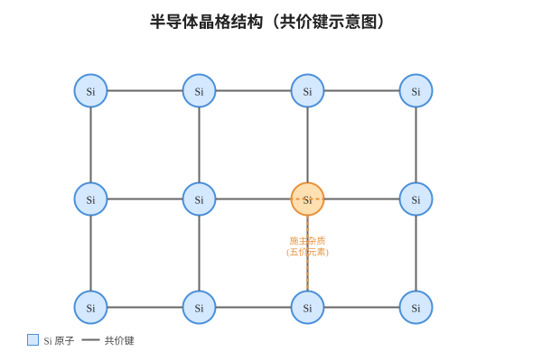
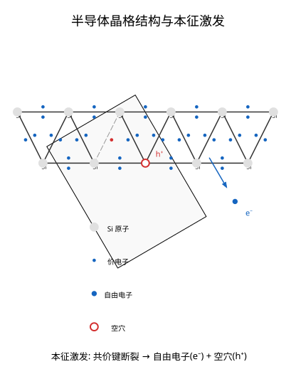
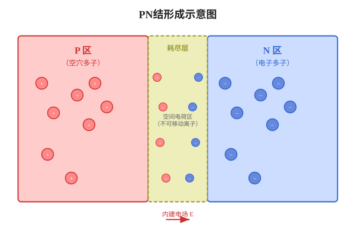
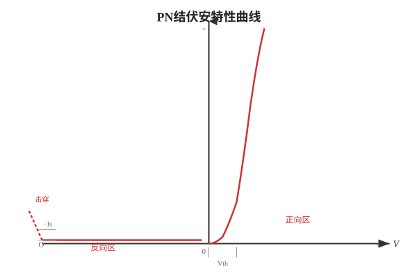

# 4.1 半导体物理基础

## 1. 本征半导体与杂质半导体

### 本征半导体

本征半导体（Intrinsic Semiconductor）是指纯净的、不含任何杂质的半导体晶体。常用的半导体材料是硅（Si）和锗（Ge），它们均为四价元素，原子最外层有4个价电子。在半导体晶体中，原子通过共价键（Covalent Bond）相互结合，形成规则的晶格结构。

在绝对零度（0K）下，所有价电子都被束缚在共价键中，半导体不导电。当温度升高或受到光照时，部分价电子获得足够能量，挣脱共价键的束缚成为**自由电子**，同时在原位置留下一个**空穴**（Hole），这一过程称为**本征激发**。

自由电子和空穴均参与导电，统称为**载流子**（Carrier）。本征激发产生的电子和空穴数量相等。

本征载流子浓度 $n_i$ 由下式决定：

$$
n_i = \sqrt{N_c N_v} \cdot e^{-\frac{E_g}{2kT}}
$$

其中：
- $N_c$、$N_v$ 分别为导带和价带有效状态密度
- $E_g$ 为禁带宽度（Si 约 1.12eV，Ge 约 0.67eV）
- $k$ 为玻尔兹曼常数（$8.617 \times 10^{-5} \text{eV/K}$）
- $T$ 为绝对温度

### 杂质半导体

在本征半导体中掺入微量杂质元素，可显著改变其导电性能，称为**掺杂**（Doping）。

**N型半导体**：掺入五价元素（如磷 P、砷 As、锑 Sb）。五价杂质原子取代晶格中的硅原子，其五个价电子中四个与相邻硅原子形成共价键，多余的一个电子成为自由电子。这类杂质称为**施主杂质**（Donor）。N型半导体中，电子是**多数载流子**（多子），空穴是**少数载流子**（少子）。

**P型半导体**：掺入三价元素（如硼 B、铝 Al、镓 Ga）。三价杂质原子与硅原子形成共价键时缺少一个电子，产生一个空穴。这类杂质称为**受主杂质**（Acceptor）。P型半导体中，空穴是多数载流子，电子是少数载流子。

多子浓度近似等于杂质浓度，少子浓度由本征激发决定：

$$
n_n \approx N_D, \quad p_n = \frac{n_i^2}{N_D} \quad (\text{N型})
$$
$$
p_p \approx N_A, \quad n_p = \frac{n_i^2}{N_A} \quad (\text{P型})
$$

其中 $N_D$ 为施主浓度，$N_A$ 为受主浓度。

## 2. PN结的形成与单向导电性

### PN结的形成

将P型半导体和N型半导体制作在同一块晶体上，在两者的交界面处形成PN结。

由于P区空穴浓度高、N区电子浓度高，载流子从高浓度区间低浓度区扩散：
- P区的空穴向N区扩散，在P区留下负离子
- N区的电子向P区扩散，在N区留下正离子

这些不能移动的离子在交界面形成一个**空间电荷区**（Space Charge Region），也称为**耗尽层**（Depletion Layer）。空间电荷区产生的内建电场方向从N区指向P区，阻碍载流子的进一步扩散。当扩散运动与漂移运动达到动态平衡时，空间电荷区的宽度稳定。

内建电势差 $V_{bi}$ 为：

$$
V_{bi} = \frac{kT}{q} \ln\left(\frac{N_A N_D}{n_i^2}\right)
$$

### 单向导电性

**正向偏置**：P区接电源正极，N区接电源负极。外加电场削弱内建电场，耗尽层变窄，扩散电流增大，PN结呈现低电阻，处于导通状态。

**反向偏置**：P区接电源负极，N区接电源正极。外加电场增强内建电场，耗尽层变宽，扩散电流几乎为零，仅有微小的反向饱和电流，PN结呈现高电阻，处于截止状态。

## 3. PN结的伏安特性

PN结的伏安特性（I-V特性）描述了流过PN结的电流与外加电压之间的关系：

$$
I = I_S \left( e^{\frac{qV}{nkT}} - 1 \right)
$$

其中：
- $I$ 为流过PN结的电流
- $I_S$ 为反向饱和电流
- $q$ 为电子电荷（$1.602 \times 10^{-19} \text{C}$）
- $V$ 为外加电压
- $n$ 为理想因子（通常 $n \approx 1 \sim 2$）
- $k$ 为玻尔兹曼常数
- $T$ 为绝对温度

正向电压时（$V > 0$），$I \approx I_S e^{qV/nkT}$，电流随电压指数增长。反向电压时（$V < 0$），$I \approx -I_S$，电流极小且几乎不变。

## 4. PN结的击穿

当反向电压增大到一定值时，反向电流急剧增大，称为**击穿**（Breakdown）。

### 齐纳击穿（Zener Breakdown）

发生在高掺杂浓度、低击穿电压（通常 $< 5\text{V}$）的PN结中。当反向电压增大时，耗尽层中的电场很强，直接拉断共价键产生大量电子-空穴对，导致电流剧增。齐纳击穿具有可逆性，只要限制电流，PN结不会损坏。

### 雪崩击穿（Avalanche Breakdown）

发生在低掺杂浓度、高击穿电压（通常 $> 7\text{V}$）的PN结中。载流子在强电场中获得足够能量，与晶格原子碰撞产生新的电子-空穴对，新产生的载流子再碰撞产生更多载流子，形成雪崩倍增效应。

击穿电压 $V_{BR}$ 与掺杂浓度的关系：

$$
V_{BR} \propto \frac{1}{N}
$$

其中 $N$ 为轻掺杂侧的杂质浓度。

## 5. PN结的电容效应

### 势垒电容 $C_T$

势垒电容（Barrier Capacitance）来源于耗尽层中空间电荷随电压的变化。反向偏置时，耗尽层宽度随电压变化，类似于平行板电容器：

$$
C_T = \frac{\varepsilon A}{W} = C_{T0} \left(1 - \frac{V}{V_{bi}}\right)^{-m}
$$

其中：
- $\varepsilon$ 为半导体介电常数
- $A$ 为结面积
- $W$ 为耗尽层宽度
- $m$ 为梯度因子（突变结 $m=1/2$，缓变结 $m=1/3$）

### 扩散电容 $C_D$

扩散电容（Diffusion Capacitance）来源于正向偏置时少子存储效应。正向偏置下，大量非平衡载流子存储在扩散区内，其数量随电压变化形成电容效应：

$$
C_D = \frac{q}{kT} \cdot I \cdot \tau
$$

其中 $\tau$ 为少子寿命。

势垒电容在反向偏置时起主导作用，扩散电容在正向偏置时起主导作用。PN结的电容效应限制了二极管在高频下的工作性能。