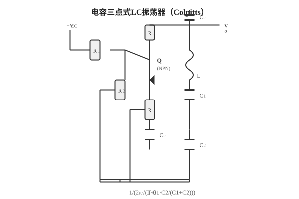
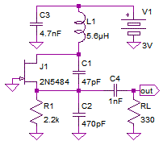
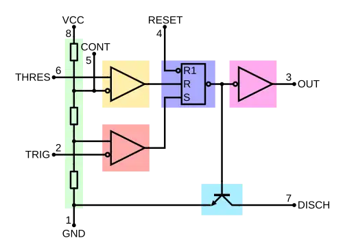
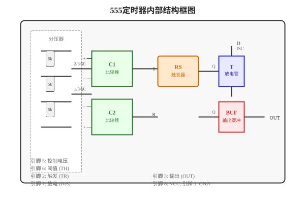
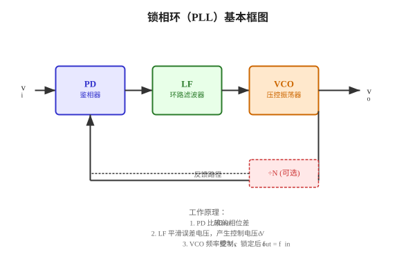

# 4.11 波形发生电路

## 1. 正弦波振荡器

### 振荡条件

正弦波振荡器无需外部输入信号，通过正反馈将直流电源能量转换为特定频率的交流输出。

**起振条件**：

$$
|AF| > 1 \quad \text{(起振时)}
$$
$$
\phi_{AF} = 2n\pi \quad (n = 0, 1, 2, \cdots)
$$

**平衡条件**：

$$
|AF| = 1
$$
$$
\phi_{AF} = 2n\pi
$$

### 组成

正弦波振荡器由以下四部分组成：
1. **放大电路**：提供增益
2. **选频网络**：确定振荡频率
3. **正反馈网络**：将输出信号反馈到输入端
4. **稳幅电路**：稳定输出幅度

## 2. RC振荡器（文氏桥振荡器）

文氏桥振荡器（Wien Bridge Oscillator）利用RC串并联网络作为选频网络。

### 选频网络

RC串并联网络的频率特性：

$$
F = \frac{1}{3 + j\left(\omega RC - \frac{1}{\omega RC}\right)}
$$

### 振荡频率

当 $\omega RC = 1$ 时，反馈系数最大且相移为零：

$$
f_0 = \frac{1}{2\pi RC}
$$

此时 $F = 1/3$，要求放大电路增益 $A \geq 3$。

### 稳幅措施

利用负温度系数热敏电阻或JFET构成自动稳幅电路，使振荡器稳定工作。

## 3. LC振荡器

LC振荡器适用于高频应用（几百kHz到几百MHz），利用LC并联谐振回路作为选频网络。

### LC并联谐振

谐振频率：

$$
f_0 = \frac{1}{2\pi \sqrt{LC}}
$$

谐振阻抗：

$$
Z_0 = \frac{L}{RC} = Q \cdot \omega_0 L
$$

其中 $Q$ 为品质因数。

### 电感三点式（Hartley振荡器）

反馈信号取自电感分压，振荡频率：

$$
f_0 = \frac{1}{2\pi \sqrt{(L_1 + L_2 + 2M)C}}
$$

### 电容三点式（Colpitts振荡器）

反馈信号取自电容分压，振荡频率：

$$
f_0 = \frac{1}{2\pi \sqrt{L \cdot \frac{C_1 C_2}{C_1 + C_2}}}
$$

### 克拉泼振荡器（Clapp）

在Colpitts基础上串联一个电容，提高频率稳定性：

$$
f_0 = \frac{1}{2\pi \sqrt{LC_3}}
$$

其中 $C_3 \ll C_1, C_2$。

## 4. 石英晶体振荡器

石英晶体具有压电效应，等效为一个高Q值的LC谐振回路，频率稳定性极高（可达 $10^{-6} \sim 10^{-10}$）。

### 等效电路

石英晶体在串联谐振频率 $f_s$ 和并联谐振频率 $f_p$ 之间表现为感性：

$$
f_s = \frac{1}{2\pi \sqrt{L_q C_q}}
$$
$$
f_p = \frac{1}{2\pi \sqrt{L_q \frac{C_q C_0}{C_q + C_0}}} = f_s \sqrt{1 + \frac{C_q}{C_0}}
$$

### 应用

- 串联型晶体振荡器：晶体工作在 $f_s$ 附近，呈低阻抗
- 并联型晶体振荡器：晶体工作在 $f_s$ 和 $f_p$ 之间，呈感性

## 5. 非正弦波振荡器

### 方波振荡器

由运放或比较器构成的弛张振荡器，通过电容的充放电产生方波输出。

周期：

$$
T = 2RC \ln\left(1 + \frac{2R_1}{R_2}\right)
$$

### 三角波发生器

由积分器和滞回比较器组成的闭环系统，产生三角波输出。

### 锯齿波发生器

通过改变积分器的充放电时间常数，使上升和下降时间不同，产生锯齿波。

## 6. 555定时器及其应用

555定时器是一种多用途的集成定时器，内部包含两个比较器、一个RS触发器和放电晶体管。

### 单稳态触发器

输出一个宽度固定的脉冲：

$$
T_W = 1.1 RC
$$

### 多谐振荡器（无稳态）

输出方波信号：

$$
f = \frac{1.44}{(R_1 + 2R_2)C}
$$

占空比：

$$
D = \frac{R_1 + R_2}{R_1 + 2R_2}
$$

### 施密特触发器

将555定时器的阈值端和触发端连接在一起，构成施密特触发器。

## 7. 函数发生器原理

函数发生器（Function Generator）是一种能够产生多种波形（正弦波、方波、三角波、锯齿波等）的信号源。它将多种波形产生电路集成于一体，通过波形选择电路切换输出不同信号。

### 基本组成

函数发生器通常由以下模块构成：

1. **恒流源充放电电路**：产生三角波/锯齿波
2. **比较器（施密特触发器）**：将三角波转换为方波
3. **波形整形电路**：将三角波整形为正弦波
4. **波形选择开关**：选择输出波形类型
5. **输出放大器**：调节幅度和直流偏置

### 工作原理

以常见的三角波/方波发生器为例：

1. 恒流源对电容进行线性充放电，产生三角波
2. 施密特比较器将三角波转换为方波
3. 三角波通过二极管整形网络（非线性网络）可近似为正弦波

### 频率调节

$$
f = \frac{I_C}{2 C \cdot \Delta V}
$$

其中 $I_C$ 为充放电电流，$C$ 为定时电容，$\Delta V$ 为施密特触发器的滞回电压。通过切换电容范围和调节充放电电流，可实现宽频率范围的输出。

## 8. 锁相环（PLL）基本原理

锁相环（Phase-Locked Loop）由三个基本部分组成：
1. **鉴相器（PD）**：比较输入信号和VCO输出信号的相位差，产生误差电压
2. **环路滤波器（LF）**：低通滤波，平滑误差电压
3. **压控振荡器（VCO）**：根据控制电压调整输出频率

### 锁定条件

当环路锁定时，VCO输出频率等于输入信号频率，相位差恒定：

$$
f_{out} = f_{in}
$$
$$
\phi_e = \text{常数}
$$

### 基本关系

VCO输出频率与控制电压的关系：

$$
f_{out} = f_0 + K_{VCO} \cdot v_c
$$

其中 $K_{VCO}$ 为VCO增益系数。

### 应用

- 频率合成
- 时钟恢复
- FM解调
- 频率调制与解调

## 9. 多谐振荡器（Multivibrator）

多谐振荡器是一种不需要外部触发信号就能产生周期性方波/矩形波的电路，又称弛张振荡器。

**三种类型**：
1. **非稳态（Astable）**：两种状态都不稳定，持续自激振荡，输出方波
2. **单稳态（Monostable）**：一种状态稳定，外部触发后进入非稳态，持续固定时间后返回，用作定时器（One Shot）
3. **双稳态（Bistable）**：两种状态都稳定，需要特定触发信号切换，即触发器/锁存器

**BJT非稳态多谐振荡器**：
- 两个交叉耦合的晶体管，RC网络决定状态持续时间
- 状态一：Q1导通，C1通过R2充电，Q2截止
- 状态二：Q2导通，C2通过R3充电，Q1截止
- 振荡周期：$T = 0.69(R_1C_1 + R_2C_2)$
- 占空比：通过选择不同的R、C值可自由配置

**555定时器**：
555定时器是集成化的多谐振荡器，可配置为三种工作模式：
- 非稳态模式（Astable）：输出连续方波，$f = 1.44/(R_1+2R_2)C$
- 单稳态模式（Monostable）：可编程脉冲宽度 $t = 1.1RC$
- 双稳态模式（Bistable）：RS触发器功能