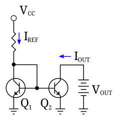
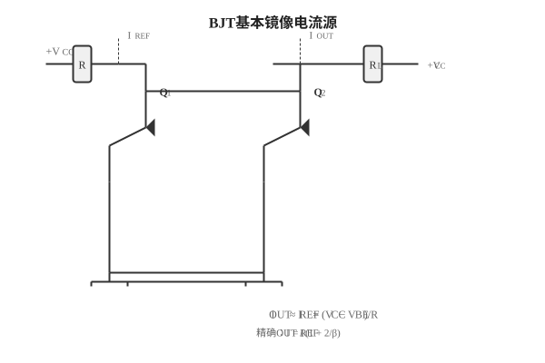
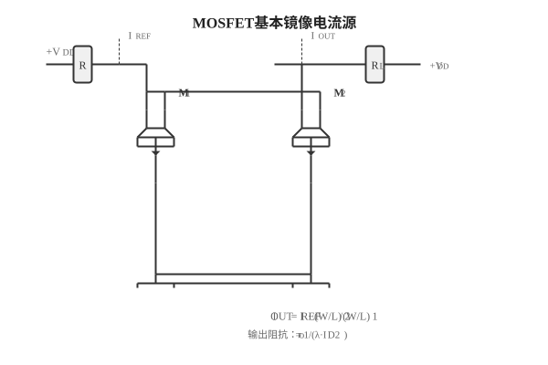
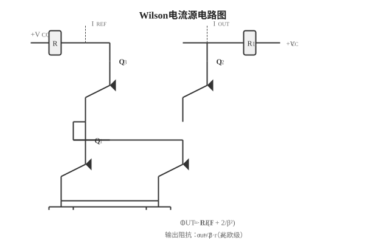

# 4.14 电流源电路

## 1. 电流源的基本概念

### 1.1 理想电流源与恒流源

理想电流源输出恒定的电流，不随负载变化而变化，其输出阻抗为无穷大。实际电路中，电流源通常由晶体管等有源器件构成，具有有限但较大的输出阻抗。

### 1.2 电流源在模拟集成电路中的重要性

在模拟集成电路中，电流源（Current Source）承担着核心的偏置功能：

- 为差分放大器提供稳定的尾电流偏置
- 作为有源负载，提高放大器的电压增益
- 在运放中提供各级静态工作电流
- 在振荡器和比较器中提供基准电流

## 2. 基本镜像电流源

### 2.1 BJT 基本镜像电流源

BJT 镜像电流源由两个匹配的晶体管 $Q_1$ 和 $Q_2$ 组成。$Q_1$ 的基极和集电极短接形成二极管连接，$Q_2$ 的基极-发射极电压与 $Q_1$ 相同。

**镜像关系**：

若 $Q_1$ 和 $Q_2$ 完全匹配（$I_{S1} = I_{S2}$，$\beta_1 = \beta_2$），则：

$$
I_{C2} \approx I_{REF}
$$

考虑基极电流的影响，精确关系为：

$$
I_{C2} = \frac{I_{REF}}{1 + \frac{2}{\beta}}
$$

其中 $I_{REF} = (V_{CC} - V_{BE})/R$。

当 $\beta \gg 1$ 时，$I_{C2} \approx I_{REF}$。

**输出阻抗**：

$$
r_o = \frac{V_A}{I_{C2}}
$$

其中 $V_A$ 为 Early 电压。基本镜像电流源的输出阻抗受 Early 效应限制，约为数十千欧到数百千欧。

### 2.2 MOSFET 基本镜像电流源

MOSFET 镜像电流源由两个匹配的 MOSFET $M_1$ 和 $M_2$ 组成。$M_1$ 的栅极和漏极短接，强制其工作在饱和区。

**镜像关系**：

若 $M_1$ 和 $M_2$ 完全匹配（$K_{n1} = K_{n2}$，$V_{TH1} = V_{TH2}$），则：

$$
I_{D2} = I_{REF} \cdot \left(\frac{W/L)_2}{(W/L)_1}\right)
$$

MOSFET 镜像电流源没有栅极电流损耗（直流输入阻抗无穷大），因此镜像精度优于 BJT 基本镜像电流源。

**输出阻抗**：

$$
r_o = \frac{1}{\lambda I_{D2}} = \frac{V_A}{I_{D2}}
$$

其中 $\lambda$ 为沟道长度调制系数。

## 3. 比例电流源

### 3.1 BJT 比例电流源

通过在 $Q_1$ 和 $Q_2$ 的发射极分别串联电阻 $R_{E1}$ 和 $R_{E2}$，可以改变镜像比例：

$$
I_{C2} \approx I_{REF} \cdot \frac{R_{E1}}{R_{E2}}
$$

更精确的公式（考虑 $V_{BE}$ 差异）：

$$
I_{C2} R_{E2} + V_T \ln\frac{I_{C2}}{I_{S2}} = I_{REF} R_{E1} + V_T \ln\frac{I_{REF}}{I_{S1}}
$$

其中 $V_T = kT/q \approx 26\text{ mV}$（室温）。

### 3.2 MOSFET 比例电流源

通过改变 MOSFET 的宽长比 $(W/L)$ 来实现比例镜像：

$$
I_{D2} = I_{REF} \cdot \frac{(W/L)_2}{(W/L)_1}
$$

这种方法在集成电路设计中非常方便，只需修改版图中 MOSFET 的几何尺寸。

## 4. 微电流源（Widlar 电流源）

### 4.1 工作原理

Widlar 电流源在 $Q_2$ 的发射极串联电阻 $R_E$，利用 $R_E$ 上的压降减小 $V_{BE2}$，从而产生远小于参考电流的输出电流。

### 4.2 设计公式

$$
I_{C2} = \frac{V_T}{R_E} \ln\left(\frac{I_{REF}}{I_{C2}}\right)
$$

这是一个超越方程，需迭代求解。给定 $I_{REF}$ 和所需的 $I_{C2}$，可求得 $R_E$：

$$
R_E = \frac{V_T}{I_{C2}} \ln\left(\frac{I_{REF}}{I_{C2}}\right)
$$

### 4.3 特点

- 用小电阻即可产生微安级甚至纳安级电流，节省芯片面积
- 输出阻抗比基本镜像电流源高
- 温度稳定性较好

## 5. Wilson 电流源

### 5.1 电路结构

Wilson 电流源由三个 BJT（$Q_1$、$Q_2$、$Q_3$）组成，其中 $Q_3$ 串联在 $Q_2$ 的集电极支路中，构成负反馈环路。

### 5.2 工作原理

$Q_3$ 的发射极电流 $I_{E3}$ 约等于 $Q_2$ 的集电极电流 $I_{C2}$。$Q_1$ 和 $Q_2$ 的 $V_{BE}$ 相等，因此 $I_{C1} \approx I_{C2}$。电流反馈使得 $I_{C3}$ 非常接近 $I_{REF}$。

### 5.3 镜像关系

$$
I_{OUT} = I_{REF} \cdot \frac{1}{1 + \frac{2}{\beta^2}}
$$

误差项为 $2/\beta^2$ 量级，远优于基本镜像电流源的 $2/\beta$。

### 5.4 输出阻抗

Wilson 电流源的输出阻抗非常高：

$$
r_{out} \approx \frac{\beta \cdot r_o}{2}
$$

其中 $r_o$ 为 $Q_2$ 的输出电阻。输出阻抗可达兆欧级别，因此 Wilson 电流源非常接近理想电流源。

### 5.5 MOSFET Wilson 电流源

用 MOSFET 实现 Wilson 电流源可获得类似的高输出阻抗特性：

$$
r_{out} \approx g_{m3} r_{o3} r_{o2}
$$

## 6. 共源共栅电流源（Cascode Current Source）

### 6.1 电路结构

共源共栅电流源在基本镜像电流源的输出端串联一个共栅（共基）晶体管，利用 Cascode 结构的高输出阻抗特性。

### 6.2 输出阻抗

MOSFET Cascode 电流源的输出阻抗：

$$
r_{out} \approx g_{m2} r_{o2} r_{o1}
$$

BJT Cascode 电流源的输出阻抗：

$$
r_{out} \approx \beta_2 \cdot r_{o2}
$$

### 6.3 特点

- 输出阻抗极高，接近理想电流源
- 电流镜像精度高
- 需要较大的电压裕量（Voltage Headroom），因为 Cascode 晶体管需要额外的饱和电压

## 7. 电流源在差分放大器与运放中的偏置应用

### 7.1 差分放大器的尾电流偏置

差分放大器（差分对）的共模抑制比（CMRR）依赖于尾电流源的高输出阻抗。理想情况下，尾电流源输出阻抗无穷大，共模增益为零。

$$
\text{CMRR} = \frac{A_{dm}}{A_{cm}} \propto g_m \cdot r_{tail}
$$

其中 $r_{tail}$ 为尾电流源的输出阻抗。

### 7.2 有源负载

在运放中用电流源作为有源负载（Active Load），可将差分输入级的双端输出转换为单端输出，同时提供高增益：

$$
A_v = g_m (r_{o1} \parallel r_{o2})
$$

其中 $r_{o1}$ 和 $r_{o2}$ 分别为放大管和有源负载的输出阻抗。

### 7.3 输出级偏置

在运放的 AB 类输出级中，电流源用于提供静态偏置电流，消除交越失真。

## 8. 电流源的输出阻抗分析

### 8.1 输出阻抗的定义

电流源的输出阻抗定义为：

$$
R_{out} = \frac{\Delta V_{out}}{\Delta I_{out}}
$$

理想电流源的 $R_{out} = \infty$，实际电流源受限于器件的 Early 效应（沟道长度调制效应）。

### 8.2 各类型电流源输出阻抗对比

| 电流源类型 | 输出阻抗（BJT） | 输出阻抗（MOSFET） |
|-----------|----------------|-------------------|
| 基本镜像电流源 | $r_o$ | $r_o$ |
| 发射极电阻比例电流源 | $r_o(1 + g_m R_E)$ | $r_o(1 + g_m R_S)$ |
| Widlar 电流源 | $r_o(1 + g_m R_E)$ | — |
| Wilson 电流源 | $\beta r_o / 2$ | $g_m r_o^2$ |
| Cascode 电流源 | $\beta r_o$ | $g_m r_o^2$ |

### 8.3 提高输出阻抗的方法

- 使用 Cascode 结构或 Wilson 结构
- 增加沟道长度（MOSFET）以减少 $\lambda$
- 使用负反馈技术
- 采用有源 Cascode（增益增强型 Cascode）

---

**分立到集成的视角转换**：本章用分立晶体管搭出的电流镜、Widlar/Wilson/Cascode 电流源，正是模拟 IC 设计里电流镜与偏置网络的原型——镜像精度、输出阻抗、电压裕量等考量在芯片上同样成立，只是换成通过宽长比而非独立器件来实现。这些结构在集成层面会作为运放的尾电流源、有源负载与各级偏置电路的构建模块，详见第 10 章模拟 IC 设计，尤其是 [10.1 运算放大器设计](../模拟IC设计/10.1-运算放大器设计.md)（其中折叠/套筒 Cascode 与偏置实现均建立在本章的电流源之上）。