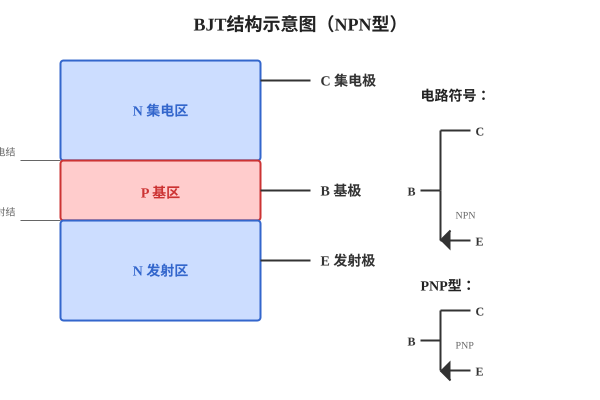
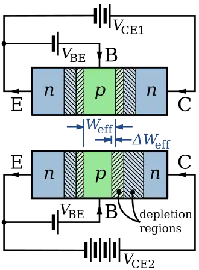
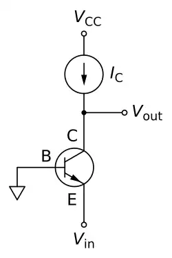
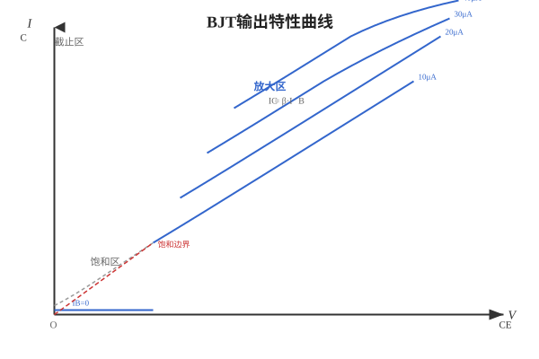
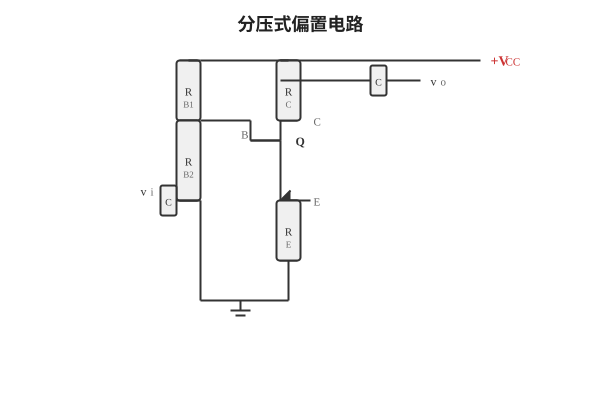
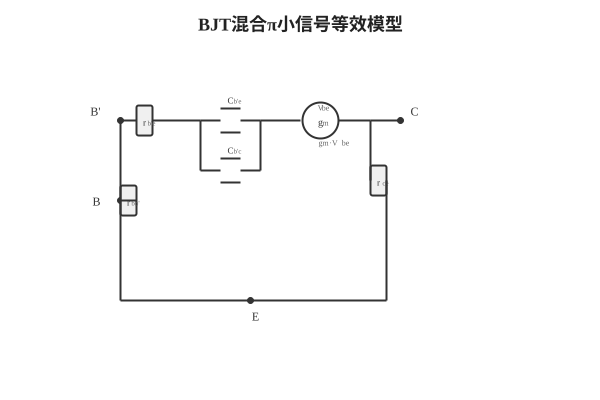
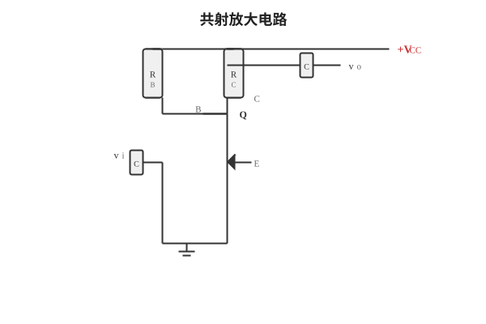

# 4.3 双极型晶体管

## 1. BJT的结构与工作原理

双极型晶体管（Bipolar Junction Transistor, BJT）是一种由两个PN结构成的三层半导体器件，包含三个区：发射区、基区和集电区，相应地引出三个电极：发射极（E）、基极（B）和集电极（C）。

BJT分为NPN型和PNP型两种结构。

### 工作原理（以NPN型为例）

BJT的工作条件：发射结正向偏置，集电结反向偏置。

- 发射区向基区注入电子（多数载流子）
- 电子在基区中扩散，部分与空穴复合，大部分到达集电结
- 集电结收集电子形成集电极电流

电流关系：

$$
I_E = I_B + I_C
$$

$$
I_C = \beta I_B + I_{CBO} \approx \beta I_B
$$

$$
I_C = \alpha I_E
$$

其中 $\beta$ 为共射电流放大系数，$\alpha$ 为共基电流放大系数，两者关系：

$$
\beta = \frac{\alpha}{1 - \alpha}, \quad \alpha = \frac{\beta}{1 + \beta}
$$

### 4. 艾伯斯-莫尔模型（Ebers-Moll Model）

Ebers-Moll模型是描述BJT大信号特性的基本数学模型：

**简化模型（正向工作区）**：
$$
I_E = I_{ES}(e^{V_{BE}/V_T} - 1), \quad I_C = \alpha_F I_E
$$

其中 $V_T = kT/q \approx 26$ mV（室温），$I_{ES}$ 为发射结反向饱和电流。

**严格模型**：
$$
i_C = I_S(e^{V_{BE}/V_T} - e^{V_{BC}/V_T}) - \frac{I_S}{\beta_R}(e^{V_{BC}/V_T} - 1)
$$
$$
i_E = I_S(e^{V_{BE}/V_T} - e^{V_{BC}/V_T}) + \frac{I_S}{\beta_F}(e^{V_{BE}/V_T} - 1)
$$

其中 $\beta_F$ 为正向共射电流放大系数，$\beta_R$ 为反向共射电流放大系数（通常 $\beta_R \ll \beta_F$）。

**厄利效应（Early Effect）**：
实际BJT的集电极电流 $I_C$ 在放大区会随 $V_{CE}$ 增大而略有增大，这一现象称为厄利效应（Early Effect）：

$$
I_C = I_S \exp\left(\frac{V_{BE}}{V_T}\right) \left(1 + \frac{V_{CE}}{V_A}\right)
$$

其中 $V_A$ 为**厄利电压**（Early Voltage），NPN管的典型值为 50-150V，PNP管的典型值为 30-80V。厄利电压越大，晶体管的输出阻抗越高，恒流特性越好。

厄利效应导致输出特性曲线在放大区呈微小的上翘，各条曲线延长线交于横轴上 $-V_A$ 处。

**古梅尔-潘模型（Gummel-Poon Model）简介**：
Gummel-Poon模型是比Ebers-Moll更精确的电荷控制模型，包含18个参数，考虑了基区宽度调制、大注入效应、寄生电阻等二阶效应，广泛用于SPICE等电路仿真软件。

**异质结双极性晶体管（HBT）**：
HBT（Heterojunction Bipolar Transistor）采用不同带隙的半导体材料制作发射区和基区（如GaAs/AlGaAs、Si/SiGe），可在极高频率下工作（可达几百GHz），广泛应用于射频和微波电路。

## 2. 三种组态

BJT放大电路根据输入输出端公共端的不同，有三种基本组态：

- **共射（Common Emitter）**：发射极公共，输入基极，输出集电极
- **共集（Common Collector）**：集电极公共，输入基极，输出发射极（射极跟随器）
- **共基（Common Base）**：基极公共，输入发射极，输出集电极

## 3. 伏安特性曲线

### 输入特性

描述 $V_{CE}$ 固定时，$I_B$ 与 $V_{BE}$ 的关系，类似于PN结的正向特性。

### 输出特性

描述 $I_B$ 固定时，$I_C$ 与 $V_{CE}$ 的关系，分为三个区域：

- **截止区**：$I_B = 0$，$I_C \approx 0$，发射结和集电结均反偏
- **放大区**：$I_C = \beta I_B$，发射结正偏、集电结反偏
- **饱和区**：$V_{CE} < V_{CE(sat)}$，发射结和集电结均正偏，$I_C$ 不再随 $I_B$ 线性增长

## 4. 静态工作点与偏置电路

### 静态工作点（Q点）

静态工作点指无输入信号时晶体管各极的直流电压和电流值。Q点设置是否合理直接影响放大电路的性能。

### 固定偏置电路

$$
I_B = \frac{V_{CC} - V_{BE}}{R_B}
$$
$$
I_C = \beta I_B
$$
$$
V_{CE} = V_{CC} - I_C R_C
$$

### 分压式偏置电路（稳定工作点）

利用电阻分压提供稳定的基极电压，通过发射极电阻引入负反馈稳定Q点：

$$
V_B \approx \frac{R_{B2}}{R_{B1} + R_{B2}} \cdot V_{CC}
$$
$$
I_E = \frac{V_B - V_{BE}}{R_E}
$$
$$
V_{CE} = V_{CC} - I_C R_C - I_E R_E
$$

### 集电极反馈偏置（电压反馈偏置）

集电极反馈偏置将基极电阻 $R_B$ 接至集电极而非电源 $V_{CC}$，利用集电极电压的变化产生负反馈，稳定工作点。

基极电流：

$$
I_B = \frac{V_{CE} - V_{BE}}{R_B}
$$

集电极电流：

$$
I_C = \beta I_B
$$

集电极-发射极电压：

$$
V_{CE} = V_{CC} - (I_C + I_B) R_C \approx V_{CC} - I_C R_C
$$

**稳定原理**：当温度升高导致 $I_C$ 增加时，$V_{CE}$ 下降，$I_B$ 随之减小，抑制 $I_C$ 的增加。这种负反馈机制使电路比固定偏置更稳定，但稳定效果不如分压式偏置电路。

## 5. 温度影响

温度对BJT参数的影响：
- $V_{BE}$ 温度系数约为 $-2 \text{mV/°C}$
- $\beta$ 随温度升高而增大，温度系数约为 $+0.5\%/°C$
- $I_{CBO}$ 随温度升高指数增长

分压式偏置电路通过发射极电阻 $R_E$ 的负反馈作用，有效抑制温度变化对Q点的影响。

## 6. 小信号等效模型

### h参数模型

BJT在小信号条件下可用h参数等效：

$$
\begin{cases}
v_{be} = h_{ie} i_b + h_{re} v_{ce} \\
i_c = h_{fe} i_b + h_{oe} v_{ce}
\end{cases}
$$

其中 $h_{ie}$ 为输入电阻，$h_{fe} = \beta$ 为电流放大系数，$h_{re}$ 为电压反馈系数，$h_{oe}$ 为输出导纳。

### 混合π模型

混合π模型在高频分析中更精确：

$$
r_{b'e} = \frac{\beta}{g_m} = \frac{\beta V_T}{I_C}
$$
$$
g_m = \frac{I_C}{V_T}
$$
$$
r_{ce} = \frac{V_A}{I_C}
$$

其中 $V_T = kT/q \approx 26 \text{mV}$（室温），$V_A$ 为厄尔利电压。

## 7. 共射/共集/共基放大电路分析

### 共射放大电路

电压增益：

$$
A_v = \frac{v_o}{v_i} = -\frac{\beta R_L'}{r_{be}}
$$

其中 $R_L' = R_C \parallel R_L$，$r_{be} = r_{bb'} + (1+\beta) \frac{V_T}{I_E}$。

输入电阻：

$$
R_i = R_B \parallel r_{be}
$$

输出电阻：

$$
R_o \approx R_C
$$

### 共集放大电路（射极跟随器）

电压增益（约等于1）：

$$
A_v = \frac{(1+\beta)R_E'}{r_{be} + (1+\beta)R_E'} \approx 1
$$

输入电阻高，输出电阻低，常用于阻抗变换。

### 共基放大电路

电压增益：

$$
A_v = \frac{\beta R_L'}{r_{be}}
$$

输入电阻低，输出电阻高，高频特性好。

## 8. 三种组态性能比较

| 性能参数 | 共射 | 共集 | 共基 |
|---------|------|------|------|
| 电压增益 | 高（几十~几百） | 约1 | 高（几十~几百） |
| 电流增益 | 高（$\beta$） | 高（$1+\beta$） | 约1 |
| 输入电阻 | 中（kΩ级） | 高（几十kΩ~MΩ） | 低（几Ω~几十Ω） |
| 输出电阻 | 中（kΩ级） | 低（几Ω~几十Ω） | 高（几十kΩ~MΩ） |
| 高频特性 | 差 | 较好 | 好 |
| 用途 | 电压放大 | 阻抗变换 | 高频放大 |

## 9. 达林顿管与复合管

达林顿管（Darlington Pair）由两个BJT复合连接，总电流放大系数为两管乘积：

$$
\beta_D = \beta_1 \cdot \beta_2
$$

达林顿管具有极高的电流放大系数（可达几千到几万）和很高的输入电阻，但饱和压降较大，高频性能较差。复合管还可以由NPN和PNP管组合，构成互补复合管。