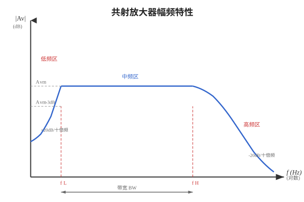
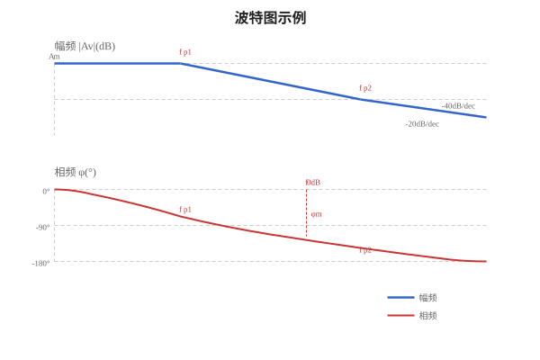

# 4.6 频率响应

## 1. 频率响应的基本概念

放大电路的频率响应（Frequency Response）描述电路对不同频率输入信号的增益和相位变化特性。

- **幅频特性**：电压增益的幅值与频率的关系
- **相频特性**：输出电压与输入电压的相位差与频率的关系

幅频特性曲线通常分为三个区域：
- **低频区**：增益下降，主要由耦合电容和旁路电容引起
- **中频区**：增益基本恒定，电路正常工作区域
- **高频区**：增益下降，主要由晶体管结电容和分布电容引起

## 2. 低频响应

在低频区，耦合电容 $C_C$ 和旁路电容 $C_E$ 的容抗增大，不能视为短路，导致增益下降。

共射放大电路的低频增益：

$$
A_{vL} = \frac{A_{vm}}{1 - j \frac{f_L}{f}}
$$

下限频率 $f_L$ 由各电容决定的时间常数确定：

$$
f_L = \frac{1}{2\pi \tau}
$$

其中 $\tau$ 为等效时间常数。多个电容共同作用时，总的下限频率近似为：

$$
f_L \approx \sqrt{f_{L1}^2 + f_{L2}^2 + \cdots}
$$

## 3. 晶体管的频率参数

放大电路的频率响应首先受到晶体管自身高频特性的限制。4.3 节“主要参数”中已介绍了晶体管的 $f_\beta$ 与 $f_T$，本节从高频（混合π）小信号模型的角度进一步讨论二者的定义、关系与物理意义。

### 共射截止频率 $f_\beta$

考虑结电容 $C_{b'e}$、$C_{b'c}$ 后，晶体管的共射电流放大系数随频率升高而下降，其频率特性可写成：

$$
\dot{\beta}(j f) = \frac{\beta_0}{1 + j\dfrac{f}{f_\beta}}
$$

其中 $\beta_0$ 为低频共射电流放大系数。**共射截止频率 $f_\beta$** 是 $|\dot{\beta}|$ 下降到低频值的 $1/\sqrt{2}$（即下降 3dB）时所对应的频率，由输入回路时间常数决定：

$$
f_\beta = \frac{1}{2\pi r_{b'e}(C_{b'e} + C_{b'c})}
$$

### 特征频率 $f_T$

**特征频率 $f_T$** 是电流放大系数的幅值下降为 1（即 $|\dot{\beta}| = 1$）时所对应的频率，也是晶体管能对电流进行放大（电流增益大于 1）的最高工作频率。

由 $\dot{\beta} = \dfrac{\beta_0}{1 + j f/f_\beta}$，令 $|\dot{\beta}| = 1$ 可得 $f_T \approx \beta_0 f_\beta$，即：

$$
f_T \approx \beta_0 f_\beta
$$

用高频小信号模型的参数还可表示为：

$$
f_T \approx \frac{g_m}{2\pi(C_{b'e} + C_{b'c})}
$$

### 与 4.3 的衔接

4.3 节从器件层面给出了 $f_\beta$、$f_T$ 的定义及其关系 $f_T \approx \beta_0 f_\beta$；本节则从混合π高频模型出发，给出 $f_\beta$ 与结电容的关系、$f_T$ 的物理意义以及电流增益的高频表达式，二者相互印证。$f_T$ 越高，器件的高频放大能力越强，据此设计的放大电路的上限频率 $f_H$ 也越高。

## 4. 高频响应

在高频区，晶体管的结电容（$C_{b'e}$、$C_{b'c}$）和电路分布电容产生低通效应，导致增益下降。

共射放大电路的高频增益：

$$
A_{vH} = \frac{A_{vm}}{1 + j \frac{f}{f_H}}
$$

上限频率 $f_H$ 由密勒效应对 $C_{b'c}$ 的等效电容和输入回路时间常数决定。

**密勒效应**：集电结电容 $C_{b'c}$ 等效到输入端：

$$
C_M = C_{b'c} (1 - A_v)
$$

输入回路总电容：

$$
C_{in} = C_{b'e} + C_M = C_{b'e} + C_{b'c} (1 + g_m R_L')
$$

上限频率：

$$
f_H = \frac{1}{2\pi R_s' C_{in}}
$$

其中 $R_s'$ 为信号源等效内阻。

## 5. 波特图（Bode Plot）

波特图是用对数坐标表示频率响应的方法，横轴为频率（对数刻度），纵轴为增益（dB）或相位（度）。

### 幅频波特图的渐近线画法

- 每有一个极点，频率超过该极点频率后，增益以 $-20\text{dB/十倍频}$ 的斜率下降
- 每有一个零点，频率超过该零点频率后，增益以 $+20\text{dB/十倍频}$ 的斜率上升

### 相频波特图

- 极点引起的相移：在 $0.1f_p$ 处约 $0^\circ$，在 $f_p$ 处约 $-45^\circ$，在 $10f_p$ 处约 $-90^\circ$
- 零点引起的相移：在 $0.1f_z$ 处约 $0^\circ$，在 $f_z$ 处约 $+45^\circ$，在 $10f_z$ 处约 $+90^\circ$

### 传递函数的一般形式

单极点系统的传递函数：

$$
A(s) = \frac{A_m}{1 + \frac{s}{\omega_H}}
$$

幅频响应：

$$
|A(j\omega)| = \frac{|A_m|}{\sqrt{1 + \left(\frac{\omega}{\omega_H}\right)^2}}
$$

相频响应：

$$
\phi(\omega) = -\arctan\left(\frac{\omega}{\omega_H}\right)
$$

## 6. 增益带宽积（GBP）

增益带宽积（Gain-Bandwidth Product）是放大电路的重要品质因素：

$$
\text{GBP} = |A_{vm}| \cdot f_H
$$

对于单级共射放大电路，GBP 近似为常数：

$$
\text{GBP} \approx \frac{g_m}{2\pi C_{b'c}}
$$

当增益提高时，带宽必然减小，反之亦然。这为设计者提供了增益-带宽的权衡依据。

## 7. 多级放大电路的频率响应

多级放大电路的总频率响应为各级频率响应的叠加。

对于n级相同放大电路级联：

总中频增益：

$$
A_{vm(total)} = A_{vm}^n
$$

总下限频率：

$$
f_{L(total)} = \frac{f_L}{\sqrt{2^{1/n} - 1}}
$$

总上限频率：

$$
f_{H(total)} = f_H \sqrt{2^{1/n} - 1}
$$

总带宽：

$$
BW = f_{H(total)} - f_{L(total)}
$$

当 $n$ 增大时，总增益提高，但总带宽减小。

## 8. 宽频带放大技术

为提高放大电路的带宽，可采用以下技术：

- **负反馈**：牺牲增益换取带宽扩展，带宽扩展因子约为 $(1 + AF)$
- **共基-共射组合（Cascode）**：利用共基电路输入阻抗低、高频特性好的特点，减小密勒效应
- **电流模电路**：利用电流传输代替电压传输，摆脱增益带宽积的限制
- **有源负载**：用恒流源代替电阻负载，在不降低增益的同时提高带宽