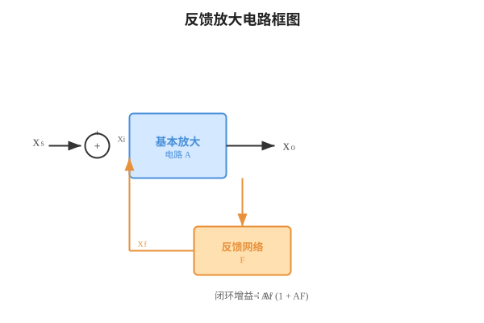
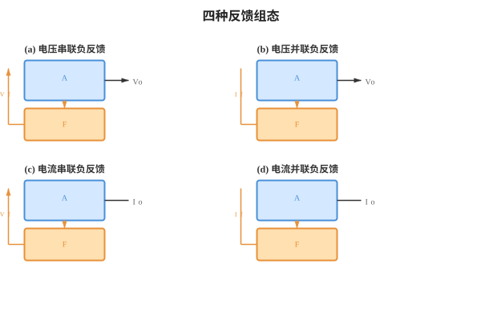

# 4.7 负反馈放大电路

## 1. 反馈的基本概念与分类

### 反馈的定义

反馈（Feedback）是将放大电路输出信号（电压或电流）的一部分或全部，通过反馈网络回送到输入端，影响输入信号的过程。

### 反馈的分类

**按极性分类**：
- **正反馈**：反馈信号增强输入信号，使增益增大，常用于振荡器
- **负反馈**：反馈信号削弱输入信号，使增益减小，用于改善放大器性能

**按取样方式分类**：
- **电压反馈**：反馈信号与输出电压成正比
- **电流反馈**：反馈信号与输出电流成正比

**按比较方式分类**：
- **串联反馈**：反馈信号与输入信号串联（电压比较）
- **并联反馈**：反馈信号与输入信号并联（电流比较）

## 2. 四种反馈组态

### 电压串联负反馈

反馈信号取自输出电压，与输入信号串联比较。特点：输入电阻增大，输出电阻减小，稳定输出电压。

### 电压并联负反馈

反馈信号取自输出电压，与输入信号并联比较。特点：输入电阻减小，输出电阻减小，稳定输出电压。

### 电流串联负反馈

反馈信号取自输出电流，与输入信号串联比较。特点：输入电阻增大，输出电阻增大，稳定输出电流。

### 电流并联负反馈

反馈信号取自输出电流，与输入信号并联比较。特点：输入电阻减小，输出电阻增大，稳定输出电流。

## 3. 反馈类型判断方法

**判断步骤**：
1. **找反馈网络**：连接输出与输入的元件
2. **判断反馈极性**：用瞬时极性法——假设输入信号瞬时极性为正，沿正向通路和反馈通路逐级推导，比较反馈信号与输入信号的极性
3. **判断取样方式**：若反馈网络与输出端直接相连则为电压反馈，否则为电流反馈
4. **判断比较方式**：若反馈信号与输入信号在同一节点汇合则为并联反馈，否则为串联反馈

## 4. 负反馈对性能的影响

负反馈以牺牲增益为代价，换取以下性能改善：

### 增益稳定性提高

闭环增益的相对变化量远小于开环增益：

$$
\frac{dA_f}{A_f} = \frac{1}{1 + AF} \cdot \frac{dA}{A}
$$

### 非线性失真减小

负反馈使输出信号的非线性失真减小约 $(1 + AF)$ 倍。

### 通频带展宽

负反馈展宽频带：

$$
f_{Hf} = f_H (1 + A_m F)
$$
$$
f_{Lf} = \frac{f_L}{1 + A_m F}
$$

### 输入电阻和输出电阻改变

- 串联负反馈：$R_{if} = R_i (1 + AF)$
- 并联负反馈：$R_{if} = \frac{R_i}{1 + AF}$
- 电压负反馈：$R_{of} = \frac{R_o}{1 + AF}$
- 电流负反馈：$R_{of} = R_o (1 + AF)$

## 5. 深度负反馈近似计算

当 $(1 + AF) \gg 1$ 时，称为深度负反馈。

闭环增益近似：

$$
A_f \approx \frac{1}{F}
$$

即闭环增益仅由反馈网络决定，与基本放大电路无关。

**四种组态的深度负反馈增益**：

- 电压串联：$A_{vf} \approx \frac{1}{F_v} = \frac{R_1 + R_f}{R_1}$
- 电压并联：$A_{rf} = \frac{v_o}{i_i} \approx \frac{1}{F_g} = -R_f$
- 电流串联：$A_{gf} = \frac{i_o}{v_i} \approx \frac{1}{F_r} = \frac{1}{R_f}$
- 电流并联：$A_{if} = \frac{i_o}{i_i} \approx \frac{1}{F_i} = 1 + \frac{R_f}{R_1}$

### 算例：深度负反馈估算闭环增益

电路为一运算放大器构成的同相放大电路，反馈电阻 $R_f = 190\text{k}\Omega$，$R_1 = 10\text{k}\Omega$，输入信号 $v_i$ 加在同相端，反相端经 $R_1$ 接地，$R_f$ 跨接于输出端与反相端之间。要求：判断反馈组态，并用虚短虚断估算闭环电压增益 $A_{vf}$。

**（1）判断反馈组态**

反馈网络由 $R_1、R_f$ 组成。反馈信号取自输出端（$R_f$ 一端直接接 $v_o$），为**电压反馈**；反馈电压经 $R_f$、$R_1$ 分压后加在运放反相输入端，是输入电压 $v_i$（加到同相端）与反馈电压串联比较后再施加于运放输入端，故属**串联反馈**。因此为**电压串联负反馈**。由于运放开环增益 $A \to \infty$，$1 + AF \to \infty$，属深度负反馈。

**（2）用虚短虚断估算 $A_{vf}$**

深度负反馈下 $v_+ \approx v_-$（虚短）、$i_+ = i_- = 0$（虚断）。由虚短：

$$
v_- \approx v_+ = v_i
$$

由虚断，流入运放反相端电流为零，故流经 $R_1$ 与 $R_f$ 的电流相等，反相端节点电流关系为：

$$
\frac{v_-}{R_1} = \frac{v_o - v_-}{R_f}
$$

由虚短 $v_- = v_+ = v_i$，代入：

$$
\frac{v_i}{R_1} = \frac{v_o - v_i}{R_f}
\quad\Longrightarrow\quad
v_o = \left(1 + \frac{R_f}{R_1}\right) v_i
$$

故：

$$
A_{vf} = \frac{v_o}{v_i} = 1 + \frac{R_f}{R_1} = 1 + \frac{190\text{k}}{10\text{k}} = 20
$$

**（3）用反馈系数校验**

反馈系数 $F_v = R_1/(R_1 + R_f) = 10\text{k}/200\text{k} = 0.05$，深度负反馈下 $A_{vf} \approx 1/F_v = 20$，与虚短虚断结果一致。

**结论**：该电压串联负反馈电路闭环增益 $A_{vf} \approx 20$，即 $v_o = 20 v_i$。（若为反相比例接法，同理可得 $A_{vf} = -R_f/R_1 = -19$，此时输入 $v_i$ 经 $R_1$ 加到反相端、同相端接地。）

## 6. 稳定性（自激振荡）

### 自激振荡条件

负反馈放大电路在某些频率下可能转变为正反馈，产生自激振荡。

自激振荡的**幅度条件**和**相位条件**：

$$
|AF| = 1 \quad \text{(幅度条件)}
$$
$$
\phi_{AF} = \pm (2n+1)\pi \quad \text{(相位条件)}
$$

### 稳定裕度

**增益裕度** $G_m$：在相位 $\phi_{AF} = -180^\circ$ 的频率处，$20\log|AF|$ 与 0dB 之差。

**相位裕度** $\phi_m$：在 $|AF| = 1$ 的频率处，相位与 $-180^\circ$ 之差。通常要求 $\phi_m \geq 45^\circ$。

## 7. 频率补偿技术

当负反馈放大电路不满足稳定条件时，需进行频率补偿（相位补偿）。

### 滞后补偿

在主极点处并联电容，使主极点频率降低，拉开主极点和次极点之间的距离，确保在增益为 0dB 时相位裕度足够。

常用的滞后补偿方法：
- **电容补偿**：在晶体管基-集间接入补偿电容（密勒电容）
- **RC滞后补偿**：在放大级间插入RC网络

### 超前补偿

在反馈网络中串联电容，引入零点，利用零点的超前相移抵消部分滞后相移，改善稳定性。

### 超前-滞后补偿

结合超前和滞后补偿的优点，在较宽的频带内保持稳定。