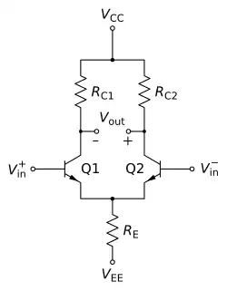
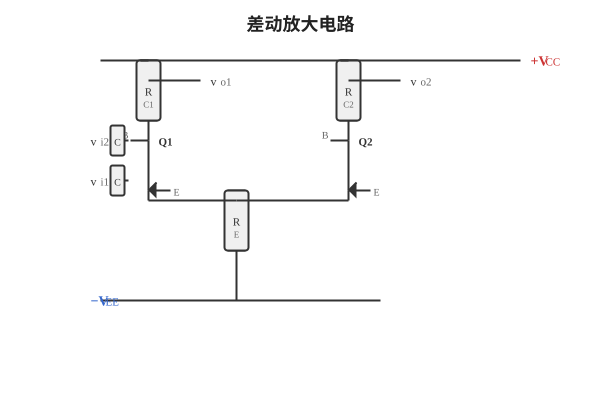
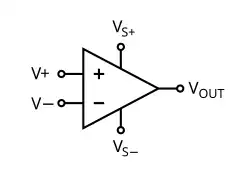
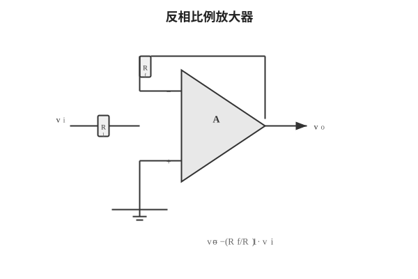
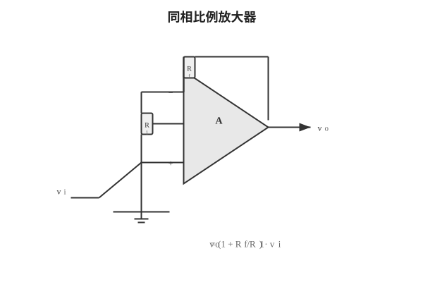
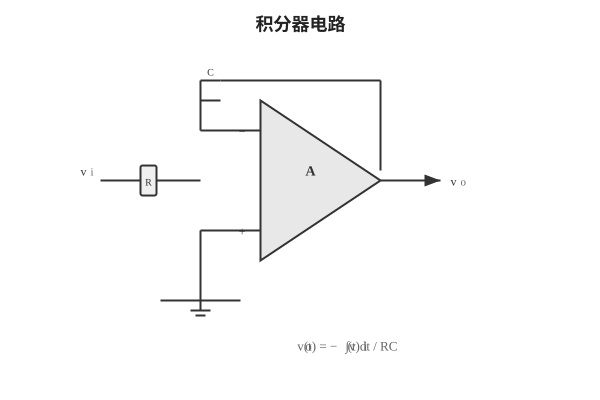
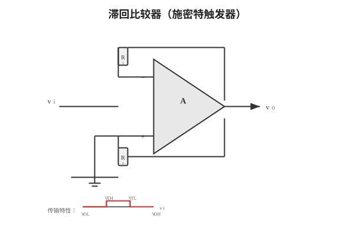

# 4.8 运算放大器

## 1. 差动放大电路

差动放大电路（Differential Amplifier）是集成运算放大器的输入级，能有效抑制零点漂移和共模干扰。

### 基本结构

差动放大电路由两个完全对称的共射放大电路组成，两管发射极连接在一起，共用发射极电阻 $R_E$。

### 工作原理

**差模输入**：两输入端电压大小相等、极性相反。两管集电极电流变化相反，输出电压为两管输出电压之差，增益较大。

**共模输入**：两输入端电压大小相等、极性相同。两管集电极电流变化相同，输出电压为零（理想对称时），增益极小。

### 差模增益与共模增益

差模电压增益：

$$
A_{vd} = \frac{v_{od}}{v_{id}} = -\frac{\beta R_C}{r_{be}}
$$

共模电压增益：

$$
A_{vc} = \frac{v_{oc}}{v_{ic}} \approx -\frac{R_C}{2R_E}
$$

## 2. 共模抑制比（CMRR）

共模抑制比（Common Mode Rejection Ratio）是衡量差动放大电路抑制共模信号能力的重要指标：

$$
\text{CMRR} = \left|\frac{A_{vd}}{A_{vc}}\right|
$$

用分贝表示：

$$
\text{CMRR(dB)} = 20 \log_{10} \left|\frac{A_{vd}}{A_{vc}}\right|
$$

理想差动放大电路的 $\text{CMRR} \to \infty$。提高 $R_E$ 可有效提高 CMRR，实际电路中常用恒流源代替 $R_E$。

## 3. 恒流源电路

恒流源电路在集成运放中广泛用作有源负载和偏置电路。

### 基本镜像恒流源

$$
I_{REF} = \frac{V_{CC} - V_{BE}}{R}
$$
$$
I_O = I_{REF} \left(1 - \frac{2}{\beta}\right) \approx I_{REF}
$$

### 微电流源

在镜像恒流源的发射极串联电阻，可获得微小电流：

$$
I_O R_E \approx V_T \ln\left(\frac{I_{REF}}{I_O}\right)
$$

### 威尔逊电流源

利用负反馈提高输出电阻，使输出电流更稳定。

## 4. 集成运放内部结构

集成运算放大器通常由四级组成：

1. **输入级**：差动放大电路，高输入电阻、高 CMRR
2. **中间级**：共射放大电路，提供高电压增益
3. **输出级**：互补对称功率放大电路（OCL），低输出电阻、大动态范围
4. **偏置电路**：恒流源提供稳定的偏置电流

## 5. 理想运放模型

理想运放的主要特性：
- 开环电压增益 $A_{vo} \to \infty$
- 输入电阻 $R_i \to \infty$
- 输出电阻 $R_o \to 0$
- 通频带 $BW \to \infty$
- CMRR $\to \infty$

### 虚短和虚断

**虚短**（Virtual Short）：由于 $A_{vo} \to \infty$，两输入端之间的电压差 $v_+ - v_- \approx 0$，即 $v_+ \approx v_-$。

**虚断**（Virtual Open）：由于 $R_i \to \infty$，两输入端的输入电流 $i_+ = i_- \approx 0$。

## 6. 反相/同相比例放大器

### 反相比例放大器

$$
v_o = -\frac{R_f}{R_1} v_i
$$

输入电阻 $R_i \approx R_1$，输出电阻 $R_o \approx 0$。

### 同相比例放大器

$$
v_o = \left(1 + \frac{R_f}{R_1}\right) v_i
$$

输入电阻 $R_i \to \infty$，输出电阻 $R_o \approx 0$。

当 $R_f = 0$ 或 $R_1 \to \infty$ 时，构成**电压跟随器**（Voltage Follower）：$v_o = v_i$。

## 7. 加法器/减法器

### 反相加法器

$$
v_o = -\left(\frac{R_f}{R_1} v_{i1} + \frac{R_f}{R_2} v_{i2} + \cdots + \frac{R_f}{R_n} v_{in}\right)
$$

当 $R_1 = R_2 = \cdots = R_n = R$ 时：

$$
v_o = -\frac{R_f}{R} (v_{i1} + v_{i2} + \cdots + v_{in})
$$

### 减法器

$$
v_o = \frac{R_f}{R_1} (v_{i2} - v_{i1})
$$

当 $R_f = R_1$ 时，$v_o = v_{i2} - v_{i1}$。

## 8. 积分器/微分器

### 积分器

$$
v_o(t) = -\frac{1}{RC} \int v_i(t) dt
$$

当输入为阶跃信号时，输出为线性斜坡电压。

### 微分器

$$
v_o(t) = -RC \frac{d v_i(t)}{dt}
$$

微分器对高频噪声敏感，实际应用中常在输入端串联电阻以提高稳定性。

## 9. 对数/指数放大器

### 对数放大器

利用BJT的PN结指数特性实现对数运算：

$$
v_o \approx -V_T \ln\left(\frac{v_i}{I_S R}\right)
$$

### 指数放大器

$$
v_o \approx -I_S R \cdot e^{\frac{v_i}{V_T}}
$$

## 10. 仪表放大器

仪表放大器由三个运放组成，具有高输入电阻、高CMRR、增益可调的特点：

$$
v_o = \left(1 + \frac{2R_1}{R_G}\right)(v_{i2} - v_{i1})
$$

其中 $R_G$ 为增益调节电阻。

## 11. 电压比较器

### 单限比较器

当 $v_i > V_{REF}$ 时输出高电平，$v_i < V_{REF}$ 时输出低电平。

### 滞回比较器（施密特触发器）

引入正反馈，使比较器具有滞回特性，消除输入噪声引起的误触发。

上门限电压：

$$
V_{TH} = \frac{R_1}{R_1 + R_f} V_{OH} + \frac{R_f}{R_1 + R_f} V_{REF}
$$

下门限电压：

$$
V_{TL} = \frac{R_1}{R_1 + R_f} V_{OL} + \frac{R_f}{R_1 + R_f} V_{REF}
$$

滞回宽度 $\Delta V = V_{TH} - V_{TL}$。

## 12. 实际运放非理想特性

- **输入失调电压 $V_{OS}$**：使输出电压为零时输入端所需的补偿电压
- **输入偏置电流 $I_B$**：两输入端输入电流的平均值
- **输入失调电流 $I_{OS}$**：两输入端输入电流之差
- **有限开环增益**：实际 $A_{vo}$ 有限，导致增益误差
- **有限带宽**：增益随频率升高而下降
- **转换速率（Slew Rate）**：输出电压的最大变化率
- **共模输入范围**：允许输入的共模电压范围