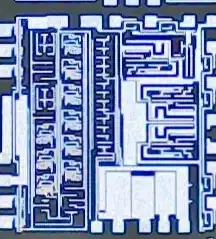
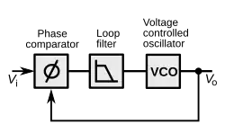
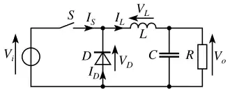

# 12.1 混合信号IC设计

## 1. 引言

随着半导体工艺的持续进步，将模拟电路、数字电路和电源管理模块集成在单一芯片上已成为现代集成电路设计的主流范式。这类芯片被称为**混合信号集成电路**（Mixed-Signal IC），它模糊了传统模拟与数字设计之间的界限，对设计者提出了跨越两个领域的综合能力要求。

混合信号IC广泛应用于通信收发器、数据转换器（ADC/DAC）、电源管理单元（PMU）、传感器接口、SerDes链路等场景。与纯数字或纯模拟设计相比，混合信号IC面临着更为严峻的挑战：数字开关噪声通过衬底和电源线耦合到敏感的模拟节点，时钟信号在模拟与数字域之间产生馈通，不同电源域之间的干扰导致性能退化。

本章将系统介绍混合信号IC设计的核心概念、关键模块和版图策略，涵盖时钟数据恢复（CDR）、低压差线性稳压器（LDO）、DC-DC变换器模拟控制、噪声隔离技术以及混合信号验证方法，为读者建立完整的混合信号设计知识体系。

## 2. 混合信号IC概述

### 2.1 混合信号IC的定义

混合信号IC是指在同一个芯片上同时集成**模拟电路**、**数字电路**和**电源管理电路**的集成电路。其典型特征包括：

- **多域共存**：高灵敏度模拟前端、高速数字逻辑和功率器件共存于同一衬底
- **信号交互**：模拟信号需要经ADC转换为数字信号处理，数字控制信号又需要通过DAC回到模拟域
- **电源多样性**：芯片内部存在多个不同电压等级的电源域（如1.2V核心电压、3.3V I/O电压、5V功率级电压）

下图是典型混合信号集成电路（SoC）的功能框图，示意模拟前端、数据转换器、数字逻辑与电源管理模块在同一芯片上的共存：



### 2.2 典型应用

| 应用类别 | 典型产品 | 模拟部分 | 数字部分 | 关键挑战 |
|---------|---------|---------|---------|---------|
| **SoC** | 手机基带芯片 | RF前端、PLL、ADC/DAC | CPU、DSP、存储器 | 数字噪声对RF的干扰 |
| **数据转换器** | 高速ADC/DAC | 采样保持、比较器、基准源 | 数字编码、接口逻辑 | 时钟抖动、衬底噪声 |
| **电源管理** | PMIC | 误差放大器、基准、LDO | 状态机、数字控制 | 负载瞬态、效率优化 |
| **传感器接口** | 温度/压力传感器 | 仪表放大器、Σ-Δ ADC | 校准逻辑、I²C/SPI接口 | 微弱信号提取、失调校准 |
| **SerDes** | 高速串行收发器 | CDR、均衡器、驱动器 | 8b/10b编码、FIFO | 抖动、码间干扰 |

### 2.3 设计挑战

混合信号IC设计面临的核心挑战可归纳为以下四类：

**（1）噪声耦合**

数字电路产生的开关噪声通过多种路径耦合到模拟电路：

- **衬底耦合**：数字开关电流注入衬底，通过衬底传播到模拟节点
- **电源耦合**：数字负载瞬态电流在电源线上产生 $\Delta I$ 噪声（$V_{noise} = L \cdot di/dt$）
- **信号线耦合**：数字信号走线与模拟信号走线之间的容性/感性串扰

**（2）衬底耦合**

在CMOS工艺中，所有器件共享同一衬底，数字开关产生的衬底噪声电压为：

$$V_{sub} = I_{switch} \cdot Z_{sub}(f)$$

其中 $Z_{sub}(f)$ 是衬底阻抗，与频率、衬底掺杂浓度和几何尺寸有关。

**（3）电源耦合**

数字电路的瞬态电流在电源分布网络（PDN）的寄生阻抗上产生压降：

$$\Delta V_{DD} = I_{digital} \cdot R_{PDN} + L_{PDN} \cdot \frac{dI_{digital}}{dt}$$

**（4）时钟馈通**

高速时钟信号通过寄生电容耦合到模拟信号路径，产生周期性干扰：

$$V_{feedthrough} = \frac{C_{parasitic}}{C_{total}} \cdot V_{clock}$$

## 3. 时钟数据恢复（CDR）

### 3.1 CDR在通信系统中的角色

时钟数据恢复（Clock and Data Recovery, CDR）是高速串行通信接收器中的关键模块，其功能是从输入的数据流中提取时钟信息，并利用恢复的时钟对数据进行重新采样，从而恢复出原始数据。

```
输入数据 ──→ [采样器] ──→ [CDR] ──→ 恢复时钟
              ↑              ↓
              └── [数据判决] ──→ 恢复数据
```

CDR在以下应用中不可或缺：

| 应用场景 | 数据速率 | 典型架构 |
|---------|---------|---------|
| 以太网（10GbE） | 10.3125 Gbps | 线性/非线性CDR |
| PCIe Gen4 | 16 GT/s | 半速率CDR |
| 5G前传 | 25 Gbps | 全速率CDR |
| USB 3.0 | 5 Gbps | 过采样CDR |

### 3.2 CDR架构

CDR的基本架构由以下模块组成：

```
输入数据 ──→ [鉴相器(PD)] ──→ [环路滤波器(LF)] ──→ [VCO] ──→ 恢复时钟
                                    ↓
                              [÷M 分频器]
```

CDR本质上是锁相环（PLL）结构，其各模块组织成经典的PLL框图，将输入数据作为参考来锁定恢复时钟的相位与频率：



**各模块功能**：

1. **鉴相器（Phase Detector, PD）**：比较输入数据和恢复时钟的相位关系，输出相位误差信号
2. **环路滤波器（Loop Filter, LF）**：滤除鉴相器输出中的高频分量，产生平滑的VCO控制电压
3. **压控振荡器（VCO）**：根据控制电压产生恢复时钟
4. **分频器（÷M）**：将VCO输出频率分频到数据速率量级

### 3.3 鉴相器类型

#### 3.3.1 线性鉴相器

线性鉴相器（如乘法器型或Hogge鉴相器）输出与相位误差成线性关系的信号：

$$V_{PD} = K_{PD} \cdot \Delta\phi \quad (-\pi < \Delta\phi < \pi)$$

其中 $K_{PD}$ 是鉴相器增益（V/rad）。

**Hogge鉴相器**（早期-滞后型）：

$$V_{PD} = \frac{I_{CP}}{2\pi} \cdot (\tau_{early} - \tau_{late})$$

优点：线性度好，环路分析简单；缺点：对数据转换沿敏感，需要数据跳变。

#### 3.3.2 Bang-Bang鉴相器

Bang-Bang鉴相器（又称Alexander鉴相器或Bang-Bang PD）仅输出相位误差的符号信息：

$$D_{PD} = \begin{cases} +1 & \text{数据超前时钟} \\ -1 & \text{数据滞后时钟} \end{cases}$$

**Alexander鉴相器**使用三个采样器（早期、数据、滞后）：

| 早期采样 | 数据采样 | 滞后采样 | UP/DOWN决策 |
|---------|---------|---------|------------|
| 0 | 1 | — | UP（时钟滞后） |
| 1 | 0 | — | DOWN（时钟超前） |
| — | 1 | 0 | UP |
| — | 0 | 1 | DOWN |

优点：工作速率高（可达数十Gbps），结构简单；缺点：存在固有抖动（极限环振荡）。

### 3.4 CDR环路分析

CDR可建模为二阶锁相环，其线性化传递函数如下：

**开环传递函数**：

$$H_{OL}(s) = \frac{K_{PD} \cdot K_{VCO}}{s \cdot M} \cdot F(s)$$

其中 $F(s)$ 为环路滤波器传递函数，$M$ 为分频比。

**一阶环路滤波器**（$F(s) = 1$）时，闭环传递函数：

$$H(s) = \frac{K_{PD} \cdot K_{VCO} / M}{s + K_{PD} \cdot K_{VCO} / M}$$

这是一个单极点低通系统，-3dB带宽为：

$$\omega_{BW} = \frac{K_{PD} \cdot K_{VCO}}{M}$$

**二阶环路滤波器**（$F(s) = 1 + s\tau_z$）时，引入零点改善稳定性：

$$H(s) = \frac{K_{PD} \cdot K_{VCO}(1 + s\tau_z) / M}{s^2 + s \cdot K_{PD} \cdot K_{VCO} \cdot \tau_z / M + K_{PD} \cdot K_{VCO} / M}$$

对应标准二阶系统：

$$\omega_n = \sqrt{\frac{K_{PD} \cdot K_{VCO}}{M}}, \quad \zeta = \frac{\omega_n \tau_z}{2}$$

### 3.5 抖动传递

CDR对输入抖动的传递特性由闭环传递函数 $H(s)$ 决定：

- **低频抖动**（$f < f_{BW}$）：被CDR跟踪，传递到输出（高通特性）
- **高频抖动**（$f > f_{BW}$）：被CDR滤除（低通特性）

$$|H(j\omega)| = \frac{\omega_n^2}{\sqrt{(\omega_n^2 - \omega^2)^2 + (2\zeta\omega_n\omega)^2}}$$

**输出总抖动**：

$$\sigma_{out}^2 = \int_0^\infty |H(j2\pi f)|^2 \cdot S_{jitter}(f) \, df + \sigma_{CDR,int}^2$$

其中 $S_{jitter}(f)$ 是输入抖动功率谱密度，$\sigma_{CDR,int}^2$ 是CDR自身产生的抖动。

### 3.6 CDR设计考虑

| 设计参数 | 设计考虑 | 典型取值 |
|---------|---------|---------|
| **环路带宽** | 需滤除高频抖动，但不能太窄（否则锁定慢） | 数据速率的1/1000 ~ 1/10000 |
| **阻尼因子** | 避免过冲和振荡 | $\zeta = 0.707$（Butterworth） |
| **VCO增益** | $K_{VCO}$ 太大会引入噪声，太小则锁定范围窄 | 根据频率范围折中 |
| **鉴相器类型** | 线性PD适合低抖动，Bang-Bang适合高速 | 根据速率选择 |
| **锁定时间** | 初始频差越大，锁定越慢 | 通常 < 100 μs |

## 4. 片上低压差线性稳压器（LDO）

### 4.1 原理与在混合信号IC中的作用

低压差线性稳压器（Low Dropout Regulator, LDO）是最基本的线性电源管理电路，也是混合信号IC中最常用的**片上电源模块**之一，其功能是将较高的输入电压转换为稳定的较低输出电压，同时借助其电源抑制能力（PSRR）为芯片内敏感的模拟模块提供干净的局部电源。

```
VIN ──→ [调整管Mp] ──→ VOUT ──→ [反馈分压R1/R2] ──→ [误差放大器EA] ──→ Mp栅极
                                          ↑
                                      VREF ──→ EA另一端
```

**基本工作原理**：误差放大器将反馈电压 $V_{FB}$ 与基准电压 $V_{REF}$ 进行比较，通过调整调整管（Pass Transistor）的栅极电压来维持输出电压恒定：

$$V_{OUT} = V_{REF} \cdot \left(1 + \frac{R_1}{R_2}\right)$$

LDO的核心特征是低压差（Dropout Voltage），即调整管工作在线性区时所需的最小输入-输出压差。值得强调的是，在混合信号集成语境下，LDO除了稳压外更关键的贡献在于**电源隔离**：利用其高PSRR阻断数字电源域噪声向模拟节点的传播（参见 12.1 §6.2.2 片上LDO）。

### 4.2 关键设计要点概述

从设计角度，LDO的核心问题可归纳为调整管、稳定性、PSRR以及瞬态与静态性能几个方面。其完整的原理、公式推导与参数计算均在 **12.2 §3 LDO（低压差线性稳压器）IC设计** 中给出，此处仅作概念性概览：

- **调整管**：PMOS/NMOS的取舍、尺寸与压差 $V_{DO}$ 的折中——深入设计与参数计算见 **12.2 §3.2 调整管设计**。
- **稳定性**：输出极点、EA极点与ESR零点的位置关系，以及不同负载条件下的相位裕度设计——深入设计与参数计算见 **12.2 §3.3 稳定性分析**。
- **PSRR**：低频/高频下的抑制机理与改善手段——深入设计与参数计算见 **12.2 §3.4 PSRR分析**。
- **瞬态响应与静态电流**：负载阶跃尖峰与轻载效率的折中——见 **12.2 §3.5 瞬态响应分析** 与 **12.2 §3.6 静态电流优化**。
- **完整设计流程**：以1.2V/100mA LDO为例的逐步计算——见 **12.2 §3.7 LDO设计实例**。

### 4.3 与混合信号集成的耦合

片内集成LDO还需额外关注其与芯片整体的耦合问题，这是以离散模块为对象的常规设计（12.2 §3）之外的混合信号特有考虑：

- **噪声隔离**：片内LDO必须与片外电源一样具备足够的PSRR，避免数字开关噪声沿电源线进入敏感模拟模块（参见 12.1 §6.2.2）。
- **面积与稳定性折中**：片内调整管面积受芯片尺寸约束，其栅极电容会引入非主极点，需结合片内补偿与去耦设计（见 12.2 §3.3 与 12.1 §6.2.3 电源去耦策略）。
- **多电源域管理**：芯片内多个电压域的规划、上电时序与保护功能在 **12.2 §7 PMIC 系统设计** 中进一步系统化。

## 5. DC-DC变换器的模拟控制

### 5.1 概念与在混合信号IC中的角色

与LDO的线性调节不同，DC-DC变换器（如Buck降压、Boost升压）通过高速功率开关与储能元件的周期性动作实现高效率电压转换，其效率远高于LDO，但必须依赖完整的**模拟反馈控制环路**（误差放大器、PWM调制、补偿网络）来维持输出稳定。在混合信号IC中，DC-DC通常作为系统的功率级，其模拟控制环路是典型的小信号负反馈设计，也扮演着将功率级的开关行为与数字控制接口（如PMIC中的DVS、时序控制）衔接起来的桥梁角色。

下图为典型Buck（降压）变换器的拓扑与电流方向约定，是理解电压/电流模式控制及其反馈环路的基础：



### 5.2 控制方式与补偿概述

DC-DC的控制方式差异主要体现在反馈信号与调制策略上，不同方式的建模、传递函数与补偿参数计算详见 **12.2 §4.2 控制环路设计**（以及 **12.2 §5 中 Boost 的 RHP 零点挑战**）：

- **电压模式控制**：仅反馈输出电压，结构简单但响应较慢，需 Type II/III 补偿器——深入设计与参数计算见 **12.2 §4.2.1 电压模式控制（Type III补偿器）**。
- **电流模式控制**：电压环内嵌套电流环，将功率级降为一阶系统，响应更快——深入设计与参数计算见 **12.2 §4.2.2 电流模式控制**。
- **恒定导通时间（COT）控制**：非线性控制，瞬态极快且无需补偿——见 **12.2 §4.2.3 恒定导通时间（COT）控制**。
- **斜坡补偿**：解决峰值电流模式在占空比 > 50% 时的次谐波振荡——见 **12.2 §4.2.2**。

其中，Buck 在小信号建模下表现为标准二阶系统，其功率级传递函数 $G_{vd}(s)$、谐振频率 $\omega_0$ 与品质因数 $Q$ 的定义见 12.2 §4.2.1；补偿器设计（穿越频率选取、零极点放置、相位裕度验证）的完整流程与参数计算也见对应小节。

### 5.3 与混合信号集成的耦合

从混合信号集成视角，DC-DC 控制除需保证环路自身稳定外，还要处理好与数字控制及系统级的接口（电路级深入设计见 12.2 §4、§5）：

- **数字辅助控制**：现代 PMIC 常采用数字补偿与数字校准，模拟控制环是基础，数字接口（I2C/SMBus、DVS、上电时序、保护）见 **12.2 §7**。
- **开关噪声耦合**：DC-DC 的开关动作是片内强噪声源，会通过衬底与电源耦合到模拟节点，需结合 12.1 §6 的隔离技术一并考虑。
- **功率管与效率**：导通损耗与开关损耗的权衡、效率分析及功率管优化见 **12.2 §4.3 功率管优化** 与 **12.2 §4.4 效率分析**。

## 6. 模拟-数字混合设计考虑

### 6.1 衬底噪声隔离技术

#### 6.1.1 保护环（Guard Ring）

保护环是最基本的衬底噪声隔离手段，通过在噪声源和敏感电路周围放置衬底接触环来收集噪声电流。

**NMOS保护环**（收集电子/空穴噪声）：

- 在噪声源周围放置重掺杂N+环，连接到 $V_{DD}$
- 收集从噪声源横向扩散的少数载流子

**PMOS保护环**：

- 在敏感电路周围放置重掺杂P+环，连接到 $GND$
- 收集衬底中的噪声电流

**保护环设计要点**：

| 参数 | 设计建议 | 说明 |
|------|---------|------|
| **宽度** | ≥ 5 μm | 降低环的串联电阻 |
| **间距** | 距噪声源 < 10 μm | 越近隔离效果越好 |
| **深度** | 尽可能深 | 增加收集效率 |
| **多重环** | 2~3层同心环 | 提高隔离度10~20 dB |
| **衬底接触密度** | 每100 μm²至少1个接触 | 降低衬底阻抗 |

**保护环隔离效果**：

单环隔离度：10~20 dB
双环隔离度：20~30 dB
三环（含深N阱）：30~40 dB

#### 6.1.2 深N阱隔离

深N阱（Deep N-Well, DNW）是在P型衬底上形成的N型埋层，可以将PMOS器件与P型衬底完全隔离。

**工作原理**：

```
        ┌──────────────────┐
        │  P-sub           │
        │  ┌────────────┐  │
        │  │ Deep N-Well │  │
        │  │ ┌────────┐ │  │
        │  │ │ P-Well  │ │  │
        │  │ │ (隔离区) │ │  │
        │  │ └────────┘ │  │
        │  └────────────┘  │
        └──────────────────┘
```

深N阱将敏感模拟电路所在的P阱与P型衬底之间的PN结反偏，形成隔离屏障。

**隔离效果**：

- 衬底噪声衰减：20~40 dB（取决于频率）
- 有效频率范围：< 几GHz（高频时寄生电容降低隔离效果）

**设计注意事项**：

- 深N阱电阻率较高，需要良好的衬底接触
- 深N阱与衬底之间的结电容会引入高频耦合路径
- 面积开销较大（深N阱边缘需要额外间距）

#### 6.1.3 物理分离

在版图布局中，将模拟区域和数字区域尽可能远离：

- **间距要求**：模拟区与数字区之间至少保持 50~100 μm 的距离
- **中间放置保护环和衬底接触**
- **避免数字走线跨越模拟区域上方**

### 6.2 电源域分离

#### 6.2.1 独立电源引脚

为模拟和数字部分提供独立的电源和地引脚：

```
芯片封装
┌─────────────────────────┐
│  AVDD  AGND  DVDD  DGND │
│                         │
│  [模拟区域]  │  [数字区域] │
│             │           │
└─────────────────────────┘
     ↑    ↑       ↑     ↑
   AVDD AGND   DVDD  DGND  ← 封装引脚
```

**设计要点**：

- 模拟电源和数字电源在芯片外部通过不同的PCB电源平面供电
- 模拟地和数字地在单点连接（通常在芯片封装处或PCB上）
- 避免模拟和数字电源引脚相邻（防止封装键合线耦合）

#### 6.2.2 片上LDO

为芯片内部的敏感模拟模块提供独立的片上LDO供电：

$$V_{DD,analog} = V_{OUT,LDO}$$

**优势**：

- 隔离外部电源噪声
- 提供干净的局部电源
- LDO的PSRR进一步抑制数字电源噪声

**设计考虑**：

- LDO的PSRR需要在数字噪声频率范围内保持足够高
- LDO的静态电流增加总功耗
- 需要足够的输出电容保证稳定性

#### 6.2.3 电源去耦策略

**多级去耦电容架构**：

| 去耦层级 | 电容值 | 位置 | 目标频率 |
|---------|--------|------|---------|
| **片外大容量** | 1~100 μF | PCB上 | < 1 MHz |
| **片外小容量** | 0.01~0.1 μF | 封装引脚附近 | 1~100 MHz |
| **片上去耦** | 1~100 pF | 模拟模块电源端 | 100 MHz~1 GHz |
| **分布式去耦** | 1~10 pF | 数字标准单元内 | > 1 GHz |

**去耦电容的阻抗模型**：

$$Z_{decap}(f) = \frac{R_{ESR}}{1 + (2\pi f R_{ESR} C)^2} + j\left(2\pi f L_{ESL} - \frac{2\pi f C R_{ESR}^2}{1 + (2\pi f R_{ESR} C)^2}\right)$$

在自谐振频率处阻抗最低（$f_{res} = \frac{1}{2\pi\sqrt{LC}}$），去耦效果最好。

### 6.3 时钟隔离

高速时钟信号是混合信号IC中最强的噪声源之一，需要特别处理：

**时钟隔离策略**：

1. **时钟走线远离模拟区域**：时钟走线与模拟信号线之间保持至少3倍线宽的间距
2. **使用差分时钟**：差分信号产生的共模噪声较小
3. **时钟走线加屏蔽**：在时钟走线两侧放置地线（GND shield）
4. **避免时钟走线跨越模拟/数字边界**
5. **使用片内展频技术**：将时钟能量分散到更宽的频带，降低峰值EMI

### 6.4 衬底接触策略

良好的衬底接触是降低衬底噪声的关键：

**设计原则**：

- **均匀分布**：衬底接触应在整个芯片上均匀分布，间距不超过100 μm
- **模拟区域**：增加衬底接触密度（间距 < 50 μm）
- **数字区域**：标准衬底接触密度即可
- **隔离带**：在模拟/数字边界处放置密集的衬底接触带

**衬底接触电阻**：

$$R_{sub} = \frac{\rho_{sub} \cdot t_{contact}}{A_{contact}}$$

其中 $\rho_{sub}$ 是衬底电阻率，$t_{contact}$ 是接触深度，$A_{contact}$ 是接触面积。

## 7. 混合信号版图设计

### 7.1 模拟区域与数字区域分离

混合信号版图的首要原则是将模拟和数字区域在物理上分开：

**布局策略**：

```
┌─────────────────────────────────────────┐
│              芯片顶层布局                  │
│                                         │
│  ┌──────────┐  隔离带  ┌──────────────┐ │
│  │ 模拟区域  │ ←─────→ │   数字区域    │ │
│  │          │         │              │ │
│  │ - 运放    │  保护环  │ - 标准单元    │ │
│  │ - ADC/DAC│  +衬底   │ - 存储器      │ │
│  │ - PLL    │  接触    │ - I/O        │ │
│  │ - LDO    │         │              │ │
│  └──────────┘         └──────────────┘ │
│                                         │
│  ┌──────────────────────────────────┐   │
│  │         I/O 和 PAD 区域           │   │
│  └──────────────────────────────────┘   │
└─────────────────────────────────────────┘
```

**设计规则**：

- 模拟和数字区域之间保留足够的间距（≥ 50 μm）
- 模拟区域使用独立的阱和电源域
- 数字区域的标准单元放置不侵入模拟区域

### 7.2 衬底分区

**衬底分区策略**：

| 分区方式 | 实现方法 | 隔离效果 | 面积开销 |
|---------|---------|---------|---------|
| **同衬底分区** | 保护环 + 衬底接触 | 20~30 dB | 低 |
| **深N阱隔离** | DNW隔离模拟P阱 | 30~40 dB | 中 |
| **SOI工艺** | 绝缘体上硅 | > 50 dB | 高（工艺成本） |
| **三阱工艺** | 独立阱 + 保护环 | 30~40 dB | 中 |

### 7.3 电源/地平面规划

**电源平面规划原则**：

1. **模拟电源和数字电源分离**：在芯片顶层和次顶层使用独立的金属层
2. **地平面完整**：模拟区域下方的地平面不应被数字信号线打断
3. **电源去耦就近放置**：每个电源引脚附近放置去耦电容
4. **低阻抗路径**：使用宽金属线和多通孔降低电源阻抗

**典型电源平面分配**（6层金属工艺）：

| 金属层 | 用途 | 说明 |
|--------|------|------|
| M1~M2 | 信号布线 | 模拟和数字信号分开布线 |
| M3 | 模拟地（AGND） | 完整地平面 |
| M4 | 模拟电源（AVDD） | 模拟电源平面 |
| M5 | 数字地（DGND） | 数字地平面 |
| M6 | 数字电源（DVDD） | 数字电源平面 |

### 7.4 信号屏蔽

**屏蔽策略**：

- **敏感模拟信号**：两侧放置地线屏蔽（GND shield），间距 ≥ 2倍线宽
- **时钟信号**：两侧和上下层放置地线屏蔽
- **差分信号**：保持对称性，两侧等距放置屏蔽线
- **屏蔽线接地**：屏蔽线必须良好接地，每隔一定距离（< 10 μm）放置接地通孔

**屏蔽效果**：

$$C_{coupling,shielded} \approx \frac{C_{coupling,unshielded}}{1 + g_m \cdot R_{shield}}$$

良好的屏蔽可以将串扰降低20~40 dB。

### 7.5 匹配设计

混合信号IC中的模拟部分经常需要精确匹配的器件（如电流镜、差分对、电阻串等）。匹配设计的基本原则包括：

- **共质心布局**（Common Centroid）：消除线性梯度效应
- **虚拟器件**（Dummy）：消除刻蚀负载效应
- **方向一致**：所有匹配器件使用相同的沟道方向
- **等间距**：匹配器件之间保持均匀间距

（匹配设计的详细讨论参见6.11版图设计章节。）

## 8. 混合信号验证

### 8.1 混合信号仿真

混合信号仿真需要同时处理模拟连续时间行为和数字离散事件行为。

**仿真方法对比**：

| 仿真方法 | 工具示例 | 精度 | 速度 | 适用场景 |
|---------|---------|------|------|---------|
| **纯SPICE** | HSPICE, Spectre | 最高 | 最慢 | 关键模拟模块 |
| **混合模式** | Verilog-AMS, VHDL-AMS | 高 | 中等 | 模拟+数字协同 |
| **行为级** | Simulink, MATLAB | 中等 | 快 | 系统级验证 |
| **数字RTL + 模拟SPICE** | 混合仿真器 | 模块级精度 | 较快 | SoC验证 |

**混合模式仿真**：

使用硬件描述语言（Verilog-AMS或VHDL-AMS）对模拟模块进行行为级建模，数字模块使用Verilog/VHDL，由混合仿真器协同仿真：

$$\text{Verilog-AMS (模拟)} \leftrightarrow \text{混合仿真引擎} \leftrightarrow \text{Verilog (数字)}$$

### 8.2 行为级建模

行为级建模用简化的数学模型代替晶体管级电路，大幅提高仿真速度。

**LDO行为级模型示例**：

```verilog
// Verilog-AMS 行为级LDO模型
module ldo_behavior(avdd, dvdd, vout, en);
  input avdd, dvdd, en;
  output vout;
  
  // 参数
  parameter real vref = 1.2;
  parameter real gain = 1000;    // EA增益
  parameter real rdo = 10;       // 调整管导通电阻
  parameter real ilimit = 0.5;   // 限流值
  
  // 行为描述
  analog begin
    if (en > 0.5) begin
      V(vout) <+ min(gain * (V(avdd) - vref), ilimit * rdo);
    end else begin
      V(vout) <+ 0;
    end
  end
endmodule
```

**行为级建模的层次**：

| 建模层次 | 描述内容 | 仿真速度 | 精度 |
|---------|---------|---------|------|
| **晶体管级** | 所有MOSFET详细模型 | 1x（基准） | 最高 |
| **宏模型** | 等效电路子模块 | 10~100x | 高 |
| **行为级** | 传递函数/状态方程 | 1000~10000x | 中等 |
| **理想模型** | 理想功能块 | >10000x | 低 |

### 8.3 混合信号DFT

混合信号IC的可测性设计（DFT）比纯数字IC更具挑战性，因为模拟模块的测试需要精确的激励和测量。

**混合信号DFT技术**：

| 技术 | 描述 | 适用模块 | 面积开销 |
|------|------|---------|---------|
| **内建自测试（BIST）** | 片上产生测试激励并分析响应 | ADC/DAC/滤波器 | 中 |
| **环回测试（Loopback）** | 将模拟输出环回到输入进行验证 | 数据转换器 | 低 |
| **数字辅助校准** | 利用数字逻辑校准模拟失调/增益误差 | 运放/ADC | 中 |
| **边界扫描** | IEEE 1149.1标准，测试数字I/O | 数字接口 | 低 |
| **混合扫描链** | 将模拟节点数字化后插入扫描链 | 混合信号节点 | 中~高 |

**ADC的BIST方法**：

1. 片上产生斜坡或正弦波测试激励
2. ADC对测试激励进行转换
3. 数字逻辑分析输出码的直方图或FFT
4. 计算SNR、THD、INL/DNL等指标
5. 与预期值比较判断好坏

## 9. 小结

混合信号IC设计是现代集成电路设计中最为复杂和综合的领域之一。本章从以下几个方面进行了系统介绍：

**核心内容回顾**：

| 章节 | 核心要点 |
|------|---------|
| **混合信号IC概述** | 模拟+数字+电源共存带来的噪声耦合、衬底耦合、电源耦合等挑战 |
| **CDR** | 鉴相器类型（线性/Bang-Bang）、环路分析、抖动传递特性 |
| **LDO** | 概念与片上电源隔离作用；深入设计与参数计算见12.2 §3 |
| **DC-DC控制** | 模拟控制环概念与集成耦合；深入设计见12.2 §4、§5 |
| **噪声隔离** | 保护环、深N阱、物理分离、电源域分离、去耦策略 |
| **版图设计** | 模拟/数字分离、衬底分区、电源平面规划、信号屏蔽 |
| **验证方法** | 混合模式仿真、行为级建模、混合信号DFT |

**设计原则总结**：

1. **隔离优先**：在版图规划阶段就确定模拟/数字的隔离策略
2. **系统思维**：从系统层面分析噪声传播路径，而非仅关注单个模块
3. **层次化设计**：从行为级到晶体管级的层次化验证
4. **权衡取舍**：性能、功耗、面积、成本之间的综合优化

混合信号IC设计需要设计者同时具备模拟电路和数字设计的深厚功底，以及对半导体工艺和版图实现的全面理解。随着工艺节点进入深亚微米和纳米尺度，电源电压不断降低而集成度不断提高，混合信号设计面临的挑战将更加严峻，但同时也为创新设计方法提供了更广阔的空间。
