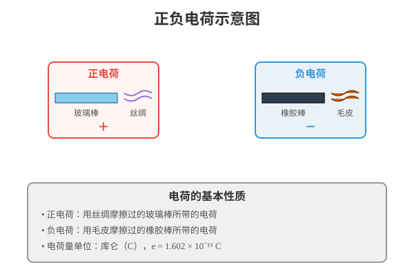
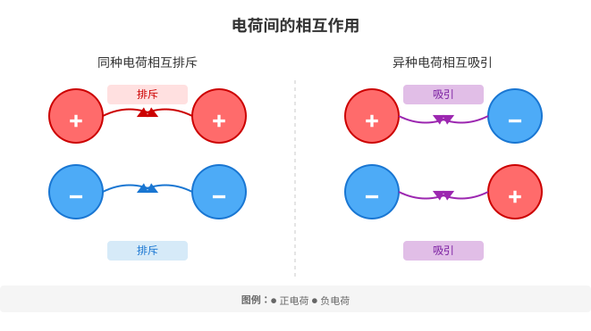
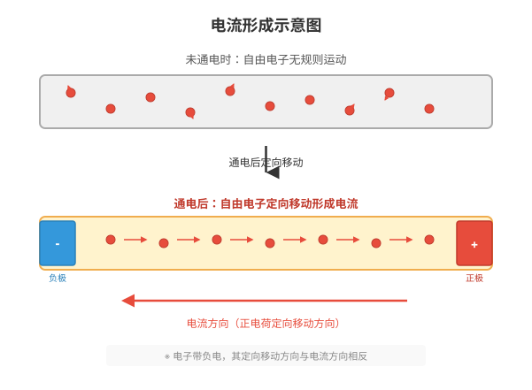

# 1.1 电荷与电流

## 一、电荷的种类

自然界中存在两种电荷：**正电荷**和**负电荷**。

- **正电荷**：用丝绸摩擦过的玻璃棒所带的电荷称为正电荷（用"+"表示）。
- **负电荷**：用毛皮摩擦过的橡胶棒所带的电荷称为负电荷（用"−"表示）。

### 电荷间的相互作用

同种电荷相互排斥，异种电荷相互吸引。这一规律是静电学的基础。

电荷的多少称为**电荷量**，用符号 $Q$ 或 $q$ 表示，国际单位是**库仑**（C）。一个电子所带的电荷量为：

$$
e = 1.602 \times 10^{-19} \, \text{C}
$$

任何带电体所带的电荷量都是 $e$ 的整数倍。

## 二、导体与绝缘体

- **导体**：容易导电的物体，如金属、石墨、人体、大地、酸碱盐溶液等。导体内部存在大量可以自由移动的电荷（自由电子或离子）。
- **绝缘体**：不容易导电的物体，如橡胶、塑料、玻璃、陶瓷、干燥的空气等。绝缘体内部几乎没有自由移动的电荷。

> 导体与绝缘体之间没有绝对的界限，在特定条件下（如高温、高压、潮湿）绝缘体也可能变为导体。

## 三、电流的形成与方向

### 电流的形成

电荷的**定向移动**形成电流。在金属导体中，自由电子定向移动形成电流；在溶液中，正、负离子定向移动形成电流。

### 电流的方向

规定**正电荷定向移动的方向**为电流方向。在金属导体中，自由电子带负电，其定向移动方向与电流方向相反。

### 电流的大小

电流强度（简称电流）表示电流的强弱，用符号 $I$ 表示，国际单位是**安培**（A）。常用的单位还有毫安（mA）和微安（μA）：

$$
1 \, \text{A} = 10^3 \, \text{mA} = 10^6 \, \mu\text{A}
$$

电流的定义式为：

$$
I = \frac{Q}{t}
$$

其中 $Q$ 是通过导体横截面的电荷量（单位：C），$t$ 是通电时间（单位：s）。

## 四、电流的测量——电流表

电流表是测量电路中电流大小的仪表。

### 电流表的使用规则

1. **串联**：电流表必须串联在被测电路中。
2. **正进负出**：电流从"+"接线柱流入，从"−"接线柱流出。
3. **不超量程**：被测电流不得超过电流表的量程。
4. **禁止短路**：绝对不允许将电流表直接接在电源两端（电流表内阻极小，相当于导线）。

### 电流表的读数

- 先看清量程：常用量程有 0\~0.6 A 和 0\~3 A。
- 再认清分度值：0\~0.6 A 量程的分度值为 0.02 A；0\~3 A 量程的分度值为 0.1 A。
- 读数时视线应与指针所指刻度垂直。

## 六、电流的微观解释

### 电流的微观表达式

在金属导体中，设自由电子数密度为 $n$（单位体积内的自由电子数），导体的横截面积为 $S$，自由电子的电荷量为 $e$，自由电子的定向移动（漂移）平均速度为 $v$，则在时间 $t$ 内通过横截面的自由电子数为 $nSvt$，通过的总电荷量为：

$$
Q = neSvt
$$

由电流定义 $I = Q/t$ 可得电流的微观表达式：

$$
I = neSv
$$

该表达式揭示了电流的微观本质：电流的大小取决于自由电子的数密度、横截面积和漂移速度。

### 漂移速度

自由电子在电场作用下获得的定向移动平均速度称为**漂移速度**。金属导体中自由电子的漂移速度非常小，典型值约为 $10^{-4} \, \text{m/s}$ 量级。自由电子在定向移动过程中不断与晶体格点碰撞，因此漂移速度远小于电子热运动速度（约 $10^5 \, \text{m/s}$）。

### 电场传播速度与电子漂移速度的区别

电场在导体中的传播速度接近光速（约 $3 \times 10^8 \, \text{m/s}$），因此开关一闭合，整个电路几乎同时建立电场，用电器立即有电流通过。而自由电子本身的漂移速度极小，每个电子需要在电路中缓慢移动，但电场传播极快，使整个电路中的自由电子几乎同时开始定向移动。

## 七、超导现象

### 超导的定义

**超导现象**是指某些材料在温度降到某一临界值以下时，电阻突然降为零的现象。这一现象由荷兰物理学家昂内斯于 1911 年首次在汞（Hg）中发现。

### 临界温度

电阻降为零时的温度称为**临界温度**，用 $T_c$ 表示。不同超导材料的临界温度不同。

### 超导体的主要特性

1. **零电阻效应**：当温度低于 $T_c$ 时，超导体的直流电阻为零。一旦在超导回路中激发电流，电流将持续流动而不会衰减。
2. **完全抗磁性（迈斯纳效应）**：1933 年迈斯纳发现，处于超导态的材料会将体内的磁通线完全排出，使体内磁感应强度始终为零。这是超导体与理想导体的本质区别。

### 常见超导材料

| 类型     | 材料举例           | 临界温度  | 特点                   |
| -------- | ------------------ | --------- | ---------------------- |
| 低温超导 | NbTi, Nb$_3$Sn     | $T_c < 30\,\text{K}$ | 需液氦冷却，成本高     |
| 高温超导 | YBCO, BSCCO        | $T_c > 77\,\text{K}$ | 可用液氮冷却，成本低   |

### 超导的应用

- **超导磁体**：用于磁共振成像（MRI）、核磁共振（NMR）、粒子加速器（如大型强子对撞机 LHC）
- **超导电缆**：零电阻输电，可大幅降低传输损耗
- **超导量子干涉仪（SQUID）**：可测量极微弱的磁场，广泛应用于精密测量
- **超导滤波器**：用于移动通信基站，提高信号选择性

### 超导体与理想导体的区别

理想导体仅具有零电阻特性，但超导体除零电阻外还具有完全抗磁性。理想导体在磁场中冷却时，磁通线可以被"冻结"在体内；而超导体在磁场中冷却到 $T_c$ 以下时，会将磁通线完全排出体外（迈斯纳效应）。

## 五、小结

| 概念         | 说明                   |
| ------------ | ---------------------- |
| 正电荷       | 丝绸摩擦玻璃棒所带电荷 |
| 负电荷       | 毛皮摩擦橡胶棒所带电荷 |
| 电荷相互作用 | 同种相斥，异种相吸     |
| 电流方向     | 正电荷定向移动的方向   |
| 电流定义     | $I = Q/t$            |
| 电流表       | 串联使用，正进负出     |
