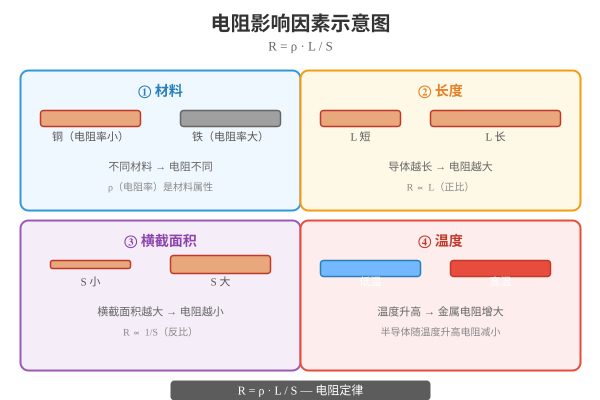
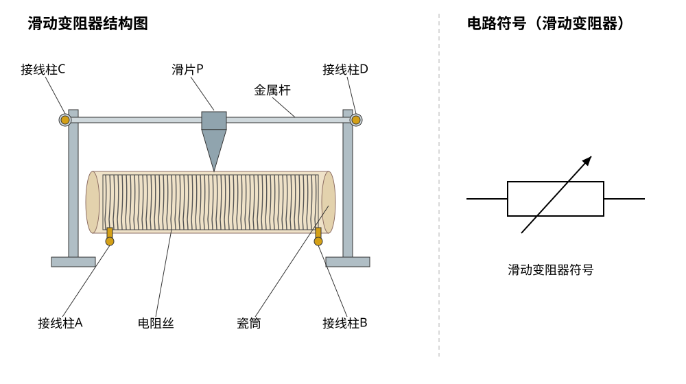

# 1.2 电压与电阻

## 一、电压的概念

电压是使自由电荷发生定向移动形成电流的原因，用符号 $U$ 表示，国际单位是**伏特**（V）。常用的单位还有千伏（kV）、毫伏（mV）：

$$
1 \, \text{kV} = 10^3 \, \text{V}, \quad 1 \, \text{V} = 10^3 \, \text{mV}
$$

电源是提供电压的装置。常见的电源电压值：

| 电源         | 电压        |
| ------------ | ----------- |
| 一节干电池   | 1.5 V       |
| 一节铅蓄电池 | 2 V         |
| 家庭电路     | 220 V       |
| 人体安全电压 | 不高于 36 V |
| 闪电         | 10^5 V 以上 |

### 电压的测量——电压表

电压表是测量电路中两点间电压大小的仪表。

### 电压表的使用规则

1. **并联**：电压表必须并联在被测电路两端。
2. **正进负出**：电流从"+"接线柱流入，从"−"接线柱流出。
3. **不超量程**：被测电压不得超过电压表的量程。
4. **可以直接接电源**：电压表可以直接接在电源两极测电源电压（电压表内阻极大，相当于断路）。

### 电压表的读数

- 常用量程：0~3 V（分度值 0.1 V）和 0~15 V（分度值 0.5 V）。
- 读数时先确定量程，再读取分度值。

## 二、电阻的概念

电阻表示导体对电流阻碍作用的大小，用符号 $R$ 表示，国际单位是**欧姆**（Ω）。常用的单位还有千欧（kΩ）和兆欧（MΩ）：

$$
1 \, \text{M}\Omega = 10^3 \, \text{k}\Omega = 10^6 \, \Omega
$$

### 电阻的影响因素

导体的电阻是导体本身的一种性质，其大小由以下因素决定：

1. **材料**：不同材料的导电性能不同，电阻率不同。
2. **长度**：在材料和横截面积相同时，导体越长，电阻越大。
3. **横截面积**：在材料和长度相同时，横截面积越大，电阻越小。
4. **温度**：对大多数金属导体，温度升高，电阻增大；对半导体和某些合金，温度升高，电阻减小。

电阻定律公式：

$$
R = \rho \frac{L}{S}
$$

其中 $\rho$ 为电阻率（单位：Ω·m），$L$ 为导体长度（单位：m），$S$ 为横截面积（单位：m²）。

## 三、滑动变阻器与电阻箱

### 滑动变阻器

滑动变阻器通过改变接入电路中电阻线的**长度**来改变电阻大小。

**滑动变阻器的使用方法：**

1. **一上一下**：将接线柱"一上一下"接入电路。
2. **串联**：滑动变阻器与被控制电路串联。
3. **闭合开关前**：将滑片调到阻值最大端（保护电路）。

**铭牌参数**：例如"20 Ω 2 A"表示最大阻值为 20 Ω，允许通过的最大电流为 2 A。

### 电阻箱

电阻箱是一种可以读出电阻值的变阻器。与滑动变阻器不同，电阻箱能直接读出接入电路的阻值，但一般不能连续改变电阻值。

## 四、小结

| 概念         | 公式/说明                  |
| ------------ | -------------------------- |
| 电压         | 形成电流的原因，单位 V     |
| 电压表       | 并联使用，正进负出         |
| 电阻         | $R = \rho \, L/S$        |
| 电阻影响因素 | 材料、长度、横截面积、温度 |
| 滑动变阻器   | 改变接入长度来改变电阻     |
