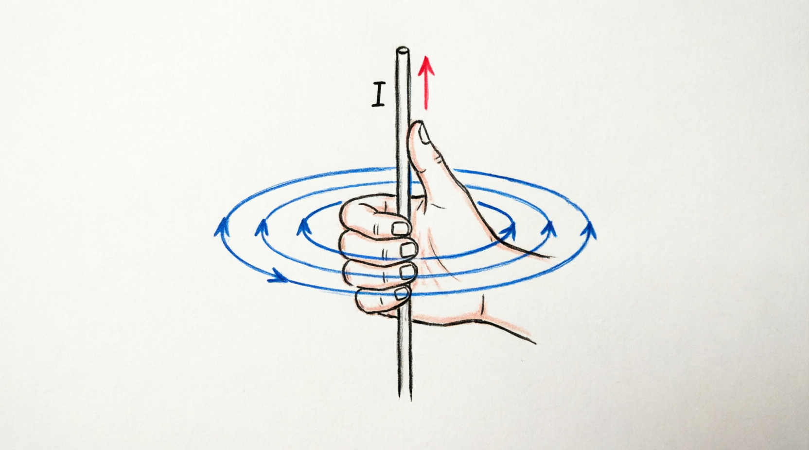
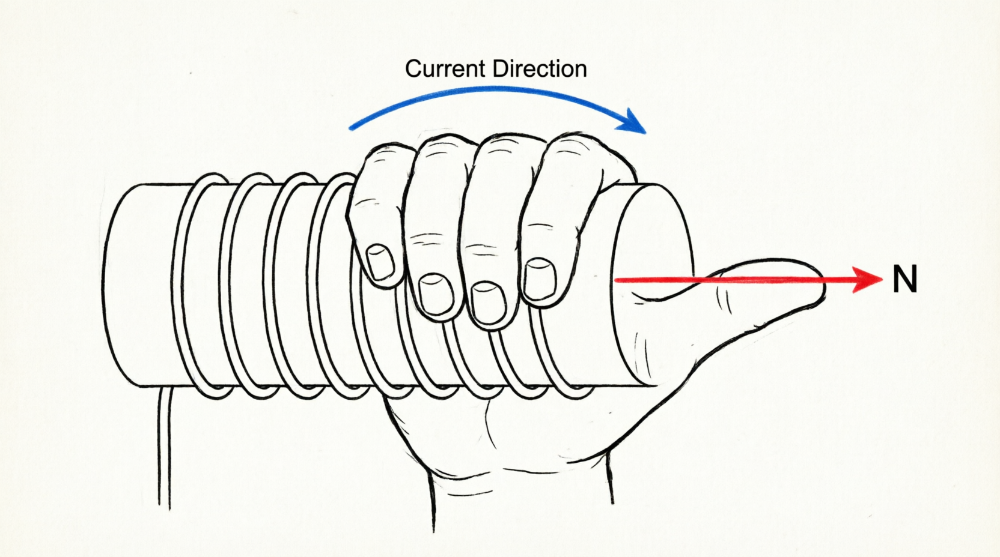
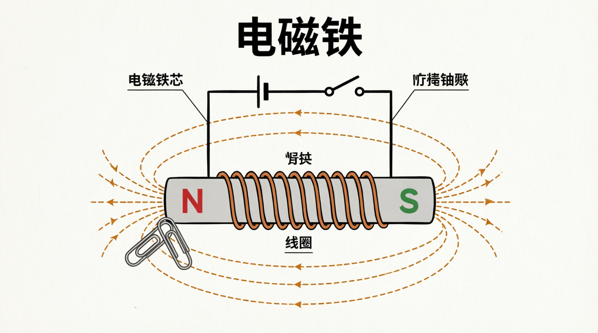

# 1.4 安培定律

## 一、电流的磁效应

1820年，丹麦物理学家奥斯特通过实验发现：通电导体周围存在磁场。这一发现揭示了电与磁之间的内在联系，被称为**电流的磁效应**。

### 通电直导体的磁场

通电直导线周围的磁场呈**同心圆**状分布，磁场方向与电流方向有关。

#### 右手螺旋定则（安培定则一）

用右手握住直导线，让大拇指指向电流方向，则四指弯曲的方向即为磁场方向（即磁感线环绕方向）。

**磁场特点：**

- 磁感线是以导线为中心的同心圆。
- 距离导线越近，磁场越强；距离越远，磁场越弱。
- 磁场方向由电流方向决定（改变电流方向，磁场方向随之改变）。

### 磁感应强度

通电直导线在距离 $r$ 处产生的磁感应强度大小为：

$$
B = \frac{\mu_0 I}{2\pi r}
$$

其中 $\mu_0 = 4\pi \times 10^{-7} \, \text{T·m/A}$ 为真空磁导率，$I$ 为电流强度。

## 二、通电螺线管的磁场

螺线管是将导线绕成螺旋状的线圈。通电螺线管的磁场与条形磁铁的磁场相似。

### 右手螺旋定则（安培定则二）

用右手握住螺线管，让四指弯曲的方向与电流方向一致，则大拇指所指的方向即为螺线管的**N极**（北极）。

### 通电螺线管的磁场特点

1. 通电螺线管外部磁场与条形磁铁相同，两端分别为 N 极和 S 极。
2. 内部磁场方向从 S 极指向 N 极，内部磁场近似为匀强磁场。
3. 螺线管内部的磁感应强度大小为：

$$
B = \mu_0 n I
$$

其中 $n$ 为单位长度上的匝数（匝/m），$I$ 为电流强度。

### 影响磁场强弱的因素

- **电流大小**：电流越大，磁场越强。
- **线圈匝数**：匝数越多，磁场越强。
- **有无铁芯**：插入铁芯后磁场显著增强（铁芯被磁化，使磁场增强数百倍甚至上千倍）。

## 三、电磁铁的原理与应用

### 电磁铁的结构

电磁铁由**线圈**和**铁芯**两部分组成。当线圈通电时，铁芯被磁化产生磁性；断电后磁性消失。

### 电磁铁的特点

1. **磁性可控**：通断电可控制磁性的有无。
2. **强弱可调**：通过改变电流大小或线圈匝数调节磁性强弱。
3. **极性可换**：改变电流方向可改变电磁铁的 N、S 极。

### 电磁铁的应用

| 应用                 | 原理说明                                     |
| -------------------- | -------------------------------------------- |
| **电磁起重机** | 利用电磁铁吸起铁制物品，断电后放下           |
| **电铃**       | 电磁铁吸引衔铁带动铃锤敲击铃盖               |
| **电磁继电器** | 利用低电压、弱电流控制高电压、强电流电路     |
| **磁悬浮列车** | 利用电磁铁产生吸引力或排斥力使列车悬浮       |
| **扬声器**     | 通入音频电流的线圈在磁场中振动，带动纸盆发声 |

## 四、安培力

通电导体在磁场中会受到力的作用，这个力称为**安培力**。

安培力的大小公式：

$$
F = BIL\sin\theta
$$

其中 $B$ 为磁感应强度，$I$ 为电流，$L$ 为有效长度，$\theta$ 为电流方向与磁场方向的夹角。

安培力的方向由**左手定则**判断：伸开左手，让磁感线垂直穿入手心，四指指向电流方向，则大拇指所指方向即为安培力方向。

## 五、小结

| 概念                   | 说明                                    |
| ---------------------- | --------------------------------------- |
| 电流的磁效应           | 通电导体周围存在磁场（奥斯特实验）      |
| 右手螺旋定则（直导线） | 拇指指电流，四指指磁场方向              |
| 右手螺旋定则（螺线管） | 四指指电流，拇指指 N 极                 |
| 电磁铁                 | 线圈 + 铁芯，磁性可控                   |
| 安培力                 | $F = BIL\sin\theta$，左手定则判断方向 |
