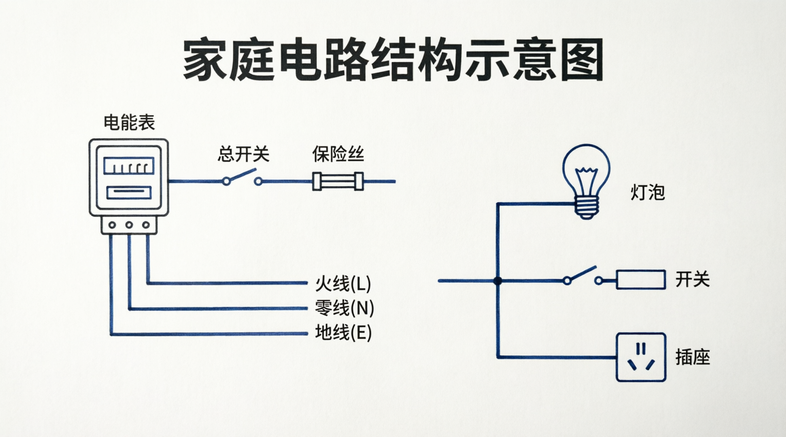
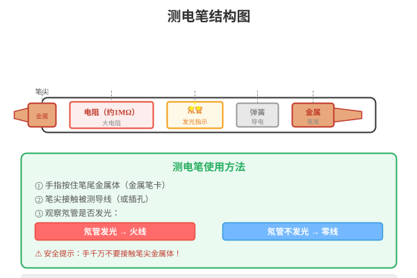
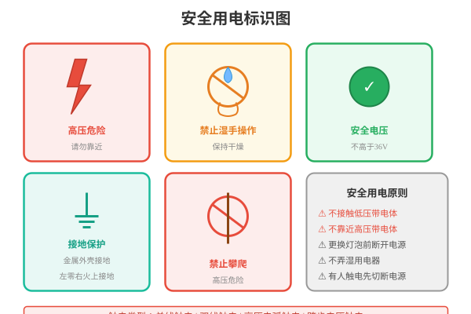

# 1.7 家庭电路

## 一、家庭电路的组成

家庭电路由进户线、电能表、总开关、保险装置、用电器和导线等部分组成。

### 家庭电路的组成顺序

进户线 → 电能表 → 总开关 → 保险装置 → 用电器（并联）

### 各部分的作用

| 组成部分           | 作用                             |
| ------------------ | -------------------------------- |
| **进户线**   | 引入家庭电路的火线和零线         |
| **电能表**   | 测量用户消耗的电能               |
| **总开关**   | 控制整个家庭电路的通断           |
| **保险装置** | 电流过大时自动切断电路，保护安全 |
| **用电器**   | 将电能转化为其他形式的能         |
| **插座**     | 方便移动用电器接入电路           |

## 二、火线与零线

### 火线和零线的区别

- **火线（L）**：对地电压为 220 V，符号 L（Live）。
- **零线（N）**：对地电压为 0 V，符号 N（Neutral）。
- **地线（PE）**：与大地相连，用于安全保护，符号 PE（Protective Earth）。

### 家庭电路电压

我国家庭电路的电压为 **220 V**，频率为 **50 Hz**。

## 三、测电笔的使用

### 测电笔的结构

测电笔是用来辨别火线和零线的工具，由笔尖金属体、电阻、氖管、弹簧和笔尾金属体组成。

### 测电笔的使用方法

1. 手指按住笔尾金属体（金属笔卡）。
2. 笔尖接触被测导线（或插孔）。
3. 观察氖管是否发光：
   - 氖管发光 → 被测的是**火线**。
   - 氖管不发光 → 被测的是**零线**。

> **安全提示**：使用测电笔时，手千万不要接触笔尖金属体，否则会发生触电事故。

### 测电笔的工作原理

测电笔中串联了一个阻值很大的电阻（约 1 MΩ）。当笔尖接触火线时，电流经笔尖、电阻、氖管、弹簧、人体流向大地，形成闭合回路，氖管发光。由于电阻很大，通过人体的电流非常微小（约 0.2 mA），不会对人体造成伤害。

## 四、三线插头与漏电保护器

### 三线插头

三线插头（三脚插头）对应的三孔插座接线规则：

- **左零右火上接地**

即左孔接零线（N），右孔接火线（L），上孔接地线（PE）。

### 接地保护

有金属外壳的用电器必须使用三线插头，将外壳接地。当外壳漏电时，电流会通过地线流向大地，避免人体触电。

### 漏电保护器

漏电保护器的作用是检测电路中的漏电电流。当人体触电或电器漏电时，火线和零线中的电流不平衡，漏电保护器会迅速切断电路（动作时间小于 0.1 s），保障人身安全。

## 五、安全用电常识

### 触电类型

1. **单线触电**：人体接触火线，电流通过人体流向大地。
2. **双线触电**：人体同时接触火线和零线，电流从火线经人体流向零线。
3. **高压电弧触电**：靠近高压带电体时，空气被击穿产生电弧。
4. **跨步电压触电**：高压线落地时，在落地点周围形成电压梯度。

### 安全用电原则

1. **不接触低压带电体，不靠近高压带电体**。
2. 更换灯泡、搬动电器前应断开电源开关。
3. 不弄湿用电器，不损坏绝缘层。
4. 保险装置、插座、导线等必须符合规格。
5. 有金属外壳的用电器要接地。
6. 发现有人触电时，应先**切断电源**，再进行施救。

### 人体安全电压

人体安全电压为**不高于 36 V**。

在潮湿环境中，安全电压更低（不高于 12 V）。

### 电流对人体的危害

| 电流大小    | 人体反应           |
| ----------- | ------------------ |
| 1~5 mA      | 有麻刺感           |
| 5~20 mA     | 肌肉痉挛，无法摆脱 |
| 20~50 mA    | 呼吸困难，可能昏迷 |
| 50~100 mA   | 心室颤动，危险     |
| 100 mA 以上 | 致死               |

## 六、家庭电路故障分析

### 常见故障

| 故障现象       | 可能原因                         |
| -------------- | -------------------------------- |
| 所有灯都不亮   | 总保险丝熔断、总开关跳闸、停电   |
| 某盏灯不亮     | 灯泡烧坏、灯座接触不良、支路断路 |
| 灯忽明忽暗     | 接触不良、电压不稳               |
| 闭合开关即跳闸 | 该支路短路                       |
| 漏电保护器跳闸 | 某处火线或零线漏电               |

## 七、小结

| 知识点       | 要点                                             |
| ------------ | ------------------------------------------------ |
| 家庭电路组成 | 进户线 → 电能表 → 总开关 → 保险装置 → 用电器 |
| 火线零线     | 火线 220 V，零线 0 V，地线保护                   |
| 测电笔       | 接触火线氖管发光，接触零线不发光                 |
| 三孔插座     | 左零右火上接地                                   |
| 安全电压     | 不高于 36 V                                      |
| 安全原则     | 不接触低压，不靠近高压                           |
