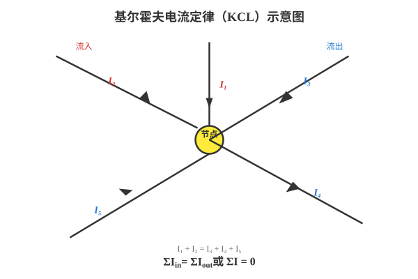
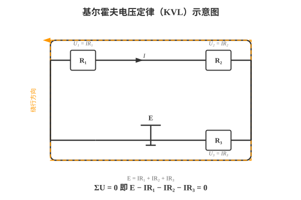

# 2.3 电路分析基础

## 一、基尔霍夫电流定律（KCL）

### 1. 定律内容

基尔霍夫电流定律（Kirchhoff's Current Law, KCL）指出：**在任一时刻，流入电路中任一节点的电流之和等于流出该节点的电流之和**。或者说，在任一节点处，电流的代数和为零。

$$
\sum I_{\text{in}} = \sum I_{\text{out}} \quad \text{或} \quad \sum I = 0
$$

### 2. 物理本质

KCL 的物理本质是**电荷守恒定律**。在节点处，电荷不能积累，因此流入的电荷量必然等于流出的电荷量。

### 3. 应用步骤

1. 标定各支路电流的参考方向
2. 对节点列写 KCL 方程：流入取正，流出取负（或反之，但需一致）
3. 解方程求解未知电流

---

## 二、基尔霍夫电压定律（KVL）

### 1. 定律内容

基尔霍夫电压定律（Kirchhoff's Voltage Law, KVL）指出：**在任一时刻，沿电路中任一闭合回路绕行一周，各段电压降的代数和为零**。

$$
\sum U = 0
$$

### 2. 物理本质

KVL 的物理本质是**能量守恒定律**，即电场力将单位正电荷沿闭合回路移动一周所做的功为零（静电场是保守场）。

### 3. 应用步骤

1. 标定各元件电压的参考方向
2. 选定绕行方向（顺时针或逆时针）
3. 列写 KVL 方程：电压降方向与绕行方向一致时取正，相反时取负
4. 解方程求解未知电压

---

## 三、支路电流法

### 1. 方法

支路电流法以各支路电流为未知量，利用 KCL 和 KVL 列方程求解。

### 2. 步骤

1. 确定电路的支路数 $b$ 和节点数 $n$
2. 标定各支路电流的参考方向
3. 对 $n-1$ 个独立节点列写 KCL 方程
4. 选择 $b - (n-1)$ 个独立回路，列写 KVL 方程
5. 联立求解

### 3. 示例

对于有两个节点、三条支路的电路，可列写 1 个 KCL 方程和 2 个 KVL 方程，联立求解三个支路电流。

---

## 四、节点电压法

节点电压法以节点电压为未知量，利用 KCL 列方程求解。通常选择一个参考节点（接地），对其余节点列写方程。其方程个数为 $n-1$，比支路电流法少，适用于节点较少、支路较多的电路。

这是后续电路分析的重要基础，节点电压方程的完整建立步骤、矩阵求解形式以及含受控源情形的处理见 **3.2 电阻电路的一般分析方法 §1（节点电压法）**。

---

## 五、叠加定理

在线性电路中，任一支路的电流（或电压）等于各个独立电源单独作用时在该支路产生的分量的代数和。应用时需注意：其他独立电源置零（电压源短路、电流源开路）、受控源不能单独作用且应始终保留、功率不满足叠加定理（功率是电压与电流的乘积，是非线性量）。

该定理的严格表述、数学形式及含受控源情形的详细处理见 **3.3 电路定理 §1（叠加定理）**。

---

## 六、等效电源定理

任何线性含源二端网络，对外电路来说都可以用一个**电压源串联电阻**（戴维南等效）或**电流源并联电阻**（诺顿等效）的支路来等效代替。

- 戴维南等效参数：电压源的电动势即是端口开路电压 $U_{oc}$，串联电阻为独立源置零后的等效电阻 $R_{eq}$，即 $U_{th} = U_{oc}$、$R_{th} = R_{eq}$
- 诺顿等效参数：电流源的电流 $I_N$ 等于端口短路电流 $I_{sc}$，并联电阻 $R_N = R_{eq}$，且满足 $U_{th} = I_N R_N$，两者可相互转换

该定理是化简复杂电路的有力工具，其完整的推导与求解步骤见 **3.3 电路定理 §3（戴维南定理与诺顿定理）**。

---

## 七、最大功率传输定理

当负载电阻 $R_L$ 等于电源的等效内阻 $R_s$ 时，负载从电源获得的功率最大，最大功率为：

$$
R_L = R_s, \qquad P_{L,\max} = \frac{U_{oc}^2}{4R_s}
$$

相关推导过程，以及交流电路中"阻抗共轭匹配"（$Z_L = Z_s^*$）的推广形式见 **3.3 电路定理 §4（最大功率传输定理）**。

---

## 八、星形与三角形网络的等效变换（Y-Δ 变换）

### 1. 变换的必要性

在某些电路中，电阻的连接方式既不是串联也不是并联，而是呈星形（Y 形）或三角形（Δ 形）连接。通过 Y-Δ 变换，可以将网络转化为可用串并联化简的形式。

### 2. Δ → Y 变换

将三角形（Δ）连接变换为等效的星形（Y）连接：

$$
\begin{aligned}
R_a &= \frac{R_{ab} R_{ac}}{R_{ab} + R_{bc} + R_{ca}} \\[4pt]
R_b &= \frac{R_{bc} R_{ba}}{R_{ab} + R_{bc} + R_{ca}} \\[4pt]
R_c &= \frac{R_{ca} R_{cb}}{R_{ab} + R_{bc} + R_{ca}}
\end{aligned}
$$

### 3. Y → Δ 变换

将星形（Y）连接变换为等效的三角形（Δ）连接：

$$
\begin{aligned}
R_{ab} &= R_a + R_b + \frac{R_a R_b}{R_c} \\[4pt]
R_{bc} &= R_b + R_c + \frac{R_b R_c}{R_a} \\[4pt]
R_{ca} &= R_c + R_a + \frac{R_c R_a}{R_b}
\end{aligned}
$$

### 4. 特殊情况

当三个电阻相等时（对称情况）：

- Y 形：$R_Y = \dfrac{1}{3}R_{\Delta}$
- Δ 形：$R_{\Delta} = 3R_Y$

---

## 知识小结

| 定理/方法 | 核心公式 | 适用场景 |
|-----------|---------|---------|
| KCL | $\sum I = 0$ | 节点电流分析 |
| KVL | $\sum U = 0$ | 回路电压分析 |
| 支路电流法 | KCL + KVL 联立 | 一般电路 |
| 节点电压法 | $\sum \dfrac{U_i - U_j}{R_{ij}} = \sum I_S$ | 节点少、支路多的电路 |
| 叠加定理 | $I = \sum I^{(k)}$ | 多电源线性电路 |
| 戴维南定理 | $U_{th} = U_{oc}, R_{th} = R_{eq}$ | 化简复杂电路 |
| 诺顿定理 | $I_N = I_{sc}, R_N = R_{eq}$ | 化简复杂电路 |
| 最大功率传输 | $R_L = R_s$ | 负载匹配 |
| Y-Δ 变换 | $R_Y = \frac{1}{3}R_{\Delta}$（对称时） | 桥式电路化简 |