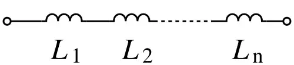
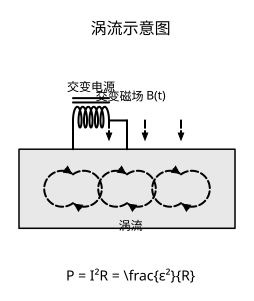

# 2.5 电感

## 一、自感现象与自感电动势

### 1. 自感现象

当线圈中的电流发生变化时，线圈本身产生的穿过自身的磁通量也随之变化，从而在线圈中产生感应电动势，这种现象称为**自感现象**。自感现象是电磁感应现象的一种特殊形式。

### 2. 自感电动势

由自感现象产生的感应电动势称为**自感电动势** $e_L$。根据法拉第电磁感应定律：

$$
e_L = -L \frac{di}{dt}
$$

其中：
- $L$ — 自感系数（电感量），单位：亨利（H）
- $\dfrac{di}{dt}$ — 电流的变化率
- 负号表示自感电动势的方向总是阻碍原电流的变化（楞次定律）

### 3. 自感现象的应用

- **通电自感**：开关闭合时，与线圈串联的灯泡逐渐变亮，而非立即达到最亮
- **断电自感**：开关断开时，与线圈并联的灯泡可能闪亮一下再熄灭

> **自感电动势的方向**：当电流增大时，$e_L$ 与电流方向相反，阻碍电流增大；当电流减小时，$e_L$ 与电流方向相同，阻碍电流减小。这就是"电磁惯性"的体现。

---

## 二、自感系数（电感量）

### 1. 定义

自感系数 $L$ 是描述线圈产生自感电动势本领的物理量。线圈中电流变化率为 $1\ \text{A/s}$ 时产生的自感电动势大小，在数值上等于自感系数。

$$
L = \frac{\Phi}{I}
$$

即线圈的自感系数等于线圈中通过单位电流时产生的磁通量。

### 2. 影响自感系数的因素

对于长直螺线管，自感系数为：

$$
L = \mu \frac{N^2}{l} S = \mu n^2 V
$$

其中：
- $\mu$ — 磁芯的磁导率
- $N$ — 线圈匝数
- $l$ — 线圈长度
- $S$ — 横截面积
- $n = N/l$ — 单位长度的匝数
- $V = Sl$ — 线圈的体积

### 3. 影响 $L$ 的因素总结

| 因素 | 变化方向 | 自感系数变化 |
|------|---------|-------------|
| 线圈匝数 $N$ | 增大 | $L \uparrow$ |
| 线圈面积 $S$ | 增大 | $L \uparrow$ |
| 线圈长度 $l$ | 增大 | $L \downarrow$ |
| 插入铁磁芯 | $\mu$ 增大 | $L \uparrow$（显著增大） |

### 4. 电感元件的特性

在直流电路中，电感在稳态时相当于**短路**（仅有导线电阻）。在交流电路中，电感呈现感抗 $X_L = \omega L$。

---

## 三、互感现象与互感系数

### 1. 互感现象

当一个线圈中的电流发生变化时，在邻近的另一个线圈中产生感应电动势的现象，称为**互感现象**。

### 2. 互感电动势

设线圈 1 中的电流 $i_1$ 变化，在线圈 2 中产生的互感电动势为：

$$
e_{21} = -M \frac{di_1}{dt}
$$

同理，线圈 2 中的电流 $i_2$ 变化，在线圈 1 中产生的互感电动势为：

$$
e_{12} = -M \frac{di_2}{dt}
$$

其中 $M$ 称为**互感系数**（简称互感），单位也是亨利（H）。

### 3. 互感系数

互感系数 $M$ 取决于两个线圈的几何形状、大小、匝数、相对位置以及周围介质的磁导率。

$$
M = k\sqrt{L_1 L_2}
$$

其中 $k$ 为耦合系数（$0 \leq k \leq 1$），表示两个线圈之间磁耦合的紧密程度：
- $k = 1$：理想耦合（无漏磁）
- $k = 0$：无耦合
- $0 < k < 1$：一般情况，存在漏磁

### 4. 互感的实际应用

- **变压器**：利用互感原理实现电压变换
- **无线充电**：利用互感实现能量的无线传输
- **RFID 技术**：利用互感实现非接触式识别

---

## 四、涡流与趋肤效应

### 1. 涡流

当导体处于变化的磁场中时，导体内部会产生感应电流。由于这种电流在导体内自行闭合，形成旋涡状，故称为**涡流**（eddy current）。

### 2. 涡流的影响与应用

**有害影响**：
- 涡流在导体中产生焦耳热，造成能量损耗（涡流损耗）
- 在变压器和电机铁芯中，涡流损耗会使设备发热、效率降低

**减少涡流的方法**：
- 使用硅钢片叠压铁芯（片间绝缘，增加电阻，减少涡流）
- 使用铁氧体等高电阻率材料

**有益应用**：
- **电磁炉**：利用涡流加热锅具
- **感应加热**：金属熔炼、热处理
- **涡流制动**：电气列车中的涡流制动装置
- **金属探测**：利用涡流检测金属物体

### 3. 趋肤效应

**趋肤效应**（Skin Effect）是指当交流电通过导体时，电流密度在导体横截面上的分布不均匀，越靠近导体表面电流密度越大，越靠近中心电流密度越小的现象。

### 4. 趋肤深度的计算

趋肤深度 $\delta$ 定义为电流密度降至表面值的 $1/e$（约 37%）处的深度：

$$
\delta = \sqrt{\frac{2}{\omega \mu \sigma}} = \sqrt{\frac{1}{\pi f \mu \sigma}}
$$

其中：
- $\omega = 2\pi f$ — 角频率
- $\mu$ — 导体的磁导率
- $\sigma$ — 导体的电导率
- $f$ — 频率

### 5. 趋肤效应的影响

| 频率 | 趋肤深度（铜） | 影响 |
|------|--------------|------|
| 50 Hz | 约 9.3 mm | 工频下影响较小 |
| 1 kHz | 约 2.1 mm | 开始显著 |
| 1 MHz | 约 66 μm | 电流集中在表面极薄层 |
| 1 GHz | 约 2.1 μm | 高频下几乎只在表面传导 |

### 6. 趋肤效应的应对措施

- **多股细导线绞合**（李兹线，Litz wire）：增加有效导电面积
- **镀银或镀金**：提高表面导电率
- **空心导体**：高频下中心区域几乎无电流，可以使用空心导体节省材料（如电力传输线中的钢芯铝绞线）

---

## 五、电感中的磁场储能

当线圈中通有电流时，电流产生的磁场储存了**磁场能**。电感量为 $L$ 的线圈中储存的磁场能为：

$$
W = \frac{1}{2}L I^2
$$

电感储存的能量与电流的二次方成正比。由于线圈中电流不能突变，磁场能也不会突变，这正体现了本节的"电磁惯性"，也是通电、断电自感现象中存在能量交换的本质。

> **与电容储能相对偶**：电容以电场能储能，$E = \tfrac{1}{2}CU^2$（正比于电压平方）；电感以磁场能储能，$W = \tfrac{1}{2}LI^2$（正比于电流平方）。

---

## 知识小结

| 概念 | 公式 | 说明 |
|------|------|------|
| 自感电动势 | $e_L = -L\dfrac{di}{dt}$ | 阻碍电流变化 |
| 自感系数 | $L = \mu n^2 V$ | 由线圈结构决定 |
| 互感电动势 | $e_{21} = -M\dfrac{di_1}{dt}$ | 互感现象 |
| 互感系数 | $M = k\sqrt{L_1 L_2}$ | $k$ 为耦合系数 |
| 磁场储能 | $W = \tfrac{1}{2}LI^2$ | 正比于电流平方 |
| 趋肤深度 | $\delta = \sqrt{\dfrac{2}{\omega \mu \sigma}}$ | 高频时显著 |