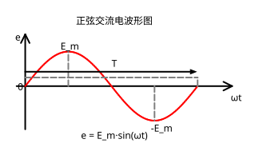
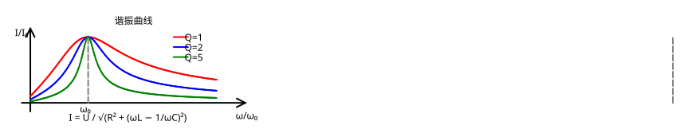
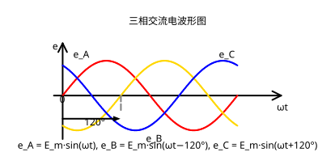

# 2.6 交流电

## 一、正弦交流电的产生

### 1. 交流发电机的原理

正弦交流电由线圈在匀强磁场中绕垂直于磁场的轴匀速转动产生。

设线圈的面积为 $S$，匝数为 $N$，磁感应强度为 $B$，角速度为 $\omega$。当线圈平面与中性面夹角为 $\omega t$ 时，穿过线圈的磁通量为：

$$
\Phi = BS\cos\omega t
$$

根据法拉第电磁感应定律，感应电动势为：

$$
e = -\frac{d\Phi}{dt} = NBS\omega\sin\omega t = E_m\sin\omega t
$$

其中 $E_m = NBS\omega$ 为电动势的最大值。

### 2. 交流电的描述

**瞬时值**：

$$
e = E_m\sin\omega t, \quad u = U_m\sin\omega t, \quad i = I_m\sin\omega t
$$

**最大值**（峰值）：

$$
E_m = NBS\omega, \quad U_m = I_m R
$$

**有效值**（均方根值）：

正弦交流电的有效值等于最大值除以 $\sqrt{2}$：

$$
E = \frac{E_m}{\sqrt{2}}, \quad U = \frac{U_m}{\sqrt{2}}, \quad I = \frac{I_m}{\sqrt{2}}
$$

**平均值**：

交流电的平均值是指一个周期内瞬时值的平均。对于正弦交流电，半周期内的平均值为：

$$
\bar{E} = \frac{2}{\pi}E_m, \quad \bar{I} = \frac{2}{\pi}I_m
$$

**周期与频率**：

$$
T = \frac{2\pi}{\omega}, \quad f = \frac{1}{T} = \frac{\omega}{2\pi}
$$

其中 $T$ 为周期（s），$f$ 为频率（Hz），$\omega$ 为角频率（rad/s）。

---

## 二、纯电阻 / 纯电感 / 纯电容电路

### 1. 纯电阻电路

电压与电流同相位：

$$
u = U_m\sin\omega t, \quad i = I_m\sin\omega t
$$

$$
I = \frac{U}{R}, \quad I_m = \frac{U_m}{R}
$$

功率：$P = UI = I^2R = \dfrac{U^2}{R}$（有功功率）

### 2. 纯电感电路

电感对交流电的阻碍作用称为**感抗**：

$$
X_L = \omega L = 2\pi f L
$$

电压超前电流 $90^\circ$（$\dfrac{\pi}{2}$）：

$$
u = U_m\sin\omega t, \quad i = I_m\sin\left(\omega t - \frac{\pi}{2}\right)
$$

欧姆定律形式：

$$
I = \frac{U}{X_L}, \quad I_m = \frac{U_m}{X_L}
$$

功率：电感不消耗有功功率，只进行能量的交换，无功功率 $Q_L = UI = I^2 X_L$

### 3. 纯电容电路

电容对交流电的阻碍作用称为**容抗**：

$$
X_C = \frac{1}{\omega C} = \frac{1}{2\pi f C}
$$

电流超前电压 $90^\circ$（$\dfrac{\pi}{2}$）：

$$
u = U_m\sin\omega t, \quad i = I_m\sin\left(\omega t + \frac{\pi}{2}\right)
$$

欧姆定律形式：

$$
I = \frac{U}{X_C}, \quad I_m = \frac{U_m}{X_C}
$$

功率：电容也不消耗有功功率，无功功率 $Q_C = UI = I^2 X_C$

---

## 三、RLC 串联交流电路

### 1. 电路构成

电阻 $R$、电感 $L$、电容 $C$ 串联在交流电源上。

### 2. 阻抗与阻抗角

RLC 串联电路的总阻抗为：

$$
Z = R + j(X_L - X_C) = |Z| \angle \varphi
$$

阻抗模：

$$
|Z| = \sqrt{R^2 + (X_L - X_C)^2} = \sqrt{R^2 + \left(\omega L - \frac{1}{\omega C}\right)^2}
$$

阻抗角（电压与电流的相位差）：

$$
\varphi = \arctan\frac{X_L - X_C}{R}
$$

### 3. 欧姆定律的相量形式

$$
\dot{U} = \dot{I} Z, \quad I = \frac{U}{|Z|}
$$

### 4. 电路性质

| 条件 | 性质 | 相位关系 |
|------|------|---------|
| $X_L > X_C$ | 感性 | 电压超前电流 |
| $X_L < X_C$ | 容性 | 电压滞后电流 |
| $X_L = X_C$ | 阻性（谐振） | 电压与电流同相 |

---

## 四、谐振电路

### 1. 串联谐振

当 $X_L = X_C$ 时，电路发生串联谐振。

**谐振条件**：

$$
\omega_0 L = \frac{1}{\omega_0 C} \quad \Rightarrow \quad \omega_0 = \frac{1}{\sqrt{LC}}, \quad f_0 = \frac{1}{2\pi\sqrt{LC}}
$$

**谐振特点**：
- 阻抗最小：$Z = R$
- 电流最大：$I_0 = \dfrac{U}{R}$
- 电感电压与电容电压大小相等、方向相反，相互抵消
- 品质因数 $Q = \dfrac{\omega_0 L}{R} = \dfrac{1}{\omega_0 C R} = \dfrac{U_L}{U} = \dfrac{U_C}{U}$

### 2. 并联谐振

**谐振条件**：同串联谐振 $\omega_0 = \dfrac{1}{\sqrt{LC}}$

**谐振特点**：
- 阻抗最大（理想情况为无穷大）
- 电流最小
- 支路电流可能远大于总电流（电流谐振）

### 3. 谐振的应用

- **选频电路**：收音机通过调节 $C$ 使电路谐振于特定频率
- **滤波电路**：利用谐振特性滤除或选出特定频率的信号
- **振荡器**：LC 振荡回路产生正弦波信号

---

## 五、功率因数及其提高

### 1. 功率因数的定义

在交流电路中，有功功率 $P$ 与视在功率 $S$ 的比值称为功率因数：

$$
\lambda = \cos\varphi = \frac{P}{S}
$$

其中：
- 有功功率 $P = UI\cos\varphi$（实际消耗的功率）
- 无功功率 $Q = UI\sin\varphi$（储能元件与电源间交换的功率）
- 视在功率 $S = UI = \sqrt{P^2 + Q^2}$

### 2. 提高功率因数的意义

- **提高设备利用率**：功率因数越高，同样的视在功率可提供更多的有功功率
- **减小线路损耗**：功率因数越高，传输同样有功功率所需的电流越小，线路损耗越小
- **节约电能**：降低线路压降，改善供电质量

### 3. 提高功率因数的方法

工业生产中，大量感性负载（如电动机、变压器）会导致功率因数偏低。通常采用**并联电容器**的方法进行补偿：

$$
C = \frac{P}{\omega U^2}(\tan\varphi_1 - \tan\varphi_2)
$$

其中 $\varphi_1$ 为补偿前的阻抗角，$\varphi_2$ 为补偿后的阻抗角。

---

## 六、三相交流电基础

### 1. 三相交流电的产生

三相交流电由三相发电机产生，发电机中有三个独立的绕组，在空间上互差 $120^\circ$。

三个绕组产生的感应电动势为：

$$
\begin{aligned}
e_A &= E_m\sin\omega t \\
e_B &= E_m\sin(\omega t - 120^\circ) \\
e_C &= E_m\sin(\omega t - 240^\circ) = E_m\sin(\omega t + 120^\circ)
\end{aligned}
$$

### 2. 三相电源的连接

**星形连接（Y 接）**：
- 线电压 $U_L = \sqrt{3} U_P$（$U_P$ 为相电压）
- 线电流 $I_L = I_P$（$I_P$ 为相电流）

**三角形连接（Δ 接）**：
- 线电压 $U_L = U_P$
- 线电流 $I_L = \sqrt{3} I_P$

### 3. 三相功率

三相总功率等于各相功率之和：

- 有功功率：$P = \sqrt{3} U_L I_L \cos\varphi = 3U_P I_P \cos\varphi$
- 无功功率：$Q = \sqrt{3} U_L I_L \sin\varphi = 3U_P I_P \sin\varphi$
- 视在功率：$S = \sqrt{3} U_L I_L = 3U_P I_P$

### 4. 三相交流电的优点

- 输送相同功率时比单相节省导线材料
- 三相电动机结构简单、性能优良
- 能产生旋转磁场，驱动三相电动机工作
- 三相整流电路输出纹波小

---

## 知识小结

| 概念 | 公式 | 说明 |
|------|------|------|
| 瞬时值 | $e = E_m\sin\omega t$ | 随时间变化 |
| 有效值 | $E = E_m/\sqrt{2}$ | 热效应等效 |
| 感抗 | $X_L = \omega L$ | 正比于频率 |
| 容抗 | $X_C = 1/(\omega C)$ | 反比于频率 |
| RLC 阻抗 | $\|Z\| = \sqrt{R^2 + (X_L - X_C)^2}$ | 总阻抗 |
| 谐振频率 | $f_0 = 1/(2\pi\sqrt{LC})$ | 串联/并联谐振 |
| 功率因数 | $\cos\varphi = P/S$ | 提高可降低损耗 |
| 三相线电压 | $U_L = \sqrt{3}U_P$（Y 接） | 三相四线制 |