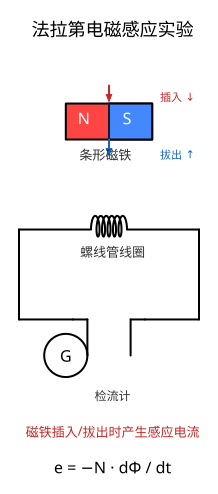
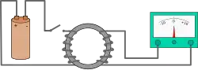
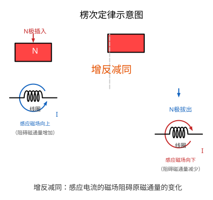

# 2.8 电磁感应

## 一、电磁感应现象

### 1. 发现历史

1831 年，英国物理学家**法拉第**（Michael Faraday）通过一系列实验发现：当穿过闭合导体回路的磁通量发生变化时，回路中就会产生感应电流。这一现象被称为**电磁感应现象**，产生的电动势称为**感应电动势**。

### 2. 产生感应电流的条件

穿过闭合回路的磁通量发生变化，即：

$$
\Delta\Phi = \Phi_2 - \Phi_1 \neq 0
$$

磁通量变化的方式包括：
- **磁场变化**：磁场强度 $B$ 随时间变化
- **面积变化**：回路面积 $S$ 发生变化
- **角度变化**：回路平面与磁场方向的夹角 $\theta$ 改变
- **组合变化**：以上多种因素同时变化

---

## 二、法拉第电磁感应定律

### 1. 定律内容

电路中感应电动势的大小，跟穿过这一电路的磁通量的变化率成正比。对于 $N$ 匝线圈：

$$
e = -N\frac{d\Phi}{dt}
$$

其中：
- $e$ — 感应电动势（V）
- $N$ — 线圈匝数
- $\Phi$ — 穿过每匝线圈的磁通量（Wb）
- $\dfrac{d\Phi}{dt}$ — 磁通量的变化率（Wb/s）
- 负号表示感应电动势的方向由楞次定律决定

### 2. 磁通量 $\Phi$

磁通量是描述穿过某一面积的磁感线条数的物理量：

$$
\Phi = BS\cos\theta
$$

其中：
- $B$ — 磁感应强度（T）
- $S$ — 面积（m²）
- $\theta$ — 磁场方向与面积法线方向的夹角

### 3. 感应电动势的平均值与瞬时值

**平均感应电动势**：

$$
\bar{e} = N\frac{\Delta\Phi}{\Delta t}
$$

**瞬时感应电动势**：

$$
e = \lim_{\Delta t \to 0} N\frac{\Delta\Phi}{\Delta t} = N\frac{d\Phi}{dt}
$$

### 4. 感应电荷量

在一段时间内通过回路某一横截面的感应电荷量，与磁通量的变化量成正比，与回路电阻成反比：

$$
q = \bar{I}\Delta t = \frac{\bar{e}}{R}\Delta t = \frac{N\Delta\Phi}{R}
$$

这个公式表明，感应电荷量只与磁通量的变化量 $\Delta\Phi$ 和回路电阻 $R$ 有关，与磁通量变化快慢无关。

---

## 三、楞次定律

### 1. 定律内容

**楞次定律**：感应电流具有这样的方向，即感应电流的磁场总是**阻碍**引起感应电流的磁通量的变化。

简记为："**增反减同**"——磁通量增加时，感应电流的磁场与原磁场方向相反；磁通量减少时，感应电流的磁场与原磁场方向相同。

### 2. 楞次定律的深层含义

楞次定律的本质是**能量守恒定律在电磁感应现象中的具体体现**。感应电流的磁场阻碍磁通量的变化，需要外力克服这种阻碍做功，从而将机械能转化为电能。

### 3. 应用楞次定律判断感应电流方向的步骤

1. **明确原磁场方向**：确定穿过闭合回路的原磁场 $B$ 的方向
2. **判断磁通量变化**：判断 $\Phi$ 是增加还是减少
3. **确定感应电流磁场方向**：根据"增反减同"原则
4. **利用右手螺旋定则**：由感应电流磁场方向确定感应电流方向

### 4. 右手定则（适用于导体切割磁感线）

伸开右手，使拇指与其余四指垂直，让磁感线穿入手心，拇指指向导体运动方向，则四指所指方向即为感应电流方向。

---

## 四、动生电动势与感生电动势

### 1. 动生电动势

**定义**：由于导体在磁场中运动（切割磁感线）而产生的感应电动势。

**产生机制**：导体中的自由电荷受到洛伦兹力的作用而定向移动，形成电动势。

**计算公式**：

当长度为 $L$ 的直导体以速度 $v$ 在磁感应强度为 $B$ 的匀强磁场中做切割磁感线运动时：

$$
e = BLv\sin\theta
$$

其中 $\theta$ 为 $v$ 与 $B$ 之间的夹角。

当 $v \perp B$ 时（$\theta = 90^\circ$），$e = BLv$（最大）。

当 $v \parallel B$ 时（$\theta = 0^\circ$），$e = 0$。

**旋转切割**：长为 $L$ 的导体棒以角速度 $\omega$ 在匀强磁场中绕一端匀速转动（$B$ 垂直于转轴），产生的感应电动势为：

$$
e = \frac{1}{2}BL^2\omega
$$

### 2. 感生电动势

**定义**：由于磁场变化（导体不动，磁场随时间变化）而在导体中产生的感应电动势。

**产生机制**：变化的磁场在其周围空间激发**涡旋电场**（感生电场），涡旋电场对自由电荷的作用力（非静电力）驱使电荷定向移动。

**麦克斯韦的贡献**：麦克斯韦指出，变化的磁场会在其周围空间产生感生电场，这种电场与静电场不同，其电场线是闭合的，称为**涡旋电场**。

**计算公式**：

$$
e = -\frac{d\Phi}{dt} = -\frac{d}{dt}\iint_S \mathbf{B} \cdot d\mathbf{S}
$$

### 3. 动生电动势与感生电动势的对比

| 比较项目 | 动生电动势 | 感生电动势 |
|---------|-----------|-----------|
| 产生原因 | 导体运动，切割磁感线 | 磁场随时间变化 |
| 非静电力 | 洛伦兹力 | 涡旋电场力 |
| 计算公式 | $e = BLv\sin\theta$ | $e = -N\dfrac{d\Phi}{dt}$ |
| 磁场条件 | 磁场可以不随时间变化 | 磁场必须随时间变化 |
| 典型实例 | 发电机 | 变压器 |

---

## 五、涡流及其应用

### 1. 涡流的产生

当块状金属处于变化的磁场中或相对于磁场运动时，金属内部会产生感应电流。由于这种电流在金属内部自行闭合，呈旋涡状，故称为**涡流**（Eddy Current）。

### 2. 涡流的热效应

涡流通过金属时会产生焦耳热：

$$
P = I^2R = \frac{e^2}{R}
$$

涡流产生的热量与磁场变化频率的平方成正比，因此高频交变磁场可以产生大量热。

### 3. 涡流的应用

**（1）电磁炉**

电磁炉利用高频交变电流（20 kHz ~ 50 kHz）通过线圈产生高频交变磁场，在铁质锅底产生强大的涡流，利用涡流的热效应加热食物。

> 电磁炉要求锅具必须是铁磁性材料（如铸铁、不锈钢锅），铝锅、铜锅因电阻率低，涡流热效应不显著，不适用于电磁炉。

**（2）金属探测器**

金属探测器利用发射线圈产生交变磁场，当金属物体靠近时，金属内部产生涡流，涡流产生的磁场被接收线圈检测到，从而实现金属探测。

应用场景：安检门、地雷探测、考古勘探、食品工业中的金属异物检测。

**（3）涡流制动**

在旋转的金属圆盘（如列车车轮）附近放置电磁铁，当电磁铁通电时，金属圆盘中产生涡流，涡流在磁场中受到安培力，力的方向与圆盘旋转方向相反，从而实现制动。

涡流制动的优点：无接触、无磨损、制动力平滑可调。广泛应用于高速列车、游乐设施、电表阻尼等。

**（4）感应加热**

利用涡流对金属工件进行加热，应用于金属熔炼、淬火、焊接等领域。

### 4. 涡流的危害与抑制

- **变压器铁芯**：采用硅钢片叠压，片间绝缘，增大涡流路径电阻
- **电机铁芯**：同样使用叠片结构
- **高频变压器**：使用铁氧体磁芯（电阻率极高）

---

## 六、电磁感应在生活中的应用

### 1. 无线充电

利用电磁感应原理，发射线圈产生交变磁场，接收线圈中产生感应电动势，经整流后为设备充电。

**工作原理**：

$$
e_2 = -M\frac{di_1}{dt}
$$

其中 $M$ 为发射线圈与接收线圈之间的互感系数。

常用标准：
- **Qi 标准**：工作频率 110 kHz ~ 205 kHz，适用于手机、穿戴设备
- **AirFuel 标准**：支持磁共振方式，充电距离更远

### 2. 电磁炉

如前所述，利用高频涡流加热。电磁炉的效率可达 80% 以上，远高于传统燃气灶。

### 3. 磁卡读卡器

磁卡上有一条磁条，磁条上以不同方向的微小磁畴记录信息。读卡时，磁卡划过读卡头（含线圈），磁条上的磁场变化使线圈中产生感应电动势，从而读取信息。

### 4. 变压器

利用电磁感应实现电压变换，是电力系统中最核心的设备之一。

### 5. 麦克风（动圈式）

声波使振膜带动线圈在永磁体磁场中振动，切割磁感线产生感应电动势，将声信号转换为电信号。

### 6. 电磁流量计

利用电磁感应原理测量导电流体的流量。导电流体在磁场中流动时，相当于导体切割磁感线，在与磁场和流速垂直的方向上产生感应电动势：

$$
e = BDv
$$

其中 $D$ 为管道直径，$v$ 为流速。通过测量 $e$ 即可得到流量。

### 7. RFID 技术

射频识别（Radio Frequency Identification）利用电磁感应实现非接触式自动识别，广泛应用于门禁卡、公交卡、物流追踪等。

---

## 知识小结

| 概念 | 公式 | 说明 |
|------|------|------|
| 法拉第电磁感应定律 | $e = -N\dfrac{d\Phi}{dt}$ | 感应电动势与磁通量变化率成正比 |
| 磁通量 | $\Phi = BS\cos\theta$ | 穿过某一面积的磁感线条数 |
| 动生电动势 | $e = BLv\sin\theta$ | 导体切割磁感线 |
| 旋转切割 | $e = \frac{1}{2}BL^2\omega$ | 导体棒绕一端转动 |
| 感应电荷量 | $q = \dfrac{N\Delta\Phi}{R}$ | 与磁通量变化量成正比 |
| 楞次定律 | 增反减同 | 能量守恒的体现 |
| 涡流 | 块状金属中的感应电流 | 热效应与制动效应 |