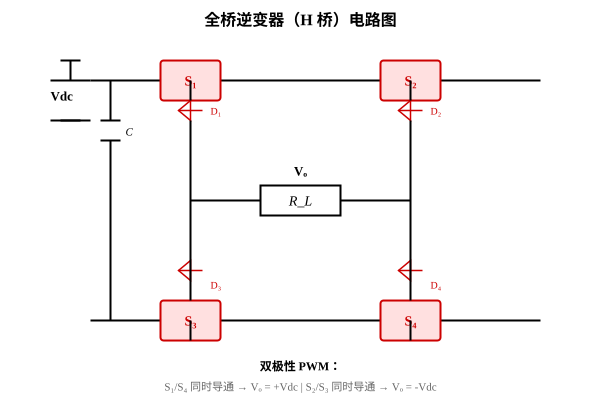

# 8.2 逆变器

## 1. 引言

逆变器（Inverter）是将直流电（DC）转换为交流电（AC）的电力电子装置。作为电力电子四大变换（整流、逆变、斩波、交交变频）之一，逆变器在可再生能源发电、不间断电源（UPS）、电机驱动等领域具有不可替代的作用。

## 2. 逆变器的基本概念

### 2.1 分类

按输入电源类型：
- **电压型逆变器（VSI）**：直流侧并联大电容，维持电压恒定
- **电流型逆变器（CSI）**：直流侧串联大电感，维持电流恒定

按输出波形：
- **方波逆变器**：输出 50% 占空比方波
- **阶梯波逆变器**：多电平叠加逼近正弦波
- **正弦波逆变器**：通过 PWM 调制输出正弦波

按拓扑结构：
- **半桥逆变器**
- **全桥逆变器（H 桥）**
- **推挽逆变器**
- **多电平逆变器**

## 3. 半桥逆变器

### 3.1 工作原理

半桥逆变器由两个开关管 $S_1$、$S_2$ 和两个电容 $C_1$、$C_2$ 构成。电容中点作为参考点。

- $S_1$ 导通、$S_2$ 关断：$V_o = +V_{dc}/2$
- $S_2$ 导通、$S_1$ 关断：$V_o = -V_{dc}/2$

输出为方波，幅值 $\pm V_{dc}/2$。

### 3.2 输出电压分析

方波输出电压的傅里叶级数展开：

$$v_o(t) = \frac{2V_{dc}}{\pi} \sum_{n=1,3,5,\ldots}^{\infty} \frac{\sin(n\omega t)}{n}$$

基波幅值：

$$V_{o1} = \frac{2V_{dc}}{\pi} \approx 0.637 V_{dc}$$

总谐波畸变率（THD）：

$$THD = \sqrt{\sum_{n=2}^{\infty} \left(\frac{V_{on}}{V_{o1}}\right)^2} \times 100\%$$

方波的 THD 约为 48.4%。

## 4. 全桥逆变器（H 桥）

### 4.1 工作原理

全桥逆变器由四个开关管 $S_1$–$S_4$ 构成 H 形拓扑。负载跨接在桥臂中点之间。

**双极性 PWM 控制**：
- $S_1$ 和 $S_4$ 同时导通：$V_o = +V_{dc}$
- $S_2$ 和 $S_3$ 同时导通：$V_o = -V_{dc}$

**单极性 PWM 控制**：
- 正半周：$S_1$ 常通，$S_4$ 按 PWM 开关，$S_2$ 和 $S_3$ 关断
- 负半周：$S_2$ 常通，$S_3$ 按 PWM 开关，$S_1$ 和 $S_4$ 关断

### 4.2 半桥与全桥对比

| 特性 | 半桥 | 全桥 |
|------|------|------|
| 开关管数量 | 2 | 4 |
| 输出电压幅值 | $\pm V_{dc}/2$ | $\pm V_{dc}$ |
| 直流侧电容 | 需要两个电容 | 只需一个电容 |
| 器件电压应力 | $V_{dc}$ | $V_{dc}$ |
| 功率等级 | 中小功率 | 中高功率 |

## 5. 方波逆变器与正弦波逆变器

### 5.1 方波逆变器

方波逆变器输出为 50% 占空比方波，结构简单但谐波含量高。适用于对波形质量要求不高的负载（如阻性加热器）。

### 5.2 正弦波逆变器

通过 PWM 调制技术，使输出电压基波为正弦波。输出滤波后，THD 可降至 3% 以下。

**准方波（Modified Sine Wave）逆变器**：
- 输出为三级电平（$+V_{dc}$、$0$、$-V_{dc}$）
- 在方波中插入零电平区间，降低谐波
- 输出电压的傅里叶级数：

$$v_o(t) = \sum_{n=1,3,5,\ldots}^{\infty} \frac{4V_{dc}}{n\pi} \cos(n\alpha) \sin(n\omega t)$$

其中 $\alpha$ 为零电平角的一半。通过选择 $\alpha$ 可消除特定次谐波。

## 6. 单相逆变器与三相逆变器

### 6.1 单相逆变器

使用一个全桥（H 桥）或半桥，输出单相交流电。适用于家用 UPS、小型光伏逆变器等。

### 6.2 三相逆变器

由三个半桥臂组成（共 6 个开关管），输出三相交流电。三相逆变器是工业电机驱动的主流方案。

三相输出电压（相差 120°）：

$$v_{AN}(t) = V_m \sin(\omega t)$$

$$v_{BN}(t) = V_m \sin(\omega t - 120°)$$

$$v_{CN}(t) = V_m \sin(\omega t + 120°)$$

线电压（如 $v_{AB} = v_{AN} - v_{BN}$）：

$$v_{AB}(t) = \sqrt{3}V_m \sin(\omega t + 30°)$$

## 7. SPWM 逆变原理

### 7.1 正弦脉宽调制原理

SPWM（Sinusoidal PWM）将正弦调制波 $v_m(t)$ 与高频三角载波 $v_c(t)$ 比较，生成 PWM 驱动信号。

- 当 $v_m(t) > v_c(t)$：上管导通，输出电压 $+V_{dc}$
- 当 $v_m(t) < v_c(t)$：下管导通，输出电压 $-V_{dc}$

### 7.2 调制比与频率比

**调制比（调制度）**：

$$m_a = \frac{V_m}{V_c}$$

其中 $V_m$ 为调制波幅值，$V_c$ 为载波幅值。

**频率比**：

$$m_f = \frac{f_c}{f_m}$$

其中 $f_c$ 为载波频率，$f_m$ 为调制波频率。

### 7.3 输出电压基波

线性调制区（$m_a \leq 1$）：

$$V_{o1} = m_a \cdot V_{dc}$$

过调制区（$m_a > 1$）：$V_{dc} < V_{o1} < \frac{4}{\pi}V_{dc}$。

## 8. 逆变器的应用

### 8.1 不间断电源（UPS）

UPS 的核心是逆变器，在市电断电时由电池供能，逆变输出交流电。在线式 UPS 的逆变器始终工作，提供最高质量的电源。

### 8.2 变频器（VFD）

变频器用于交流电机调速，典型结构为 AC-DC-AC（整流 + 逆变）。通过调节逆变器输出电压的频率和幅值控制电机转速。

### 8.3 光伏逆变器

光伏逆变器将光伏电池的直流电转换为交流电，并网或独立供电。关键要求：
- 最大功率点跟踪（MPPT）
- 高效率（> 98%）
- 低谐波注入（满足并网标准）

### 8.4 电动汽车牵引逆变器

将电池直流电转换为三相交流电驱动电机。要求：
- 高功率密度
- 高效率（影响续航里程）
- 宽调速范围

## 9. DC-DC 斩波变换

### 9.1 引言

引言将电力电子归纳为四种基本变换（整流、逆变、斩波、交交变频），其中**斩波（DC-DC 变换）**是将一个直流电压转换为另一个（通常不同幅值）直流电压的过程，是开关电源、电池管理、新能源系统的基础。按是否带变压器可分为**非隔离型**与**隔离型**两大类。

DC-DC 变换器通过开关管以高频 PWM 通断，配合储能元件（电感/电容）实现电压变换，其核心思想源于 8.3 节介绍的占空比 $D$ 控制。

### 9.2 非隔离型拓扑

#### 9.2.1 Buck（降压斩波）

Buck 变换器将输入电压降到更低的输出电压。电路由一个开关管 $S$、续流二极管 $D$、滤波电感 $L$ 和电容 $C$ 组成。

当 $S$ 导通时，电源向电感充电并供电给负载；当 $S$ 关断时，电感电流经二极管 $D$ 续流。稳态下电感伏秒平衡，输出电压为：

$$V_o = D \cdot V_{in}$$

其中 $D = T_{on}/T$ 为占空比。因为 $0 \le D \le 1$，所以 $V_o \le V_{in}$，实现降压。

#### 9.2.2 Boost（升压斩波）

Boost 变换器将输入电压升到更高的输出电压。当 $S$ 导通时，电源直接对电感储能（此时负载由电容供电）；当 $S$ 关断时，电感与电源串联向负载放电，从而抬高输出电压。

由电感伏秒平衡可得：

$$V_o = \frac{V_{in}}{1 - D}$$

因为 $1 - D \le 1$，所以 $V_o \ge V_{in}$，实现升压。需注意 $D \to 1$ 时 $V_o$ 趋于无穷，实际受限于器件与效率。

#### 9.2.3 Buck-Boost（升降压斩波）

Buck-Boost 变换器既能升压也能降压，且输出电压极性反转（属于反极性/反相斩波）。当 $S$ 导通时，电感储能，负载由电容供电；当 $S$ 关断时，电感电流流过二极管向负载释放能量，输出端产生负电压。

输出电压为：

$$V_o = -\frac{D}{1 - D} \cdot V_{in}$$

当 $D < 0.5$ 时降压，$D > 0.5$ 时升压，且 $V_o$ 与 $V_{in}$ 极性相反。

三种非隔离拓扑的关系可归结为：由开关管占空比 $D$ 与储能电感共同决定输出电压幅值。

### 9.3 隔离型拓扑概述

隔离型 DC-DC 变换器通过**高频变压器**实现输入输出的电气隔离，可用于获得安全的低压输出、实现多路输出、以及电压匹配。

#### 9.3.1 反激变换器（Flyback）

耦合电感（变压器）兼作储能元件，次级侧仅在开关管关断时通过二极管向输出供电。结构简单、器件少、成本低，适用于**中低功率**（几十 W 至一两百 W）场合，如手机充电器、小功率适配器。

#### 9.3.2 正激变换器（Forward）

变压器只起电气隔离作用，不储能，需要额外的磁复位绕组与输出电感滤波。适用于**中功率**（数百 W 级）场合。

#### 9.3.3 半桥变换器

由两个开关管与两个电容构成半桥，变压器初级连接在桥臂中点与电容中点之间。开关管电压应力低、结构对称，适用于**数百 W 至 kW 级**中功率场合。

#### 9.3.4 全桥变换器

由四个开关管构成全桥（H 桥），初级接在桥臂之间。输出功率大、变压器利用率高，适用于**大功率**（kW 至数十 kW）场合，如服务器电源、充电电源、电动汽车车载充电机等。

隔离型拓扑的功率适用范围可大致归纳为：反激 < 正激 ≤ 半桥 < 全桥。

## 10. 小结

1. 逆变器是 DC-AC 变换的核心装置
2. 半桥结构简单，全桥输出幅值翻倍
3. 方波逆变器 THD 高，正弦波逆变器通过 PWM 实现低谐波
4. 三相逆变器是工业电机驱动的主流方案
5. SPWM 是实现正弦波输出的核心技术
6. 逆变器在 UPS、光伏、电动汽车等领域广泛应用
7. 斩波（DC-DC）是四大变换之一，非隔离拓扑包括 Buck、Boost、Buck-Boost
8. Buck 实现降压（$V_o = DV_{in}$），Boost 实现升压（$V_o = V_{in}/(1-D)$），Buck-Boost 反极性（$V_o = -DV_{in}/(1-D)$）
9. 隔离型 DC-DC 通过高频变压器实现电气隔离，反激/正激适合中小功率，半桥/全桥适合中大功率