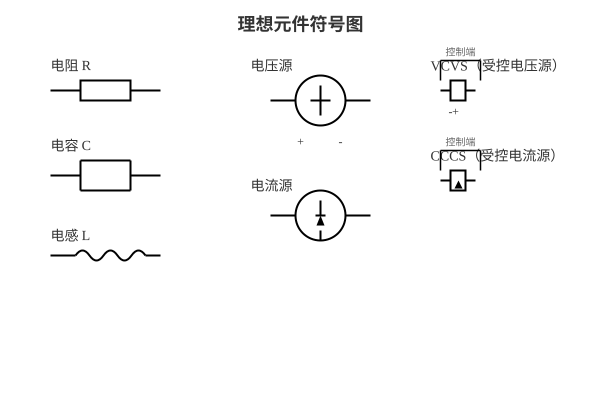
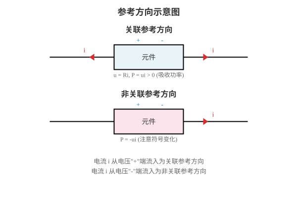
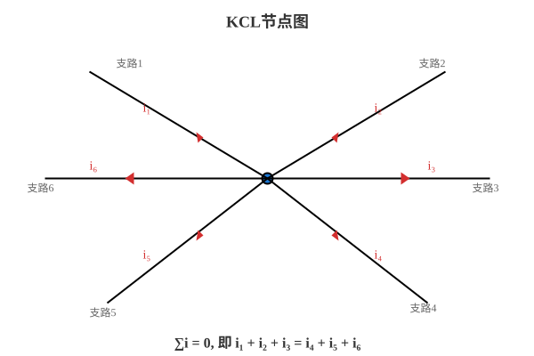
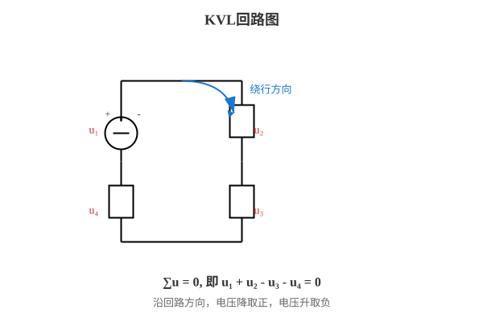

# 3.1 电路基本概念与定律

> **前置知识**：[第一章 电路基础](../物理·电路基础/1.1-电荷与电流.md)与[第二章 电路进阶](../物理·电路进阶/2.1-恒定电流.md)（欧姆定律、串并联、基本电学现象）；[0.0 数学基础](../大学物理基础/0.0-数学基础.md)（本章起将使用导数 $i = C\frac{du}{dt}$ 等微积分工具）。

## 1. 电路模型与理想元件

实际电路由各种电气器件通过导线连接而成。为了便于分析和计算，我们引入**电路模型**的概念，将实际器件抽象为**理想元件**。

常见的理想元件包括：

- **电阻（R）**：表征消耗电能的特性，满足欧姆定律 $u = Ri$。
- **电容（C）**：表征储存电场能量的特性，满足 $i = C \frac{du}{dt}$。
- **电感（L）**：表征储存磁场能量的特性，满足 $u = L \frac{di}{dt}$。
- **电压源**：提供恒定电压，电流由外电路决定。
- **电流源**：提供恒定电流，电压由外电路决定。

## 2. 参考方向与关联参考方向

在电路分析中，我们无法事先知道电流和电压的真实方向，因此引入**参考方向**的概念。

- **参考方向**：人为假定的正方向，用箭头（电流）或极性（电压）表示。
- **关联参考方向**：电流从电压的正极流入、负极流出，即电流参考方向与电压参考方向一致。

在关联参考方向下，功率的计算公式为：

$$
P = ui
$$

若 $P > 0$，表示元件吸收功率（负载特性）；若 $P < 0$，表示元件发出功率（电源特性）。

在非关联参考方向下：

$$
P = -ui
$$

## 3. 功率的计算与符号约定

功率是电路分析中的重要物理量。对于任意二端元件，功率的计算遵循以下约定：

| 参考方向 | 功率公式 | 物理意义 |
|---------|---------|---------|
| 关联 | $P = ui$ | $P>0$ 吸收功率，$P<0$ 发出功率 |
| 非关联 | $P = -ui$ | $P>0$ 吸收功率，$P<0$ 发出功率 |

**能量**的计算公式为：

$$
W = \int_{t_0}^{t} P(\tau) d\tau
$$

## 4. 基尔霍夫电流定律（KCL）

**KCL**：在集总参数电路中，任一时刻，流入任一节点的电流之和等于流出该节点的电流之和。

数学表达式：

$$
\sum_{k=1}^{n} i_k = 0
$$

其中，$i_k$ 是流入该节点的第 $k$ 条支路的电流，流入取正号，流出取负号。

**KCL的推广**：KCL可以推广到任意闭合曲面（广义节点）。对于包围部分电路的闭合曲面，流入该曲面的电流代数和为零。

## 5. 基尔霍夫电压定律（KVL）

**KVL**：在集总参数电路中，任一时刻，沿任一回路，所有支路电压的代数和恒等于零。

数学表达式：

$$
\sum_{k=1}^{n} u_k = 0
$$

其中，$u_k$ 是回路中第 $k$ 个元件的电压。当电压参考方向与回路绕行方向一致时取正号，相反时取负号。

**KVL的推广**：KVL可以推广到任意假想回路，包括含有开路电压的回路。

## 6. 特勒根定理

特勒根定理是电路理论中最普遍的定理之一，它直接从KCL和KVL推导而来。

**特勒根定理（功率形式）**：

对于一个具有 $n$ 个节点、$b$ 条支路的电路，若各支路电压 $u_k$ 和电流 $i_k$ 满足KVL和KCL，则：

$$
\sum_{k=1}^{b} u_k i_k = 0
$$

这实际上是电路中的功率守恒定律，即所有元件吸收功率的代数和为零。

**特勒根定理（似功率形式）**：

对于两个具有相同拓扑结构（有向图相同）的电路 $N$ 和 $\hat{N}$，若它们的支路电压和电流分别满足KVL和KCL，则：

$$
\sum_{k=1}^{b} u_k \hat{i}_k = 0, \quad \sum_{k=1}^{b} \hat{u}_k i_k = 0
$$

特勒根定理在电路灵敏度分析、网络理论等领域有重要应用。

## 小结

- 电路模型将实际电路抽象为理想元件的组合
- 参考方向是电路分析的基础，关联参考方向下 $P = ui$
- KCL和KVL是电路分析的两个基本定律，适用于所有集总参数电路
- 特勒根定理是KCL和KVL的推论，反映了电路的能量守恒特性