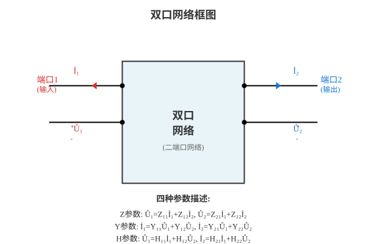
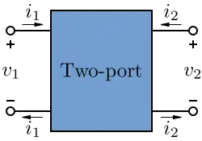
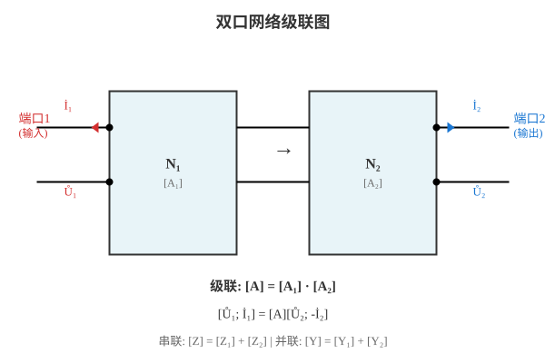

# 3.10 双口网络

## 1. 双口网络的参数

双口网络（二端口网络）具有两个端口：输入端口（端口1）和输出端口（端口2），用四个变量描述：$\dot{U}_1$、$\dot{I}_1$、$\dot{U}_2$、$\dot{I}_2$。

### Z参数（开路阻抗参数）

Z参数方程：

$$
\begin{bmatrix}
\dot{U}_1 \\
\dot{U}_2
\end{bmatrix}
=
\begin{bmatrix}
Z_{11} & Z_{12} \\
Z_{21} & Z_{22}
\end{bmatrix}
\begin{bmatrix}
\dot{I}_1 \\
\dot{I}_2
\end{bmatrix}
$$

其中：
- $Z_{11} = \frac{\dot{U}_1}{\dot{I}_1}\big|_{\dot{I}_2=0}$：端口1的输入阻抗（端口2开路）
- $Z_{12} = \frac{\dot{U}_1}{\dot{I}_2}\big|_{\dot{I}_1=0}$：端口1对端口2的转移阻抗（端口1开路）
- $Z_{21} = \frac{\dot{U}_2}{\dot{I}_1}\big|_{\dot{I}_2=0}$：端口2对端口1的转移阻抗（端口2开路）
- $Z_{22} = \frac{\dot{U}_2}{\dot{I}_2}\big|_{\dot{I}_1=0}$：端口2的输出阻抗（端口1开路）

### Y参数（短路导纳参数）

Y参数方程：

$$
\begin{bmatrix}
\dot{I}_1 \\
\dot{I}_2
\end{bmatrix}
=
\begin{bmatrix}
Y_{11} & Y_{12} \\
Y_{21} & Y_{22}
\end{bmatrix}
\begin{bmatrix}
\dot{U}_1 \\
\dot{U}_2
\end{bmatrix}
$$

Y参数与Z参数互为逆矩阵：

$$
\begin{bmatrix}
Y_{11} & Y_{12} \\
Y_{21} & Y_{22}
\end{bmatrix}
=
\begin{bmatrix}
Z_{11} & Z_{12} \\
Z_{21} & Z_{22}
\end{bmatrix}^{-1}
$$

### H参数（混合参数）

H参数方程：

$$
\begin{bmatrix}
\dot{U}_1 \\
\dot{I}_2
\end{bmatrix}
=
\begin{bmatrix}
H_{11} & H_{12} \\
H_{21} & H_{22}
\end{bmatrix}
\begin{bmatrix}
\dot{I}_1 \\
\dot{U}_2
\end{bmatrix}
$$

H参数常用于晶体管的小信号模型分析。

### A参数（传输参数）

A参数方程：

$$
\begin{bmatrix}
\dot{U}_1 \\
\dot{I}_1
\end{bmatrix}
=
\begin{bmatrix}
A & B \\
C & D
\end{bmatrix}
\begin{bmatrix}
\dot{U}_2 \\
-\dot{I}_2
\end{bmatrix}
$$

A参数特别适合分析双口网络的级联。

## 2. 各参数之间的转换

各参数之间可以相互转换。以下为Z参数与Y参数之间的转换关系：

$$
Y_{11} = \frac{Z_{22}}{\Delta_Z}, \quad Y_{12} = -\frac{Z_{12}}{\Delta_Z}
$$
$$
Y_{21} = -\frac{Z_{21}}{\Delta_Z}, \quad Y_{22} = \frac{Z_{11}}{\Delta_Z}
$$

其中 $\Delta_Z = Z_{11}Z_{22} - Z_{12}Z_{21}$。

Z参数与A参数的转换关系：

$$
A = \frac{Z_{11}}{Z_{21}}, \quad B = \frac{\Delta_Z}{Z_{21}}
$$
$$
C = \frac{1}{Z_{21}}, \quad D = \frac{Z_{22}}{Z_{21}}
$$

## 3. 双口网络的连接

### 级联

两个双口网络级联时，总A参数矩阵等于各A参数矩阵的乘积（按连接顺序）：

$$
\begin{bmatrix}
A & B \\
C & D
\end{bmatrix}
=
\begin{bmatrix}
A_1 & B_1 \\
C_1 & D_1
\end{bmatrix}
\begin{bmatrix}
A_2 & B_2 \\
C_2 & D_2
\end{bmatrix}
$$

### 串联

两个双口网络串联时，总Z参数矩阵等于各Z参数矩阵之和：

$$
\begin{bmatrix}
Z_{11} & Z_{12} \\
Z_{21} & Z_{22}
\end{bmatrix}
=
\begin{bmatrix}
Z_{11}^{(1)} & Z_{12}^{(1)} \\
Z_{21}^{(1)} & Z_{22}^{(1)}
\end{bmatrix}
+
\begin{bmatrix}
Z_{11}^{(2)} & Z_{12}^{(2)} \\
Z_{21}^{(2)} & Z_{22}^{(2)}
\end{bmatrix}
$$

### 并联

两个双口网络并联时，总Y参数矩阵等于各Y参数矩阵之和：

$$
\begin{bmatrix}
Y_{11} & Y_{12} \\
Y_{21} & Y_{22}
\end{bmatrix}
=
\begin{bmatrix}
Y_{11}^{(1)} & Y_{12}^{(1)} \\
Y_{21}^{(1)} & Y_{22}^{(1)}
\end{bmatrix}
+
\begin{bmatrix}
Y_{11}^{(2)} & Y_{12}^{(2)} \\
Y_{21}^{(2)} & Y_{22}^{(2)}
\end{bmatrix}
$$

## 4. 回输函数与特性阻抗

### 回输函数

回输函数（传输函数）描述了双口网络从输入端到输出端的传输特性：

$$
T(s) = \frac{U_2(s)}{U_1(s)}\bigg|_{I_2=0} \quad \text{或} \quad T(s) = \frac{I_2(s)}{I_1(s)}\bigg|_{U_2=0}
$$

### 特性阻抗

双口网络的特性阻抗是指当输出端口接特定负载时，使输入端口阻抗与该负载匹配的阻抗值。

**输入阻抗**：

$$
Z_{in} = \frac{A Z_L + B}{C Z_L + D}
$$

**输出阻抗**（当输入端口接信号源内阻 $Z_s$ 时）：

$$
Z_{out} = \frac{D Z_s + B}{C Z_s + A}
$$

## 5. 有载双口网络的分析

有载双口网络是指输出端口接有负载 $Z_L$，输入端口接有信号源 $\dot{U}_s$ 和内阻 $Z_s$ 的双口网络。

**分析步骤**：
1. 根据双口网络参数写出端口方程
2. 写出端口约束条件：$\dot{U}_2 = -Z_L \dot{I}_2$
3. 联立求解，得到电压增益、电流增益、输入阻抗和输出阻抗

**电压增益**：

$$
A_u = \frac{\dot{U}_2}{\dot{U}_1} = \frac{Z_L}{A Z_L + B}
$$

**电流增益**：

$$
A_i = \frac{\dot{I}_2}{\dot{I}_1} = \frac{1}{C Z_L + D}
$$

**输入阻抗**：

$$
Z_{in} = \frac{\dot{U}_1}{\dot{I}_1} = \frac{A Z_L + B}{C Z_L + D}
$$

## 小结

- 双口网络有Z参数、Y参数、H参数和A参数四种描述方式
- 不同参数之间可以相互转换，适用于不同应用场景
- 双口网络可以级联、串联或并联，连接后总参数由各子网络参数组合得到
- 特性阻抗和回输函数描述了双口网络的传输特性
- 有载双口网络的分析需要结合端口方程和负载约束条件