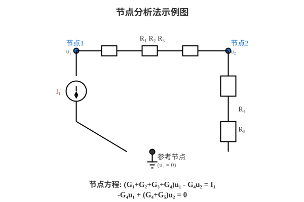
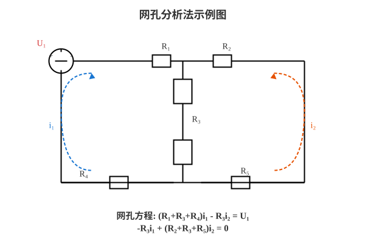
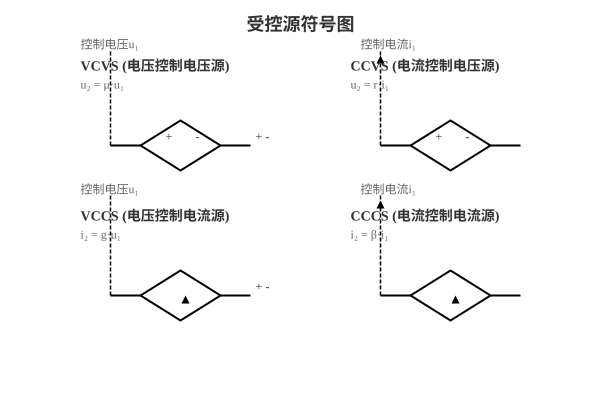
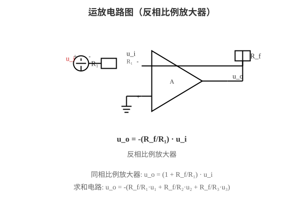

# 3.2 电阻电路的一般分析方法

## 1. 节点电压法（节点分析）

节点电压法是以节点电压为求解变量，根据KCL建立方程组的方法。

**基本步骤**：

1. 选取参考节点（地节点），电位设为零
2. 对其他 $(n-1)$ 个独立节点列写KCL方程
3. 用节点电压表示各支路电流
4. 求解节点电压方程组

对于具有 $n$ 个节点的电路，节点电压方程的矩阵形式为：

$$
\begin{bmatrix}
G_{11} & G_{12} & \cdots & G_{1(n-1)} \\
G_{21} & G_{22} & \cdots & G_{2(n-1)} \\
\vdots & \vdots & \ddots & \vdots \\
G_{(n-1)1} & G_{(n-1)2} & \cdots & G_{(n-1)(n-1)}
\end{bmatrix}
\begin{bmatrix}
u_{n1} \\
u_{n2} \\
\vdots \\
u_{n(n-1)}
\end{bmatrix}
=
\begin{bmatrix}
i_{s11} \\
i_{s22} \\
\vdots \\
i_{s(n-1)(n-1)}
\end{bmatrix}
$$

其中：
- $G_{ii}$：节点 $i$ 的自电导，等于连接到节点 $i$ 的所有电导之和
- $G_{ij}$（$i \neq j$）：节点 $i$ 与节点 $j$ 的互电导，等于连接在节点 $i$ 和节点 $j$ 之间的电导之和的负值
- $u_{ni}$：节点 $i$ 的节点电压
- $i_{sii}$：流入节点 $i$ 的电流源电流的代数和

### 节点电压法例题（带数字）

**例题**：电路含节点 $a$、$b$ 与参考节点 $0$。电阻 $R_1 = 6\,\Omega$（$a$ 与 $0$ 之间）、$R_2 = 3\,\Omega$（$a$ 与 $b$ 之间）、$R_3 = 2\,\Omega$（$b$ 与 $0$ 之间）；独立电流源 $1\,\text{A}$ 流入节点 $a$，$3\,\text{A}$ 流入节点 $b$。求 $u_a$ 和 $u_b$。

**解**：

**① 列自电导与互电导**。节点 $a$ 的自电导 $G_{aa} = \frac{1}{6}+\frac{1}{3} = \frac{1}{2}\,\text{S}$；节点 $b$ 的自电导 $G_{bb} = \frac{1}{3}+\frac{1}{2} = \frac{5}{6}\,\text{S}$；互电导 $G_{ab}=G_{ba} = -\frac{1}{3}\,\text{S}$（取负值）。

**② 列方程**。由 KCL：

$$
\begin{aligned}
\frac{1}{2}u_a - \frac{1}{3}u_b &= 1 \\
-\frac{1}{3}u_a + \frac{5}{6}u_b &= 3
\end{aligned}
$$

两边同乘以 6，化为整系数：

$$
3u_a - 2u_b = 6, \qquad -2u_a + 5u_b = 18
$$

**③ 求解**。由第一式 $u_a = \dfrac{6+2u_b}{3}$，代入第二式：

$$
-2\cdot\frac{6+2u_b}{3} + 5u_b = 18
\;\Rightarrow\; 11u_b = 66
\;\Rightarrow\; u_b = 6\ \text{V}, \quad u_a = \frac{6+12}{3} = 6\ \text{V}
$$

**④ 验证 KCL**。$i_{R_1} = u_a/6 = 1\ \text{A}$（$a\to0$）、$i_{R_2} = (u_a-u_b)/3 = 0\ \text{A}$、$i_{R_3} = u_b/2 = 3\ \text{A}$。节点 $a$ 注入之和 $1+0 = 1\ \text{A}$，节点 $b$ 注入之和 $0+3 = 3\ \text{A}$，与电流源一致。

**答案**：$u_a = 6\,\text{V}$，$u_b = 6\,\text{V}$。

### 含无伴电压源的节点分析（超节点 supernode）

当电压源两端都连接在**非参考节点**之间、且无串联电阻（**无伴电压源**）时，该支路电流是未知量、无法直接写出，而相邻节点电压又已被电源端电压约束，不能再对该区间内的节点各自独立列写 KCL。处理方法是引入**超节点**：把电压源及其两端节点合成一个整体（supernode），对超节点的**外边界**列写 KCL（该方程中不含电压源支路电流），再用电压源的端电压关系补充一条约束方程。

引入超节点后，独立 KCL 方程数由 $(n-1)$ 减为 $(n-2)$（每个无伴电压源减少一个可独立列写 KCL 的节点），再补上对应数量的端电压方程，方程总数不变，仍可解。

**例题**：节点 $a$、$b$ 之间有 $10\,\text{V}$ 电压源（$a$ 端为 $+$），$a$、$b$ 各接 $6\,\Omega$ 电阻到参考点，另有 $3\,\text{A}$ 电流源从参考点注入节点 $a$。

**解**：对超节点（含 $a$、$b$）的外边界列 KCL：

$$
\frac{u_a}{6} + \frac{u_b}{6} = 3
$$

补充电压源端电压约束：

$$
u_a - u_b = 10
$$

联立得 $u_b = 4\,\text{V}$，$u_a = 14\,\text{V}$。电压源支路电流再由节点 $a$ 的 KCL 求出：$i_s = 3 - u_a/6 = 3 - 14/6 = \dfrac{2}{3}\ \text{A}$（由 $a$ 流向 $b$）。

**答案**：$u_a = 14\,\text{V}$，$u_b = 4\,\text{V}$，电压源支路电流 $\frac{2}{3}\,\text{A}$。

## 2. 网孔电流法（网孔分析）

网孔电流法是以网孔电流为求解变量，根据KVL建立方程组的方法。

**基本步骤**：

1. 确定每个网孔及其绕行方向
2. 对每个网孔列写KVL方程
3. 用网孔电流表示各支路电压
4. 求解网孔电流方程组

网孔电流方程的矩阵形式：

$$
\begin{bmatrix}
R_{11} & R_{12} & \cdots & R_{1m} \\
R_{21} & R_{22} & \cdots & R_{2m} \\
\vdots & \vdots & \ddots & \vdots \\
R_{m1} & R_{m2} & \cdots & R_{mm}
\end{bmatrix}
\begin{bmatrix}
i_{m1} \\
i_{m2} \\
\vdots \\
i_{mm}
\end{bmatrix}
=
\begin{bmatrix}
u_{s11} \\
u_{s22} \\
\vdots \\
u_{smm}
\end{bmatrix}
$$

其中：
- $R_{ii}$：网孔 $i$ 的自电阻，等于网孔 $i$ 中所有电阻之和
- $R_{ij}$（$i \neq j$）：网孔 $i$ 与网孔 $j$ 的互电阻，等于两个网孔公共支路上的电阻之和（方向相同时取正，相反时取负）
- $i_{mi}$：网孔 $i$ 的网孔电流
- $u_{sii}$：网孔 $i$ 中电压源电压升的代数和

### 网孔电流法例题（带数字）

**例题**：电路由两个网孔组成。左网孔含 $5\,\text{V}$ 电压源与 $R_1 = 2\,\Omega$；右网孔含 $R_3 = 3\,\Omega$ 与 $2\,\text{V}$ 电压源；两网孔公共支路上有公共电阻 $R_2 = 1\,\Omega$。设网孔电流 $i_1$、$i_2$ 均顺时针，求网孔电流及各支路电流。

**解**：

**① 列网孔方程**。左网孔自电阻 $R_{11} = R_1+R_2 = 3\,\Omega$，互电阻 $R_{12} = -1\,\Omega$；右网孔自电阻 $R_{22} = R_2+R_3 = 4\,\Omega$。由 KVL：

$$
3i_1 - i_2 = 5
$$
$$
-i_1 + 4i_2 = 2
$$

**② 求解**。由第一式 $i_1 = \dfrac{5+i_2}{3}$，代入第二式：

$$
-\frac{5+i_2}{3} + 4i_2 = 2
\;\Rightarrow\; -5 - i_2 + 12i_2 = 6
\;\Rightarrow\; i_2 = 1\ \text{A}, \quad i_1 = \frac{5+1}{3} = 2\ \text{A}
$$

**③ 求支路电流**。$R_1$ 支路电流即 $i_1 = 2\ \text{A}$；公共支路电流 $i_1 - i_2 = 1\ \text{A}$；$R_3$ 支路电流即 $i_2 = 1\ \text{A}$。

**答案**：$i_1 = 2\,\text{A}$，$i_2 = 1\,\text{A}$，公共支路电流 $1\,\text{A}$。

### 含无伴电流源的网孔分析

当某条支路含有**电流源**时，分两种情况：

- 若电流源仅位于单个网孔的**外边界**（只属于该网孔，无串联电阻），则该网孔电流直接被电流源电流确定，无需对该网孔写 KVL，代入其他网孔方程即可。
- 若**无伴电流源**位于两个网孔的**公共支路**上，则其电流等于两网孔电流之差（为未知组合），且该支路两端电压无法写出，此时应使用**超网孔（supermesh）**：沿两网孔合并后的**公共外边界**写一个大的 KVL 回路（避开公共电流源支路），再补充"电流源电流 = 两网孔电流差（或和）"的约束方程。

**例题**：两网孔公共支路接 $3\,\text{A}$ 无伴电流源（指向使公共支路电流 $i_1 - i_2 = 3\ \text{A}$ 的方向）；左网孔含 $12\,\text{V}$ 电压源与 $R_1 = 2\,\Omega$，右网孔含 $R_2 = 4\,\Omega$。

**解**：绕开公共电流源，沿外环对超网孔列 KVL：

$$
12 = 2i_1 + 4i_2
$$

补充约束：

$$
i_1 - i_2 = 3
$$

联立得 $i_1 = i_2 + 3$，代入 $2(i_2+3)+4i_2 = 12 \Rightarrow 6i_2 = 6 \Rightarrow i_2 = 1\ \text{A}$，$i_1 = 4\ \text{A}$。

**答案**：$i_1 = 4\,\text{A}$，$i_2 = 1\,\text{A}$，公共支路电流 $3\,\text{A}$。

## 3. 回路电流法（回路分析）

回路电流法是网孔电流法的推广，适用于非平面电路。它选择一组独立回路（不一定是网孔）作为求解变量。

**独立回路的选择**：对于具有 $n$ 个节点、$b$ 条支路的电路，独立回路数为 $l = b - n + 1$。

回路电流方程的形式与网孔电流法类似，但互电阻的符号需要根据两个回路在公共支路上的方向关系确定。

## 4. 含受控源的电路分析

受控源是输出电压或电流受电路中其他支路电压或电流控制的电源。常见的受控源有四种类型：

| 类型 | 符号 | 控制关系 |
|-----|------|---------|
| 电压控制电压源（VCVS） | $u_2 = \mu u_1$ | 输出电压受电压控制 |
| 电流控制电压源（CCVS） | $u_2 = r i_1$ | 输出电压受电流控制 |
| 电压控制电流源（VCCS） | $i_2 = g u_1$ | 输出电流受电压控制 |
| 电流控制电流源（CCCS） | $i_2 = \beta i_1$ | 输出电流受电流控制 |

**含受控源电路的节点分析法**：

将受控源视为独立源处理，列出方程后，将控制量用节点电压表示，整理成标准形式。

**含受控源电路的网孔分析法**：

将受控源视为独立源处理，列出方程后，将控制量用网孔电流表示，整理成标准形式。

## 5. 含运算放大器的电阻电路

运算放大器（运放）是一种高增益、高输入阻抗、低输出阻抗的集成电路。

**理想运放的两个重要特性**：

- **虚短**：同相输入端与反相输入端电压相等，$u_+ = u_-$
- **虚断**：流入同相输入端和反相输入端的电流为零，$i_+ = i_- = 0$

**典型运放电路分析**：

**反相比例放大器**：

$$
u_o = -\frac{R_f}{R_1} u_i
$$

**同相比例放大器**：

$$
u_o = \left(1 + \frac{R_f}{R_1}\right) u_i
$$

**求和电路**：

$$
u_o = -\left(\frac{R_f}{R_1} u_1 + \frac{R_f}{R_2} u_2 + \frac{R_f}{R_3} u_3\right)
$$

## 小结

- 节点电压法以节点电压为变量，基于KCL建立方程，适用于节点数较少的电路
- 网孔电流法以网孔电流为变量，基于KVL建立方程，适用于网孔数较少的电路
- 回路电流法是网孔法的推广，可用于非平面电路
- 含受控源电路分析时，先将其视为独立源，再将控制量用变量表示
- 理想运放满足"虚短"和"虚断"特性，可简化分析