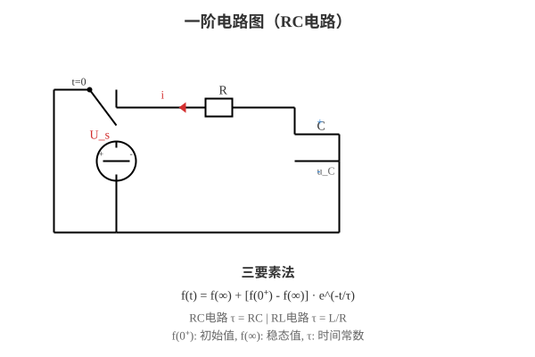
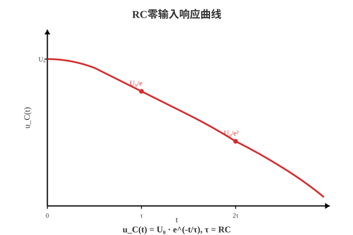
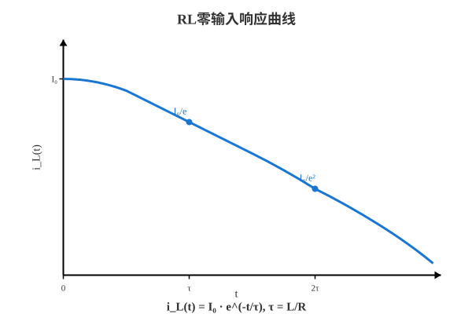
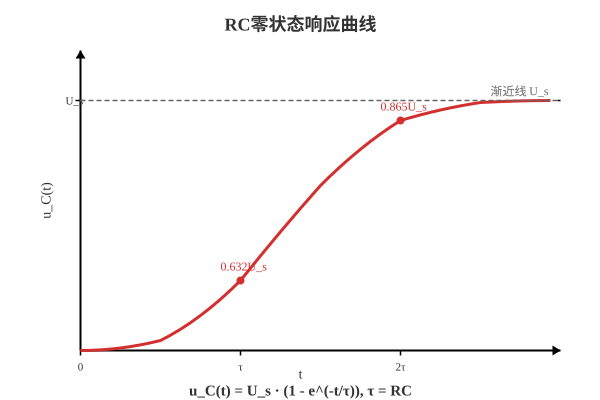

# 3.4 一阶电路暂态分析

## 1. 换路定律与初始条件确定

**换路定律**：在换路瞬间（$t = 0$），电容电压和电感电流不能跃变。

数学表述：

$$
u_C(0^+) = u_C(0^-)
$$
$$
i_L(0^+) = i_L(0^-)
$$

其中 $0^-$ 表示换路前的瞬间，$0^+$ 表示换路后的瞬间。

**初始条件确定步骤**：
1. 计算换路前 $t = 0^-$ 时刻的 $u_C(0^-)$ 和 $i_L(0^-)$
2. 根据换路定律确定 $u_C(0^+)$ 和 $i_L(0^+)$
3. 用电压为 $u_C(0^+)$ 的电压源替代电容、电流为 $i_L(0^+)$ 的电流源替代电感
4. 求解 $t = 0^+$ 时刻电路中其他电压电流的初始值

## 2. RC电路的零输入响应

零输入响应是指电路中没有独立电源激励，仅由储能元件的初始储能引起的响应。

对于RC电路，电容初始电压为 $u_C(0^+) = U_0$，零输入响应为：

$$
u_C(t) = U_0 e^{-\frac{t}{RC}}, \quad t \geq 0
$$

时间常数 $\tau = RC$，反映了响应衰减的快慢。

电流响应：

$$
i_C(t) = C\frac{du_C}{dt} = -\frac{U_0}{R} e^{-\frac{t}{RC}}, \quad t \geq 0
$$

## 3. RL电路的零输入响应

对于RL电路，电感初始电流为 $i_L(0^+) = I_0$，零输入响应为：

$$
i_L(t) = I_0 e^{-\frac{R}{L}t}, \quad t \geq 0
$$

时间常数 $\tau = \frac{L}{R}$。

电感电压响应：

$$
u_L(t) = L\frac{di_L}{dt} = -RI_0 e^{-\frac{R}{L}t}, \quad t \geq 0
$$

## 4. RC电路的零状态响应

零状态响应是指电路中储能元件的初始储能为零，仅由独立电源激励引起的响应。

对于RC电路，电容初始电压为零，施加直流电压源 $U_s$，零状态响应为：

$$
u_C(t) = U_s(1 - e^{-\frac{t}{RC}}), \quad t \geq 0
$$

电流响应：

$$
i_C(t) = C\frac{du_C}{dt} = \frac{U_s}{R} e^{-\frac{t}{RC}}, \quad t \geq 0
$$

## 5. RL电路的零状态响应

对于RL电路，电感初始电流为零，施加直流电压源 $U_s$，零状态响应为：

$$
i_L(t) = \frac{U_s}{R}(1 - e^{-\frac{R}{L}t}), \quad t \geq 0
$$

电感电压响应：

$$
u_L(t) = L\frac{di_L}{dt} = U_s e^{-\frac{R}{L}t}, \quad t \geq 0
$$

## 6. 一阶电路的全响应（三要素法）

全响应是零输入响应和零状态响应的叠加：

$$
f(t) = f(\infty) + [f(0^+) - f(\infty)] e^{-\frac{t}{\tau}}, \quad t \geq 0
$$

**三要素法**：一阶电路的全响应由三个要素完全确定：

1. **初始值** $f(0^+)$：响应在 $t = 0^+$ 时的值
2. **稳态值** $f(\infty)$：响应在 $t \to \infty$ 时的值
3. **时间常数** $\tau$：对于RC电路 $\tau = RC$，对于RL电路 $\tau = L/R$

三要素公式：

$$
f(t) = f(\infty) + [f(0^+) - f(\infty)] e^{-\frac{t}{\tau}}, \quad t \geq 0
$$

### 三要素法例题（带数字）

**例题**：RC 充电电路，$R = 2\,\text{k}\Omega$、$C = 1\,\mu\text{F}$。$t=0$ 时开关将 $U_s = 10\,\text{V}$ 电源接入电路，已知换路前 $u_C(0^-) = 4\,\text{V}$。求 $t \geq 0$ 的 $u_C(t)$ 与 $i(t)$。

**解**（求三要素）：

**① 初始值** $f(0^+)$。由换路定律 $u_C(0^+) = u_C(0^-) = 4\,\text{V}$。

**② 稳态值** $f(\infty)$。$t\to\infty$ 时电容开路，电路稳态，$u_C(\infty) = U_s = 10\,\text{V}$。

**③ 时间常数** $\tau$。

$$
\tau = RC = 2\times10^3 \times 1\times10^{-6} = 2\ \text{ms}
$$

**④ 代入三要素公式**：

$$
u_C(t) = u_C(\infty) + \big[u_C(0^+)-u_C(\infty)\big]e^{-t/\tau}
= 10 + (4-10)e^{-500t}
= 10 - 6e^{-500t}\ \text{V}, \quad t\geq0
$$

**⑤ 求电流** $i(t) = C\dfrac{du_C}{dt}$：

$$
i(t) = 1\times10^{-6} \cdot (-6)(-500)e^{-500t}
= 3e^{-500t}\ \text{mA}, \quad t\geq0
$$

**答案**：$u_C(t) = \big(10 - 6e^{-500t}\big)\,\text{V}$，$i(t) = 3e^{-500t}\,\text{mA}$（$t\geq0$）。

### 时间常数的几何意义（切线法）

对指数响应 $f(t) = f(\infty) + [f(0^+)-f(\infty)]e^{-t/\tau}$（$f(\infty)$ 为终值），时间常数 $\tau$ 有清晰的几何与工程含义：

- **切线法**：在 $t=0^+$ 处作暂态分量 $f(t)-f(\infty)$ 曲线的切线，该切线的斜率等于曲线初始变化率 $-\big[f(0^+)-f(\infty)\big]/\tau$；把该切线延长到与稳态线 $f(\infty)$ 相交，交点处恰有 $t = \tau$。即切线从初值出发、降到与稳态线相交所经过的时间正好等于 $\tau$。
- **衰减规律**：$t=\tau$ 时暂态分量衰减为初值的 $e^{-1}\approx 36.8\%$；$t=3\tau$ 时约 $5\%$；$t=5\tau$ 时仅约 $0.7\%$，工程上认为 $t\ge 5\tau$ 后暂态基本结束、电路进入稳态。
- 实践中可用示波器读取波形从初值衰减到 $36.8\%$ 处所经历的时间，直接读出 $\tau$。

### 微分电路与积分电路（矩形脉冲响应定性）

由电容的积分关系 $u_C = \frac{1}{C}\int i\,dt$ 与 $i = u_i/R$，RC 电路可实现近似微分或积分运算，关键在于**时间常数与输入脉冲宽度 $t_p$ 的相对关系**。

**微分电路**（输出取自电阻两端，$\tau = RC \ll t_p$）：电容充电很快，脉冲平坦段内电容近似开路，$u_o = Ri \approx 0$；仅在脉冲跳变沿，电容电压不能突变、迫使电流流经电阻，故上升沿产生正尖峰、下降沿产生负尖峰。脉冲可视为正、负两个阶跃的叠加，其输出近似为输入的微分波形（对应两个反向冲激响应）。

**积分电路**（输出取自电容两端，$\tau = RC \gg t_p$）：电容来不及充电，$u_C$ 在脉冲期间近似线性上升（即对 $u_i$ 积分），输出接近三角波；脉冲结束后电容缓慢放电回落，输出近似为输入的积分波形。

**结论**：微分电路对突变/高频敏感（突出跳变沿），积分电路对缓变/低频敏感（起平均或延时作用），二者是脉冲变换与波形整形的基本单元。

## 7. 阶跃响应与冲激响应

### 阶跃响应

当电路激励为单位阶跃函数 $\varepsilon(t)$ 时，电路的响应称为单位阶跃响应 $s(t)$。

对于一阶RC电路，单位阶跃响应为：

$$
s(t) = (1 - e^{-\frac{t}{\tau}})\varepsilon(t)
$$

### 冲激响应

当电路激励为单位冲激函数 $\delta(t)$ 时，电路的响应称为单位冲激响应 $h(t)$。

冲激响应与阶跃响应的关系：

$$
h(t) = \frac{ds(t)}{dt}
$$

对于一阶RC电路，单位冲激响应为：

$$
h(t) = \frac{1}{\tau} e^{-\frac{t}{\tau}}\varepsilon(t)
$$

## 小结

- 换路定律指出电容电压和电感电流不能跃变，是暂态分析的起点
- 零输入响应是储能元件初始储能释放的过程，按指数规律衰减
- 零状态响应是电源对储能元件的充电过程，按指数规律趋近稳态
- 三要素法提供了一阶电路暂态分析的统一方法
- 阶跃响应和冲激响应是描述电路动态特性的重要响应函数