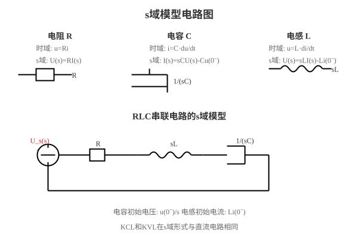
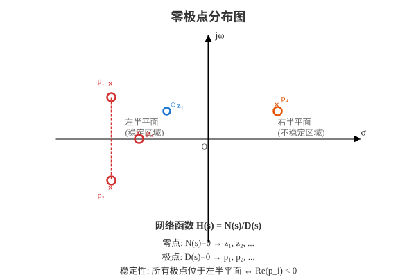

# 3.9 拉普拉斯变换在电路中的应用

> **前置知识**：[0.0 数学基础 §2 复数与相量](../大学物理基础/0.0-数学基础.md)（复频率 $s = \sigma + j\omega$ 的运算基础）、[3.6 正弦稳态分析](3.6-正弦稳态分析.md)（相量法——拉普拉斯变换是其推广到暂态的形式）。本章以"定义 + 性质表 + 应用"的方式速成，不展开数学推导。

## 1. 拉普拉斯变换的定义与基本性质

### 定义

函数 $f(t)$ 的拉普拉斯变换定义为：

$$
F(s) = \mathcal{L}[f(t)] = \int_{0^-}^{\infty} f(t) e^{-st} dt
$$

其中 $s = \sigma + j\omega$ 为复频率。

### 基本性质

| 性质 | 时域 | 复频域 |
|-----|------|-------|
| 线性性质 | $af_1(t) + bf_2(t)$ | $aF_1(s) + bF_2(s)$ |
| 时域微分 | $\frac{df(t)}{dt}$ | $sF(s) - f(0^-)$ |
| 时域积分 | $\int_{0^-}^{t} f(\tau) d\tau$ | $\frac{F(s)}{s}$ |
| 时移性质 | $f(t - t_0)\varepsilon(t - t_0)$ | $e^{-st_0}F(s)$ |
| 频移性质 | $e^{-at}f(t)$ | $F(s + a)$ |
| 卷积定理 | $f_1(t) * f_2(t)$ | $F_1(s)F_2(s)$ |

## 2. 常见信号的拉普拉斯变换

| 时域信号 $f(t)$ | 拉普拉斯变换 $F(s)$ | 收敛域 |
|----------------|-------------------|-------|
| $\delta(t)$ | $1$ | 整个 $s$ 平面 |
| $\varepsilon(t)$ | $\frac{1}{s}$ | $\text{Re}(s) > 0$ |
| $t\varepsilon(t)$ | $\frac{1}{s^2}$ | $\text{Re}(s) > 0$ |
| $t^n\varepsilon(t)$ | $\frac{n!}{s^{n+1}}$ | $\text{Re}(s) > 0$ |
| $e^{-at}\varepsilon(t)$ | $\frac{1}{s + a}$ | $\text{Re}(s) > -a$ |
| $\sin(\omega t)\varepsilon(t)$ | $\frac{\omega}{s^2 + \omega^2}$ | $\text{Re}(s) > 0$ |
| $\cos(\omega t)\varepsilon(t)$ | $\frac{s}{s^2 + \omega^2}$ | $\text{Re}(s) > 0$ |
| $e^{-at}\sin(\omega t)\varepsilon(t)$ | $\frac{\omega}{(s + a)^2 + \omega^2}$ | $\text{Re}(s) > -a$ |
| $e^{-at}\cos(\omega t)\varepsilon(t)$ | $\frac{s + a}{(s + a)^2 + \omega^2}$ | $\text{Re}(s) > -a$ |

## 3. 拉普拉斯反变换（部分分式展开法）

### 反变换的概念与路径

由 $F(s)$ 恢复时域函数 $f(t)$ 的过程称为**拉普拉斯反变换**，记作：

$$
f(t) = \mathcal{L}^{-1}\{F(s)\}
$$

其严格定义是一条复平面上的围线积分：

$$
f(t) = \frac{1}{2\pi j}\int_{\sigma - j\infty}^{\sigma + j\infty} F(s) e^{st} \, ds
$$

工程中一般并不直接计算该积分，而是按"部分分式展开 + 查变换对表"的路径：先把 $F(s)$ 展开成若干**基本分式之和**，每一项对应 §2 表格中的常见变换对，再逐项反变换叠加得到 $f(t)$。

### 部分分式展开法

设 $F(s) = N(s)/D(s)$ 为**真有理分式**（分子阶数低于分母），分母可因式分解。按极点类型分三种情形展开：

**（1）单实根（互不相同的实数极点）**

设极点 $s = -p_1, -p_2, \ldots, -p_n$ 互不相等：

$$
F(s) = \frac{K_1}{s + p_1} + \frac{K_2}{s + p_2} + \cdots + \frac{K_n}{s + p_n}
$$

各系数用留数公式求：

$$
K_i = (s + p_i) F(s) \Big|_{s = -p_i}
$$

对应时域项（利用变换对 $e^{-at}\varepsilon(t) \leftrightarrow \dfrac{1}{s + a}$）：

$$
\frac{K_i}{s + p_i} \;\longleftrightarrow\; K_i e^{-p_i t}\varepsilon(t)
$$

**（2）重根（$r$ 重实数极点）**

设 $s = -p$ 为 $r$ 重极点，则展开为：

$$
F(s) = \frac{K_{11}}{s + p} + \frac{K_{12}}{(s + p)^2} + \cdots + \frac{K_{1r}}{(s + p)^r} + (\text{其余单极点项})
$$

其中最高次项系数用乘消法求：$K_{1r} = (s+p)^r F(s)\big|_{s=-p}$。对应时域项（利用变换对 $t^n e^{-at}\varepsilon(t) \leftrightarrow \dfrac{n!}{(s+a)^{n+1}}$）：

$$
\frac{K_{1k}}{(s + p)^k} \;\longleftrightarrow\; \frac{K_{1k}}{(k-1)!}\, t^{k-1} e^{-p t}\varepsilon(t)
$$

**（3）共轭复根（位于左半平面的共轭极点 $s = -\alpha \pm j\omega$）**

把分母配成一个完全平方加常数，并拆成"余弦项 + 正弦项"两部分：

$$
F(s) = \frac{A(s + \alpha)}{(s + \alpha)^2 + \omega^2} + \frac{B\omega}{(s + \alpha)^2 + \omega^2}
$$

对应时域项（利用变换对 $\dfrac{\omega}{(s+\alpha)^2+\omega^2} \leftrightarrow e^{-\alpha t}\sin(\omega t)\varepsilon(t)$ 与 $\dfrac{s+\alpha}{(s+\alpha)^2+\omega^2} \leftrightarrow e^{-\alpha t}\cos(\omega t)\varepsilon(t)$）：

$$
F(s) \;\longleftrightarrow\; e^{-\alpha t}\big[ A\cos(\omega t) + B\sin(\omega t) \big]\varepsilon(t)
$$

### 初值定理与终值定理

在尚未得到具体时域表达式时，可先用下面两个定理对展开结果做快速校验。

**初值定理**（要求 $F(s)$ 为真有理分式）：

$$
f(0^+) = \lim_{s \to \infty} sF(s)
$$

**终值定理**（要求 $sF(s)$ 的极点都在左半平面，$s=0$ 处至多一个单极点）：

$$
\lim_{t \to \infty} f(t) = \lim_{s \to 0} sF(s)
$$

**使用技巧**：对 $F(s)$ 部分分式展开并反变换得到 $f(t)$ 后，把初值/终值代入应与物理直觉一致——初值反映 $t=0^+$ 时刻状态（电感电流、电容电压不突变），终值反映直流稳态。

### 极点位置与时域波形形态

极点位置直接决定时域响应的形态，可据此对 $f(t)$ 做定性预判：

| 极点位置 | 对应时域波形 |
|---------|------------|
| 负实轴极点 $s=-\sigma\ (\sigma>0)$ | 指数衰减 $e^{-\sigma t}$ |
| 原点单极点 $s=0$ | 直流常数项（稳态分量） |
| 虚轴共轭极点 $s=\pm j\omega$ | 等幅振荡 $\sin(\omega t)$ |
| 左半平面共轭极点 $s=-\alpha\pm j\omega$ | 衰减振荡 $e^{-\alpha t}\sin(\omega t)$ |
| 右半平面极点 | 发散（不稳定） |

### 例题：RLC 串联电路的全响应求解

**题干**：一 RLC 串联电路，$R = 5\,\Omega$，$L = 1\,\text{H}$，$C = 1/6\,\text{F}$。$t = 0$ 时接入直流电压源 $u_s(t) = 12\varepsilon(t)\,\text{V}$。已知初始条件 $i(0^-) = 0$、$u_C(0^-) = 3\,\text{V}$，求 $t \ge 0$ 时的电流 $i(t)$。

**解**（s 域求解）：

**① 列 s 域电路方程（含初始值电源等效）**。各元件的 s 域关系为：

$$
U_R(s) = R I(s) = 5I(s), \qquad
U_L(s) = sL I(s) - Li(0^-) = sI(s)
$$

$$
U_C(s) = \frac{1}{sC}I(s) + \frac{u_C(0^-)}{s} = \frac{6}{s}I(s) + \frac{3}{s}
$$

其中 $\frac{3}{s}$ 即"初始值电源"，代表电容初压 $u_C(0^-)=3\,\text{V}$ 的串入等效（重点体现含初始条件的 s 域建模）。由 KVL：

$$
\frac{12}{s} = 5I(s) + sI(s) + \frac{6}{s}I(s) + \frac{3}{s}
$$

整理得 $F(s) = I(s)$：

$$
I(s) = \frac{9}{s^2 + 5s + 6} = \frac{9}{(s+2)(s+3)}
$$

**② 部分分式展开**。极点为 $p_1 = 2$、$p_2 = 3$（单实根情形）：

$$
I(s) = \frac{K_1}{s+2} + \frac{K_2}{s+3}
$$

$$
K_1 = (s+2)I(s)\Big|_{s=-2} = \frac{9}{s+3}\Big|_{s=-2} = 9, \qquad
K_2 = (s+3)I(s)\Big|_{s=-3} = \frac{9}{s+2}\Big|_{s=-3} = -9
$$

故：

$$
I(s) = \frac{9}{s+2} - \frac{9}{s+3}
$$

**③ 反变换回时域**。利用变换对 $e^{-at}\varepsilon(t) \leftrightarrow \dfrac{1}{s+a}$：

$$
i(t) = 9\big(e^{-2t} - e^{-3t}\big)\varepsilon(t)\ \text{A}
$$

**④ 用初值/终值定理校验**。

- 初值定理：$i(0^+) = \lim_{s\to\infty} sI(s) = \lim_{s\to\infty}\dfrac{9s}{s^2 + 5s + 6} = 0$，与 $i(0^+)=i(0^-)=0$（电感电流不突变）一致，也与 $i(0)=9(1-1)=0$ 吻合。
- 终值定理：$\lim_{t\to\infty}i(t) = \lim_{s\to0}sI(s) = \lim_{s\to0}\dfrac{9s}{s^2 + 5s + 6} = 0$，直流稳态下电容开路、电流归零，合理。

**答案**：$i(t) = 9\,(e^{-2t} - e^{-3t})\,\varepsilon(t)\ \text{A}$。

## 4. 电路元件的复频域模型（s域模型）

### 电阻

时域：$u(t) = R i(t)$

s域：$U(s) = R I(s)$

### 电容

时域：$i(t) = C\frac{du(t)}{dt}$

s域：$I(s) = sC U(s) - Cu(0^-)$

或：$U(s) = \frac{1}{sC}I(s) + \frac{u(0^-)}{s}$

### 电感

时域：$u(t) = L\frac{di(t)}{dt}$

s域：$U(s) = sL I(s) - Li(0^-)$

或：$I(s) = \frac{1}{sL}U(s) + \frac{i(0^-)}{s}$

## 4. 基尔霍夫定律的s域形式

### KCL的s域形式

$$
\sum_{k=1}^{n} I_k(s) = 0
$$

### KVL的s域形式

$$
\sum_{k=1}^{n} U_k(s) = 0
$$

在s域中，KCL和KVL的形式与直流电路完全相同，因此所有电阻电路的分析方法（节点法、网孔法、戴维南定理等）都可以直接应用于s域电路。

## 5. 网络函数的定义与计算

**网络函数** $H(s)$ 定义为在零初始条件下，输出响应的拉普拉斯变换与输入激励的拉普拉斯变换之比：

$$
H(s) = \frac{R(s)}{E(s)}
$$

其中 $R(s)$ 为输出响应，$E(s)$ 为输入激励。

**常见网络函数**：
- 电压传递函数：$H(s) = U_o(s)/U_i(s)$
- 电流传递函数：$H(s) = I_o(s)/I_i(s)$
- 输入阻抗：$Z_{in}(s) = U(s)/I(s)$
- 转移阻抗：$Z_t(s) = U_o(s)/I_i(s)$

## 7. 极点和零点与系统稳定性

网络函数一般可以写成有理分式的形式：

$$
H(s) = \frac{N(s)}{D(s)} = \frac{a_m s^m + a_{m-1} s^{m-1} + \cdots + a_0}{b_n s^n + b_{n-1} s^{n-1} + \cdots + b_0}
$$

**零点**：使 $N(s) = 0$ 的 $s$ 值，记为 $z_1, z_2, \ldots, z_m$。

**极点**：使 $D(s) = 0$ 的 $s$ 值，记为 $p_1, p_2, \ldots, p_n$。

**稳定性判据**：一个线性时不变系统稳定的充要条件是所有极点位于 $s$ 平面的左半平面（即所有极点的实部小于零）。

$$
\text{Re}(p_i) < 0, \quad i = 1, 2, \ldots, n
$$

## 7. 卷积定理在电路分析中的应用

**卷积定理**：时域中的卷积对应于复频域中的乘积。

$$
\mathcal{L}[f_1(t) * f_2(t)] = F_1(s) F_2(s)
$$

其中卷积定义为：

$$
f_1(t) * f_2(t) = \int_{0}^{t} f_1(\tau) f_2(t - \tau) d\tau
$$

**应用**：在电路分析中，若已知网络的冲激响应 $h(t)$ 和输入激励 $e(t)$，则输出响应为：

$$
r(t) = e(t) * h(t) = \int_{0}^{t} e(\tau) h(t - \tau) d\tau
$$

在s域中，这一关系简化为：

$$
R(s) = E(s) H(s)
$$

## 小结

- 拉普拉斯变换将时域微分方程转换为复频域代数方程，简化了电路分析
- 电路元件的s域模型包含了初始条件，便于处理暂态问题
- 网络函数描述了系统的输入输出关系
- 极点和零点决定了系统的时域响应特性和稳定性
- 卷积定理在s域中简化为乘法运算