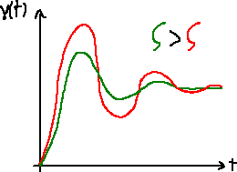
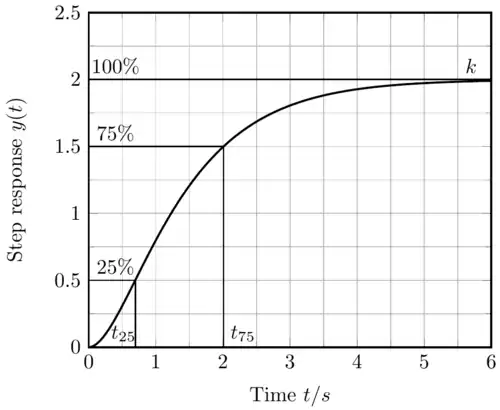
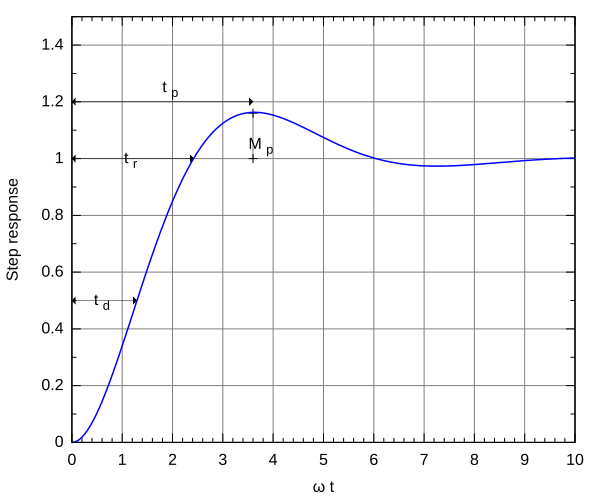

# 22.3 时域分析

> **前置知识**：[3.4 一阶电路暂态分析](../电路原理/3.4-一阶电路暂态分析.md)（一阶/二阶系统响应的时间常数与振荡概念）、[22.2 控制系统数学模型](22.2-控制系统数学模型.md)（传递函数基础）。本章研究系统在典型输入下的时域动态性能。

时域分析回答工程上最直接的问题：给系统一个阶跃，输出到底"多快、多准、多稳"？本章引入一套标准化的性能指标（峰值时间、超调量、调节时间、稳态误差），并把一阶/二阶系统、系统型别、主导极点等概念系统化。这些指标正是后续各章（根轨迹、频域、校正）设计目标的语言——无论用什么方法分析，最终都要翻译回"快、准、稳"三个时域指标。

## 1. 典型输入信号与系统响应组成

常用典型输入：单位阶跃 $\varepsilon(t)$、单位斜坡 $t\varepsilon(t)$、单位冲激 $\delta(t)$、正弦 $A\sin\omega t$。

输出响应 $y(t)$ 由**零输入响应**与**零状态响应**组成，或按性质分为**瞬态分量**（随 $t$ 衰减）与**稳态分量**（$t\to\infty$ 保留）。稳态响应与输入的差值定义为**误差**。

### 为什么选这些典型输入

- **阶跃**：考验"定得住"，对应设定值突变的调节问题
- **斜坡**：考验"跟得上"，对应匀速随动
- **冲激**：吃惊吓后的恢复，对应脉冲扰动
- **正弦**：频谱分析基础，衔接 22.5 频域

### 响应的组成与误差

瞬态分量由闭环极点决定（极点实部为负则衰减），稳态分量由输入形式与系统型别决定。稳态下：

$$
e_{ss} = \lim_{t\to\infty}\big(r(t) - y(t)\big)
$$

这是后续稳态误差分析的出发点。

## 2. 一阶系统

一阶系统传递函数 $G(s) = \dfrac{K}{Ts+1}$（$T$ 为时间常数）。单位阶跃输入下：

$$
y(t) = K\left(1 - e^{-t/T}\right)\varepsilon(t)
$$

性能指标：
- 到达 $63.2\%$ 需时 $T$，到达稳定需约 $3T\sim5T$
- 稳态值 $y_\infty = K$；无超调、无振荡
- 调节时间 $t_s \approx 3T$（5% 误差带）或 $4T$（2% 误差带）

### 一阶系统为什么没有振荡

特征根 $s=-1/T$ 是负实数，其自由响应是单边指数衰减，单调逼近稳态值。只有在特征根进入复数区（欠阻尼）后才可能出现振荡——这是二阶系统特有的现象。

## 3. 二阶系统

二阶系统（欠阻尼 $0<\zeta<1$）传递函数：

$$
G(s) = \frac{\omega_n^2}{s^2 + 2\zeta\omega_n s + \omega_n^2}
$$

其中 $\omega_n$ 为无阻尼自然角频率，$\zeta$ 为阻尼比。特征根 $s_{1,2} = -\zeta\omega_n \pm j\omega_n\sqrt{1-\zeta^2}$。

单位阶跃响应：

$$
y(t) = 1 - \frac{e^{-\zeta\omega_n t}}{\sqrt{1-\zeta^2}}\sin\left(\omega_d t + \beta\right),\quad \omega_d = \omega_n\sqrt{1-\zeta^2}
$$

其中 $\beta = \arccos\zeta$，$\omega_d$ 为阻尼振荡角频率。

### 阻尼比决定响应类型

| 阻尼比 | 极点位置 | 响应类型 |
|--------|---------|---------|
| $\zeta=0$ | 共轭纯虚根 | 无阻尼等幅振荡 |
| $0<\zeta<1$ | 左半平面共轭复根 | 欠阻尼振荡衰减 |
| $\zeta=1$ | 重实根 | 临界阻尼，最快无超调 |
| $\zeta>1$ | 两个负实根 | 过阻尼，缓慢无振荡 |

图源：[Wikimedia Commons](https://commons.wikimedia.org/wiki/File:2nd-order_system_step_response_5.png)，CC BY-SA 3.0。

### 动态性能指标（欠阻尼）

| 指标 | 表达式 | 含义 |
|------|-------|------|
| 峰值时间 | $t_p = \dfrac{\pi}{\omega_d}$ | 到达第一个峰值的时间 |
| 超调量 | $\%\mathrm{OS} = e^{-\pi\zeta/\sqrt{1-\zeta^2}} \times 100\%$ | 峰值相对稳态值的过冲比例 |
| 调节时间 | $t_s \approx \dfrac{4}{\zeta\omega_n}$（2%） | 进入并保持在误差带内所需时间 |
| 上升时间 | $t_r \approx \dfrac{\pi - \beta}{\omega_d}$ | 从 10% 升到 90%（或 0→100%） |

**折衷**：$\zeta$ 越大超调越小但可能更慢；$\omega_n$ 越大越快但带宽与噪声承受力需权衡。

图源：[Wikimedia Commons](https://commons.wikimedia.org/wiki/File:PT2_System_Step-Response_Diagram_with_required_Measurements_(2018).png)，CC BY-SA 4.0。

### 超调量公式的推导思路

在峰值时间 $t_p=\frac{\pi}{\omega_d}$ 处，响应的一阶导数为零。代入阶跃响应表达式：令 $\sin(\omega_d t+\beta)=0$ 得第一峰值对应 $\omega_d t_p=\pi$，再代回即得超调量

$$
\%\mathrm{OS} = e^{-\pi\zeta/\sqrt{1-\zeta^2}} \times 100\%
$$

可见超调量**只由阻尼比 $\zeta$ 决定**，与 $\omega_n$ 无关；而速度（$t_p,t_r,t_s$）由 $\zeta$ 与 $\omega_n$ 共同决定。这给设计提供了清晰分工：$\zeta$ 管"振不振荡"，$\omega_n$ 管"快不快"。

图源：[Wikimedia Commons](https://commons.wikimedia.org/wiki/File:Second_order_under-damped_response.svg)，CC BY-SA 3.0。

## 4. 稳态误差与系统型别

稳态误差是被控量与参考在 $t\to\infty$ 的差值。对单位反馈 $E(s) = R(s)/1+G(s)$，应用终值定理：

$$
e_{ss} = \lim_{t\to\infty} e(t) = \lim_{s\to0} s E(s) = \lim_{s\to0} s\frac{R(s)}{1 + G(s)}
$$

开环传递函数写成 $G(s)=\dfrac{K}{s^\nu}\cdot\dfrac{N(s)}{D(s)}$，$\nu$ 为**型别**（s=0 处极点的个数，即积分环节个数）。

| 型别 $\nu$ | 单位阶跃 $e_{ss}$ | 单位斜坡 $e_{ss}$ | 单位抛物线 $e_{ss}$ |
|:---:|:---:|:---:|:---:|
| 0（无积分） | $\dfrac{1}{1+K_p}$ 有限 | $\infty$ | $\infty$ |
| 1（一次积分） | $0$ | $\dfrac{1}{K_v}$ | $\infty$ |
| 2（二次积分） | $0$ | $0$ | $\dfrac{1}{K_a}$ |

其中位置/速度/加速度误差系数 $K_p=\lim_{s\to0}G(s)$、$K_v=\lim_{s\to0}sG(s)$、$K_a=\lim_{s\to0}s^2G(s)$。**提高型别或增益可减小或消除稳态误差**，但需注意稳定性（型别越高越易失稳）。

### 由型别表读出的工程结论

- **型别决定"能精确跟随哪种输入"**：高一型，就多消一类输入的稳态误差
- **增益决定"消到什么程度"**：未消除的输入，稳态误差与增益成反比
- **代价是稳定性**：每增加一个积分环节，相位滞后 $90^\circ$，更易失稳——这正是 22.5 中"型别提升需用校正补偿相位"的原因

## 5. 主导极点与简化分析

高阶系统中，离虚轴最近（实部绝对值最小）且无邻近零点的少数极点主导系统动态，称为**主导极点**，它们被忽略的部分（远极点）只影响响应起始阶段。据此可把高阶系统近似为二阶系统分析。

$$
\text{主导条件：} |\operatorname{Re}(p_{\text{dominant}})| \ll |\operatorname{Re}(p_{\text{far}})|
$$

主导极点方法的实用含义：工程师拿到一个三阶以上的复杂系统时，可以先把"最靠近虚轴的那对复极点"当作主导，套用前文的 $\zeta,\omega_n$ 公式估算超调与调节时间，再用精确仿真修正。这极大降低了设计初期的计算负担。

### 邻近零点的修正

若主导极点附近有零点，它会影响瞬态分量的幅值（甚至在响应早期引入反冲）。严格分析需保留该零点，但主导极点思想仍作为定性框架成立。

## 6. 工程/典型应用

- **确定电源环路裕量**：Buck 输出阶跃负载时，用超调与调整时间量化瞬态响应是否满足负载变化需求
- **抗扰动设计**：需要斜坡无差（如电机匀速跟踪）时，保证开环至少含一个积分环节（型别 ≥ 1）
- **快速评估系统**：把主导极点方法用于工程师快速预估闭环带宽与响应速度，再进 22.5 频域做精确校验

### 设计指标到 $\zeta,\omega_n$ 的换算

若要求超调不超过某个 $\%\mathrm{OS}$，先反解出 $\zeta$；再根据可接受的调节时间 $t_s$ 反推出 $\omega_n\approx\frac{4}{\zeta t_s}$。这一对 $(\zeta,\omega_n)$ 就是后续校正的目标极点位置（22.4、22.6、22.8 都用它）。

## 7. 一个完整的时域分析算例

设计一个 $G(s)=\frac{K}{s(s+4)}$ 的单位反馈系统，要求超调 $10\%$、调节时间 $2\%$ 误差带 $t_s\leq 2\,\text{s}$。

**第一步——由超调定期望 $\zeta$**：由 $\%\mathrm{OS}=e^{-\pi\zeta/\sqrt{1-\zeta^2}}=10\%$，反解得 $\zeta\approx0.592$。

**第二步——由调节时间定期望 $\omega_n$**：取 $t_s=\frac{4}{\zeta\omega_n}\leq 2$，得 $\omega_n\geq\frac{4}{0.592\times2}\approx3.38\ \text{rad/s}$。

**第三步——换算到增益 $K$**：闭环特征方程 $s^2+4s+K=0$，比较标准式 $s^2+2\zeta\omega_n s+\omega_n^2=0$，得 $2\zeta\omega_n=4$。若取 $\omega_n=3.38$，$\zeta=\frac{4}{2\times3.38}\approx0.592$，则 $K=\omega_n^2\approx11.4$。

**校验**：代入后 $\zeta,\omega_n$ 均满足目标，阶跃响应预测约 $10\%$ 超调、约 $1.9\,\text{s}$ 进入 2% 误差带。若实际仿真偏离，则调整 $K$ 迭代。

这个例子把 22.3 的静态公式串成了"指标 → $(\zeta,\omega_n)$ → 参数"的可执行流程，也为 22.4 的根轨迹设计提供了同一组目标极点。

## 小结

- 一阶系统无超调，$T$ 决定快慢；二阶系统由 $\zeta,\omega_n$ 决定超调/峰值时间/调节时间
- 稳态误差由系统型别与增益决定，提高积分环节可消除对阶跃/斜坡的稳态误差
- 主导极点把高阶系统降阶为二阶近似分析
- 时域指标直接对应工程关心的"快、准、稳"
- $(\zeta,\omega_n)$ 是联系时域指标与设计方法的枢纽量