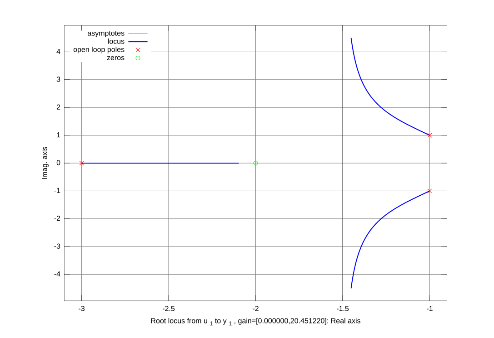
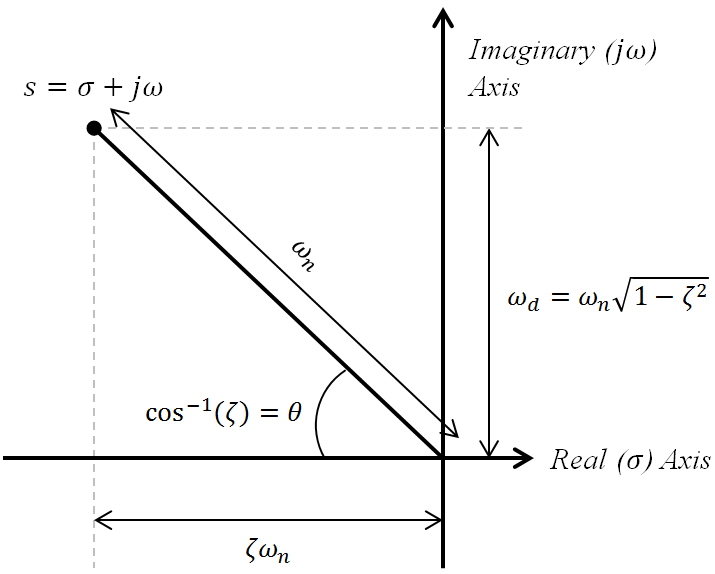

# 22.4 根轨迹法

> **前置知识**：[22.2 控制系统数学模型](22.2-控制系统数学模型.md)（传递函数、极点零点的意义）、[22.3 时域分析](22.3-时域分析.md)（极点位置决定响应形态）。根轨迹法研究当增益变化时闭环极点如何移动，从而在平面上一目了然地评估稳定性与性能。

时域分析告诉我们：闭环极点落在哪里，响应就是什么样。根轨迹法回答一个关键工程问题——**当增益（或某个参数）从 0 变到无穷时，闭环极点会怎么走？** 它把"增益为何不能乱调、加零点为什么能稳定系统"这些经验，变成可在 $s$ 平面上直观看到的几何图形。对电源环路、电机伺服这类单增益可调的系统，根轨迹是最直接的调参指导。

## 1. 根轨迹的概念

考虑单位反馈系统的开环传递函数：

$$
KG(s)H(s) = K\frac{\prod_{i}(s - z_i)}{\prod_{j}(s - p_j)}
$$

闭环特征方程为 $1 + K G(s)H(s) = 0$，即：

$$
\prod_{j}(s - p_j) + K\prod_{i}(s - z_i) = 0
$$

**根轨迹**：当 $K$ 从 $0$ 变化到 $+\infty$ 时，闭环特征根（即闭环极点）在 $s$ 平面上的运动轨迹。设计时可通过观察闭环极点落位判断稳定性与动态特性。

### 为什么根轨迹有用

闭环灵敏度 $\Phi = \frac{KG}{1+KG}$ 的分母（特征多项式）的根就是闭环极点。由于 $KG(s)H(s)$ 是 $K$ 的一次式，特征根随 $K$ 的变化是**连续的曲线**，因此可以在 $s$ 平面上把整族根画出来。根轨迹正是这根曲线族，它把"增益变化对响应的影响"压缩成一条图。

## 2. 根轨迹的幅值与相角条件

任一点 $s$ 属于根轨迹，必须同时满足**相角条件**与**幅值条件**：

$$
\text{相角条件：}\qquad \sum_{i}\angle(s - z_i) - \sum_{j}\angle(s - p_j) = (2k+1)\pi
$$

$$
\text{幅值条件：}\qquad K = \frac{\prod_{j}|s - p_j|}{\prod_{i}|s - z_i|}
$$

相角条件判定位，幅值条件求该点的增益 $K$。

### 两条条件的角色分工

- **相角条件**给出根轨迹的"形状"（与 $K$ 无关，$K$ 只改变比例尺）——它决定了哪些点是轨迹上的点
- **幅值条件**给出轨迹上某一点对应的具体增益 $K$——它决定了"走到哪一步"

工程师的做法：先用相角条件画出轨迹，走到期望的位置后，用幅值条件反算出要设定的增益。

## 3. 根轨迹绘制基本规则

**六条规则速查表**：

| 规则 | 内容 | 用途 |
|------|------|------|
| 起点/终点 | $K=0$→开环极点；$K\to\infty$→开环零点（不足则趋向无穷远零点） | 定轨迹起止 |
| 分支与对称 | 分支数 = 极点数 $n$，关于实轴对称 | 定整体形状 |
| 实轴区段 | 某段右侧总极零点数为奇数则在轨迹上 | 定实轴段 |
| 渐近线 | 方向 $\theta_a$、心 $\sigma_a$（见式） | 定远方走向 |
| 分离/会合 | $\sum\frac{1}{s-p_j}=\sum\frac{1}{s-z_i}$ | 定转折点 |
| 虚轴交点 | $s=j\omega$ 代入特征方程解临界增益 | 定稳定边界 |

1. **起点**：$K=0$ 时闭环极点为开环极点 $p_j$；**终点**：$K\to\infty$ 时趋于开环零点 $z_i$（不足个数趋于无穷远处零点）
2. **分支数与对称性**：分支数 = 开环极点数 $n$，轨迹关于实轴**对称**（闭环系数为实）
3. **实轴上的区段**：实轴上某段右侧的极、零点个数之和为奇数时，该段属于根轨迹
4. **渐近线**：指向无穷的分支终点沿渐近线，其方向角与交点分别为
$$
\theta_a = \frac{(2k+1)\pi}{n - m}, \qquad \sigma_a = \frac{\sum p_j - \sum z_i}{n - m}
$$
5. **分离点/会合点**：满足 $\sum \frac{1}{s-p_j} = \sum \frac{1}{s-z_i}$ 的解
6. **与虚轴交点**：令 $s=j\omega$ 代入特征方程解出 $\omega$ 与临界增益 $K_c$，此处即稳定边界

### 规则背后的直觉

- 分支数等于极点数，因为 $n$ 阶特征方程有 $n$ 个根，随 $K$ 连续演化
- 实轴区段规则：$s$ 在实轴区段上时，其左侧的极点/零点贡献 $0^\circ$ 相角，右侧每个贡献 $180^\circ$，故奇数个右侧元素两侧各抵消一个 $180^\circ$ 后满足相角条件
- 渐近线本质：$|s|\to\infty$ 时，所有极点/零点都在原点"合成一个等效极/零点"
- 分离点出现在两个根重合处，此时特征方程有重根

现代计算中可用数值工具绘制完整根轨迹，但理解这 6 条规则对**判断趋势、校验工具结果、手算临界增益**仍然极为重要。

## 4. 参数对根轨迹的影响

- **开环增益**：设增益为 $K$，增大 $K$ 使闭环极点沿轨迹移动，可能越过虚轴进入右半平面 → 失稳，临界点对应增益裕度
- **增加极点**（如增加惰性环节）：使根轨迹更易右移，系统更易不稳定
- **增加零点**（如增加微分/超前环节）：把根轨迹"拉"向左半平面，改善稳定性与动态特性——这正是校正的根轨迹思路

### 增加零点为什么"拉得动"轨迹

零点 $z$ 出现在相角条件中 $\angle(s-z)$，一个左半平面的零点给高频段提供正的相位贡献，使相角条件更容易在左半平面满足，从而把整条轨迹吸向左边。极点则相反（相位贡献为负），把轨迹推向右边。这就是"零点稳、极点不稳"的几何解释，也是 22.6 超前校正的基础。

## 5. 根轨迹法用于设计

给定期望的闭环极点位置（由 22.3 的 $\zeta,\omega_n$ 决定超调与速度），在根轨迹上找对应的增益 $K$：

$$
K = \frac{\prod_{j}|s_0 - p_j|}{\prod_{i}|s_0 - z_i|}
$$

若期望位置不在轨迹上，则需**引入校正（零点/极点）** 改变轨迹形状使其通过期望极点——这是 22.6 超前校正的理论基础。

### 参量根轨迹

除了增益 $K$，其他参数（如某时间常数 $\tau$）也可以作为根轨迹参数。方法：把特征方程改写成"与 $\tau$ 相关项 + 无关项 = 0"的形式，构造等效开环比，再套用普通根轨迹规则。书中常用，这里仅作概念介绍。

### 完整绘制一例：二阶系统

设开环传递函数 $G(s)H(s)=\frac{K}{s(s+4)}$，试求闭环稳定时的增益范围。

- **起点**：两个开环极点 $0, -4$；无零点，两条分支走向无穷
- **实轴区段**：$(-4,0)$ 内右侧极点数 $=2$（偶数），不属于轨迹
- **渐近线**：$n-m=2$，方向角 $\theta_a=\frac{(2k+1)\pi}{2}$ 即 $\pm 90^\circ$；交点 $\sigma_a=\frac{0-4}{2}=-2$
- **分离点**：$\frac{1}{s}+\frac{1}{s+4}=0 \Rightarrow s=-2$
- **与虚轴交点**：特征方程 $s^2+4s+K=0$，代入 $s=j\omega$ 得 $-\omega^2+4s+K$ 实部虚部分别为 $-\omega^2+K=0,\ 4\omega=0$，即 $\omega=0$，$K=0$——此例恒在左半平面，任意 $K>0$ 稳定

可见欠阻尼时两条分支从实轴分离点斜向上进入复平面，$K$ 增大后响应振荡但仍稳定。

### 设计工作流

1. 由时域指标确定期望主导极点（$s_0 = -\zeta\omega_n \pm j\omega_n\sqrt{1-\zeta^2}$）
2. 画出原系统根轨迹，检查 $s_0$ 是否在轨迹上

3. 若在 → 用幅值条件求 $K$
4. 若不在 → 加入校正网络（零点）把轨迹拉过 $s_0$，再次检查其他极点是否可接受

## 6. 工程/典型应用

- **电机伺服**：调节增益观察转子极点是否越界，确定最大可用增益
- **电源环路**：评估增加输出滤波电容（新增低频极点）对环路稳定性的影响，判断是否需要零点校正
- **运放闭环**：补偿电容改变主极点位置，使闭环两个极点回到稳定区且取得期望阻尼

### 一个具体判断：何时该加零点

若根轨迹显示某段增益下闭环复极点进入右半平面（失稳），要么降低增益（牺牲精度），要么在合适位置加入零点把轨迹向左拉。根轨迹图能直观告诉你：加零点后轨迹绕开了右半平面，从而既可以调高增益保精度、又保持稳定——这正是电源环路里"加零点补偿 LC 双极点"的本质原因。

## 小结

- 根轨迹是 $K$ 变化时闭环极点的轨迹，由相角/幅值条件决定
- 6 条基本规则可快速手绘轨迹：起始/终止、实轴区间、渐近线、分离点、虚轴交点
- 极点右移失稳、零点（超前）左移稳定，是校正的根轨迹解释
- 设计时把期望极点落在轨迹上以确定增益，或用校正重塑轨迹
- 根轨迹把"增益为什么不能乱调"变成可视的几何图形，是单参数调参的直观指导