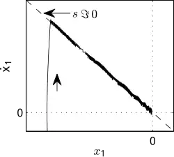

# 22.9 非线性与鲁棒控制概述

> **前置知识**：[22.3 时域分析](22.3-时域分析.md)（线性系统稳定的极点判据）、[22.5 频域分析法](22.5-频域分析法.md)（相位裕度与鲁棒性的联系）。本章对真实系统中的非线性与不确定性问题给出分析视角与控制工具。

前几章的线性理论是一副"理想放大镜"：叠加原理、极点判据、传递函数都很漂亮。但真实系统几乎都有饱和、死区、滞环、摩擦与参数漂移，这些非线性让线性工具失效——叠加原理被打破、极点判据不再成立。本章介绍两类应对：**分析**非线性的工具（相平面法、描述函数法、李雅普诺夫第二方法）与**应对不确定性**的鲁棒控制思想（H∞ 等），并说明它和线性控制的分工。

## 1. 非线性系统的特殊性

实际系统（饱和、死区、滞环、摩擦、磁饱和）几乎都是非线性的。线性叠加原理不再成立，极点判据失效，需要用专门工具。工程师关注的是**平衡点附近的局部稳定性**与**极限环**现象。

> 非线性环节无法用传递函数严格描述，但很多环节近似线性部分 + 非线性部分可分离。常见非线性：饱和（PWM 占空比限幅）、死区（DAC 不灵敏区）、滞环（比较器）、摩擦（伺服）。

### 常见非线性环节一览

| 非线性 | 特征 | 典型来源 | 后果 |
|--------|------|---------|------|
| 饱和 | 输出被限幅 | PWM 占空比上下限 | 超大信号下增益骤降、响应变慢 |
| 死区 | 小输入无响应 | DAC 不灵敏区、齿隙 | 中位附近失灵、极限环 |
| 滞环 | 输出依赖历史 | 比较器、磁滞 | 振荡（滞环控制本身即用此） |
| 摩擦/静差 | 需克服静摩擦力 | 伺服机械 | 定位残差、低速爬行 |

### 与线性系统的三条本质区别

1. **无叠加原理**：两个输入的共同响应≠各自响应之和，无法用频率响应的幅度/相位统一描述
2. **极点判据失效**：系统稳定性可能依赖输入幅度与初态，不存在全局统一的"零极点"
3. **新现象**：极限环（自持振荡）、跳跃共振、谐波生成——线性系统绝不会有

因此非线性系统分析转向"平衡点局部 + 特殊现象判断"的策略。

## 2. 相平面法

相平面法把二阶系统的状态 $(x, \dot{x})$ 置于平面，绘制**相轨迹**，从相图直观判断收敛/振荡/发散。

- 平衡点：$\dot{x}=0,\ \ddot{x}=0$ 的点
- 奇点类型：稳定/不稳定结点、焦点、鞍点——由 Jacobian 线性化特征值决定
- **极限环**：自持振荡的闭合相轨迹（如继电器振荡）

方法：把 $\ddot{x}=f(x,\dot{x})$ 写作 $\dot{x}\dfrac{d\dot{x}}{dx}=f(x,\dot{x})$，用等倾线法图解积分轨迹。

图源：[Wikimedia Commons](https://commons.wikimedia.org/wiki/File:First_order_sliding_mode_control.svg.png)，CC BY-SA 4.0。

### 从相图读信息

| 相图形态 | 系统行为 |
|---------|---------|
| 轨迹都螺旋收敛到原点 | 平衡点渐近稳定（焦点） |
| 轨迹全部发散出去 | 平衡点不稳定 |
| 闭合的孤立环，相邻轨迹绕它转 | 极限环（自持振荡） |
| 鞍点附近呈 X 型 | 不稳定平衡，可能敏感临界 |

相平面法适合二阶（因二维可视）、且初值对结论影响显著（能看出"哪个初值稳/不稳"）的场合，是对"全局行为"最直观的近似手段。

## 3. 描述函数法

对"线性部分 + 单值非线性环节"的系统，描述函数 $N(X)$ 用基波等效代替非线性在正弦输入 $X\sin\omega t$ 下的增益。系统可能自激振荡的条件近似为：

$$
G(j\omega)\,N(X) = -1
$$

即奈奎斯特图 $G(j\omega)$ 与 $-1/N(X)$ 曲线的交点对应极限环（其幅值与频率可由交点读出）。**适用限制**：仅对基波近似、适用于低通性质强的系统，无法处理多值非线性的跳变细节。

### 描述函数法的应用流程

1. 写出线性部分 $G(j\omega)$、非线性部分描述函数 $N(X)$
2. 在同一图里画 $G(j\omega)$ 与 $-1/N(X)$
3. 有交点 → 存在极限环（读出幅值与频率）；无交点 → 无非线性自持振荡
4. 用于"消除自激"：调整 $G(j\omega)$（如加补偿）让曲线不相交

优点是继承了频域形象化，缺点是仅基波近似且要求低通性。适合电子系统中含饱和/继电器的环路做稳定性第一级判断。

## 4. 李雅普诺夫稳定性常识

不用求解运动方程，用**能量型标量函数**判断稳定性：

- 若标量函数正定且其沿轨迹的时间导数恒负 → 原点渐近稳定
- 若时间导数恒非正 → 稳定（LaSalle 不变集可强化为渐近稳定）
- **李雅普诺夫第二方法（直接法）** 是处理非线性与时变系统稳定性的通用框架，无需线性近似

典型候选是二次型，对线性定常系统，稳定性条件可化为李雅普诺夫方程的解正定性：

$$
\mathbf{A}^{\mathsf{T}}\mathbf{P} + \mathbf{P}\mathbf{A} = -\mathbf{Q}
$$

其中若正定矩阵 Q 对应存在正定解 P，则系统稳定。这一方程也把线性稳定性判据换成了"矩阵方程可解性"的语言，便于推广。

### 为什么它对非线性系统也有效

直接法不只适用于线性系统：只要能构造一个沿未解轨迹单调下降的正定能量函数，就无需知道轨迹也能下稳定结论。难点在于**找 V 这个候选函数**——工程上常用"能量 + 误差二次型"来构造，从而把"证明稳定"转化为"验证一个不等式"。

### 一个说明性运用：验证线性系统稳定性

对 $\dot{x} = ax$，取候选 $V=x^2>0$，则时间导数 $\dot{V}=2x\dot{x}=2ax^2$。若 $a<0$ 则 $\dot{V}<0$，原点渐近稳定——与"特征值 $a<0$"的直觉一致，但这里无需解方程、凭不等式即证。对非线性 $\dot{x}=-x^3$，同样取 $V=x^2$，得 $\dot{V}=2x(-x^3)=-2x^4<0$，直接判定渐近稳定，而线性极点判据根本无从下手——这正体现了直接法的通则性。

## 5. 鲁棒性、H∞ 与控制目标

**鲁棒性**：系统在对象参数摄动、建模误差、外扰下仍保持稳定与性能。

- **不确定性模型**：加性、乘性或既有结构的参数摄动描述
- **H∞ 控制**：以传递函数在频域的 H∞ 范数作为最坏情形度量，最小化扰动到输出的最坏增益：

$$
\|G\|_{\infty} = \sup_{\omega} \sigma_{\max}\big(G(j\omega)\big)
$$

H∞ 综合通过求解代数黎卡提方程（ARE）得到状态反馈，把扰动衰减、灵敏度整形与模型不确定的鲁棒稳定统一设计；H2（LQG）对应能量平均意义的优化，μ 综合处理结构化不确定性。

### 鲁棒性与线性裕度的关系

22.5 的相位裕度、幅值裕度其实已经是"鲁棒性"的特例——它们量化了系统对增益/相位摄动的容忍度。鲁棒控制把所有可能的不确定性纳入 $G(j\omega)$ 的范数加权，直接在**最坏情形**上做优化，保证"即使对象偏离标称模型，闭环仍稳定且性能达标"。这也是为什么"鲁棒 = 把裕量做得客观、系统化"。

### 各种鲁棒方法的横向比较

| 方法 | 度量 | 处理的不确定性 | 实现 |
|------|------|---------------|------|
| 经典裕度 PM/GM | 单点增益/相位 | 增益/相位摄动 | 频域手算 |
| H2 (LQG) | 能量平均 | 随机噪声 | 解 ARE |
| H∞ | 最坏频域增益 | 任意有界摄动 | 解 ARE / 求解不等式 |
| μ 综合 | 结构化奇异值 | 结构化不确定性 | 数值迭代 |

## 6. 工程/典型应用

- **饱和与抗积分饱和**：PWM 限幅导致积分累积（windup），用反算/限幅处理——非线性处理的实际范例
- **轨道与姿态控制**：大扰动下用对参数摄动不敏感的方法保证鲁棒性
- **航天/过程控制**：在模型不确定严重、安全关键场合采用鲁棒综合，用最坏情形保证稳定
- **电源环路**：适应负载与输入电压大范围变化，用鲁棒性指标评估裕量

### 与线性控制的分工：先线性、后非线性与鲁棒

工程实践并非"抛掉线性方法"。正确顺序是：

1. 先做线性建模与补偿（22.3~22.6），得到可工作的标称闭环
2. 再识别非线性瓶颈（饱和、死区、极限环），用相平面/描述函数判断是否真有大问题
3. 最后评估不确定性（负载、温度、批次），用鲁棒指标确认安全裕量并调整设计

线性工具给出"设计起点"，非线性与鲁棒工具负责"查漏兜底"——两者互补而非对立。

## 小结

- 非线性需专门工具，稳定与极限环不能用极点判据直接判定
- 相平面法看轨迹形态，描述函数法估自激振荡，李雅普诺夫直接法给出通用稳定判据
- 鲁棒性刻画对不确定的容忍度，H∞ 以最坏频域增益为指标做综合设计
- 工程上需在理想线性模型之外处理饱和、死区等非线性，并把安全裕量纳入设计
- 先线性设计、再非线性与鲁棒校验，是真实系统的标准工作流