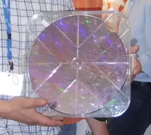
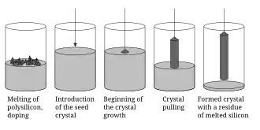
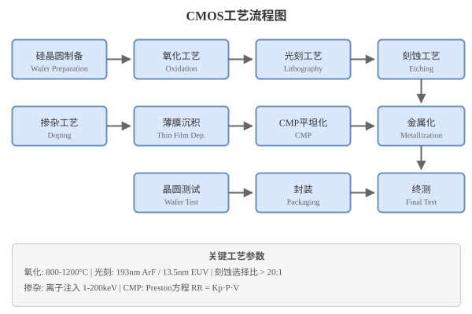
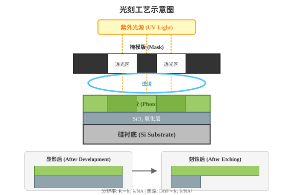
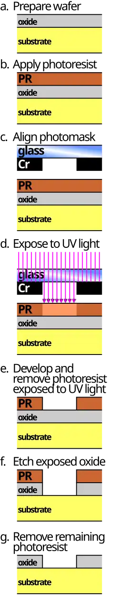
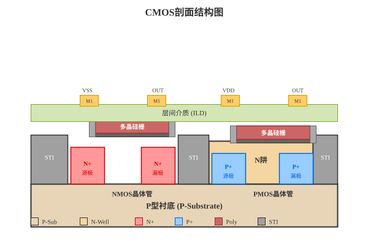

# 6.1 半导体工艺基础

## 1. 概述

半导体工艺是集成电路制造的基石，涉及从硅晶圆制备到芯片封装的全过程。随着摩尔定律的推进，工艺节点从微米级发展到纳米级，制造工艺变得越来越复杂。本章将系统介绍半导体制造的核心工艺技术。

## 2. 硅晶圆制备

### 2.1 硅材料

硅（Si）是半导体工业中最基础的材料，具有以下特性：
- 禁带宽度：1.12 eV（300K）
- 电子迁移率：1350 cm²/V·s
- 空穴迁移率：480 cm²/V·s
- 相对介电常数：11.7

### 2.2 晶圆制备流程

硅晶圆的制备流程包括：

1. **石英砂还原**：SiO₂ → 冶金级硅（MG-Si，纯度98%）
2. **提纯**：通过西门子法生成电子级多晶硅（EG-Si，纯度99.9999999%）
3. **单晶生长**：使用 Czochralski（CZ）法或浮区熔炼（FZ）法生长单晶硅锭
4. **切片**：用金刚石线锯将硅锭切成薄片
5. **研磨与抛光**：CMP工艺获得镜面表面
6. **清洗**：RCA标准清洗去除表面污染物


抛光后的单晶硅晶圆是集成电路制造的载体，后续所有工艺均在晶圆表面上完成。


Czochralski（CZ）直拉法从熔融硅中拉制单晶硅锭，是制备高纯度单晶硅的核心工艺。

### 2.3 晶圆参数

晶圆的关键参数包括：

- **直径**：从早期的2英寸发展到目前的12英寸（300mm）和即将量产的18英寸（450mm）
- **厚度**：12英寸晶圆典型厚度为775μm
- **晶向**：常见的有<100>和<111>晶向
- **电阻率**：通过掺杂浓度控制，范围从0.001Ω·cm到100Ω·cm
- **氧含量**：CZ法晶圆典型氧含量为10¹⁷~10¹⁸ atoms/cm³

## 3. 半导体制造基本流程

半导体制造的基本流程可以概括为以下几个主要步骤：

```
硅晶圆制备 → 氧化 → 光刻 → 刻蚀 → 掺杂 → 薄膜沉积 → CMP → 金属化 → 测试
```



## 4. 氧化工艺

### 4.1 氧化原理

热氧化是将硅表面转化为二氧化硅（SiO₂）的过程，反应方程式为：

Si + O₂ → SiO₂ （干氧氧化）
Si + 2H₂O → SiO₂ + 2H₂ （湿氧氧化）

### 4.2 氧化动力学

氧化层的生长遵循 Deal-Grove 模型：

$$x_0^2 + Ax_0 = B(t + \tau)$$

其中：
- $x_0$：氧化层厚度
- $t$：氧化时间
- $B$：抛物型速率常数
- $B/A$：线性速率常数
- $\tau$：初始氧化层对应的偏移时间

对于薄氧化层（<100Å），生长速率由表面反应控制：

$$x_0 = \frac{B}{A}(t + \tau)$$

对于厚氧化层，生长速率由扩散控制：

$$x_0^2 = Bt$$

### 4.3 氧化工艺参数

| 参数 | 典型值 | 影响 |
|------|--------|------|
| 温度 | 800~1200°C | 温度越高，氧化速率越快 |
| 压力 | 1~25 atm | 高压氧化可降低温度 |
| 气氛 | O₂/H₂O | 湿氧速率快，干氧质量好 |
| 晶向 | <100>/<111> | <111>晶向氧化速率更快 |

## 5. 光刻工艺

光刻是将掩模版上的图形转移到晶圆表面的工艺过程，是集成电路制造中最关键的步骤之一。

### 5.1 光刻流程



光刻的基本步骤包括：

1. **表面清洗与脱水烘烤**：去除水分，增强光刻胶粘附性
2. **涂胶**：通过旋涂方式在晶圆表面均匀涂覆光刻胶
3. **软烘**：去除光刻胶中的溶剂（90~110°C）
4. **对准与曝光**：将掩模版与晶圆对齐，进行紫外光曝光
5. **后烘**：降低驻波效应
6. **显影**：去除可溶性光刻胶区域
7. **坚膜烘烤**：增强光刻胶的耐刻蚀性
8. **检查**：测量关键尺寸（CD）和套刻精度


该图以流程示意图展示了光刻各关键环节，包括涂胶、对准曝光、显影与图形转移，是光刻章节的核心图示。

### 5.2 分辨率

光刻系统的分辨率由瑞利准则决定：

$$R = k_1 \frac{\lambda}{NA}$$

其中：
- $R$：最小可分辨尺寸
- $k_1$：工艺常数（通常0.25~0.7）
- $\lambda$：曝光光源波长
- $NA$：数值孔径

焦深（DOF）为：

$$DOF = k_2 \frac{\lambda}{NA^2}$$

### 5.3 光刻光源演进

| 技术节点 | 光源 | 波长 |
|---------|------|------|
| ≥0.5μm | g-line | 436nm |
| 0.35μm | i-line | 365nm |
| 0.25~0.13μm | KrF | 248nm |
| 130~7nm | ArF | 193nm |
| 7nm以下 | EUV | 13.5nm |

## 6. 刻蚀工艺

刻蚀是去除晶圆表面特定区域材料的工艺，分为湿法刻蚀和干法刻蚀两类。

### 6.1 湿法刻蚀

湿法刻蚀使用化学溶液进行各向同性刻蚀，刻蚀速率由化学反应决定。

对于硅的各向异性湿法刻蚀：
- KOH溶液：在<100>晶向刻蚀速率远大于<111>晶向
- TMAH溶液：与CMOS工艺兼容

### 6.2 干法刻蚀

干法刻蚀（等离子体刻蚀）利用等离子体中的离子和自由基进行刻蚀，可以实现各向异性刻蚀。

刻蚀速率公式：

$$ER = \frac{1}{\rho} \cdot \frac{M}{N_A} \cdot \Gamma$$

其中：
- $\rho$：材料密度
- $M$：摩尔质量
- $N_A$：阿伏伽德罗常数
- $\Gamma$：反应物通量

### 6.3 刻蚀关键参数

- **选择比**：目标材料与掩模材料的刻蚀速率比
- **各向异性度**：垂直刻蚀速率与横向刻蚀速率之比
- **均匀性**：晶圆表面不同位置的刻蚀速率一致性
- **刻蚀损伤**：等离子体对器件造成的损伤

## 7. 掺杂工艺

掺杂是将特定杂质元素引入硅中，改变其导电类型和电阻率的工艺。

### 7.1 扩散掺杂

扩散掺杂基于Fick扩散定律：

**Fick第一定律**（稳态扩散）：

$$J = -D\frac{\partial C}{\partial x}$$

**Fick第二定律**（非稳态扩散）：

$$\frac{\partial C}{\partial t} = D\frac{\partial^2 C}{\partial x^2}$$

其中：
- $J$：杂质通量
- $D$：扩散系数
- $C$：杂质浓度
- $x$：深度
- $t$：时间

扩散系数与温度的关系（Arrhenius公式）：

$$D = D_0 \exp\left(-\frac{E_a}{kT}\right)$$

### 7.2 离子注入

离子注入是将掺杂元素离子化后加速到高能量，直接注入硅晶格中的工艺。

注入离子的浓度分布近似为高斯分布：

$$N(x) = \frac{Q}{\sqrt{2\pi}\Delta R_p} \exp\left[-\frac{(x - R_p)^2}{2\Delta R_p^2}\right]$$

其中：
- $R_p$：投射射程（投影射程）
- $\Delta R_p$：射程标准偏差
- $Q$：注入剂量（ions/cm²）

注入损伤与退火：离子注入会破坏晶格结构，需要通过退火（快速热退火RTA或炉管退火）来修复损伤并激活杂质。

## 8. 薄膜沉积工艺

薄膜沉积用于在晶圆表面形成各种功能薄膜。

### 8.1 化学气相沉积（CVD）

CVD通过气态前驱体的化学反应在衬底表面形成固态薄膜。

沉积速率公式：

$$G = \frac{h_g}{k_s + h_g} \cdot \frac{C_g}{\rho} \cdot k_s$$

其中：
- $h_g$：气相质量传输系数
- $k_s$：表面反应速率常数
- $C_g$：气相反应物浓度
- $\rho$：薄膜密度

### 8.2 物理气相沉积（PVD）

PVD通过物理方法（溅射或蒸发）将靶材材料沉积到晶圆表面。

### 8.3 等离子体增强化学气相沉积（PECVD）

PECVD（Plasma-Enhanced Chemical Vapor Deposition）利用等离子体激活前驱体化学反应，使沉积可以在较低温度（200~400°C）下进行。相比传统CVD（通常需要600~900°C），PECVD的低温特性使其特别适合在后道工序中沉积介质层（如钝化层、层间介质），避免高温对已形成的掺杂结和金属互连造成破坏。

常用PECVD薄膜：
- **SiO₂**：使用 SiH₄ + N₂O 或 TEOS 作为前驱体
- **Si₃N₄**：使用 SiH₄ + NH₃ 作为前驱体
- **SiON**：使用 SiH₄ + N₂O + NH₃ 混合气体

### 8.4 原子层沉积（ALD）

ALD通过自限制的表面反应实现原子级别的薄膜厚度控制，每循环沉积约1Å/cycle。

## 9. CMP平坦化

化学机械抛光（CMP）通过化学腐蚀和机械研磨的协同作用实现全局平坦化。

CMP的Preston方程：

$$RR = K_p \cdot P \cdot V$$

其中：
- $RR$：抛光速率
- $K_p$：Preston系数
- $P$：施加压力
- $V$：相对速度

## 10. CMOS工艺基本流程

### 10.1 N阱CMOS工艺

标准CMOS工艺（N阱）的主要步骤：

1. 初始氧化（垫氧化层）
2. 氮化硅沉积
3. 有源区光刻与刻蚀
4. N阱注入与推阱
5. 浅槽隔离（STI）形成
6. 栅氧化层生长
7. 多晶硅栅沉积与刻蚀
8. LDD注入（轻掺杂漏）
9. 侧墙（Spacer）形成
10. 源漏重掺杂注入
11. 快速热退火（RTA）
12. 接触孔形成
13. 金属化（多层金属互连）
14. 钝化层

### 10.2 P阱与双阱工艺

- **P阱工艺**：在N型衬底上形成P阱，用于制作NMOS器件
- **双阱工艺**：在N+衬底/N-外延层上同时形成N阱和P阱，可以独立优化NMOS和PMOS性能

### 10.3 CMOS剖面结构



## 11. 特征尺寸与工艺节点演进

### 11.1 摩尔定律

摩尔定律指出，集成电路上可容纳的晶体管数量每18~24个月翻一番。这主要通过缩小特征尺寸实现。

### 11.2 工艺节点演进

| 节点 | 量产年份 | 栅极类型 | 互连 |
|------|---------|---------|------|
| 1μm | 1985 | Poly-Si | Al |
| 0.35μm | 1995 | Poly-Si | Al |
| 0.13μm | 2001 | Poly-Si | Cu |
| 90nm | 2004 | Poly-Si/SiON | Cu |
| 65nm | 2006 | Poly-Si/SiON + strain | Cu |
| 45nm | 2008 | HKMG (High-K Metal Gate) | Cu |
| 28nm | 2011 | HKMG (Gate-Last) | Cu |
| 16/14nm | 2014 | FinFET | Cu |
| 7nm | 2018 | FinFET (EUV) | Cu |
| 5nm | 2020 | FinFET (EUV) | Cu |
| 3nm | 2022 | GAAFET | Cu |

### 11.3 关键尺寸缩放

根据Demard缩放定律，当特征尺寸缩小为原来的$1/k$时：

- 栅极长度：$L \rightarrow L/k$
- 栅氧厚度：$t_{ox} \rightarrow t_{ox}/k$
- 掺杂浓度：$N_A \rightarrow k \cdot N_A$
- 电源电压：$V_{DD} \rightarrow V_{DD}/k$
- 电流密度：不变
- 延迟：$\tau \rightarrow \tau/k$
- 功耗密度：不变

## 总结

本章介绍了半导体工艺的基础知识，从硅晶圆制备到CMOS工艺的核心流程。理解这些工艺原理对于后续学习集成电路设计、器件物理和版图设计至关重要。随着工艺节点不断推进，先进工艺技术（如FinFET、EUV光刻、3D IC等）将在后续章节中详细讨论。