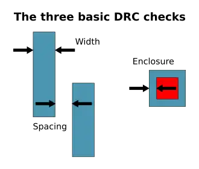
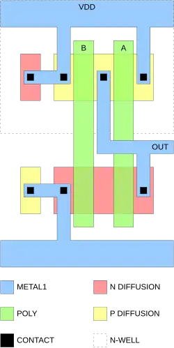
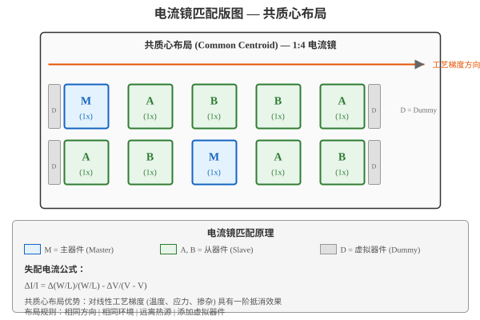
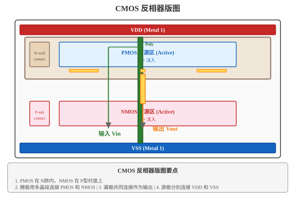
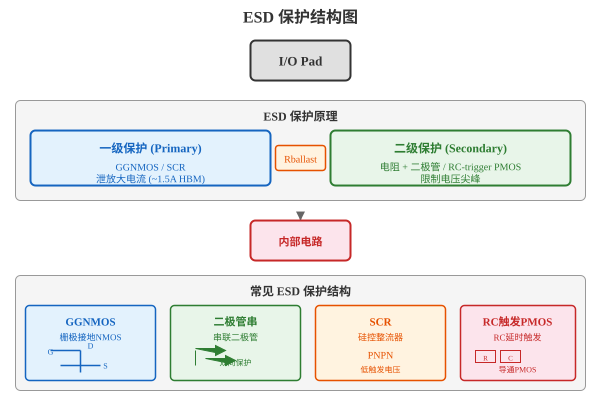

# 6.11 版图设计

## 1. 概述

版图设计（Layout Design）是集成电路设计流程中的最后一步物理实现阶段，将电路网表转化为用于制造的光掩模版图形。版图设计的质量直接影响芯片的性能、良率和可靠性。本章将系统介绍版图设计的基本概念、设计规则和关键设计技术。

## 2. 版图设计基本概念

### 2.1 版图层次

CMOS工艺的版图包含多个层次：

| 层次 | 说明 | 颜色 |
|------|------|------|
| NW（N阱） | PMOS晶体管所在的N型区域 | 黄色 |
| AA（有源区） | 形成晶体管沟道的区域 | 绿色 |
| POLY（多晶硅） | 栅极和局部互连 | 红色 |
| CONT（接触孔） | 有源区到金属的连接 | 黑色 |
| M1（金属1） | 第一层金属互连 | 蓝色 |
| VIA1（通孔1） | M1到M2的连接 | 紫色 |
| M2（金属2） | 第二层金属互连 | 青色 |
| ... | 更高层金属 | ... |

### 2.2 设计规则

设计规则是晶圆厂定义的版图几何约束，确保版图在制造过程中能被正确实现。

## 3. 设计规则与DRC

### 3.1 设计规则类型

设计规则通常包括以下类别：

- **最小宽度规则**：导线、接触孔等的最小尺寸
- **最小间距规则**：同层图形之间的最小间距
- **最小包围规则**：一层图形对另一层的最小包围
- **最小延伸规则**：一层图形超出另一层的最小长度
- **密度规则**：特定层次的最小/最大图形密度

### 3.2 Lambda设计规则

Lambda设计规则以$\lambda$为基本单位（$\lambda = L_{min}/2$）：

| 规则 | 描述 | Lambda值 |
|------|------|----------|
| 有源区宽度 | 有源区最小宽度 | 3$\lambda$ |
| 有源区间距 | 有源区最小间距 | 3$\lambda$ |
| 栅极宽度 | 多晶硅最小宽度 | 2$\lambda$ |
| 栅极间距 | 多晶硅最小间距 | 2$\lambda$ |
| 接触孔大小 | 接触孔最小尺寸 | 2$\lambda$×2$\lambda$ |
| 金属1间距 | 金属1最小间距 | 3$\lambda$ |

### 3.3 DRC检查

DRC（Design Rule Check）通过EDA工具自动检查版图规则：

```tcl
# Calibre DRC规则示例
WIDTH M1 >= 0.10  // M1最小宽度0.10μm
SPACE M1 < 0.12  // M1最小间距0.12μm
ENC POLY AA >= 0.05  // 多晶硅超出有源区至少0.05μm
```


该图示意了DRC检查的基本规则类型，包括最小宽度、最小间距、最小包围等几何约束。

## 4. 版图与电路一致性检查（LVS）

LVS（Layout vs. Schematic）验证版图与电路网表的一致性：

- **器件一致性**：版图中器件的类型、尺寸、数量与电路网表匹配
- **连接一致性**：版图中各节点的连接关系与电路网表一致
- **端口一致性**：版图的I/O端口与电路网表匹配

## 5. 版图层次化设计

### 5.1 层次化方法

层次化设计将复杂电路分解为子模块，自底向上构建：

1. **基本单元设计**：反相器、与非门、或非门等基本逻辑门
2. **功能模块设计**：加法器、乘法器、寄存器等
3. **模块集成**：将功能模块组合成完整芯片


该图为CMOS与非门（NAND）的基本单元版图，展示同一高度标准单元内PMOS与NMOS的布局及互连关系。

### 5.2 层次化版图优势

- **设计复用**：基本单元可在多个设计中重复使用
- **并行设计**：不同模块可同时由不同工程师设计
- **验证效率**：模块级验证比整芯片验证更高效
- **修改方便**：局部修改不影响其他模块

## 6. 匹配设计

### 6.1 匹配设计的重要性

模拟电路设计中，器件匹配直接影响电路性能：

- 电流镜的电流匹配精度
- 差分对的失调电压
- 参考电压源的精度

### 6.2 电流镜匹配



**共质心布局（Common Centroid）**：

将器件阵列对称排列，消除工艺梯度的影响。

对于电流镜的匹配，失配电流为：

$$\frac{\Delta I}{I} = \frac{\Delta(W/L)}{W/L} - \frac{\Delta V_{TH}}{V_{GS} - V_{TH}}$$

### 6.3 差分对匹配

差分对匹配版图注意事项：

- 使用共质心布局（如A-B-B-A交叉耦合）
- 添加虚拟器件（Dummy Device）保持环境一致
- 保持方向一致
- 匹配器件靠近放置

### 6.4 匹配设计规则

- **相同方向**：匹配器件保持相同方向
- **相同环境**：匹配器件周围环境一致
- **温度梯度**：匹配器件远离大功率器件
- **应力效应**：避免芯片边缘的应力影响

## 7. CMOS反相器版图



CMOS反相器的版图设计要点：

1. PMOS在N阱内，NMOS在P型衬底上
2. 栅极用多晶硅连接PMOS和NMOS
3. 漏极共同连接作为输出
4. 源极分别连接VDD和VSS
5. 注意阱接触和衬底接触

## 8. 天线效应

### 8.1 天线效应原理

在等离子体刻蚀过程中，连接到栅极的金属线会收集电荷，当积累的电荷足够多时，会击穿栅氧化层。

天线比率：

$$AR = \frac{A_{metal}}{A_{gate}}$$

### 8.2 天线效应预防

- **跳线法**：使用更高层金属断开天线
- **二极管插入**：添加反向偏置二极管提供放电路径
- **栅极保护**：在栅极附近添加保护二极管

## 9. 闩锁效应预防

### 9.1 版图级预防措施

- **保护环（Guard Ring）**：在NMOS周围添加P+保护环，PMOS周围添加N+保护环
- **增加接触密度**：减少阱和衬底的电阻
- **保持间距**：NMOS和PMOS保持足够距离
- **使用SOI技术**：从根源消除闩锁效应

### 9.2 保护环设计

保护环宽度和间距的规则：

$$W_{guard} \geq 3\lambda$$
$$S_{guard} \leq 5\lambda$$

## 10. ESD保护结构



### 10.1 ESD保护原理

ESD（Electrostatic Discharge）保护结构在芯片I/O引脚和内部电路之间提供低阻抗放电路径。

### 10.2 常见ESD结构

- **GGNMOS**：栅极接地的NMOS，利用寄生BJT的snapback效应
- **二极管串**：串联二极管提供双向保护
- **SCR**：硅控整流器，低触发电压
- **RC触发PMOS**：利用RC延时触发PMOS导通

### 10.3 ESD设计考虑

- 足够的放电通道宽度
- 合理的触发电压（低于栅氧击穿电压）
- 保持电压高于工作电压
- 考虑版图布局对ESD性能的影响

## 11. 版图寄生提取（RC提取）

### 11.1 寄生参数

版图中的寄生参数包括：

- **寄生电容**：金属线间的耦合电容、金属到衬底电容
- **寄生电阻**：金属线的电阻、接触孔电阻、通孔电阻
- **寄生电感**：在高速设计中需要考虑

### 11.2 RC提取公式

金属线电阻：

$$R = \rho \cdot \frac{L}{W \cdot T}$$

平行板电容：

$$C_{pp} = \varepsilon \cdot \frac{W \cdot L}{H}$$

边缘电容：

$$C_{fringe} \approx \varepsilon \cdot \frac{2\pi}{\ln(1 + 2H/S)}$$

### 11.3 寄生提取工具

| 工具 | 公司 | 特点 |
|------|------|------|
| StarRC | Synopsys | 高精度RC提取 |
| QRC | Cadence | 支持先进工艺 |
| Calibre xACT | Mentor | 3D寄生提取 |
| FastCap | MIT | 开源电容提取 |

## 12. 模拟电路版图设计注意事项

### 12.1 关键设计要点

- **噪声隔离**：模拟和数字区域保持距离，使用保护环
- **电源去耦**：添加去耦电容
- **衬底噪声**：使用深N阱隔离
- **对称性**：差分信号路径保持对称
- **屏蔽**：敏感信号使用地线屏蔽

### 12.2 模拟版图特殊考虑

- 匹配元件使用共质心布局
- 敏感节点用屏蔽线包围
- 使用足够宽的电源线
- 考虑热效应
- 最小化寄生电容和耦合

## 13. 版图设计工具

| 工具 | 公司 | 功能 |
|------|------|------|
| Virtuoso | Cadence | 全定制版图设计 |
| IC Station | Mentor | 版图设计与编辑 |
| Laker | Synopsys | 全定制版图设计 |
| Magic | 开源 | VLSI版图编辑 |
| Calibre | Mentor | DRC/LVS/RC提取 |
| Assura | Cadence | 物理验证 |
| ICV | Synopsys | 物理验证 |

## 总结

版图设计是将电路设计转化为物理实现的关键步骤，直接影响芯片的制造可行性和性能。本章介绍了版图设计的基本概念、设计规则、匹配技术、ESD保护和寄生提取等内容。良好的版图设计需要深入了解工艺、电路和物理效应，是芯片设计成功的重要保障。