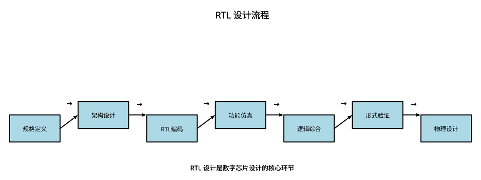

# 6.5 RTL 设计

## 1. 概述

RTL（Register Transfer Level，寄存器传输级）设计是数字集成电路设计的核心环节，使用硬件描述语言（HDL）在寄存器传输级描述数字电路的行为与结构。

RTL 设计的本质是**描述寄存器之间的组合逻辑路径**：每个时钟沿触发时，数据从一组寄存器通过组合逻辑传输到下一组寄存器。

### 三大硬件描述 / 构建语言

| 语言          | 类型               | 特点                                | 适用场景                    |
| ------------- | ------------------ | ----------------------------------- | --------------------------- |
| Verilog HDL   | 硬件描述语言       | 语法类似 C，IEEE 标准，业界最广泛   | 数字 IC 设计、FPGA 设计     |
| SystemVerilog | 硬件描述与验证语言 | Verilog 的超集，增加 OOP 和验证特性 | 复杂设计验证、UVM 测试平台  |
| Chisel        | 硬件构建语言       | 嵌入 Scala 的 DSL，参数化能力强     | 敏捷硬件设计、RISC-V 处理器 |

---

## 2. Verilog HDL 基础语法

### 2.1 模块与端口

模块（Module）是 Verilog 的基本设计单元，代表一个硬件模块：

```verilog
module module_name (
    input  wire       clk,
    input  wire       rst_n,
    input  wire [7:0] data_in,
    output reg  [7:0] data_out
);
    // 模块内部逻辑
endmodule
```

### 2.2 端口类型与方向

| 端口类型 | 关键字     | 说明                     |
| -------- | ---------- | ------------------------ |
| 输入端口 | `input`  | 只能从外部读取，不能赋值 |
| 输出端口 | `output` | 可以驱动外部信号         |
| 双向端口 | `inout`  | 既可输入也可输出（三态） |

### 2.3 注释

```verilog
// 单行注释
/* 多行注释 */
```

### 2.4 模块实例化

```verilog
// 按端口名连接（推荐）
my_module u_inst (
    .clk    (clk),
    .rst_n  (rst_n),
    .data_in(data_in),
    .data_out(data_out)
);

// 按端口顺序连接（不推荐，易出错）
my_module u_inst (clk, rst_n, data_in, data_out);
```

---

## 3. 数据类型

### 3.1 wire 类型

wire 表示连线，用于组合逻辑的输出，不能存储值：

```verilog
wire [7:0] sum;     // 8位宽连线
wire       flag;    // 1位宽连线
wire [31:0] addr;   // 32位地址总线
```

- wire 默认值为 `Z`（高阻态）
- wire 在 `assign` 语句中赋值
- wire 不能用在 `always` 块的左值

### 3.2 reg 类型

reg 表示寄存器（或变量），用于在 always 块中存储值。综合后可能是寄存器，也可能是连线：

```verilog
reg  [7:0] counter;  // 8位寄存器
reg        state;     // 1位状态寄存器
reg [31:0] mem [0:1023]; // 1024×32 位存储器
```

- reg 默认值为 `X`（未知态）
- reg 在 `always` 块中被赋值
- 综合工具根据赋值方式决定是否实现为寄存器

### 3.3 integer 类型

integer 用于循环和计算，综合为 32 位寄存器：

```verilog
integer i;
for (i = 0; i < 16; i = i + 1) begin
    // 循环展开
end
```

### 3.4 parameter / localparam 类型

parameter 用于定义常量，可在模块实例化时覆盖：

```verilog
parameter DATA_WIDTH = 8;  // 可被外部覆盖
localparam DEPTH = 16;     // 不能被外部覆盖
```

### 3.5 常用常量表示

```verilog
// 格式: [位宽]'[进制][数值]
8'b10101010     // 8位二进制
8'hAA           // 8位十六进制
8'd170          // 8位十进制
4'd15           // 4位十进制
1'b1            // 1位高电平
1'b0            // 1位低电平
```

---

## 4. 连续赋值（assign）

连续赋值用于描述组合逻辑，输入变化时输出立即更新：

```verilog
wire [3:0] a, b;
wire [4:0] sum;

assign sum = a + b;            // 加法器
assign y   = (sel) ? d1 : d0;  // 2选1多路选择器
assign full = (wr_ptr[ADDR_WIDTH] != rd_ptr[ADDR_WIDTH]) && 
              (wr_ptr[ADDR_WIDTH-1:0] == rd_ptr[ADDR_WIDTH-1:0]);
```


**重要规则**：

- assign 的左值必须是 wire 类型
- 多个 assign 语句并行执行
- assign 语句不可综合时序逻辑

---

## 5. 过程块

### 5.1 always 块

always 块是 Verilog 中最常用的过程块，可描述时序逻辑和组合逻辑：

```verilog
// 时序逻辑（同步复位）
always @(posedge clk or negedge rst_n) begin
    if (!rst_n)
        q <= 1'b0;
    else
        q <= d;
end

// 组合逻辑
always @(*) begin
    case (sel)
        2'b00: y = a;
        2'b01: y = b;
        2'b10: y = c;
        default: y = d;
    endcase
end
```


### 5.2 敏感列表

| 敏感列表                                   | 说明                           |
| ------------------------------------------ | ------------------------------ |
| `always @(posedge clk)`                  | 时钟上升沿触发                 |
| `always @(negedge clk)`                  | 时钟下降沿触发                 |
| `always @(posedge clk or negedge rst_n)` | 时钟上升沿或异步复位           |
| `always @(*)`                            | 组合逻辑，所有输入信号变化触发 |

**注意事项**：

- 时序逻辑的敏感列表中不应包含除时钟和异步复位外的信号
- 组合逻辑使用 `@(*)` 自动推断敏感列表，避免漏加信号

### 5.3 initial 块

initial 块仅用于仿真，在 0 时刻执行一次：

```verilog
initial begin
    clk = 0;
    rst_n = 0;
    #100 rst_n = 1;
end
```

---

## 6. 阻塞赋值与非阻塞赋值

### 6.1 阻塞赋值（=）

阻塞赋值顺序执行，**先赋值后执行下一条**，用于组合逻辑：

```verilog
always @(*) begin
    b = a;
    c = b;  // c = a
end
```


### 6.2 非阻塞赋值（<=）

非阻塞赋值并行执行，**所有赋值同时完成**，用于时序逻辑：

```verilog
always @(posedge clk) begin
    b <= a;
    c <= b;  // c = 旧值 b（上一个时钟沿的值）
end
```


### 6.3 赋值规则总结

| 类型       | 符号       | 适用场景            | 执行方式               |
| ---------- | ---------- | ------------------- | ---------------------- |
| 连续赋值   | `assign` | 简单组合逻辑        | 输入变化立即更新       |
| 阻塞赋值   | `=`      | always 中的组合逻辑 | 顺序执行，立即更新     |
| 非阻塞赋值 | `<=`     | always 中的时序逻辑 | 并行执行，块结束时更新 |

### 6.4 常见错误示例

```verilog
// 错误：时序逻辑使用阻塞赋值
always @(posedge clk) begin
    q = d;  // 可能产生意外的行为
end

// 正确：时序逻辑使用非阻塞赋值
always @(posedge clk) begin
    q <= d;
end

// 错误：同一信号在多个 always 块中赋值
always @(posedge clk) q <= a;
always @(posedge clk) q <= b;  // 错误！多驱动
```

---

## 7. 时序逻辑建模

### 7.1 寄存器（D 触发器）

**RTL 代码**：

```verilog
// D 触发器（同步复位）
always @(posedge clk) begin
    if (!rst_n)
        q <= 1'b0;
    else
        q <= d;
end

// D 触发器（异步复位）
always @(posedge clk or negedge rst_n) begin
    if (!rst_n)
        q <= 1'b0;
    else
        q <= d;
end
```


**综合结果**：D 触发器由两个 D 锁存器主从级联构成。每个时钟上升沿，输入 D 被采样到输出 Q。

### 7.2 计数器

**RTL 代码**：

```verilog
// 模 16 计数器
always @(posedge clk or negedge rst_n) begin
    if (!rst_n)
        cnt <= 4'b0;
    else if (cnt == 4'd15)
        cnt <= 4'b0;
    else
        cnt <= cnt + 1'b1;
end

// 带使能的计数器
always @(posedge clk or negedge rst_n) begin
    if (!rst_n)
        cnt <= 4'b0;
    else if (en)
        cnt <= cnt + 1'b1;
end
```


**综合结果**：4 个 D 触发器级联，每个触发器的输出连接到加法器，加法器输出反馈回触发器输入。

### 7.3 移位寄存器

**RTL 代码**：

```verilog
// 8 位移位寄存器
always @(posedge clk or negedge rst_n) begin
    if (!rst_n)
        shift_reg <= 8'b0;
    else
        shift_reg <= {shift_reg[6:0], data_in};
end
```


**综合结果**：8 个 D 触发器串联，每个触发器的输出 Q 连接到下一个触发器的输入 D。

### 7.4 带加载的寄存器

```verilog
always @(posedge clk or negedge rst_n) begin
    if (!rst_n)
        data_reg <= 8'b0;
    else if (load)
        data_reg <= data_in;
    // 无 else 时保持原值
end
```

---

## 8. 组合逻辑建模

### 8.1 使用 assign

```verilog
assign y = (a & b) | (c & d);  // 与或组合
assign sum = a + b;              // 加法器
assign y = s ? d1 : d0;          // 多路选择器
```

### 8.2 使用 always @(*)

```verilog
always @(*) begin
    case (sel)
        2'b00: y = a;
        2'b01: y = b;
        2'b10: y = c;
        2'b11: y = d;
    endcase
end
```

### 8.3 全加器

**RTL 代码**：

```verilog
module full_adder (
    input  a, b, cin,
    output s, cout
);
    assign s    = a ^ b ^ cin;
    assign cout = (a & b) | (a ^ b) & cin;
endmodule
```


### 8.4 组合逻辑电路


**多路选择器和加法器是组合逻辑中最常用的模块**。多路选择器实现数据选择，加法器实现算术运算。

### 8.5 避免锁存器（Latch）

**错误示例**（产生锁存器）：

```verilog
always @(*) begin
    if (en)
        q = d;
    // 缺少 else 分支，en=0 时 q 保持原值 → 综合出锁存器
end
```

**正确示例**：

```verilog
always @(*) begin
    if (en)
        q = d;
    else
        q = 1'b0;  // 所有分支都有赋值
end
```

---

## 9. 行为级与结构化建模

### 9.1 行为级建模

描述电路的功能行为，不关心具体结构：

```verilog
always @(posedge clk) begin
    if (en)
        data_out <= data_in;
end
```

### 9.2 结构化建模

实例化底层模块，描述电路的层次结构：

```verilog
module top (
    input  clk, rst_n,
    input  [7:0] a, b,
    output [8:0] sum
);
    wire [7:0] a_reg, b_reg;
  
    reg_8bit u_reg_a (.clk(clk), .rst_n(rst_n), .d(a), .q(a_reg));
    reg_8bit u_reg_b (.clk(clk), .rst_n(rst_n), .d(b), .q(b_reg));
    adder_8bit u_adder (.a(a_reg), .b(b_reg), .sum(sum));
endmodule
```

---

## 10. FSM 的 RTL 描述

### 10.1 状态编码

```verilog
// 二进制编码（面积小）
localparam IDLE  = 2'b00;
localparam READ  = 2'b01;
localparam WRITE = 2'b10;

// 独热编码（速度高，适合 FPGA）
localparam IDLE  = 3'b001;
localparam READ  = 3'b010;
localparam WRITE = 3'b100;
```

### 10.2 三段式 FSM

三段式 FSM 将状态寄存器、次态逻辑和输出逻辑分离，代码清晰、易于维护：

```verilog
// 第一段：状态寄存器
always @(posedge clk or negedge rst_n) begin
    if (!rst_n)
        state <= IDLE;
    else
        state <= next_state;
end

// 第二段：次态逻辑（组合逻辑）
always @(*) begin
    case (state)
        IDLE:  next_state = start ? READ : IDLE;
        READ:  next_state = done ? WRITE : READ;
        WRITE: next_state = done ? IDLE : WRITE;
        default: next_state = IDLE;
    endcase
end

// 第三段：输出逻辑（时序逻辑，无毛刺）
always @(posedge clk or negedge rst_n) begin
    if (!rst_n) begin
        data_out <= 1'b0;
        valid    <= 1'b0;
    end else begin
        case (next_state)
            READ:  data_out <= data_in;
            WRITE: valid <= 1'b1;
            default: begin
                data_out <= 1'b0;
                valid    <= 1'b0;
            end
        endcase
    end
end
```


### 10.3 两段式 FSM（输出为组合逻辑）

```verilog
// 第一段：状态寄存器
always @(posedge clk or negedge rst_n) begin
    if (!rst_n) state <= IDLE;
    else        state <= next_state;
end

// 第二段：次态逻辑 + 输出逻辑（组合逻辑）
always @(*) begin
    next_state = state;
    data_out   = 1'b0;
    valid      = 1'b0;
    case (state)
        IDLE: begin
            if (start) next_state = READ;
        end
        READ: begin
            data_out = data_in;
            if (done) next_state = WRITE;
        end
        WRITE: begin
            valid = 1'b1;
            if (done) next_state = IDLE;
        end
    endcase
end
```

### 10.4 FSM 设计注意事项

| 注意点       | 说明                               |
| ------------ | ---------------------------------- |
| 避免无效状态 | 使用`default` 分支跳转到安全状态 |
| 输出无毛刺   | 使用三段式，输出用时序逻辑         |
| 状态编码选择 | 面积优先用二进制，速度优先用独热码 |
| 综合优化     | 综合工具可自动优化状态编码         |

---

## 11. 流水线设计

### 11.1 流水线概念

流水线通过在组合逻辑中插入寄存器，将长路径分割为多个短路径，提高系统时钟频率。


### 11.2 三级流水线加法器

```verilog
module pipeline_adder (
    input  clk, rst_n,
    input  [7:0] a, b, c, d,
    output reg [9:0] result
);
    reg [8:0] sum1, sum2;
    reg [7:0] a_reg, b_reg, c_reg, d_reg;

    // 第一级：输入寄存
    always @(posedge clk) begin
        a_reg <= a;
        b_reg <= b;
        c_reg <= c;
        d_reg <= d;
    end

    // 第二级：部分和
    always @(posedge clk) begin
        sum1 <= a_reg + b_reg;
        sum2 <= c_reg + d_reg;
    end

    // 第三级：最终结果
    always @(posedge clk) begin
        result <= sum1 + sum2;
    end
endmodule
```

### 11.3 流水线设计的权衡

| 指标                 | 无流水线         | 3 级流水线     |
| -------------------- | ---------------- | -------------- |
| 关键路径延迟         | 长（组合逻辑深） | 短（每级 1/3） |
| 最大时钟频率         | 低               | 高（约 3 倍）  |
| 延迟（Latency）      | 1 个时钟周期     | 3 个时钟周期   |
| 吞吐量（Throughput） | 1 结果/周期      | 1 结果/周期    |
| 面积                 | 小               | 大（需寄存器） |

---

## 12. 同步 FIFO 设计

### 12.1 同步 FIFO 结构


### 12.2 核心代码

```verilog
module sync_fifo #(
    parameter DATA_WIDTH = 8,
    parameter DEPTH = 16
)(
    input  clk, rst_n,
    input  wr_en, rd_en,
    input  [DATA_WIDTH-1:0] data_in,
    output reg [DATA_WIDTH-1:0] data_out,
    output full, empty
);
    localparam ADDR_WIDTH = $clog2(DEPTH);

    reg [DATA_WIDTH-1:0] mem [0:DEPTH-1];
    reg [ADDR_WIDTH:0] wr_ptr, rd_ptr;  // 多1位用于判断空满

    // 空满标志（组合逻辑）
    assign full  = (wr_ptr[ADDR_WIDTH] != rd_ptr[ADDR_WIDTH]) && 
                   (wr_ptr[ADDR_WIDTH-1:0] == rd_ptr[ADDR_WIDTH-1:0]);
    assign empty = (wr_ptr == rd_ptr);

    // 读写操作
    always @(posedge clk or negedge rst_n) begin
        if (!rst_n) begin
            wr_ptr <= 0;
            rd_ptr <= 0;
        end else begin
            if (wr_en && !full) begin
                mem[wr_ptr[ADDR_WIDTH-1:0]] <= data_in;
                wr_ptr <= wr_ptr + 1;
            end
            if (rd_en && !empty) begin
                data_out <= mem[rd_ptr[ADDR_WIDTH-1:0]];
                rd_ptr <= rd_ptr + 1;
            end
        end
    end
endmodule
```

### 12.3 FIFO 深度计算

FIFO 深度取决于读写速率差和最大突发长度：

$$
\text{FIFO Depth} \geq \text{Burst Length} \times \left(1 - \frac{\text{Read Rate}}{\text{Write Rate}}\right)
$$

---

## 13. 跨时钟域同步

### 13.1 亚稳态问题

当信号跨时钟域传输时，可能发生亚稳态（Metastability），导致逻辑错误。

### 13.2 双级同步器


```verilog
module sync_2stage (
    input  clk_dst, rst_n,
    input  data_in,
    output data_out
);
    reg sync_reg1, sync_reg2;

    always @(posedge clk_dst or negedge rst_n) begin
        if (!rst_n) begin
            sync_reg1 <= 1'b0;
            sync_reg2 <= 1'b0;
        end else begin
            sync_reg1 <= data_in;
            sync_reg2 <= sync_reg1;
        end
    end

    assign data_out = sync_reg2;
endmodule
```

### 13.3 单比特同步方案

| 信号类型   | 同步方案              | 说明             |
| ---------- | --------------------- | ---------------- |
| 电平信号   | 双级同步器            | 2 个触发器打两拍 |
| 脉冲信号   | 边沿检测 + 双级同步器 | 展宽为电平再同步 |
| 快→慢时钟 | 握手机制              | 请求-应答协议    |

### 13.4 多比特同步——异步 FIFO

异步 FIFO 使用格雷码（Gray Code）指针进行跨时钟域同步，确保多比特信号的正确传输：

```verilog
// 二进制转格雷码
assign gray = (binary >> 1) ^ binary;

// 格雷码转二进制
always @(*) begin
    for (int i = 0; i < ADDR_WIDTH; i++)
        binary[i] = ^(gray >> i);
end
```

格雷码相邻值只有一位变化，降低多比特同步的出错概率。

---

## 14. 同步 / 异步复位

### 14.1 同步复位

仅在时钟沿检查复位信号：

```verilog
always @(posedge clk) begin
    if (!rst_n)  // 仅在时钟沿检查复位
        q <= 1'b0;
    else
        q <= d;
end
```

**优点**：综合后电路简单，无亚稳态问题
**缺点**：复位依赖时钟，无法立即复位

### 14.2 异步复位

立即复位，不依赖时钟：

```verilog
always @(posedge clk or negedge rst_n) begin
    if (!rst_n)  // 立即复位
        q <= 1'b0;
    else
        q <= d;
end
```

**优点**：复位响应快，无需时钟
**缺点**：复位释放时可能产生亚稳态

### 14.3 异步复位同步释放

结合两者优点：

```verilog
reg rst_n_sync1, rst_n_sync2;

always @(posedge clk or negedge rst_n) begin
    if (!rst_n) begin
        rst_n_sync1 <= 1'b0;
        rst_n_sync2 <= 1'b0;
    end else begin
        rst_n_sync1 <= 1'b1;
        rst_n_sync2 <= rst_n_sync1;
    end
end

assign rst_n_sync = rst_n_sync2;
```

---

## 15. 可综合代码风格

### 15.1 可综合与不可综合

| 可综合                        | 不可综合                |
| ----------------------------- | ----------------------- |
| `assign`                    | `initial`             |
| `always @(posedge/negedge)` | `#` 延迟              |
| `always @(*)`               | `wait`                |
| `case / if-else`            | `force / release`     |
| 算术运算                      | `$display / $monitor` |
| 寄存器 / 线网                 | 文件操作                |

### 15.2 设计规范

1. **避免锁存器**：组合逻辑中所有条件分支都要有赋值
2. **避免组合反馈环路**：组合逻辑的输出不能直接反馈到输入
3. **参数化设计**：使用 `parameter` 提高可重用性
4. **模块接口清晰**：功能单一，接口明确
5. **添加注释**：关键逻辑和时序约束

### 15.3 常见陷阱1

```verilog
// 陷阱1：缺少 default 分支 → 产生锁存器
always @(*) begin
    case (sel)
        2'b00: y = a;
        2'b01: y = b;
        // 缺少 2'b10 和 2'b11
    endcase
end

// 陷阱2：同一 always 块混合阻塞和非阻塞赋值
always @(posedge clk) begin
    q1 = d;   // 阻塞
    q2 <= q1; // 非阻塞 → 仿真行为不确定
end

// 陷阱3：敏感列表不完整
always @(a or b) begin  // 漏了 c
    y = a & b & c;
end
```

---

## 16. RTL 综合与数字设计流程

### 16.1 数字设计抽象层次

| 层次                | 描述                       | 时序信息     |
| ------------------- | -------------------------- | ------------ |
| 算法 / 系统级       | 功能算法描述，无硬件结构   | 无           |
| 寄存器传输级（RTL） | 寄存器与组合逻辑，有时钟沿 | 有时序       |
| 门级                | 基本逻辑门互连             | 有门延迟     |
| 电路级              | 晶体管级实现               | 有晶体管特性 |
| 版图级              | 物理掩模版图               | 有物理参数   |

### 16.2 RTL 设计流程



### 16.3 逻辑综合

逻辑综合将 RTL 代码转换为门级网表，包括三个子步骤：

**1. 逻辑优化**：布尔代数化简、资源共享、逻辑等价变换
**2. 技术映射**：将优化后的逻辑映射到目标工艺库的标准单元
**3. 时序约束驱动优化**：设定时钟频率，在关键路径上优化延迟

### 16.4 综合约束

```tcl
create_clock -name clk -period 10 [get_ports clk]
set_clock_uncertainty -setup 0.2 [get_clocks clk]
set_input_delay -clock clk -max 2.0 [get_ports data_in]
set_output_delay -clock clk -max 3.0 [get_ports data_out]
set_false_path -from [get_clocks rst_n]
set_multicycle_path -setup 2 -from [get_pins A_reg/CK] -to [get_pins B_reg/D]
```

---

## 17. Testbench 编写

### 17.1 基本 Testbench 结构

```verilog
module testbench;
    reg  clk, rst_n;
    reg  [7:0] data_in;
    wire [7:0] data_out;

    my_module dut (
        .clk     (clk),
        .rst_n   (rst_n),
        .data_in (data_in),
        .data_out(data_out)
    );

    // 时钟生成
    initial begin
        clk = 0;
        forever #5 clk = ~clk;
    end

    // 测试激励
    initial begin
        rst_n = 0; data_in = 0;
        #20 rst_n = 1;
        #10 data_in = 8'hA5;
        #10 data_in = 8'h5A;
        #10 data_in = 8'hFF;
        #100 $finish;
    end
endmodule
```

### 17.2 自检测 Testbench

```systemverilog
module testbench_sv;
    logic       clk, rst_n;
    logic [3:0] a, b, y;

    sillyfunction dut (.a(a), .b(b), .y(y));

    initial begin
        clk = 0;
        forever #5 clk = ~clk;
    end

    initial begin
        for (int i = 0; i < 4; i++) begin
            {a, b} = i;
            #10;
            assert (y === a & b) else
                $error("a=%b, b=%b, y=%b (expected %b)", a, b, y, a & b);
        end
        #10 $finish;
    end
endmodule
```

### 17.3 仿真常用系统函数

```verilog
$display("format", args);     // 打印信息
$monitor("format", args);     // 监测信号变化
$time;                         // 返回当前仿真时间
$finish;                       // 结束仿真
$dumpfile("sim.vcd");         // 生成 VCD 波形文件
$dumpvars(0, testbench);      // 导出所有信号
```

---

## 18. FPGA 验证实践

> **前置知识**：[5.8 可编程逻辑器件](../数字电路/5.8-可编程逻辑器件.md)（FPGA 的硬件结构：LUT/CLB/布线资源）。

仿真通过只完成了一半验证——真实时序、IO、时钟资源只有上板才能暴露。本节梳理从 RTL 到开发板的标准流程。

### 18.1 开源工具链 vs 商业工具链

| 环节 | 开源方案 | 商业方案（Xilinx/AMD） | 商业方案（Intel/Altera） |
|------|---------|----------------------|------------------------|
| 仿真 | Icarus Verilog / Verilator | Vivado Simulator | ModelSim / Questa |
| 综合 | **Yosys** | Vivado Synthesis | Quartus Synthesis |
| 布局布线 | nextpnr | Vivado Implementation | Quartus Fitter |
| 时序分析 | nextpnr 报告 | Vivado Timing | Quartus TimeQuest |
| 烧写 | openFPGALoader | Vivado Hardware Manager | Quartus Programmer |

开源流程对中小规模设计（Lattice iCE40/ECP5、部分 Gowin）已完全可用：

```bash
# 开源全流程示例（iCE40）
yosys -p "synth_ice40 -top top -json top.json" top.v   # 综合
nextpnr-ice40 --lp38k --json top.json --asc top.asc \  # 布局布线
    --freq 25 --pcf top.pcf
icepack top.asc top.bin                                  # 打包
openFPGALoader --board icebreaker top.bin                # 烧写
```

### 18.2 FPGA 设计流程六步

```
RTL编码 → 仿真验证 → 综合+布局布线 → 时序收敛 → 烧写上板 → 板级调试
   ↑______________发现问题回环________________↓
```

**关键差异（对比 ASIC 流程，见6.3章）**：FPGA 的"物理设计"由工具自动完成，无标准单元库约束，时钟树由全局时钟网络资源提供——验证迭代以分钟计，而 ASIC 流片以月计。这也是6.3节强调"FPGA 原型验证"作为 ASIC 前置环节的原因。

### 18.3 约束文件：告诉工具板子长什么样

XDC（Vivado）/ PCF（开源流程）约束定义引脚与 时钟：

```tcl
# 时钟约束：100MHz 晶振接入
create_clock -period 10.000 -name sys_clk [get_ports clk]

# 引脚约束：LED 接到指定管脚
set_property -dict {PACKAGE_PIN A1 IOSTANDARD LVCMOS33} [get_ports led]

# 跨时钟域约束（配合第13节 CDC 设计）
set_clock_groups -asynchronous -group {clk_sys} -group {clk_uart}
```

### 18.4 时序报告解读

综合布线后工具报告 WNS（最差负时序裕量）：

```
WNS (Worst Negative Slack) = 实际到达时间要求到达时间
  WNS ≥ 0  → 时序收敛，可以烧写
  WNS < 0  → 违例，需优化
```

**常见违例修法**（呼应第11节流水线设计）：

| 违例原因 | 修法 |
|---------|------|
| 组合逻辑太长 | 插入流水线寄存器切级 |
| 高扇出网络 | 手动复制寄存器降低扇出 |
| 跨时钟域 | 第13节的同步器+约束 |
| 布线拥塞 | 改变层次结构或物理约束 |

### 18.5 板级调试手段

- **ILA（集成逻辑分析仪）**：Vivado 把逻辑分析仪核插进 FPGA，触发抓取内部信号波形，等效"硬件版 \$dumpvars"
- **VIO**：虚拟 IO，运行时改写内部寄存器初值
- **LED/七段数码管**：最低成本的状态指示
- **UART 打印**：软核或硬件打印调试信息上 PC

### 18.6 RTL 到上板的常见翻车点

| 症状 | 根因 |
|------|------|
| 仿真正确、上板不工作 | 未写约束/时钟未约束、复位未连到全局网络 |
| 偶发跑飞 | 跨时钟域没做同步（第13节） |
| 综合后Latch警告 | 组合 always 缺 default 分支（第8节） |
| 上下板行为不同 | 测试激励不完备 + 时序违例 |
| 复位后不启动 | 异步复位释放未同步，违反 Recovery/Removal |

---

## 19. Verilog 高级特性

### 19.1 门级原语

```verilog
and   g1 (out, a, b);       // 与门
or    g2 (out, a, b);       // 或门
nand  g3 (out, a, b);       // 与非门
nor   g4 (out, a, b);       // 或非门
xor   g5 (out, a, b);       // 异或门
xnor  g6 (out, a, b);       // 同或门
not   g7 (out, in);         // 反相器
bufif1 g8 (out, in, en);    // 三态缓冲器
```

### 19.2 编译器指令

```verilog
`define DATA_WIDTH 8
`ifdef SIMULATION
    initial $display("Simulation mode");
`endif
`include "defines.v"
`timescale 1ns / 1ps   // 时间单位 1ns，精度 1ps
```

### 19.3 generate 语句

```verilog
// 使用 generate 生成重复结构
generate
    for (genvar i = 0; i < 8; i++) begin
        DFF dff_inst (
            .clk(clk),
            .d(data_in[i]),
            .q(data_out[i])
        );
    end
endgenerate
```

---

## 20. 参数化模块设计

### 20.1 参数化 2:1 多路选择器

```verilog
module mux2 #(
    parameter WIDTH = 8
)(
    input  [WIDTH-1:0] d0, d1,
    input              s,
    output [WIDTH-1:0] y
);
    assign y = s ? d1 : d0;
endmodule

// 实例化时覆盖参数
mux2 #(12) lowmux (d0, d1, s, y);
```

### 20.2 参数化构建层次化设计

```verilog
module mux4 #(
    parameter WIDTH = 8
)(
    input  [WIDTH-1:0] d0, d1, d2, d3,
    input  [1:0]       s,
    output [WIDTH-1:0] y
);
    wire [WIDTH-1:0] low, high;
    mux2 #(WIDTH) lowmux  (d0, d1, s[0], low);
    mux2 #(WIDTH) highmux (d2, d3, s[0], high);
    mux2 #(WIDTH) finalmux(low, high, s[1], y);
endmodule
```

---

## 21. SystemVerilog 详细教程

SystemVerilog 是 Verilog 的超集，增加了大量面向对象编程、断言、随机化等高级特性，是现代数字 IC 验证的标准语言。

### 21.1 新增数据类型

```systemverilog
logic [7:0] data;       // 替代 reg 和 wire，自动推断
bit  [7:0] b;            // 二值逻辑（0/1）
byte c;                   // 8 位有符号整数
shortint d;               // 16 位有符号整数
int e;                    // 32 位有符号整数
longint f;                // 64 位有符号整数

typedef enum logic [1:0] { IDLE, READ, WRITE } state_t;  // 枚举类型
typedef struct {
    logic [31:0] addr;
    logic [31:0] data;
    logic        rw;
} packet_t;               // 结构体

union packed {
    logic [31:0] word;
    logic [3:0][7:0] bytes;
} data_word;              // 联合体

string str = "Hello";     // 字符串类型
```

### 21.2 接口（Interface）

接口封装了信号组，简化模块连接：

```systemverilog
interface bus_if #(parameter WIDTH = 32);
    logic [WIDTH-1:0] addr;
    logic [WIDTH-1:0] data;
    logic             rw;
    logic             valid;
    logic             ready;

    modport master (output addr, data, rw, valid, input ready);
    modport slave  (input  addr, data, rw, valid, output ready);
endinterface

// 使用接口连接
module top;
    bus_if #(32) bus();
    master u_master (.bus(bus.master));
    slave  u_slave  (.bus(bus.slave));
endmodule
```

### 21.3 断言（Assertion）

断言用于验证设计行为是否符合预期：

```systemverilog
// 立即断言
assert (y === a & b) else $error("输出错误");

// 并发断言（SVA）
property p_handshake;
    @(posedge clk) valid |=> ##[1:3] ready;
endproperty
assert property (p_handshake);

// 覆盖断言
cover property (p_handshake);
```

### 21.4 随机化

SystemVerilog 提供强大的随机化机制，用于生成随机测试向量：

```systemverilog
class Packet;
    rand bit [7:0] addr;
    rand bit [7:0] data;
    rand bit       rw;

    constraint addr_range { addr inside {[0:15], [32:47]}; }
    constraint data_valid { data != 8'h00; }
    constraint write_ratio { rw dist {0 := 70, 1 := 30}; }
endclass

Packet p = new();
assert (p.randomize());
$display("addr=%h, data=%h, rw=%b", p.addr, p.data, p.rw);
```

### 21.5 面向对象编程

```systemverilog
class Driver;
    virtual bus_if vif;
    string name;

    function new(string name, virtual bus_if vif);
        this.name = name;
        this.vif  = vif;
    endfunction

    task drive(input logic [31:0] addr, data);
        @(posedge vif.clk);
        vif.addr <= addr;
        vif.data <= data;
        vif.valid <= 1;
        @(posedge vif.clk);
        vif.valid <= 0;
    endtask
endclass
```

### 21.6 功能覆盖率

```systemverilog
covergroup addr_cov @(posedge clk);
    addr_bins: coverpoint addr {
        bins low  = {[0:15]};
        bins mid  = {[16:127]};
        bins high = {[128:255]};
    }
    rw_bins: coverpoint rw;
    cross addr_bins, rw_bins;
endgroup
```

断言（21.3）与功能覆盖率（本节）只是验证可观测手段的**概览**：它们告诉你怎么检查与丈量，但尚未构成一套完整的验证方法学。基于 SystemVerilog 的 UVM 验证平台、约束随机与形式化验证（断言检查、模型检查、等价性检查）的深入内容见第 11 章——[11.1 UVM验证方法学](../数字验证方法学/11.1-UVM验证方法学.md) 与 [11.2 形式验证深入](../数字验证方法学/11.2-形式验证深入.md)。

### 21.7 always_comb / always_ff / always_latch

SystemVerilog 引入明确语义的过程块：

```systemverilog
always_comb begin      // 组合逻辑，自动推断敏感列表
    y = a & b;
end

always_ff @(posedge clk or negedge rst_n) begin  // 时序逻辑
    if (!rst_n)
        q <= 1'b0;
    else
        q <= d;
end

always_latch begin     // 锁存器（显式声明）
    if (en)
        q <= d;
end
```

### 21.8 SystemVerilog 与 Verilog 对比

| 特性     | Verilog   | SystemVerilog                             |
| -------- | --------- | ----------------------------------------- |
| 数据类型 | wire, reg | logic, bit, int, struct, enum             |
| 接口     | 无        | interface / modport                       |
| 断言     | 无        | assert / cover / property                 |
| 随机化   | 无        | rand / randc / constraint                 |
| OOP 支持 | 无        | class / extends / virtual                 |
| 覆盖率   | 无        | covergroup / coverpoint / cross           |
| 过程块   | always    | always_comb / always_ff / always_latch    |
| 字符串   | 不支持    | string 类型                               |
| 动态数组 | 不支持    | dynamic array / queue / associative array |
| 包       | 无        | package / import                          |

---

## 22. Chisel 硬件构建语言

Chisel（Constructing Hardware in a Scala Embedded Language）是一种嵌入在 Scala 中的硬件构建语言，由 UC Berkeley 开发，广泛应用于 RISC-V 处理器设计。

### 22.1 Chisel 设计哲学

Chisel 将硬件描述提升到**元编程**层次：

- 使用 Scala 的完整编程能力生成硬件
- 参数化、可重用性远超传统 HDL
- 生成高效的 Verilog 代码，与标准 EDA 工具兼容

### 22.2 基本概念

```scala
import chisel3._

// 模块定义
class MyModule extends Module {
    val io = IO(new Bundle {
        val a = Input(UInt(8.W))
        val b = Input(UInt(8.W))
        val y = Output(UInt(8.W))
    })
  
    io.y := io.a & io.b
}
```

### 22.3 数据类型

```scala
UInt(8.W)          // 8 位无符号整数
SInt(8.W)          // 8 位有符号整数
Bool()              // 布尔类型
Vec(4, UInt(8.W))  // 4 元素向量，每个元素 8 位

// Bundle（类似结构体）
class MyBundle extends Bundle {
    val addr = UInt(32.W)
    val data = UInt(32.W)
    val rw   = Bool()
}
```

### 22.4 寄存器与时序逻辑

```scala
// 寄存器声明
val reg = Reg(UInt(8.W))
reg := io.d          // 每个时钟沿更新

// 带复位寄存器
val reg = RegInit(0.U(8.W))
reg := io.d

// 计数器
val cnt = RegInit(0.U(4.W))
when(cnt === 15.U) {
    cnt := 0.U
}.otherwise {
    cnt := cnt + 1.U
}

// 移位寄存器
val shiftReg = Reg(Vec(8, UInt(1.W)))
for (i <- 0 until 7) {
    shiftReg(i+1) := shiftReg(i)
}
shiftReg(0) := io.serialIn
```

### 22.5 组合逻辑

```scala
// 连续赋值
val sum = io.a + io.b
val mux = Mux(io.sel, io.d1, io.d0)

// 条件判断
when(io.en) {
    io.y := io.a
}.elsewhen(io.sel) {
    io.y := io.b
}.otherwise {
    io.y := 0.U
}
```

### 22.6 FSM 状态机

```scala
object State extends ChiselEnum {
    val idle, read, write = Value
}

class MyFSM extends Module {
    val io = IO(new Bundle {
        val start = Input(Bool())
        val done  = Input(Bool())
        val valid = Output(Bool())
    })

    val state = RegInit(State.idle)

    switch(state) {
        is(State.idle) {
            when(io.start) { state := State.read }
        }
        is(State.read) {
            when(io.done) { state := State.write }
        }
        is(State.write) {
            when(io.done) { state := State.idle }
        }
    }

    io.valid := (state === State.write)
}
```

### 22.7 参数化模块

```scala
class ParameterizedModule(val width: Int) extends Module {
    val io = IO(new Bundle {
        val a = Input(UInt(width.W))
        val b = Input(UInt(width.W))
        val y = Output(UInt(width.W))
    })

    io.y := io.a + io.b
}

// 实例化
val mod = Module(new ParameterizedModule(8))
```

### 22.8 函数式生成

Chisel 利用 Scala 的函数式编程能力生成硬件：

```scala
// 生成加法器树
def adderTree(inputs: Seq[UInt]): UInt = {
    if (inputs.length == 1) inputs.head
    else if (inputs.length == 2) inputs(0) + inputs(1)
    else {
        val half = inputs.length / 2
        adderTree(inputs.take(half)) + adderTree(inputs.drop(half))
    }
}

val sum = adderTree(Seq(a, b, c, d, e, f, g, h))
```

### 22.9 生成 Verilog

```scala
object MyModule extends App {
    println(getVerilogString(new MyModule))
    // 或写入文件
    emitVerilog(new MyModule, Array("--target-dir", "verilog"))
}
```

### 22.10 Chisel 注意事项

| 注意点                        | 说明                                               |
| ----------------------------- | -------------------------------------------------- |
| `:=` 是连接操作符           | 类似 Verilog 的`<=`，但语义更接近赋值            |
| 不要使用`=`                 | Scala 的`=` 是变量赋值，不能用于硬件连接         |
| 所有硬件在构建时生成          | Chisel 在 Scala 运行时生成硬件图，然后输出 Verilog |
| 复位值必须明确                | 使用`RegInit` 或 `Reg(init = ...)` 指定复位值  |
| 不要混用 Scala 和 Chisel 类型 | `scala.Int` 和 `chisel3.UInt` 是不同的类型     |
| 使用`WireDefault`           | 组合逻辑线网需要初始值或明确赋值                   |

### 22.11 Chisel vs Verilog 对比

| 特性     | Verilog                | Chisel                  |
| -------- | ---------------------- | ----------------------- |
| 底层语言 | 独立 HDL               | 嵌入 Scala              |
| 参数化   | parameter + generate   | Scala 函数 + 类参数     |
| 类型安全 | 弱（位宽不匹配易出错） | 强（编译时检查位宽）    |
| 代码复用 | 模块实例化             | 函数 + 类 + 继承        |
| 生成能力 | generate 有限          | 完整 Scala 编程能力     |
| FSM 描述 | 三段式 case 语句       | ChiselEnum + switch/is  |
| 学习曲线 | 中等                   | 较高（需 Scala 基础）   |
| 工具链   | 成熟 EDA 工具          | 生成 Verilog 后再用 EDA |

### 22.12 Chisel 适用场景

- **处理器设计**：RISC-V 处理器（如 Rocket Chip、BOOM）
- **敏捷硬件开发**：快速迭代原型设计
- **参数化设计**：需要大量配置参数的复杂硬件
- **学术研究**：快速验证新的硬件架构

---

## 23. 总结

RTL 设计是数字 IC 设计的核心技能。本章介绍了：

| 语言                    | 核心内容                                   | 关键要点                            |
| ----------------------- | ------------------------------------------ | ----------------------------------- |
| **Verilog**       | 基础语法、建模方法、FSM、流水线、FIFO、CDC | 阻塞/非阻塞赋值规则、可综合代码风格 |
| **SystemVerilog** | 接口、断言、随机化、OOP、覆盖率            | 验证方法学、always_comb/always_ff   |
| **Chisel**        | 数据类型、寄存器、FSM、函数式生成          | 元编程、参数化、与 Verilog 的互操作 |

良好的 RTL 设计风格和代码规范对于后续的综合、验证和物理设计至关重要。无论使用哪种语言，**理解底层硬件行为**是写出高质量 RTL 代码的基础。
