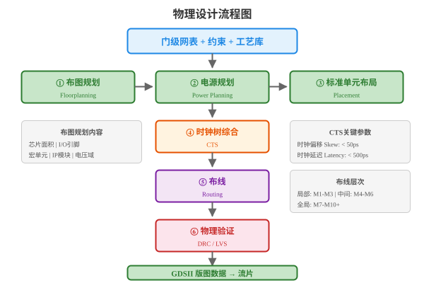
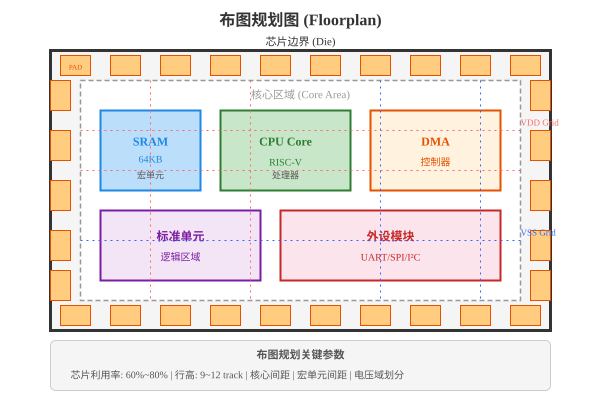
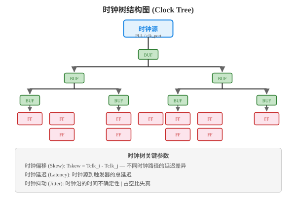

# 6.8 物理设计

## 1. 概述

物理设计（Physical Design）是将门级网表转化为芯片版图的过程，是连接逻辑设计和芯片制造的关键环节。物理设计的目标是在满足时序、功耗、面积约束的同时，生成符合工艺设计规则的版图数据。

## 2. 物理设计流程



物理设计的主要流程包括：

1. **布图规划（Floorplanning）**：确定芯片尺寸、模块位置、I/O引脚
2. **电源规划（Power Planning）**：设计电源分配网络
3. **标准单元布局（Placement）**：放置标准单元
4. **时钟树综合（CTS）**：构建时钟分配网络
5. **布线（Routing）**：完成信号连接
6. **物理验证（Physical Verification）**：DRC/LVS检查
7. **签核（Sign-off）**：时序、功耗、物理验证签核

## 3. 布图规划（Floorplanning）

### 3.1 布图规划内容

布图规划是物理设计的第一步，决定了芯片的整体布局：

- **芯片面积**：确定芯片的宽度和高度
- **I/O引脚**：确定I/O pad的位置
- **宏单元放置**：SRAM、ROM、PLL等硬宏的位置
- **IP模块**：第三方IP的布局
- **电压域**：不同电压区域的划分



### 3.2 布图规划关键参数

- **芯片利用率**：标准单元面积与总核心面积之比，通常为60%~80%
- **行高**：标准单元行的垂直间距
- **核心间距**：核心区域与I/O区域的间距
- **宏单元间距**：宏单元之间的最小间距

### 3.3 布图规划优化目标

- 最小化芯片面积
- 减少信号线长度
- 避免拥塞
- 满足时序约束

## 4. 宏单元与IP放置

### 4.1 宏单元放置策略

- **沿芯片边缘放置**：便于I/O连接
- **分组放置**：相关宏单元靠近放置
- **避免核心区域遮挡**：为标准单元留出连续区域

### 4.2 放置考虑因素

- 数据流向
- 总线连接
- 时钟分布
- 电源需求
- 散热要求

## 5. 电源网络规划（Power Grid）

### 5.1 电源网络结构

电源网络（Power Grid）由多层金属的电源线和地线组成：

- **顶层**：宽金属线，连接I/O pad和C4 bump
- **中间层**：网格状电源线，分布在各金属层
- **底层**：标准单元电源轨（VDD和VSS）

### 5.2 电源网络设计参数

- **线宽**：影响IR Drop和电迁移
- **间距**：影响布线资源
- **层级**：影响电源分布均匀性
- **通孔**：影响层间连接电阻

### 5.3 IR Drop约束

IR Drop是电源网络上的电压降：

$$\Delta V = I \cdot R$$

其中：
- $I$：通过电源线的电流
- $R$：电源线的电阻

允许的IR Drop通常为电源电压的3%~5%。

## 6. 电源域与电压岛

### 6.1 多电压域设计

现代SoC通常包含多个电压域：

- **核心电压**：0.6V~0.9V
- **I/O电压**：1.8V~3.3V
- **存储器电压**：0.8V~1.0V
- **模拟电压**：特定电压

### 6.2 电压岛（Voltage Island）

电压岛是独立供电的区域，通过电源门控实现功耗管理：

- 常开域（Always-on Domain）
- 可关断域（Power-gated Domain）
- 保留域（Retention Domain）

## 7. 标准单元布局（Placement）

### 7.1 布局流程

标准单元布局分为以下几个阶段：

1. **全局布局（Global Placement）**：粗略放置所有单元，优化线长
2. **合法化（Legalization）**：将单元对齐到标准单元行
3. **详细布局（Detailed Placement）**：微调单元位置，优化时序

### 7.2 布局优化目标

- **线长最小化**：减少互联延迟
- **拥塞减少**：避免布线资源不足
- **时序优化**：减少关键路径延迟
- **功耗优化**：减少高活跃度信号的线长

### 7.3 布局约束

```tcl
# 布局约束示例
set_placement_density -local_density 0.7
place_opt -congestion -timing
```

## 8. 时钟树综合（CTS）

### 8.1 时钟树概念

时钟树（Clock Tree）是用于将时钟信号从时钟源（PLL/时钟端口）分配到所有时序单元（触发器/锁存器）的网络。



### 8.2 时钟树结构

常见的时钟树结构包括：

- **H树**：平衡结构，延迟均匀
- **网格结构**：低偏移，但功耗大
- **平衡二叉树**：延迟可控
- **混合结构**：结合多种结构优点

### 8.3 CTS关键参数

- **时钟偏移（Skew）**：不同时钟路径的延迟差异
- **时钟延迟（Latency）**：时钟源到触发器的总延迟
- **时钟抖动（Jitter）**：时钟沿的时间不确定性
- **占空比失真**：时钟高/低电平宽度差异

### 8.4 时钟偏移公式

$$T_{skew} = T_{clk_i} - T_{clk_j}$$

其中：
- $T_{clk_i}$：时钟源到触发器i的延迟
- $T_{clk_j}$：时钟源到触发器j的延迟

### 8.5 CTS流程

```tcl
# CTS命令示例
create_clock -name clk -period 10 [get_ports clk]
set_clock_uncertainty -setup 0.2 [get_clocks clk]
set_clock_uncertainty -hold 0.1 [get_clocks clk]

clock_opt -no_clock_route -fix_hold_all_clocks
route_clock_nets -clock_tree
```

## 9. 时钟偏移与抖动

### 9.1 时钟偏移来源

- **工艺变化**：晶体管和互连参数变化
- **温度变化**：不同区域的温度差异
- **电压变化**：电源分布不均匀
- **负载差异**：不同时钟分支的负载不同

### 9.2 时钟抖动

时钟抖动分为：

- **随机抖动（RJ）**：由热噪声等随机因素引起
- **确定性抖动（DJ）**：由电源噪声、串扰等确定因素引起

## 10. 布线（Routing）

### 10.1 布线流程

布线分为以下阶段：

1. **全局布线（Global Routing）**：将布线区域划分为网格，规划每条线的大致路径
2. **详细布线（Detailed Routing）**：在全局布线的基础上，确定每条线的精确位置
3. **布线优化（Post-route Optimization）**：修复DRC违例，优化时序

### 10.2 布线层次

现代工艺使用多层金属进行布线：

- **局部互连**：M1~M3，用于标准单元内部和近距离连接
- **中间互连**：M4~M6，用于模块间连接
- **全局互连**：M7~M10+，用于时钟、电源、长距离信号

### 10.3 布线规则

- **最小间距**：同一层金属线之间的最小距离
- **最小宽度**：金属线的最小宽度
- **通孔规则**：通孔的大小和间距
- **天线规则**：防止天线效应

## 11. 布线拥塞处理

### 11.1 拥塞原因

- 局部布线需求过高
- 宏单元阻挡布线通道
- 电源网络占用过多布线资源
- 标准单元密度过高

### 11.2 拥塞缓解方法

- **增加布线资源**：扩大芯片面积
- **优化布局**：分散高密度区域
- **调整电源网络**：释放布线通道
- **使用更多金属层**：增加布线层次

## 12. 物理验证（DRC/LVS）

### 12.1 设计规则检查（DRC）

DRC验证版图是否满足晶圆厂的工艺设计规则：

- 最小宽度规则
- 最小间距规则
- 最小包围规则
- 最小延伸规则
- 密度规则

### 12.2 版图与电路一致性检查（LVS）

LVS验证版图与电路网表的一致性：

- 器件类型和尺寸匹配
- 网络连接正确性
- 端口匹配

## 13. 天线效应与修复

### 13.1 天线效应原理

在刻蚀过程中，连接到栅极的金属线会收集电荷，可能损坏栅氧化层。

天线比率：

$$AR = \frac{A_{metal}}{A_{gate}}$$

当AR超过工艺限制时，需要修复。

### 13.2 修复方法

- **跳线法**：使用更高层金属断开长金属线
- **二极管插入**：在金属线上添加反向二极管
- **缓冲插入**：插入缓冲器断开长连线

## 14. 金属填充（Metal Fill）

金属填充是在版图中添加虚拟金属图形，以满足工艺密度要求：

- **密度均匀化**：保证CMP平坦化效果
- **浮空填充**：不连接任何网络
- **接地填充**：连接到地

## 15. 物理设计工具

| 工具 | 公司 | 功能 |
|------|------|------|
| ICC2 | Synopsys | 完整物理设计流程 |
| Innovus | Cadence | 完整物理设计流程 |
| Calibre | Mentor | 物理验证（DRC/LVS） |
| ICV | Synopsys | 物理验证 |
| PVS | Cadence | 物理验证 |
| RedHawk | Ansys | 功耗/IR Drop分析 |
| StarRC | Synopsys | 寄生参数提取 |
| QRC | Cadence | 寄生参数提取 |

## 总结

物理设计是将逻辑设计转化为物理版图的关键步骤，涉及布图规划、布局、时钟树综合、布线、物理验证等多个环节。随着工艺节点不断缩小，物理设计的复杂度和挑战性持续增加，对设计工程师的要求也越来越高。

物理设计产出的是满足签核要求的版图，而芯片制造完成后还要进入芯片链条的后道环节——把裸片封装成可用的器件，并处理随之而来的电气与散热问题。物理设计阶段的引脚规划、电源/接地网络与版图格局，正是封装基板、引脚和散热方案设计的直接输入，二者必须协同考虑。封装与热设计详见第 14 章（[14.1 封装与热设计](../封装与热设计/14.1-封装与热设计.md)）。