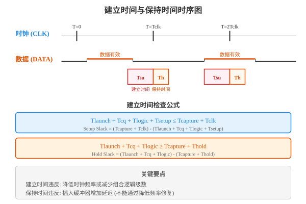
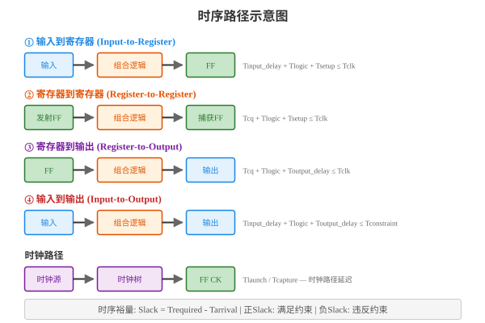
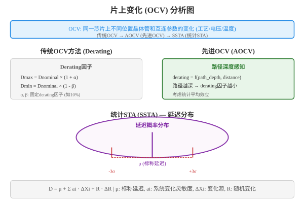

# 6.9 时序分析

## 1. 概述

时序分析是数字集成电路设计中最关键的验证环节之一，确保芯片在所有工作条件下都能正确运行。静态时序分析（Static Timing Analysis, STA）通过穷举所有可能的时序路径，验证设计是否满足时序约束，无需仿真向量。

## 2. 静态时序分析（STA）基本概念

### 2.1 STA的特点

- **穷举性**：分析所有可能的时序路径
- **无需测试向量**：不需要仿真输入
- **速度快**：相比仿真，分析速度快
- **保守性**：考虑最坏情况

### 2.2 STA vs 动态仿真

| 特性 | STA | 动态仿真 |
|------|-----|---------|
| 覆盖范围 | 所有路径 | 仅激励覆盖的路径 |
| 速度 | 快 | 慢 |
| 向量依赖 | 否 | 是 |
| 功能验证 | 否 | 是 |
| 时序验证 | 是 | 部分 |

## 3. 建立时间与保持时间检查

### 3.1 建立时间检查

建立时间（Setup Time）约束确保数据在时钟沿到达之前已经稳定：



**建立时间检查公式**：

$$T_{launch} + T_{cq} + T_{logic} + T_{setup} \leq T_{capture} + T_{clk}$$

其中：
- $T_{launch}$：发射时钟路径延迟
- $T_{cq}$：寄存器时钟到输出延迟
- $T_{logic}$：组合逻辑延迟
- $T_{setup}$：目标寄存器的建立时间
- $T_{capture}$：捕获时钟路径延迟
- $T_{clk}$：时钟周期

建立时间裕量（Setup Slack）：

$$Slack_{setup} = (T_{capture} + T_{clk}) - (T_{launch} + T_{cq} + T_{logic} + T_{setup})$$

### 3.2 保持时间检查

保持时间（Hold Time）约束确保数据在时钟沿之后保持稳定：

**保持时间检查公式**：

$$T_{launch} + T_{cq} + T_{logic} \geq T_{capture} + T_{hold}$$

保持时间裕量（Hold Slack）：

$$Slack_{hold} = (T_{launch} + T_{cq} + T_{logic}) - (T_{capture} + T_{hold})$$

### 3.3 建立时间和保持时间的关系

- 建立时间违反：降低时钟频率或在路径中插入流水线
- 保持时间违反：在路径中插入缓冲器增加延迟
- 保持时间违反不能通过降低频率修复


该图以采样波形示意建立时间与保持时间的时序窗口，说明数据在时钟沿前后必须稳定以满足触发器采样要求。

## 4. 时序路径类型



时序路径分为以下四种类型：

### 4.1 输入到寄存器（Input-to-Register）

从芯片输入端口到第一个触发器的路径：

$$T_{input\_delay} + T_{logic} + T_{setup} \leq T_{clk}$$

### 4.2 寄存器到寄存器（Register-to-Register）

从发射触发器到捕获触发器的路径：

$$T_{cq} + T_{logic} + T_{setup} \leq T_{clk}$$

### 4.3 寄存器到输出（Register-to-Output）

从最后一个触发器到芯片输出端口的路径：

$$T_{cq} + T_{logic} + T_{output\_delay} \leq T_{clk}$$

### 4.4 输入到输出（Input-to-Output）

从芯片输入端口到输出端口的纯组合路径：

$$T_{input\_delay} + T_{logic} + T_{output\_delay} \leq T_{constraint}$$

## 5. 时序弧与延迟计算

### 5.1 时序弧（Timing Arc）

时序弧定义了两个引脚之间的延迟关系：

- **组合时序弧**：输入到输出之间的延迟
- **时序时序弧**：时钟到输出之间的延迟
- **建立时序弧**：数据输入在时钟沿前的约束
- **保持时序弧**：数据输入在时钟沿后的约束

### 5.2 延迟计算

单元延迟基于查找表（NLDM/CCS模型）：

$$D = f(S_{in}, C_{load}, V_{DD}, T)$$

互连延迟基于RC网络计算：

$$t_{pd} = RC \propto \frac{L^2}{WH}$$

对于长互连线，使用Elmore延迟模型：

$$t_{Elmore} = \sum_{i} R_i \cdot C_i$$

## 6. 最差/最佳情况分析

### 6.1 多模式多角分析（MMMC）

STA在不同的工艺角（PVT）下进行分析：

- **最差情况（Worst Case）**：SS工艺角，高温，低电压
- **最佳情况（Best Case）**：FF工艺角，低温，高电压

### 6.2 建立时间分析

建立时间分析使用最慢的路径延迟：

- 发射路径：最慢（Max Delay）
- 捕获路径：最快（Min Delay）

### 6.3 保持时间分析

保持时间分析使用最快的路径延迟：

- 发射路径：最快（Min Delay）
- 捕获路径：最慢（Max Delay）

## 7. 片上变化（OCV）

### 7.1 OCV概念

片上变化（On-Chip Variation, OCV）指同一芯片上不同位置晶体管和互连的参数变化。



### 7.2 OCV分析方法

**传统OCV方法**：

使用derating因子：

$$D_{max} = D_{nominal} \times (1 + \alpha)$$
$$D_{min} = D_{nominal} \times (1 - \beta)$$

其中$\alpha$和$\beta$为derating因子。

**先进OCV方法（AOCV）**：

AOCV考虑路径深度对变化的影响：

$$derating = f(path\_depth, distance)$$

路径越深，derating因子越小。

**统计OCV方法（SSTA）**：

SSTA将延迟视为随机变量，使用统计方法计算时序分布：

$$D = \mu + \sum_i a_i \cdot \Delta X_i + R \cdot \Delta R$$

其中：
- $\mu$：标称延迟
- $a_i$：系统变化灵敏度
- $\Delta X_i$：系统变化源
- $R$：随机变化
- $\Delta R$：随机变化量

## 8. 时序裕量（Slack）

### 8.1 Slack计算

时序裕量（Slack）是时序路径满足约束的余量：

$$Slack = T_{required} - T_{arrival}$$

- **正Slack（Positive Slack）**：路径满足时序约束
- **负Slack（Negative Slack）**：路径违反时序约束

### 8.2 关键路径

关键路径（Critical Path）是Slack最小的路径，决定芯片的最大工作频率：

$$f_{max} = \frac{1}{T_{clk} - Slack_{min}}$$

## 9. 时钟门控检查

时钟门控检查验证时钟门控信号的正确性：

- **时钟门控建立时间**：使能信号在时钟沿前必须稳定
- **时钟门控保持时间**：使能信号在时钟沿后必须保持

时钟门控检查确保不会产生毛刺（Glitch）导致时钟错误。

## 10. 异步时钟域与同步检查

### 10.1 异步时钟域

异步时钟域之间没有固定的相位关系，需要特殊处理：

- 双级同步器
- 异步FIFO
- 握手协议

### 10.2 同步检查

STA会检查所有跨时钟域路径，对于异步时钟域，需要设置false path：

```tcl
set_false_path -from [get_clocks clk_a] -to [get_clocks clk_b]
```

## 11. SDC时序约束

SDC（Synopsys Design Constraints）是标准的时序约束格式：

```tcl
# 时钟定义
create_clock -name sys_clk -period 10.0 [get_ports clk]
create_clock -name usb_clk -period 30.0 [get_ports usb_clk]

# 生成时钟
create_generated_clock -name div_clk -source [get_ports clk] \
    -divide_by 2 [get_pins divider/Q]

# 时钟分组
set_clock_groups -asynchronous -group {sys_clk} -group {usb_clk}

# 输入输出延迟
set_input_delay -clock sys_clk -max 2.0 [get_ports data_in]
set_output_delay -clock sys_clk -max 3.0 [get_ports data_out]

# 时序例外
set_false_path -from [get_ports test_mode]
set_multicycle_path -setup 2 -from [get_pins reg_a/Q] -to [get_pins reg_b/D]

# 时钟不确定性
set_clock_uncertainty -setup 0.2 [get_clocks sys_clk]
set_clock_uncertainty -hold 0.1 [get_clocks sys_clk]

# 时钟转换时间
set_clock_transition -rise 0.1 [get_clocks sys_clk]
set_clock_transition -fall 0.1 [get_clocks sys_clk]
```

## 12. STA工具

### 12.1 PrimeTime（Synopsys）

PrimeTime是业界最主流的STA工具：

```tcl
# PrimeTime脚本
read_verilog top_synth.v
read_liberty -max gscl45nm_ss.lib
read_liberty -min gscl45nm_ff.lib
read_sdc constraints.sdc
read_parasitics top.spef

set_operating_conditions -max slow -min fast

update_timing
report_timing -nworst 10 > setup.rpt
report_timing -delay_type hold -nworst 10 > hold.rpt
report_analysis_coverage > coverage.rpt
```

### 12.2 Tempus（Cadence）

```tcl
# Tempus脚本
read_netlist top_synth.v
read_liberty gscl45nm_ss.lib
read_sdc constraints.sdc
read_parasitics top.spef
update_timing -full
report_timing
```

### 12.3 OpenSTA（开源）

OpenSTA是开源的STA引擎：

```tcl
# OpenSTA脚本
read_liberty gscl45nm.lib
read_verilog top_synth.v
read_sdc constraints.sdc
report_checks -path_delay max -digits 4
```

## 13. 时序收敛策略

### 13.1 建立时间违反修复

- 降低时钟频率
- 减少组合逻辑级数
- 使用更高驱动能力的单元
- 逻辑复制减少负载
- 插入流水线寄存器

### 13.2 保持时间违反修复

- 插入延迟缓冲器
- 使用更慢的单元
- 增加路径长度

### 13.3 设计阶段时序收敛

| 阶段 | 时序优化方法 |
|------|------------|
| RTL设计 | 合理的流水线划分，避免过深组合逻辑 |
| 逻辑综合 | 正确的时序约束，综合优化 |
| 布图规划 | 合理的模块布局，减少长互连 |
| 布局 | 关键路径单元靠近放置 |
| CTS | 平衡时钟树，减少偏移 |
| 布线 | 优化长线延迟，减少串扰 |
| 签核 | 完整STA分析，修复所有违例 |

## 总结

静态时序分析是确保芯片能够正确工作的关键验证手段。本章介绍了STA的基本概念、建立/保持时间检查、时序路径类型、OCV分析、SDC约束和STA工具等内容。理解时序分析原理对于芯片设计工程师在各个设计阶段做出正确的优化决策至关重要。