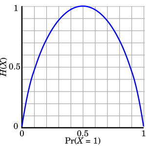
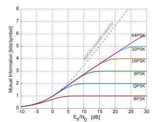
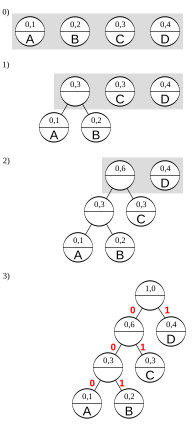

# 21.2 信息论基础

> **前置知识**：[0.0 数学基础](../大学物理基础/0.0-数学基础.md)、[21.1 通信系统概述](21.1-通信系统概述.md)。本章从信息量的定量度量出发，引出熵、互信息与信道容量的概念，并给出数字通信的终极性能上限——香农定理。

信息论由香农（C. E. Shannon）于 1948 年创立，它回答了三个根本问题：信息如何度量、信道最多能无差错地传多少信息、以及如何用编码逼近该极限。本节把这套体系引入全库，后续所有信源编码（[21.4](21.4-模拟信号的数字化.md)）与信道编码（[21.7](21.7-信道编码.md)）的章节都建立在本节的概念之上。

## 1. 信息量与熵

### 1.1 自信息量

信息是对"不确定性消除程度"的度量。对于概率为 $p(x_i)$ 的事件 $x_i$，其**自信息量**定义为：

$$
I(x_i) = \log_2 \frac{1}{p(x_i)} = -\log_2 p(x_i) \quad (\text{bit})
$$

信息量与事件发生的概率成反比：越不可能发生的事件，其发生带来的信息量越大。两个要点：

- 确定事件（$p=1$）的自信息量为 0，即"早就知道的消息不含信息"。
- 底数为 2 时单位是比特（bit），底数为 $e$ 时是奈特（nat），底数为 10 时是哈特（hart）。

### 1.2 熵

信源 $X$ 输出符号的平均自信息量称为**熵（熵率）**：

$$
H(X) = E[I(X)] = -\sum_{i=1}^{n} p(x_i) \log_2 p(x_i) \quad (\text{bit/符号})
$$

熵刻画了信源"平均每输出一个符号携带多少比特信息"，是信源编码的理论下界。

熵的性质：

- **非负性**：$H(X) \geq 0$，等号当且仅当某一符号概率为 1 时成立。
- **最大熵定理**：当各符号等概率 $p(x_i)=1/n$ 时熵最大，$H_{\max} = \log_2 n$。
- **联合熵**与**条件熵**：

$$
H(X,Y) = -\sum_{x,y}p(x,y)\log_2 p(x,y), \quad
H(X|Y) = -\sum_{x,y}p(x,y)\log_2 p(x|y)
$$

其中联合熵描述两个变量共同携带的信息量，条件熵描述已知 $Y$ 后 $X$ 仍保留的不确定性。二者满足链式法则：

$$
H(X,Y) = H(X) + H(Y|X) = H(Y) + H(X|Y)
$$

**示例**：抛掷一枚无偏硬币，$H = -\frac12\log_2\frac12 - \frac12\log_2\frac12 = 1$ bit；若硬币有偏（正面向上的概率 $p$），则 $H = -p\log_2 p - (1-p)\log_2(1-p)$，当 $p=1$ 时 $H=0$。

> 上图即二元熵函数 $H(p) = -p\log_2 p - (1-p)\log_2(1-p)$：在 $p=1/2$ 处取最大值 1 bit，向两端 ($p=0$ 或 $p=1$) 趋于 0，直观体现"越接近确定，信息量越小"。

## 2. 互信息

### 2.1 定义

接收端观察到 $Y$ 后对信源 $X$ 不确定性的减少量称为**平均互信息量**：

$$
I(X;Y) = H(X) - H(X|Y)
$$

互信息越大，说明 $Y$ 提供的关于 $X$ 的信息越多，通信质量越好；$I(X;Y)=0$ 表示 $Y$ 与 $X$ 独立、通信完全没有收益。

> 互信息随信噪比增大而上升，最终趋于该调制方式的信道容量，直观体现信道可靠性越高承载的信息量越大。

### 2.2 与熵的关系

互信息满足对称性与非负性：

$$
\begin{aligned}
I(X;Y) &= H(X) - H(X|Y) = H(Y) - H(Y|X) \\
       &= H(X) + H(Y) - H(X,Y) \geq 0
\end{aligned}
$$

等价地，互信息可由联合分布直接写出：

$$
I(X;Y) = \sum_{x,y} p(x,y) \log_2 \frac{p(x,y)}{p(x)\,p(y)}
$$

互信息刻画了信道输出的符号中携带的关于输入符号的信息量，是信道容量计算的基础。

### 2.3 剩余度（冗余）

信源实际熵 $H(X)$ 与最大熵 $H_{\max}$ 之差定义**剩余度** $D = H_{\max} - H(X)$，相对冗余 $r = D/H_{\max}$。冗余正是信源编码要消除的对象，也是信道编码可复用的"保护位"来源。

## 3. 信道容量与香农定理

### 3.1 AWGN 信道容量（香农公式）

对于带宽为 $B$、信号平均功率为 $S$、加性高斯白噪声功率为 $N$ 的连续信道，其**信道容量**为：

$$
C = B \log_2 \left( 1 + \frac{S}{N} \right) \quad (\text{bit/s})
$$

其中信噪比 $S/N$ 常以 dB 表示。这是理论上的最大无误码传输速率。

**香农信道编码定理**指出：只要信息速率 $R < C$，就存在某种编码使误码率任意小；反之若 $R > C$，则不可能实现可靠通信。这一"阈值"性质奠定了所有调制与编码设计的边界。

### 3.2 香农公式的工程含义

- 带宽与信噪比可互换：带宽有限时可通过提高信噪比维持容量，反之亦然。
- 存在非零信道容量 $C$，只要信息速率 $R < C$，总存在编码使误码率任意小——这为 [21.7 信道编码](21.7-信道编码.md) 的存在性提供了理论依据。
- 当 $B \to \infty$ 时容量趋于有限值：

$$
C_{\infty} = \lim_{B\to\infty} B \log_2\left(1+\frac{S}{N_0 B}\right) = \frac{S}{N_0}\log_2 e \approx 1.44 \frac{S}{N_0}
$$

其中 $N_0$ 为单边噪声功率谱密度。该极限说明：一味加带宽未必能无限提高容量，噪声也随之增加。

### 3.3 谱效率视角

把香农公式两边除以 $B$，得到**谱效率**的香农极限：

$$
\eta = \frac{C}{B} = \log_2\left(1 + \frac{S}{N}\right) \quad (\text{bit/s/Hz})
$$

这是 [21.6 数字调制](21.6-数字调制.md) 中"高阶调制能换取多少谱效率"的理论标尺。

## 4. 信源编码

### 4.1 信源编码的可逆性

信源编码的目的是去除信源符号中的**冗余**，进行数据压缩。其下限由信源熵给出：

$$
R \geq H(X)
$$

仅当 $R \geq H(X)$ 时才能做到信息无失真传输（**无失真信源编码定理**，即香农第一定理）。它说明：用编码后码字平均长度不低于 $H(X)$ 的二进制码不可能无失真地表示信源，而总能构造出平均码长任意接近 $H(X)$ 的编码。

### 4.2 典型信源编码方法

- **霍夫曼（Huffman）编码**：依据符号概率构造可变长码字，概率高的符号用短码，逼近熵界限，是无损压缩的代表。
- **算术编码**：将符号序列映射到区间 $[0,1)$ 上的一个实数，压缩效率接近无损极限，对小概率串的整体编码优于霍夫曼。
- **LZ/LZW**：基于字典的通用无损压缩，无需预先知道符号概率，广泛用于文件压缩。
- **预测与变换编码**（有损压缩）：如语音中的线性预测编码、图像中的 DCT 编码。

> 哈夫曼编码按符号概率自底向上反复合并概率最小的两棵子树构造最优前缀码，概率高的符号路径短、得短码字，从而把平均码长压向信源熵 $H(X)$。

### 4.3 限失真信源编码（率失真理论）

对语音、图像等连续信源，允许重构与原始之间存在一定失真 $D$ 时，所需的最小码率由**率失真函数** $R(D)$ 描述：

$$
R(D) = \min_{p(\hat{x}|x):\ E[d(x,\hat{x})]\le D} I(X;\hat{X})
$$

率失真理论说明"以可接受失真换取码率压缩"的空间，是现代有损压缩（JPEG、MP3、视频编码）的理论基础。

## 5. 工程/典型应用：音视频的无损与有损压缩

1. 语音（如 PCM 电话）用 $\mu$-law/A-law 压扩降低量化开销量，见 [21.4 模拟信号的数字化](21.4-模拟信号的数字化.md)。
2. 高质量音频/视频用有损变换编码（如 MP3 的感知编码、JPEG 的 DCT、H.26x 的运动补偿）在满足码率的条件下逼近信源熵。
3. 无损数据（如文件、固件升级）采用 Huffman/LZ 类算法保证无失真。

将信息论与后续章节联系起来：

| 概念 | 对应章节 | 角色 |
|------|---------|------|
| 熵、剩余度 | 21.4 信源编码 | 压缩的下界 |
| 信道容量 $C$ | 21.7 信道编码 | 可靠传输的边界 |
| 互信息 | 21.6 数字调制 | 调制阶数选择依据 |

以此可见，熵给出了"最少需要多少比特"的理论下界，信源编码的目标就是尽可能逼近这一下界，而信道编码则以略低于 $C$ 的速率换取近乎零的误码。