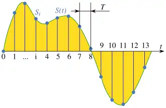
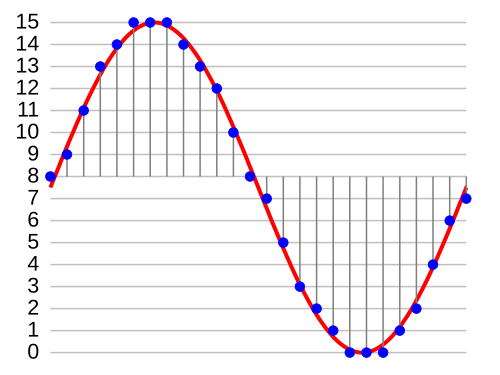
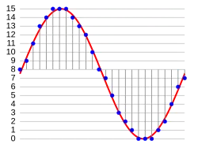

# 21.4 模拟信号的数字化

> **前置知识**：[5.9 数模与模数转换](../数字电路/5.9-数模与模数转换.md)、[15.1 数据转换器 IC 设计](../数据转换器IC设计/15.1-数据转换器IC设计.md)、[21.3 模拟调制](21.3-模拟调制.md)。本章介绍把连续模拟信号表示为离散数字序列的三步：抽样、量化与编码（PCM），并讨论语音压缩中的非线性量化。

把模拟信号变为数字信号要依次完成三件事：**抽样**（时间离散化）、**量化**（幅度离散化）、**编码**（幅度映射为二进制码字）。其中量化是有损的，决定了重构误差的底线；抽样是否有损则取决于是否满足抽样定理。本章还介绍以 DM/DPCM 为代表的差分编码路线。

## 1. 抽样定理

### 1.1 理想抽样

对带宽为 $f_m$ 的带限信号 $m(t)$ 以采样周期 $T_s$ 抽样，得到：

$$
m_s(t) = \sum_{n=-\infty}^{\infty} m(nT_s) \delta(t - nT_s)
$$

抽样脉冲序列的频谱是原信号频谱在 $n f_s$（$f_s = 1/T_s$）处的周期延拓：

$$
M_s(f) = f_s \sum_{n=-\infty}^{\infty} M(f - n f_s)
$$

若各延拓副本不重叠，就能用一个理想低通滤波器取出 $n=0$ 的原始频谱 $M(f)$。

> 蓝色竖线为抽样时刻得到的离散样本，满足 $f_s\ge 2f_m$ 即可无失真重建原信号。

### 1.2 奈奎斯特（Nyquist）抽样定理

当采样率满足：

$$
f_s \geq 2f_m
$$

时，可用理想低通滤波器从抽样值中无失真地重建 $m(t)$。$2f_m$ 称为**奈奎斯特频率**。

- 若 $f_s < 2f_m$，频谱副本相互交叠，发生**混叠（Aliasing）**，无法恢复原信号。
- 重建滤波器的截止频率取 $f_c = f_s/2$，理想内插重建公式为：

$$
m(t) = \sum_{n=-\infty}^{\infty} m(nT_s)\, \text{sinc}\left(\frac{t - nT_s}{T_s}\right)
$$

### 1.3 带通抽样与实际采用

- **带通抽样**：对中心频率远大于带宽 $B$ 的带通信号，可用 $f_s = 2B$ 同样无失真地抽样。
- **实际抽样**：采样保持（S/H）电路在前端限制孔径时间误差，抗混叠滤波器在抽样前滤除带外高频，相关电路详见 [5.9 数模与模数转换](../数字电路/5.9-数模与模数转换.md)。

### 1.4 自然抽样与平顶抽样

抽样脉冲为实际非理想脉冲时，可区分两种方式：

| 方式 | 定义 | 特点 |
|------|------|------|
| 理想抽样 | 用理想冲激 $\delta(t-nT_s)$ 取值 | 重建最简单，理论上无失真 |
| 自然抽样 | 用宽度为 $\tau$ 的脉冲包络取样 | 频谱乘一个 sin c 因子，可用简单低通重建 |
| 平顶抽样（保真） | 每个抽样值保持一个 $\tau$ 的恒定电平 | 需孔径补偿，是实际 S/H 的基础 |

平顶抽样中每个样值保持为恒定电平，正是 [15.1 数据转换器 IC 设计](../数据转换器IC设计/15.1-数据转换器IC设计.md) 中 S/H 电路的理想化模型。

## 2. 量化

### 2.1 均匀量化

把抽样值的连续幅度域分成 $N$ 个等间隔电平，量化间隔为：

$$
\Delta = \frac{V_{\max} - V_{\min}}{N}
$$

均匀量化在均匀分布输入下的**量化信噪比**（满量程、均匀概率密度）：

$$
\text{SNR}_q \approx 6.02\, b + 1.76 \quad (\text{dB})
$$

其中 $b$ 为量化位数，$N = 2^b$。**核心规律**：每增加 1 位量化位数，量化信噪比改善约 $6\,\text{dB}$。这一近似也直接适用于 [15.1 数据转换器 IC 设计](../数据转换器IC设计/15.1-数据转换器IC设计.md) 中 ADC 的 ENOB 评估。

量化误差（量化噪声）是均匀分布于 $[-\Delta/2, \Delta/2]$ 的随机变量，其均方误差为：

$$
\sigma_q^2 = \frac{\Delta^2}{12}
$$

> 量化把抽样值的连续幅度映射到 $N=2^b$ 个等间隔电平台阶上，每一步的舍入差异即量化误差（噪声），正是 $\mathrm{SNR}_q \approx 6.02b + 1.76$ dB 的来源。

### 2.2 非均匀量化与压扩（μ-law / A-law）

语音信号峰值幅度远大于平均幅度，均匀量化在小信号时信噪比很差。**压扩（Companding）** 先对信号做对数压缩再均匀量化：

**μ-law（北美/日本）**：

$$
y(x) = \text{sgn}(x) \frac{\ln(1 + \mu |x|)}{\ln(1 + \mu)}, \quad x \in [-1,1],\ \mu = 255
$$

**A-law（中国/欧洲）**：

$$
y(x) = \begin{cases}
\dfrac{A x}{1 + \ln A}, & 0 \le |x| \le \dfrac{1}{A} \\[6pt]
\dfrac{\text{sgn}(x)}{1 + \ln A}\left(1 + \ln(A|x|)\right), & \dfrac{1}{A} \le |x| \le 1
\end{cases}, \quad A = 87.6
$$

压扩的本质是小信号电平被放大、大信号电平被压缩，量化后再在接收端做逆变换（扩张），使**小信号量化信噪比在较宽动态范围内保持近似恒定**。也就是说，以信号压扩换取了不随幅度大变的量化噪声特性。

## 3. 脉冲编码调制（PCM）

### 3.1 PCM 的构成

量化后的电平用二进制码字表示即得到 PCM 信号，其**比特率**为：

$$
R_b = f_s \cdot b = B \cdot \log_2 N \quad (\text{bit/s})
$$

其中 $B = f_s/2$ 为信号带宽。PCM 的三个环节——抽样、量化、编码——与 [5.9 数模与模数转换](../数字电路/5.9-数模与模数转换.md) 及 [15.1](../数据转换器IC设计/15.1-数据转换器IC设计.md) 的 ADC 对应，编码所需的量化器与解码后的 DAC 共同构成完整的模数-数模链路。

> 信号先被抽样为离散样本，再量化到有限电平（图中 16 级），量化后的电平即编成 PCM 码字。

### 3.2 PCM 的基本特性

- 抽样频率越高、量化位数越多，码率越高，量化噪声越小。
- 常见电话语音采用 **A-law/μ-law** 压扩 + $f_s = 8\ \text{kHz}$、$b = 8$ 位，得到标准 PCM 的 $64\ \text{kbit/s}$ 码流。
- PCM 是数字电话（T1/E1、PSTN）的基础。

### 3.3 量化信噪比与码率折中

量化信噪比每提高 $6\,\text{dB}$ 需增加 1 位，而码率随之线性上升。因此必须在**量化精度**（质量）与**传输比特率**（带宽代价）之间折中，这正是限失真信源编码（[21.2 信息论基础](21.2-信息论基础.md) 的率失真理论）关心的内容。

## 4. 差分编码与增量调制

### 4.1 差分脉冲编码调制（DPCM）

相邻抽样值高度相关时，先预测再量化**差值** $d(n) = m(n) - \hat m(n)$，可用少得多的位数表示同样的质量：

$$
e(n) = d(n) - \hat d(n), \quad \hat d(n) = \text{quant}[d(n)]
$$

### 4.2 增量调制（ΔM, DM）

DPCM 的 1 位极限：只量化差值的正负（上升 $+1$ 或下降 $-1$），输出 1 bit/抽样：

$$
y(n) = \text{sgn}\big(m(n) - \hat m(n)\big)
$$

增量调制简单、码率极低，但有**斜率过载失真**（信号变化快于步长跟进）与**颗粒噪声**（无变化时步进抖动）两类误差，通常要求抽样率远高于奈奎斯特率以减小失真。

### 4.3 自适应与电话编码

语音编码广泛结合自适应：**ADPCM**（自适应 DPCM）按信号统计调整预测器与量化步长，G.726 用 ADPCM 把码率降到 32/40 kbit/s。参数编码模型（如 CELP）进一步压缩到 8 kbit/s 量级，主要用于移动与 IP 语音。

## 5. 工程/典型应用：语音通信的压缩编码

1. 语音经话筒与 A/D（含 [15.1 数据转换器 IC 设计](../数据转换器IC设计/15.1-数据转换器IC设计.md) 的 ADC）转换为 PCM。
2. 电话网用 `G.711`（即 A-law/μ-law PCM，64 kbit/s）作高质量数字话音。
3. 为进一步压缩，`G.726` 用自适应差分脉冲编码调制（ADPCM）把码率降到 32/40 kbit/s。
4. 移动与 IP 语音进一步用参数编码模型（如 CELP）降至 8 kbit/s 量级。

各种数字化方案对比：

| 方案 | 抽样 | 量化位数 | 典型码率 | 用途 |
|------|------|---------|---------|------|
| G.711（A/μ-law PCM） | 8 kHz | 8 | 64 kbit/s | PSTN 数字电话 |
| G.726（ADPCM） | 8 kHz | 4 | 32 kbit/s | 电话压缩 |
| CELP 类参数编码 | 8 kHz | — | 8~13 kbit/s | 移动/网络语音 |

由此把"抽样-量化-编码"三步与 [21.2 信息论基础](21.2-信息论基础.md) 的信源熵联系起来：量化和编码的目标是在保证主观质量的前提下逼近语音的信源熵。