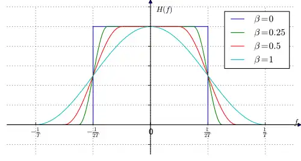
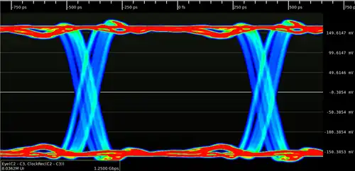

# 21.5 数字基带传输

> **前置知识**：[5.1 数制与编码](../数字电路/5.1-数制与编码.md)、[3.11 傅里叶变换在电路中的应用](../电路原理/3.11-傅里叶变换在电路中的应用.md)、[21.4 模拟信号的数字化](21.4-模拟信号的数字化.md)。数字基带信号指未经调制、频率较低的原始数字脉冲序列。本章讨论其波形、码型选择、最佳接收与码间串扰（ISI）。

在有线短距离链路（如芯片间、板卡间、以太网）中，数字比特直接以基带脉冲传输而无需调制到射频。其核心设计问题有三个：用什么**波形/码型**、接收端如何**最佳判决**、如何应对**码间串扰**。本章的频域分析离不开 [20.4 离散傅里叶变换](../数字信号处理/20.4-离散傅里叶变换.md) 的处理思想。

## 1. 数字基带信号波形与码型

### 1.1 基本波形表示

二元基带信号可用脉冲 $g(t)$ 及其位移表示：

$$
s(t) = \sum_n a_n g(t - nT_s)
$$

其中 $T_s$ 为码元间隔（符号周期），$a_n$ 为第 $n$ 个码元的幅度（对应 0/1）。频谱特性由脉冲 $g(t)$ 决定，其功率谱密度正比于 $|G(f)|^2$（$G(f)$ 为 $g(t)$ 的傅里叶变换）。

### 1.2 常见码型

| 码型 | 特点 | 波形特征 |
|------|------|---------|
| 单极性 NRZ | 简单，含直流分量 | 高/低电平各占一码元周期 |
| 双极性 NRZ | 无直流分量（等概率时），抗噪好 | $+A$/$-A$ 两电平 |
| 单极性 RZ | 每码元只占部分周期 | 归零，便于位同步提取 |
| 差分码 | 用相邻跳变表示 0/1 | 无绝对电平依赖，利于无直流 |
| 曼彻斯特编码 | 自含时钟，电平跳变 | 每码元中间必有跳变 |
| AMI/HDB3 | 交替反转/高密度双极性 | 无直流且便于定时（电话线） |
| 4B5B/8B10B | 把 4/8 比特映射为 5/10 比特码组 | 限制游程、保证跳变密度（高速串行） |

> 曼彻斯特编码在每个码元中间跳变一次，既携带数据也自带时钟，便于位同步提取。

NRZ = 不归零（Non-Return-to-Zero），RZ = 归零（Return-to-Zero）。码型选择需权衡直流分量、定时分量、跳变密度与解码复杂度的折中。

> 同一比特序列在不同线路码型（NRZ、RZ、曼彻斯特等）下的波形差异，反映各自的直流电平与跳变特性。

## 2. 最佳接收与匹配滤波

### 2.1 匹配滤波器

在白噪声背景下，使输出信噪比最大的线性滤波器是**匹配滤波器**，其冲激响应与发射脉冲互为时间反转：

$$
h(t) = g^*(T_s - t)
$$

其最大输出信噪比为：

$$
\left( \frac{S}{N} \right)_{\max} = \frac{2E}{N_0}
$$

其中 $E$ 为码元能量，$N_0$ 为单边噪声谱密度。匹配滤波在实现上等价于**相关器**：在 $T_s$ 时刻与发射波形做相关积分，因此最佳接收机常用相关接收机结构。

### 2.2 最佳判决

二进制等概率且等能量的 $\{0,1\}$ 信号在 AWGN 下的最佳判决门限位于两波形中点；对应的差错性能由互补误差函数给出：

$$
P_e = Q\left( \sqrt{\frac{2E_b}{N_0}} \right)
$$

其中 $Q(\cdot)$ 为高斯 Q 函数，定义为

$$
Q(x) = \frac{1}{\sqrt{2\pi}} \int_{x}^{\infty} e^{-t^2/2}\, dt
$$

对双极性信号，$E_b = A^2 T_s$，其误码率公式即上式；对单极性（开关）信号则比双极性差约 $3\,\text{dB}$。又如随符号高效的差分检测、软判决等，都需要基带匹配滤波后的统计量作基础。

## 3. 码间串扰与奈奎斯特准则

### 3.1 码间串扰（ISI）

传输系统带宽有限或频率特性不理想时，前一码元的拖尾会干扰当前码元的抽样判决，称为**码间串扰**。

传输系统的等效冲激响应可写为 $h_{sys}(t) = g(t) * h_c(t) * g_r(t)$，其中 $h_c(t)$ 为信道冲激响应，$g_r(t)$ 为接收滤波器冲激响应。抽样时刻 $t_0 + nT_s$ 的接收样值：

$$
r(nT_s) = a_n h_{sys}(0) + \sum_{k\ne n} a_k h_{sys}\big((n-k)T_s\big) + n
$$

第二项即为 ISI 干扰。物理上，频率选择性信道（见 [21.11](21.11-差错与链路预算.md)）正是 ISI 的主要来源。

### 3.2 奈奎斯特第一准则

要使抽样时刻无码间串扰，传输系统的传递函数 $H(f)$ 需满足：

$$
\sum_{k=-\infty}^{\infty} H\left( f + \frac{k}{T_s} \right) = T_s, \quad |f| \le \frac{1}{2T_s}
$$

即按符号速率折叠后的频谱应平坦。由此得到**奈奎斯特速率**与带宽的极限关系：

$$
R_s^{\max} = 2B \quad (\text{符号/秒})
$$

即在带宽 $B$ 内，最大无 ISI 符号速率等于 $2B$。对应地，无 ISI 所需的理论最小带宽为 $B_{\min} = R_s/2$。

### 3.3 升余弦滚降滤波器

理想砖墙滤波不可实现，工程上通常用**升余弦（raised-cosine）**滤波器逼近，其频率响应为：

$$
H(f) = \begin{cases}
T_s, & |f| \le \dfrac{1-\alpha}{2T_s} \\[4pt]
\dfrac{T_s}{2}\left[1 + \cos\left(\dfrac{\pi T_s}{\alpha}\left(|f| - \dfrac{1-\alpha}{2T_s}\right)\right)\right], & \dfrac{1-\alpha}{2T_s} \le |f| \le \dfrac{1+\alpha}{2T_s} \\[4pt]
0, & |f| > \dfrac{1+\alpha}{2T_s}
\end{cases}
$$

其滚降因子 $\alpha \in [0,1]$ 使实际带宽变为 $B = (1+\alpha)/(2T_s)$。$\alpha=0$ 为理想矩形（不可实现），$\alpha$ 越大越易实现但占用带宽越多。发送端与接收端滤波器通常各取一半构成**根升余弦**（平方组合为升余弦）以整体满足无 ISI 条件。

> 滚降因子 $\alpha$ 越大，滚降越平缓、越易实现，但占用带宽 $B=(1+\alpha)/(2T_s)$ 越大。

### 3.4 眼图

把示波器在多个码元周期上触发叠加显示，得到**眼图**：

- **眼张开程度**反映抗噪能力与 ISI 大小。
- 眼张开幅度越大、交叉点越清晰、眼皮越薄，系统性能越好。
- 眼图中心水平位置的宽度对应最佳抽样时刻的裕量，垂直张开高度对应噪声裕量。

眼图是工程上直接衡量基带链路质量的通用工具，典型的眼图参数包括眼高、眼宽、交叉点抖动与眼交叉比等。

> 眼图由多个码元重叠显示而成，眼张开越大、眼皮越薄越好，反映抗噪能力与 ISI 大小。

## 4. 工程/典型应用：有线接口的基带传输

1. 以太网用 **PAM 类基带信号** + 线路编码（如 1000BASE-T 的 PAM-5）在双绞线上传输。
2. 曼彻斯特编码用于早期 10M 以太网，自含时钟便于位同步。
3. 高速串行接口（如 PCIe、SATA）发送端加发射均衡、接收端用**均衡器/判决反馈均衡**对抗 ISI，详见 [21.11 差错与链路预算](21.11-差错与链路预算.md)。
4. 用眼图验证链路码间串扰与噪声裕度（对应于 [9.1 信号完整性](../信号完整性与电磁兼容/9.1-信号完整性.md) 中的时域分析）。

把频域设计与时域验证闭环：奈奎斯特准则在频域保证了无 ISI 的理论边界，升余弦滤波器在工程上实现了它，而眼图在时域直观地检验设计裕量。理解本节，才能衔接 [21.6 数字调制](21.6-数字调制.md) 中 QPSK/QAM 的基带成型滤波。