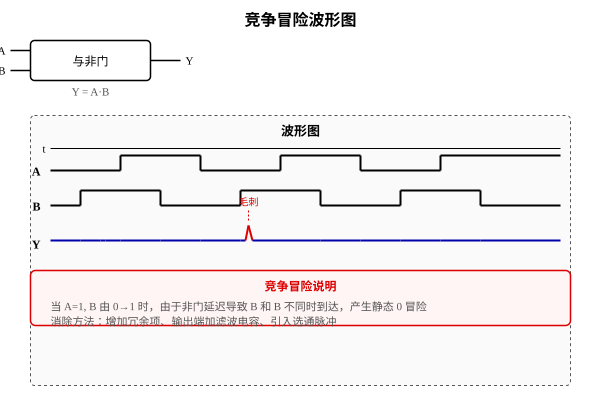

# 5.4 组合逻辑电路

## 1. 组合逻辑电路分析方法

组合逻辑电路的特点是输出仅取决于当前输入，与电路的历史状态无关（无记忆功能）。

**分析步骤**：
1. 根据逻辑图写出各输出端的逻辑表达式
2. 化简逻辑表达式
3. 列出真值表
4. 分析逻辑功能

**示例**：分析一个由三个与非门构成的电路。

$$Y = \overline{\overline{AB} \cdot \overline{CD}} = AB + CD$$

由此可知，该电路实现的是"与或"功能。

## 2. 组合逻辑电路设计方法

**设计步骤**：
1. 分析逻辑功能要求，确定输入输出变量
2. 列出真值表
3. 写出逻辑表达式并化简
4. 根据化简结果画逻辑图
5. 验证设计

## 3. 加法器

### 3.1 半加器（Half Adder）

半加器实现两个 1 位二进制数的加法，不考虑来自低位的进位。

**真值表**：

| A | B | S（和） | C（进位） |
|---|---|---------|----------|
| 0 | 0 | 0 | 0 |
| 0 | 1 | 1 | 0 |
| 1 | 0 | 1 | 0 |
| 1 | 1 | 0 | 1 |

**逻辑表达式**：
$$S = A \oplus B$$
$$C = A \cdot B$$

### 3.2 全加器（Full Adder）

全加器实现两个 1 位二进制数及来自低位的进位相加。

**真值表**：

| A | B | $C_{i-1}$ | S | $C_i$ |
|---|---|-----------|--|-------|
| 0 | 0 | 0 | 0 | 0 |
| 0 | 0 | 1 | 1 | 0 |
| 0 | 1 | 0 | 1 | 0 |
| 0 | 1 | 1 | 0 | 1 |
| 1 | 0 | 0 | 1 | 0 |
| 1 | 0 | 1 | 0 | 1 |
| 1 | 1 | 0 | 0 | 1 |
| 1 | 1 | 1 | 1 | 1 |

**逻辑表达式**：
$$S = A \oplus B \oplus C_{i-1}$$
$$C_i = AB + (A \oplus B)C_{i-1} = AB + BC_{i-1} + AC_{i-1}$$

### 3.3 超前进位加法器（Carry Lookahead Adder）

传统行波进位加法器中，进位信号逐级传递，延迟较大。超前进位加法器通过并行计算进位信号来提高速度。

**进位生成函数**：$G_i = A_i \cdot B_i$
**进位传递函数**：$P_i = A_i \oplus B_i$

**进位公式**：
$$C_i = G_i + P_i \cdot C_{i-1}$$

展开后：
$$C_0 = G_0 + P_0 \cdot C_{-1}$$
$$C_1 = G_1 + P_1 \cdot G_0 + P_1 \cdot P_0 \cdot C_{-1}$$
$$C_2 = G_2 + P_2 \cdot G_1 + P_2 \cdot P_1 \cdot G_0 + P_2 \cdot P_1 \cdot P_0 \cdot C_{-1}$$
$$\vdots$$

### 3.4 加法器延迟分析

**波纹进位加法器（Ripple Carry Adder）的延迟**：
- 关键路径：从最低位到最高位的进位传递路径
- 进位链延迟：$T_{CRA}(n) = n \cdot 2D$，其中 $D$ 为单位门延迟
- 和输出延迟：$T_{CRA}(n) = (n+2) \cdot 2D$

**超前进位加法器（Carry Look-ahead Adder）的延迟**：
- 进位产生函数：$G_i = A_i \cdot B_i$
- 进位传递函数：$P_i = A_i \oplus B_i$
- 进位递推公式：
  $$
  \begin{aligned}
  c_1 &= G_0 + P_0 \cdot c_0 \\
  c_2 &= G_1 + P_1 \cdot G_0 + P_1 \cdot P_0 \cdot c_0 \\
  c_3 &= G_2 + P_2 \cdot G_1 + P_2 \cdot P_1 \cdot G_0 + P_2 \cdot P_1 \cdot P_0 \cdot c_0
  \end{aligned}
  $$
- 超前进位加法器的延迟约为 $4D$，与位数n无关，但扇入问题限制了位数（通常4位一组）

**标准加法器芯片**：
- 7483 / 74283：4位超前进位加法器

## 4. 数值比较器

### 4.1 1 位比较器

比较两个 1 位二进制数 $A$ 和 $B$：

$$F_{A>B} = A \cdot \overline{B}$$
$$F_{A=B} = A \odot B = \overline{A \oplus B}$$
$$F_{A<B} = \overline{A} \cdot B$$

### 4.2 多位比较器

从高位到低位逐位比较：
- 若高位 $A_i > B_i$，则 $A > B$
- 若高位 $A_i < B_i$，则 $A < B$
- 若高位相等，比较次高位，以此类推

## 5. 编码器

### 5.1 普通编码器

将输入信号转换为二进制代码。例如 8 线-3 线编码器，输入 $I_0 \sim I_7$ 中只有一个为 1，输出 $Y_2Y_1Y_0$ 为对应的二进制编码。

$$Y_2 = I_4 + I_5 + I_6 + I_7$$
$$Y_1 = I_2 + I_3 + I_6 + I_7$$
$$Y_0 = I_1 + I_3 + I_5 + I_7$$

### 5.2 优先编码器

优先编码器允许同时有多个输入有效，但仅对优先级最高的输入进行编码。例如 74LS148 是 8 线-3 线优先编码器，$I_7$ 优先级最高。

## 6. 译码器

### 6.1 二进制译码器

将二进制代码转换为对应的输出信号。例如 3 线-8 线译码器 74LS138：

**输出表达式**：
$$Y_i = \overline{A_2 \cdot A_1 \cdot A_0 \cdot \text{使能条件}}$$

其中 $i$ 对应输入二进制数。

### 6.2 显示译码器

显示译码器将 BCD 码转换为七段数码管显示所需的驱动信号。

**七段数码管**由 a~g 七个 LED 段组成，共阴极或共阳极连接。

**共阴极显示译码器**（如 74LS48）：
- 输入为 4 位 BCD 码
- 输出为 7 位段选信号（a~g）
- 当输入为 0000 时，输出 1111110（显示 0）

## 7. 数据选择器

数据选择器（Multiplexer, MUX）从多路输入中选择一路输出。

**2 选 1 MUX**：
$$Y = S \cdot D_1 + \overline{S} \cdot D_0$$

**4 选 1 MUX**：
$$Y = \overline{S_1}\overline{S_0}D_0 + \overline{S_1}S_0D_1 + S_1\overline{S_0}D_2 + S_1S_0D_3$$

**8 选 1 MUX**（如 74LS151）：由三个地址选择端 $A_2A_1A_0$ 从 8 路数据中选择一路。

## 8. 数据分配器

数据分配器（Demultiplexer, DEMUX）将一路输入数据分配到多路输出中的一路。

**1 路-4 路 DEMUX**：
$$Y_0 = D \cdot \overline{S_1}\overline{S_0}$$
$$Y_1 = D \cdot \overline{S_1}S_0$$
$$Y_2 = D \cdot S_1\overline{S_0}$$
$$Y_3 = D \cdot S_1S_0$$

## 9. 奇偶校验器

奇偶校验器用于检测数据中 1 的个数是否为奇数或偶数。

**奇偶产生/校验原理**：
- 奇校验：数据位加上校验位后，1 的总数为奇数
- 偶校验：数据位加上校验位后，1 的总数为偶数

**8 位奇偶校验器**：
$$P = B_0 \oplus B_1 \oplus B_2 \oplus B_3 \oplus B_4 \oplus B_5 \oplus B_6 \oplus B_7$$

## 10. 竞争与冒险

### 10.1 竞争现象

当逻辑门的输入信号经过不同路径到达时，由于各路径延迟不同，导致输入信号到达的时间有先后，这种现象称为"竞争"。

### 10.2 冒险现象

竞争可能导致输出出现不应有的尖峰脉冲，称为"冒险"（Hazard）。

**静态冒险**：输出本应保持不变，但出现短暂毛刺。
- **静态 1 冒险**：输出本应为 1，出现 0 毛刺
- **静态 0 冒险**：输出本应为 0，出现 1 毛刺

**动态冒险**：输出本应变化一次，但变化过程中出现多次跳变。

### 10.3 冒险的判断方法

**代数法**：检查逻辑表达式是否满足 $Y = A + \overline{A}$（产生 1 冒险）或 $Y = A \cdot \overline{A}$（产生 0 冒险）。

**卡诺图法**：若卡诺图中存在两个相邻的 1（或 0）没有被同一个圈覆盖，则存在冒险。

### 10.4 冒险消除方法

1. **增加冗余项**：在逻辑表达式中增加冗余乘积项，覆盖所有相邻项
2. **输出端加滤波电容**：利用电容的充放电特性滤除窄脉冲
3. **引入选通脉冲**：在输出稳定后再读取
4. **采用同步设计**：使用时钟同步信号