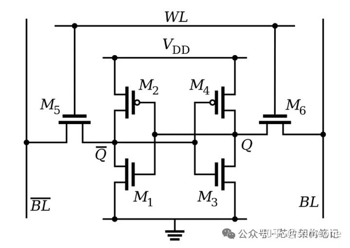
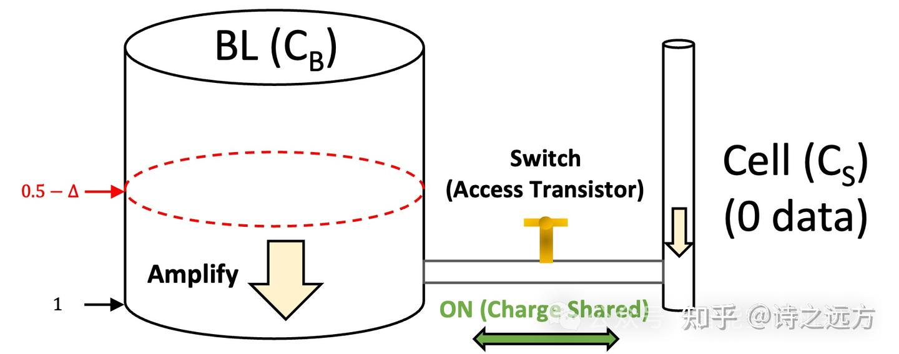
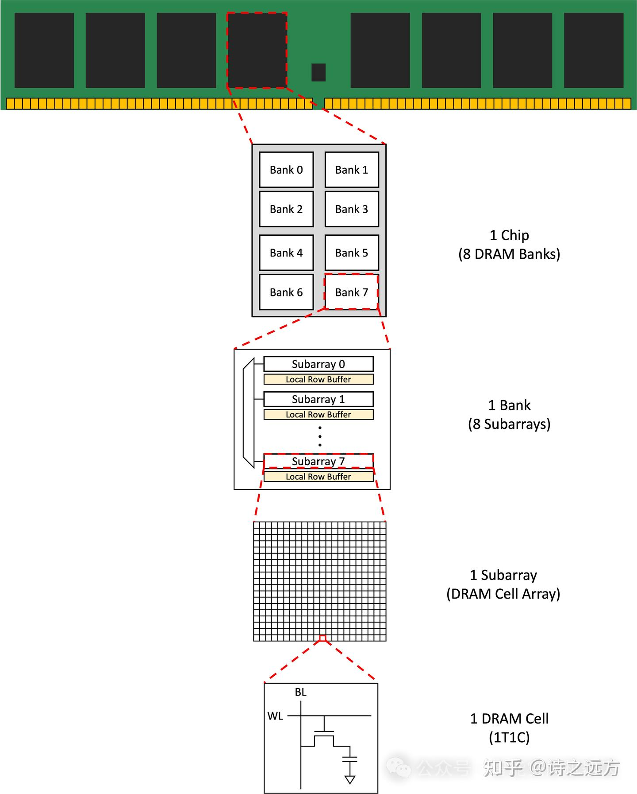
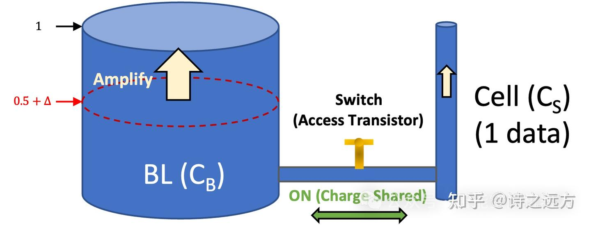
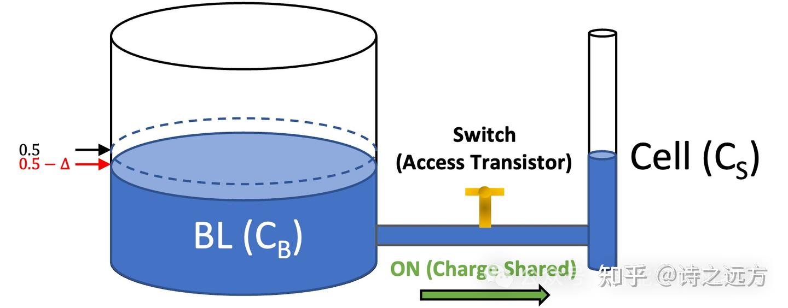
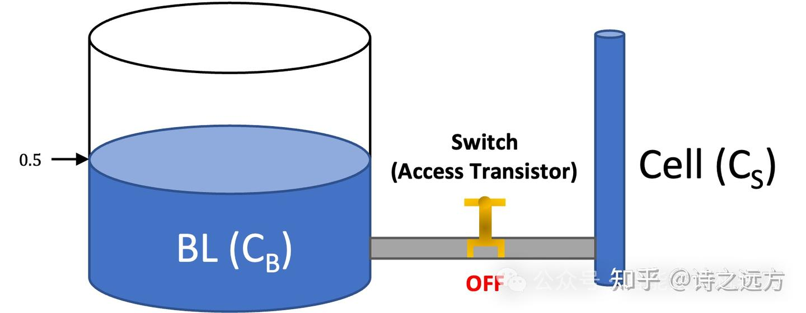
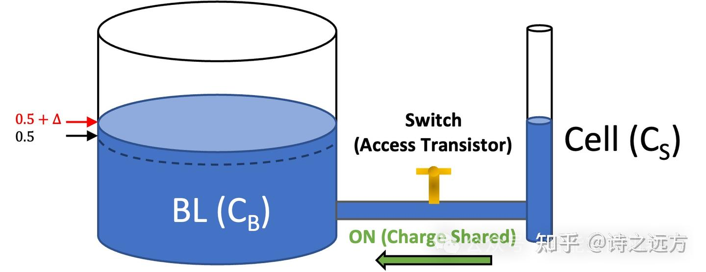

# 5.7 半导体存储器

## 1. 半导体存储器概述

半导体存储器是数字系统中用于存储数据和程序的重要部件。

**分类**：
- **ROM（Read-Only Memory）**：只读存储器，断电后数据不丢失
- **RAM（Random Access Memory）**：随机存取存储器，断电后数据丢失

## 2. 只读存储器（ROM）

### 2.1 掩模 ROM（Mask ROM）

掩模 ROM 在芯片制造过程中由掩模版决定存储内容，出厂后不可更改。

**优点**：生产成本低，适合大批量生产
**缺点**：不可编程，灵活性差

### 2.2 PROM（Programmable ROM）

PROM 出厂时所有存储单元均为 0（或 1），用户可通过编程器一次性写入数据。

**编程原理**：通过大电流熔断存储单元中的熔丝。

### 2.3 EPROM（Erasable Programmable ROM）

EPROM 可多次编程，写入后通过紫外线照射擦除（擦除时间约 15-20 分钟）。

**存储单元**：浮栅 MOS 管（FAMOS 或 SIMOS 结构）

### 2.4 EEPROM（Electrically Erasable Programmable ROM）

EEPROM 可电擦除和重新编程，可逐字节擦写。

**特点**：
- 可在线编程（不需要从电路板上取下）
- 擦写次数有限（约 10 万次）
- 擦写速度较慢（毫秒级）

### 2.5 Flash Memory

Flash Memory 结合了 EPROM 的高密度和 EEPROM 的电擦除特性。

**特点**：
- 以块（Block）为单位擦除
- 高密度、低成本
- 读取速度快，但写入速度较慢
- 广泛应用于 U 盘、SSD、嵌入式系统

**NAND Flash** 和 **NOR Flash** 是两种主要类型：
- NAND Flash：高密度、快擦写、适合大容量存储
- NOR Flash：随机读取快、适合代码执行

### 2.6 闪存（Flash Memory）的工作原理

闪存（Flash Memory）是EEPROM的改进型，具有更高的集成度和更快的擦写速度。

**NAND Flash**：以页（Page）为读写单位，以块（Block）为擦除单位。存储单元串联成串（NAND结构），具有高密度、低成本的特点，广泛用于SSD固态硬盘、U盘、存储卡。

**NOR Flash**：存储单元并联（NOR结构），支持随机访问（字节级读取），读取速度快，但擦写速度慢、密度低，广泛用于代码存储（如嵌入式系统的固件）。

**SLC/MLC/TLC/QLC**：
- SLC（Single-Level Cell）：每单元存储1位，速度最快、寿命最长（约10万次擦写）
- MLC（Multi-Level Cell）：每单元存储2位，容量翻倍，寿命约1万次
- TLC（Triple-Level Cell）：每单元存储3位，容量更大，寿命约3000次
- QLC（Quad-Level Cell）：每单元存储4位，密度最高，寿命约1000次

## 3. 随机存取存储器（RAM）

### 3.1 SRAM（Static RAM）

SRAM 用触发器（锁存器）存储数据，只要不断电，数据就能保持。

**6 管 SRAM 存储单元**：
- 由两个交叉耦合的反相器（四个晶体管）构成锁存器
- 两个字线控制管控制读写

**特点**：
- 速度快
- 不需要刷新
- 集成度低（每个单元需要 6 个晶体管）
- 功耗较高
- 常用于 Cache

### 3.2 DRAM（Dynamic RAM）

DRAM（动态随机存取存储器）用电容存储电荷来代表数据，由于电容会漏电，需要定期刷新。DRAM 是目前最广泛使用的存储器，从 DDR3 到 DDR5 经历了多代发展。

#### 3.2.1 DRAM 存储单元（1T1C）

最基本的 DRAM 存储单元由一个 NMOS 存取晶体管（Access Transistor）和一个存储电容（Storage Capacitor）组成，称为 1T1C 结构。

**工作原理**：
- 存取晶体管的栅极连接到字线（Word Line, WL），源极/漏极一端连接到位线（Bit Line, BL），另一端连接电容
- 电容充电（存储电荷）表示数据 1，电容放电（无电荷）表示数据 0
- 字线 WL 控制存取晶体管的开关，决定是否允许位线 BL 对电容进行读写

#### 3.2.2 DRAM 写操作

**写操作步骤**：
1. **初始状态**：WL 电压为 0，存取晶体管关闭，电容与 BL 隔离
2. **打开晶体管**：升高 WL 电压，存取晶体管导通，电容连接到 BL
3. **写入数据**：写入驱动器（Write Driver）通过 BL 向电容充入或释放电荷
4. **关闭晶体管**：电容电压稳定后，降低 WL 电压，关闭存取晶体管，数据被锁存在电容中

无论电容之前存储什么值，写入驱动器都会将电容强制充到目标电压。

#### 3.2.3 DRAM 读操作与感测放大器

DRAM 读操作比写操作复杂，因为电容存储的电荷量很小，需要通过感测放大器（Sense Amplifier）来检测微小的电压变化。

**读操作步骤**：
1. **预充电（Precharge）**：在读操作前，将位线 BL 预充电至 $V_{DD}/2$（参考电压）
2. **打开晶体管**：升高 WL 电压，存取晶体管导通，电容与 BL 发生电荷共享
3. **电压变化**：
   - 若存储数据为 0（电容放电），BL 电压从 $V_{DD}/2$ 略微下降
   - 若存储数据为 1（电容充电），BL 电压从 $V_{DD}/2$ 略微上升
4. **感测放大**：感测放大器检测 BL 与参考电压的微小差异，将其放大到满摆幅（0 或 $V_{DD}$）

**注意事项**：
- DRAM 读操作是破坏性读取（Destructive Read），读取后电容中的数据被破坏，必须在读取后立即执行回写（Write Back）恢复数据
- 由于位线 BL 很长，寄生电容远大于存储电容，因此电荷共享后电压变化非常微小，必须依靠高灵敏度的感测放大器

#### 3.2.4 刷新（Refresh）

DRAM 的动态节点（电容）中的数据会随时间泄漏，需要定期刷新来保持数据。

**刷新特点**：
- 刷新周期：通常每 64ms 对所有行刷新一次（JEDEC 标准）
- 刷新操作本质上是逐行执行一次读操作（但不输出数据），再利用感测放大器自动完成回写
- 刷新期间该行不能进行正常读写访问

#### 3.2.5 DRAM 整体架构（DDR3 为例）

**DDR3 DRAM 内部结构**：
- **Bank**：DRAM 芯片内部划分为多个独立的 Bank（通常为 8 个），每个 Bank 包含独立的存储阵列、行译码器、列译码器和感测放大器
- **行地址和列地址**：地址信号分时复用——先发送行地址（RAS），再发送列地址（CAS），减少地址引脚数量
- **页模式**：打开一行后，该行的所有列数据都可以快速访问，称为"页"
- **Burst 操作**：一次列访问可连续读取多个数据，提高数据吞吐率

**DDR 系列演进**：
| 代次 | I/O 速率 | 电压 | 预取位数 | 首发年份 |
|------|---------|------|---------|---------|
| DDR | 200-400 MT/s | 2.5V | 2n | 2000 |
| DDR2 | 400-800 MT/s | 1.8V | 4n | 2003 |
| DDR3 | 800-2133 MT/s | 1.5V | 8n | 2007 |
| DDR4 | 1600-3200 MT/s | 1.2V | 8n | 2014 |
| DDR5 | 3200-8400 MT/s | 1.1V | 16n | 2020 |

#### 3.2.6 DRAM 的特点总结

**优点**：
- 集成度高（每个单元只需 1 个晶体管 + 1 个电容）
- 成本低，单位存储价格远低于 SRAM
- 功耗较低

**缺点**：
- 速度较 SRAM 慢（需要预充电、电荷共享、感测放大等步骤）
- 需要定期刷新，增加了功耗和访问延迟
- 读操作是破坏性的，需要回写
- 控制逻辑比 SRAM 复杂

**应用**：计算机主存（Main Memory），手机 LPDDR，显卡 GDDR

## 4. 存储器基本结构

存储器基本结构包括：
1. **存储阵列**：由存储单元组成的矩阵
2. **地址译码器**：将地址信号转换为字线选择信号
3. **读写控制电路**：控制数据的读写操作
4. **数据缓冲器**：暂存输入/输出数据
5. **片选控制**：使能存储器芯片

**地址译码方式**：
- **单译码**：所有地址线通过一个译码器
- **双译码**：行地址和列地址分别译码，可减少译码器规模

## 5. 存储器容量扩展

### 5.1 位扩展

当存储芯片的位数不足时，将多个芯片的对应地址线并联，数据线分别引出。

**示例**：用 8 片 1M×1 位的芯片扩展为 1M×8 位的存储器。

### 5.2 字扩展

当存储芯片的容量不足时，通过片选信号选择不同的芯片，扩展地址空间。

**示例**：用 4 片 256K×8 位的芯片扩展为 1M×8 位的存储器。

### 5.3 字位同时扩展

同时进行位扩展和字扩展。

**芯片数计算**：
$$\text{芯片数} = \frac{\text{总容量}}{\text{单片容量}} = \frac{\text{总字数}}{\text{单片字数}} \times \frac{\text{总位数}}{\text{单片位数}}$$

## 6. 用 ROM 实现组合逻辑

ROM 的存储阵列可以看作是一个查表系统，输入地址对应输出数据。

**用 ROM 实现组合逻辑的步骤**：
1. 将逻辑函数的真值表写入 ROM
2. 输入变量作为地址线
3. 输出函数作为数据线

**示例**：用 8×4 位 ROM 实现全加器。

ROM 的地址输入 $A_2A_1A_0$ 对应全加器的 $C_i\;A\;B$，数据输出 $D_3D_2D_1D_0$ 对应 $C_{i+1}\;S$。

## 7. 新型存储器

### 7.1 FRAM（Ferroelectric RAM）

利用铁电材料的极化反转来存储数据。

**特点**：
- 非易失性
- 读写速度快
- 功耗低
- 擦写次数高（$10^{12}$ 次以上）

### 7.2 MRAM（Magnetoresistive RAM）

利用磁隧道结（MTJ）的磁阻效应存储数据。

**特点**：
- 非易失性
- 读写速度快（接近 SRAM）
- 抗辐射能力强
- 擦写次数无限

### 7.3 RRAM（Resistive RAM）

利用电阻材料的电阻值变化来存储数据。

**特点**：
- 结构简单
- 高密度
- 低功耗
- 速度快

### 7.4 PCRAM（Phase Change RAM）

利用硫系化合物在晶态（低阻）和非晶态（高阻）之间转变来存储数据。

**特点**：
- 非易失性
- 高密度
- 与 CMOS 工艺兼容
- 速度介于 Flash 和 DRAM 之间

### 7.5 存储级内存（SCM）

存储级内存（Storage Class Memory, SCM）介于DRAM和NAND Flash之间，兼具DRAM的速度和Flash的非易失性。

**3D XPoint（Intel Optane）**：基于相变材料，速度比NAND快1000倍，寿命更长，但已于2022年停产。

**新型非易失性存储器对比**：
| 类型 | 原理 | 速度 | 密度 | 耐久性 | 现状 |
|------|------|------|------|--------|------|
| FRAM | 铁电效应 | 快 | 低 | 极高 | 小规模应用 |
| MRAM | 磁阻效应 | 快 | 中 | 极高 | 嵌入式应用 |
| RRAM | 电阻变化 | 快 | 高 | 高 | 研发中 |
| PCRAM | 相变材料 | 中 | 高 | 中 | 商用(C. Optane) |

## 8. 存储器主要性能指标

| 指标 | 说明 |
|------|------|
| 存储容量 | 存储器的最大存储单元数，如 $2^{20} \times 8$ |
| 存取时间 | 从发出读命令到数据稳定输出的时间 |
| 存取周期 | 连续两次独立存取操作之间的最小时间间隔 |
| 功耗 | 工作功耗和待机功耗 |
| 数据保持时间 | 断电后数据保持的时间 |
| 擦写次数 | 存储器可擦写编程的次数 |