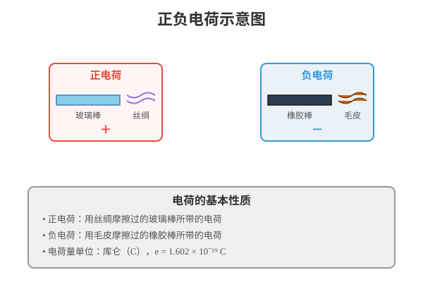
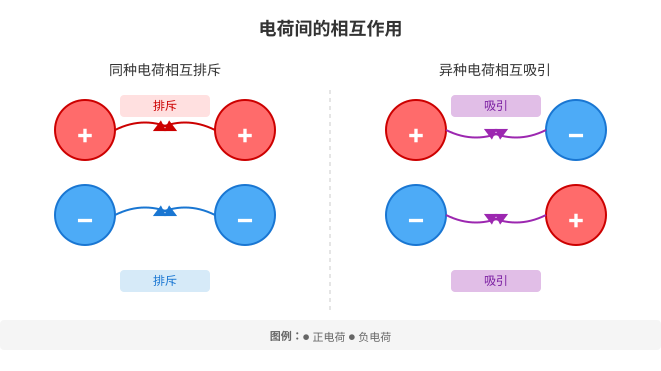
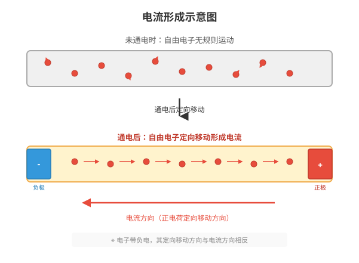

# 1.1 电荷与电流

## 一、电荷的种类

自然界中存在两种电荷：**正电荷**和**负电荷**。

- **正电荷**：用丝绸摩擦过的玻璃棒所带的电荷称为正电荷（用"+"表示）。
- **负电荷**：用毛皮摩擦过的橡胶棒所带的电荷称为负电荷（用"−"表示）。

### 电荷间的相互作用

同种电荷相互排斥，异种电荷相互吸引。这一规律是静电学的基础。

电荷的多少称为**电荷量**，用符号 $Q$ 或 $q$ 表示，国际单位是**库仑**（C）。一个电子所带的电荷量为：

$$
e = 1.602 \times 10^{-19} \, \text{C}
$$

任何带电体所带的电荷量都是 $e$ 的整数倍。

## 二、导体与绝缘体

- **导体**：容易导电的物体，如金属、石墨、人体、大地、酸碱盐溶液等。导体内部存在大量可以自由移动的电荷（自由电子或离子）。
- **绝缘体**：不容易导电的物体，如橡胶、塑料、玻璃、陶瓷、干燥的空气等。绝缘体内部几乎没有自由移动的电荷。

> 导体与绝缘体之间没有绝对的界限，在特定条件下（如高温、高压、潮湿）绝缘体也可能变为导体。

## 三、电流的形成与方向

### 电流的形成

电荷的**定向移动**形成电流。在金属导体中，自由电子定向移动形成电流；在溶液中，正、负离子定向移动形成电流。

### 电流的方向

规定**正电荷定向移动的方向**为电流方向。在金属导体中，自由电子带负电，其定向移动方向与电流方向相反。

### 电流的大小

电流强度（简称电流）表示电流的强弱，用符号 $I$ 表示，国际单位是**安培**（A）。常用的单位还有毫安（mA）和微安（μA）：

$$
1 \, \text{A} = 10^3 \, \text{mA} = 10^6 \, \mu\text{A}
$$

电流的定义式为：

$$
I = \frac{Q}{t}
$$

其中 $Q$ 是通过导体横截面的电荷量（单位：C），$t$ 是通电时间（单位：s）。

## 四、电流的测量——电流表

电流表是测量电路中电流大小的仪表。

### 电流表的使用规则

1. **串联**：电流表必须串联在被测电路中。
2. **正进负出**：电流从"+"接线柱流入，从"−"接线柱流出。
3. **不超量程**：被测电流不得超过电流表的量程。
4. **禁止短路**：绝对不允许将电流表直接接在电源两端（电流表内阻极小，相当于导线）。

### 电流表的读数

- 先看清量程：常用量程有 0\~0.6 A 和 0\~3 A。
- 再认清分度值：0\~0.6 A 量程的分度值为 0.02 A；0\~3 A 量程的分度值为 0.1 A。
- 读数时视线应与指针所指刻度垂直。

## 五、小结

| 概念         | 说明                   |
| ------------ | ---------------------- |
| 正电荷       | 丝绸摩擦玻璃棒所带电荷 |
| 负电荷       | 毛皮摩擦橡胶棒所带电荷 |
| 电荷相互作用 | 同种相斥，异种相吸     |
| 电流方向     | 正电荷定向移动的方向   |
| 电流定义     | $I = Q/t$            |
| 电流表       | 串联使用，正进负出     |
