# 1.3 欧姆定律

## 一、欧姆定律

德国物理学家欧姆通过大量实验得出：导体中的电流，跟导体两端的电压成正比，跟导体的电阻成反比。这就是**欧姆定律**。

### 欧姆定律公式

$$
I = \frac{U}{R}
$$

其中：

- $I$ 表示电流，单位：安培（A）
- $U$ 表示电压，单位：伏特（V）
- $R$ 表示电阻，单位：欧姆（Ω）

### 公式的变形

由欧姆定律可推导出：

$$
U = IR \quad \text{（求电压）}
$$

$$
R = \frac{U}{I} \quad \text{（求电阻）}
$$

> **注意**：$R = U/I$ 是电阻的计算式，但电阻 $R$ 的大小由导体本身决定（材料、长度、横截面积、温度），与 $U$ 和 $I$ 无关。

## 二、伏安法测电阻

伏安法通过测量电阻两端的电压和通过电阻的电流，利用欧姆定律 $R = U/I$ 计算电阻值。

### 实验电路

### 实验步骤

1. 按照电路图连接实物图，开关处于断开状态。
2. 将滑动变阻器滑片调至阻值最大端（保护电路）。
3. 闭合开关，调节滑动变阻器，记录多组电压表和电流表的示数。
4. 根据 $R = U/I$ 计算电阻值，取平均值以减小误差。

### 两种接法的比较

| 接法     | 电流表外接                                | 电流表内接                                |
| -------- | ----------------------------------------- | ----------------------------------------- |
| 电路特点 | 电流表在电压表外侧                        | 电流表在电压表内侧                        |
| 测量结果 | $R_{\text{测}} < R_{\text{真}}$（偏小） | $R_{\text{测}} > R_{\text{真}}$（偏大） |
| 适用条件 | 待测电阻较小时                            | 待测电阻较大时                            |

## 三、串并联电路的等效电阻

### 串联电路

串联电路的总电阻（等效电阻）等于各串联电阻之和：

$$
R_{\text{总}} = R_1 + R_2 + \cdots + R_n
$$

当 $n$ 个相同的电阻 $R_0$ 串联时：

$$
R_{\text{总}} = nR_0
$$

**串联分压规律**：串联电路中，各电阻两端的电压与电阻成正比：

$$
\frac{U_1}{U_2} = \frac{R_1}{R_2}
$$

### 并联电路

并联电路的总电阻（等效电阻）的倒数等于各并联电阻的倒数之和：

$$
\frac{1}{R_{\text{总}}} = \frac{1}{R_1} + \frac{1}{R_2} + \cdots + \frac{1}{R_n}
$$

两个电阻并联的简化公式：

$$
R_{\text{总}} = \frac{R_1 R_2}{R_1 + R_2}
$$

当 $n$ 个相同的电阻 $R_0$ 并联时：

$$
R_{\text{总}} = \frac{R_0}{n}
$$

**并联分流规律**：并联电路中，通过各电阻的电流与电阻成反比：

$$
\frac{I_1}{I_2} = \frac{R_2}{R_1}
$$

## 四、小结

| 电路类型 | 等效电阻公式                                                         | 特点                   |
| -------- | -------------------------------------------------------------------- | ---------------------- |
| 串联     | $R_{\text{总}} = R_1 + R_2 + \cdots$                               | 越串越大，大于任一电阻 |
| 并联     | $\frac{1}{R_{\text{总}}} = \frac{1}{R_1} + \frac{1}{R_2} + \cdots$ | 越并越小，小于任一电阻 |

欧姆定律是电学中最基本的定律之一，它揭示了电流、电压和电阻三者之间的定量关系，是分析和计算电路的基础。
