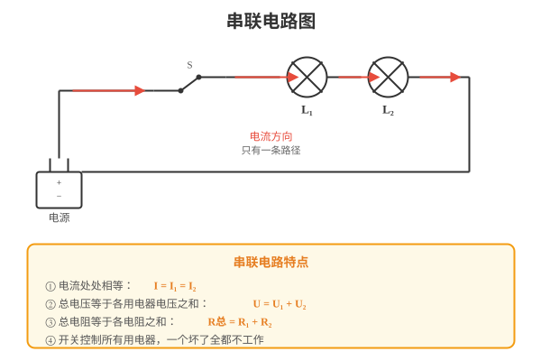
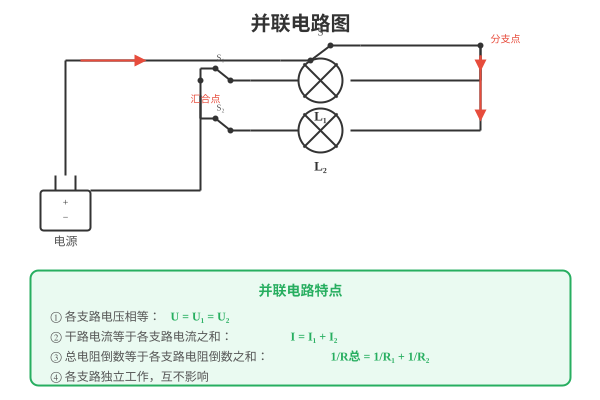
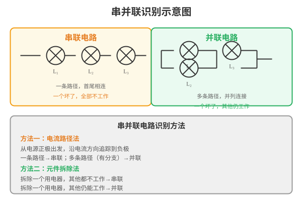

# 1.5 串联与并联电路

## 一、串联电路

### 串联电路的定义

将电路元件**逐个依次连接**起来组成的电路称为串联电路。串联电路中电流只有一条路径，没有分支。



### 串联电路的特点

#### 1. 电流特点——电流处处相等

串联电路中，通过各元件的电流处处相等：

$$
I = I_1 = I_2 = \cdots = I_n
$$

##### 本质原因

**① 电荷守恒（根本原因）**

在稳恒直流电路中，电荷不会在电路中任何一点堆积。对串联电路中的任意一个截面，**单位时间内流入的电荷量等于流出的电荷量**。如果某处电流不同，意味着电荷在中间累积，这不可能持续稳定。

**② 唯一路径（几何约束）**

串联电路中电流只有**一条路径**，没有分支。电子从电源正极出发，必须依次经过所有元件，没有第二条路可走，因此通过任一截面的电荷量必然相同。

**③ 电磁波视角（深层机制）**

当开关闭合时，电源在导线两端建立电场，电场变化以电磁波形式沿导线传播，速度接近光速。串联电路构成一个**单回路波导结构**，电磁波在回路中建立稳态后，整个回路中任意截面的电磁场通量必须一致，迫使电流处处相等。

**深入理解：两个速度的区分**

在电路中存在两个完全不同的速度：

| 概念                     | 速度量级                 | 说明                        |
| ------------------------ | ------------------------ | --------------------------- |
| **电子漂移速度**   | ~0.1 mm/s                | 电子实际定向移动的速率      |
| **电磁场传播速度** | ~3×10⁸ m/s（接近光速） | 电场/电磁波沿导线传播的速率 |

开关闭合的瞬间，发生的不是"电子从正极跑到了负极"，而是：

1. 电源在导线两端建立起电场，电场变化以电磁波的形式沿导线传播，速度接近光速。
2. 导线作为**波导**引导电磁波沿着电路路径传播。在串联电路中，电磁波只有一条路径可走，必须依次经过每个元件。
3. 电磁波以接近光速在整个回路中建立稳态，迫使整个回路中任意截面的电荷流动速率相同，形成处处相等的电流。

> 类比（水波 vs 水管）：水波沿水面传播的速度远快于水分子实际运动的速率。电磁波沿导线传播的速度也远快于电子漂移的速率。电磁波强迫电子整体定向移动，就像水波强迫水分子集体运动一样。

> 类比（水流）：就像一根水管，水只能从一端流向另一端，中间没有分支，那么水管任意位置的"水流强度"（单位时间通过的水量）必然相同。

#### 2. 电压特点——总电压等于各用电器电压之和

串联电路两端的总电压等于各用电器两端电压之和：

$$
U = U_1 + U_2 + \cdots + U_n
$$

#### 3. 电阻特点——总电阻等于各电阻之和

$$
R_{\text{总}} = R_1 + R_2 + \cdots + R_n
$$

#### 4. 分压规律

串联电路中，各电阻两端的电压与电阻成正比：

$$
\frac{U_1}{U_2} = \frac{R_1}{R_2}
$$

##### 本质原因

串联电路中电流处处相等（$I$ 相同），由欧姆定律 $U = IR$ 可得：

$$
U_1 = I R_1,\quad U_2 = I R_2,\quad \cdots,\quad U_n = I R_n
$$

因此 $U \propto R$，电阻越大，两端电压降越大。

**微观解释**：为了维持相同的电流 $I$ 通过不同阻值的电阻，电阻内部的电场强度 $E$ 会自适应调整。大电阻需要更强的电场来推动电子通过，因此两端电压降 $U = EL$ 更大；小电阻只需要较弱的电场，因此电压降更小。这个"电场自适应分配"由电磁波在回路中建立稳态时自动完成。

**深入理解：欧姆定律的微观形式**

欧姆定律的宏观形式 $U = IR$ 源于微观层面的规律：

$$
J = \sigma E
$$

其中 $J$ 是电流密度（单位面积通过的电流），$\sigma$ 是电导率（材料固有属性），$E$ 是电场强度。

对于长度为 $L$ 的均匀导体，两端电压为：

$$
U = \int E \cdot dl = E \cdot L
$$

当电流通过不同阻值的电阻时，为了维持**相同的电流密度 $J$**（因为串联电路中电流处处相等，且导线截面通常相同），电阻率大（$\sigma$ 小）的材料需要更大的电场强度 $E$ 来推动电子，因此两端电压降 $U = EL$ 更大。这就是分压规律的微观物理本质。

> 类比：粗细不同的水管串联，相同水流通过时，细管（大阻力）两端水压差更大，粗管（小阻力）两端水压差更小。

### 串联电路应用

- 节日小彩灯（一个坏了整串不亮）
- 开关控制整个电路（开关位置不影响控制效果）

## 二、并联电路

### 并联电路的定义

将电路元件**并列连接**在电路两点之间组成的电路称为并联电路。并联电路中有多条电流路径，有分支点和汇合点。



### 并联电路的特点

#### 1. 电压特点——各支路电压相等

并联电路中，各支路两端的电压相等：

$$
U = U_1 = U_2 = \cdots = U_n
$$

##### 本质原因

**① 同一对节点（电路拓扑）**

并联电路中，所有支路的两端都连接在**相同的两个节点**上。节点是电路中电势唯一确定的点，因此任意两个节点之间的**电势差（电压）是唯一确定的**，与电流走哪条路径无关。

```
   ┌───•A───┐
   │   │   │
   │  R₁ R₂ │
   │   │   │
   └───•B───┘
```

无论从 A 到 B 经过 R₁ 还是 R₂，A、B 两点之间的电势差都是同一个值，所以 $U_{R_1} = U_{R_2} = U_{AB}$。

**② 保守电场的路径无关性（电磁学）**

在静电场和稳恒电路中，电场是**保守场**，满足：

$$
\oint \vec{E} \cdot d\vec{l} = 0
$$

这意味着**将单位电荷从 A 点移动到 B 点，电场力做的功与路径无关**。无论电荷走哪条支路，A、B 之间的电势差都相同。

**③ 电磁波建立稳态电势分布（微观机制）**

当开关闭合时，电磁波以接近光速在整个电路中传播，在电路建立稳态之前，电磁波已经"告知"了所有节点各自的电势。对于并联电路的两个公共节点，电磁波在它们之间建立了一个固定的电势差（等于电源电压），这个电势差不会因为电流走了哪条支路而改变。

**对比串联**

|                    | **串联**                            | **并联**                   |
| ------------------ | ----------------------------------------- | -------------------------------- |
| **电流路径** | 唯一路径，电流必须依次通过每个电阻        | 多条路径，电流在节点处分流       |
| **电压**     | 总电压分摊到各电阻（分压）                | 各支路电压相等（不分压）         |
| **根本原因** | 电流处处相等，$U = IR$，$U \propto R$ | 各支路连接同一对节点，电势差唯一 |

> 类比：两个水箱之间并联多根水管，每根水管两端的水压差相同，因为两个水箱的水位差是固定的，与水流走哪根管无关。

#### 2. 电流特点——干路电流等于各支路电流之和

$$
I = I_1 + I_2 + \cdots + I_n
$$

#### 3. 电阻特点——总电阻的倒数等于各电阻倒数之和

$$
\frac{1}{R_{\text{总}}} = \frac{1}{R_1} + \frac{1}{R_2} + \cdots + \frac{1}{R_n}
$$

两个电阻并联的简化公式：

$$
R_{\text{总}} = \frac{R_1 R_2}{R_1 + R_2}
$$

#### 4. 分流规律

并联电路中，通过各支路的电流与电阻成反比：

$$
\frac{I_1}{I_2} = \frac{R_2}{R_1}
$$

### 并联电路应用

- 家庭电路中的各用电器（一个坏了不影响其他）
- 各支路有独立开关控制

## 三、串并联电路的识别与简化

### 识别方法



**方法一：电流路径法**

从电源正极出发，沿着电流方向追踪到电源负极：

- 若只有一条路径，则为串联。
- 若有两条或以上路径（有分支 → 汇合），则为并联。

**方法二：元件拆除法**

拆除一个用电器：

- 若其他用电器都不工作，则为串联。
- 若其他用电器仍能工作，则为并联。

**方法三：节点法**

- 在电路中找出各元件的连接点。
- 若元件首尾相连（无分支），则为串联。
- 若元件两端分别连接在相同的两个节点上，则为并联。

### 电路简化原则

1. **导线视为可伸缩**：同一导线上的各点电势相同，可合并为一点。
2. **电流表视为导线**（内阻极小）。
3. **电压表视为断路**（内阻极大）。
4. **开关闭合视为导线**，断开视为断路。

## 四、串并联电路的对比总结

| 特征                | 串联电路                   | 并联电路                                                 |
| ------------------- | -------------------------- | -------------------------------------------------------- |
| **连接方式**  | 首尾相连                   | 并列连接                                                 |
| **电流路径**  | 一条                       | 多条                                                     |
| **电流关系**  | $I = I_1 = I_2 = \cdots$ | $I = I_1 + I_2 + \cdots$                               |
| **电压关系**  | $U = U_1 + U_2 + \cdots$ | $U = U_1 = U_2 = \cdots$                               |
| **电阻关系**  | $R = R_1 + R_2 + \cdots$ | $\frac{1}{R} = \frac{1}{R_1} + \frac{1}{R_2} + \cdots$ |
| **分压/分流** | 分压：$U \propto R$      | 分流：$I \propto 1/R$                                  |
| **开关作用**  | 控制所有用电器             | 干路开关控制整体，支路开关控制支路                       |

## 五、电路图绘制规范

绘制电路图时应注意：

1. 使用统一的电路元件符号。
2. 导线要横平竖直，拐弯处画成直角。
3. 元件不能画在拐角处。
4. 合理安排元件位置，使电路图简洁、美观、易于识别。
