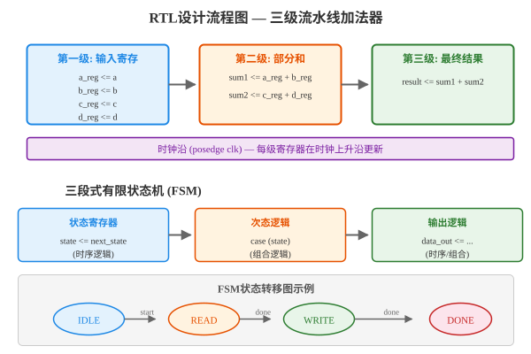

# 6.5 RTL设计

## 1. 概述

RTL（Register Transfer Level）设计是数字集成电路设计的核心环节，使用硬件描述语言（HDL）在寄存器传输级描述数字电路的行为。本章将系统介绍RTL设计的基础知识、语法规则和设计方法。

## 2. Verilog HDL基础语法

### 2.1 模块与端口

模块（Module）是Verilog的基本设计单元：

```verilog
module module_name (
    input  wire  clk,
    input  wire  rst_n,
    input  wire  [7:0] data_in,
    output reg   [7:0] data_out
);
    // 模块内部逻辑
endmodule
```

### 2.2 端口类型

| 端口类型 | 关键字 | 说明             |
| -------- | ------ | ---------------- |
| 输入端口 | input  | 只能从外部读取   |
| 输出端口 | output | 可以驱动外部信号 |
| 双向端口 | inout  | 既可输入也可输出 |

## 3. 数据类型

### 3.1 wire类型

wire表示连线，用于组合逻辑的输出：

```verilog
wire [7:0] sum;
wire       flag;
```

### 3.2 reg类型

reg表示寄存器，用于在always块中存储值：

```verilog
reg  [7:0] counter;
reg        state;
```

### 3.3 integer类型

integer用于循环和计算：

```verilog
integer i;
```

### 3.4 parameter类型

parameter用于定义常量：

```verilog
parameter DATA_WIDTH = 8;
parameter DEPTH = 16;
```

## 4. 连续赋值（assign）

连续赋值用于描述组合逻辑：

```verilog
wire [3:0] a, b;
wire [4:0] sum;

assign sum = a + b;
```

## 5. 过程块

### 5.1 always块

always块是Verilog中最常用的过程块，用于描述时序逻辑和组合逻辑：

```verilog
// 时序逻辑（同步复位）
always @(posedge clk or negedge rst_n) begin
    if (!rst_n)
        q <= 1'b0;
    else
        q <= d;
end

// 组合逻辑
always @(*) begin
    case (sel)
        2'b00: y = a;
        2'b01: y = b;
        2'b10: y = c;
        default: y = d;
    endcase
end
```

### 5.2 initial块

initial块用于仿真初始化，在0时刻执行一次：

```verilog
initial begin
    clk = 0;
    rst_n = 0;
    #100 rst_n = 1;
end
```

## 6. 阻塞赋值与非阻塞赋值

### 6.1 阻塞赋值（=）

阻塞赋值顺序执行，用于组合逻辑：

```verilog
always @(*) begin
    b = a;
    c = b;  // c = a
end
```

### 6.2 非阻塞赋值（<=）

非阻塞赋值并行执行，用于时序逻辑：

```verilog
always @(posedge clk) begin
    b <= a;
    c <= b;  // c = 旧值b
end
```

### 6.3 赋值规则

| 类型       | 赋值符号 | 适用场景 | 执行方式 |
| ---------- | -------- | -------- | -------- |
| 阻塞赋值   | =        | 组合逻辑 | 顺序执行 |
| 非阻塞赋值 | <=       | 时序逻辑 | 并行执行 |

## 7. 时序逻辑建模

### 7.1 寄存器

```verilog
// D触发器
always @(posedge clk or negedge rst_n) begin
    if (!rst_n)
        q <= 1'b0;
    else
        q <= d;
end
```

### 7.2 计数器

```verilog
// 模16计数器
always @(posedge clk or negedge rst_n) begin
    if (!rst_n)
        cnt <= 4'b0;
    else if (cnt == 4'd15)
        cnt <= 4'b0;
    else
        cnt <= cnt + 1'b1;
end
```

### 7.3 移位寄存器

```verilog
// 8位移位寄存器
always @(posedge clk or negedge rst_n) begin
    if (!rst_n)
        shift_reg <= 8'b0;
    else
        shift_reg <= {shift_reg[6:0], data_in};
end
```

## 8. 组合逻辑建模

### 8.1 使用assign

```verilog
assign y = (a & b) | (c & d);
```

### 8.2 使用always@(*)

```verilog
always @(*) begin
    case (sel)
        2'b00: y = a;
        2'b01: y = b;
        2'b10: y = c;
        2'b11: y = d;
    endcase
end
```

## 9. 行为级与结构化建模

### 9.1 行为级建模

描述电路的功能行为，不关心具体结构：

```verilog
always @(posedge clk) begin
    if (en)
        data_out <= data_in;
end
```

### 9.2 结构化建模

实例化底层模块，描述电路的层次结构：

```verilog
// 顶层模块
module top (
    input  clk,
    input  rst_n,
    input  [7:0] a,
    input  [7:0] b,
    output [8:0] sum
);
    wire [7:0] a_reg, b_reg;
  
    // 实例化寄存器模块
    reg_8bit u_reg_a (
        .clk    (clk),
        .rst_n  (rst_n),
        .d      (a),
        .q      (a_reg)
    );
  
    reg_8bit u_reg_b (
        .clk    (clk),
        .rst_n  (rst_n),
        .d      (b),
        .q      (b_reg)
    );
  
    // 实例化加法器
    adder_8bit u_adder (
        .a      (a_reg),
        .b      (b_reg),
        .sum    (sum)
    );
endmodule
```

## 10. FSM的RTL描述

### 10.1 状态编码

```verilog
// 状态定义
localparam IDLE   = 3'b001;
localparam READ   = 3'b010;
localparam WRITE  = 3'b100;
```

### 10.2 三段式FSM

```verilog
// 状态寄存器
always @(posedge clk or negedge rst_n) begin
    if (!rst_n)
        state <= IDLE;
    else
        state <= next_state;
end

// 次态逻辑
always @(*) begin
    case (state)
        IDLE:  next_state = start ? READ : IDLE;
        READ:  next_state = done ? WRITE : READ;
        WRITE: next_state = done ? IDLE : WRITE;
        default: next_state = IDLE;
    endcase
end

// 输出逻辑
always @(posedge clk or negedge rst_n) begin
    if (!rst_n) begin
        data_out <= 1'b0;
        valid    <= 1'b0;
    end else begin
        case (next_state)
            READ:  data_out <= data_in;
            WRITE: valid <= 1'b1;
            default: begin
                data_out <= 1'b0;
                valid    <= 1'b0;
            end
        endcase
    end
end
```

## 11. 流水线设计

### 11.1 流水线概念

流水线通过在组合逻辑中插入寄存器，将长路径分割为多个短路径，提高系统时钟频率。



### 11.2 流水线示例

```verilog
// 三级流水线加法器
module pipeline_adder (
    input  clk,
    input  rst_n,
    input  [7:0] a, b, c, d,
    output reg [9:0] result
);
    reg [8:0] sum1, sum2;
    reg [7:0] a_reg, b_reg, c_reg, d_reg;
  
    // 第一级：输入寄存
    always @(posedge clk) begin
        a_reg <= a;
        b_reg <= b;
        c_reg <= c;
        d_reg <= d;
    end
  
    // 第二级：部分和
    always @(posedge clk) begin
        sum1 <= a_reg + b_reg;
        sum2 <= c_reg + d_reg;
    end
  
    // 第三级：最终结果
    always @(posedge clk) begin
        result <= sum1 + sum2;
    end
endmodule
```

## 12. 同步FIFO设计


### 12.1 FIFO核心代码

```verilog
module sync_fifo #(
    parameter DATA_WIDTH = 8,
    parameter DEPTH = 16
)(
    input  clk,
    input  rst_n,
    input  wr_en,
    input  rd_en,
    input  [DATA_WIDTH-1:0] data_in,
    output reg [DATA_WIDTH-1:0] data_out,
    output full,
    output empty
);
    localparam ADDR_WIDTH = $clog2(DEPTH);
  
    reg [DATA_WIDTH-1:0] mem [0:DEPTH-1];
    reg [ADDR_WIDTH:0] wr_ptr, rd_ptr;  // 多1位用于判断空满
  
    assign full  = (wr_ptr[ADDR_WIDTH] != rd_ptr[ADDR_WIDTH]) && 
                   (wr_ptr[ADDR_WIDTH-1:0] == rd_ptr[ADDR_WIDTH-1:0]);
    assign empty = (wr_ptr == rd_ptr);
  
    always @(posedge clk or negedge rst_n) begin
        if (!rst_n) begin
            wr_ptr <= 0;
            rd_ptr <= 0;
        end else begin
            if (wr_en && !full) begin
                mem[wr_ptr[ADDR_WIDTH-1:0]] <= data_in;
                wr_ptr <= wr_ptr + 1;
            end
            if (rd_en && !empty) begin
                data_out <= mem[rd_ptr[ADDR_WIDTH-1:0]];
                rd_ptr <= rd_ptr + 1;
            end
        end
    end
endmodule
```

## 13. 跨时钟域同步

### 13.1 亚稳态问题

当信号跨时钟域传输时，可能发生亚稳态（Metastability），导致逻辑错误。

### 13.2 双级同步器


```verilog
// 双级同步器
module sync_2stage (
    input  clk_dst,
    input  rst_n,
    input  data_in,
    output data_out
);
    reg sync_reg1, sync_reg2;
  
    always @(posedge clk_dst or negedge rst_n) begin
        if (!rst_n) begin
            sync_reg1 <= 1'b0;
            sync_reg2 <= 1'b0;
        end else begin
            sync_reg1 <= data_in;
            sync_reg2 <= sync_reg1;
        end
    end
  
    assign data_out = sync_reg2;
endmodule
```

### 13.3 异步FIFO

异步FIFO使用格雷码（Gray Code）指针进行跨时钟域同步，确保多比特信号的正确传输。

## 14. 同步/异步复位

### 14.1 同步复位

```verilog
always @(posedge clk) begin
    if (rst_n)  // 仅在时钟沿检查复位
        q <= 1'b0;
    else
        q <= d;
end
```

### 14.2 异步复位

```verilog
always @(posedge clk or negedge rst_n) begin
    if (!rst_n)  // 立即复位
        q <= 1'b0;
    else
        q <= d;
end
```

### 14.3 异步复位同步释放

```verilog
// 异步复位同步释放
reg rst_n_sync1, rst_n_sync2;

always @(posedge clk or negedge rst_n) begin
    if (!rst_n) begin
        rst_n_sync1 <= 1'b0;
        rst_n_sync2 <= 1'b0;
    end else begin
        rst_n_sync1 <= 1'b1;
        rst_n_sync2 <= rst_n_sync1;
    end
end

assign rst_n_sync = rst_n_sync2;
```

## 15. 可综合代码风格

### 15.1 可综合与不可综合

| 可综合                    | 不可综合            |
| ------------------------- | ------------------- |
| assign                    | initial             |
| always @(posedge/negedge) | #延迟               |
| always @(*)               | wait                |
| case/if-else              | force/release       |
| 算术运算                  | $display/$monitor |
| 寄存器/线网               | 文件操作            |

### 15.2 设计规范

1. 避免产生锁存器（Latch）：确保组合逻辑中所有条件分支都有赋值
2. 避免组合逻辑反馈环路
3. 使用参数化设计提高可重用性
4. 模块接口清晰，功能单一
5. 添加适当的注释

## 16. VHDL基础

VHDL是另一种广泛使用的硬件描述语言，其基本结构如下：

```vhdl
entity counter is
    port (
        clk    : in  std_logic;
        rst_n  : in  std_logic;
        en     : in  std_logic;
        count  : out std_logic_vector(7 downto 0)
    );
end entity;

architecture rtl of counter is
    signal cnt_reg : unsigned(7 downto 0);
begin
    process(clk, rst_n)
    begin
        if rst_n = '0' then
            cnt_reg <= (others => '0');
        elsif rising_edge(clk) then
            if en = '1' then
                cnt_reg <= cnt_reg + 1;
            end if;
        end if;
    end process;
  
    count <= std_logic_vector(cnt_reg);
end architecture;
```

## 17. SystemVerilog简介

SystemVerilog是Verilog的扩展，增加了许多高级功能：

### 17.1 接口（Interface）

```systemverilog
interface bus_if;
    logic [31:0] addr;
    logic [31:0] data;
    logic        rw;
    logic        valid;
    logic        ready;
endinterface
```

### 17.2 枚举类型

```systemverilog
typedef enum logic [1:0] {
    IDLE  = 2'b00,
    READ  = 2'b01,
    WRITE = 2'b10
} state_t;
```

### 17.3 结构体和联合体

```systemverilog
typedef struct {
    logic [31:0] addr;
    logic [31:0] data;
    logic        rw;
} packet_t;
```

## 总结

RTL设计是数字IC设计的核心技能。本章介绍了Verilog HDL的基础语法、建模方法、FSM设计、流水线设计、跨时钟域同步等关键内容。良好的RTL设计风格和代码规范对于后续的综合、验证和物理设计至关重要。
