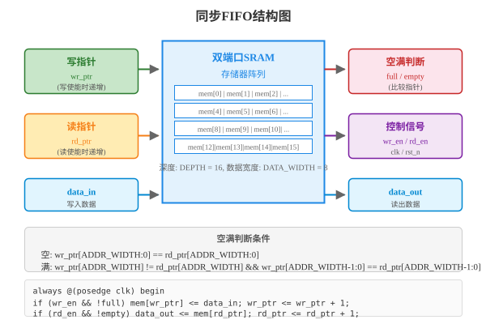
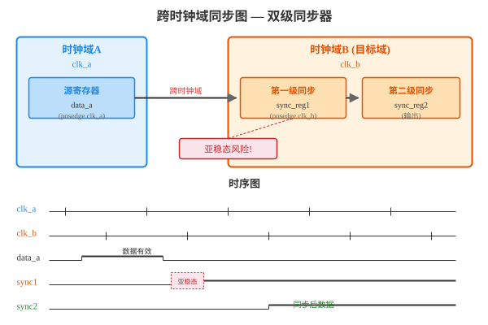

# 6.5 RTL设计

## 1. 概述

RTL（Register Transfer Level）设计是数字集成电路设计的核心环节，使用硬件描述语言（HDL）在寄存器传输级描述数字电路的行为。本章将系统介绍RTL设计的基础知识、语法规则和设计方法。

## 2. Verilog HDL基础语法

### 2.1 模块与端口

模块（Module）是Verilog的基本设计单元：

```verilog
module module_name (
    input  wire  clk,
    input  wire  rst_n,
    input  wire  [7:0] data_in,
    output reg   [7:0] data_out
);
    // 模块内部逻辑
endmodule
```

### 2.2 端口类型

| 端口类型 | 关键字 | 说明             |
| -------- | ------ | ---------------- |
| 输入端口 | input  | 只能从外部读取   |
| 输出端口 | output | 可以驱动外部信号 |
| 双向端口 | inout  | 既可输入也可输出 |

## 3. 数据类型

### 3.1 wire类型

wire表示连线，用于组合逻辑的输出：

```verilog
wire [7:0] sum;
wire       flag;
```

### 3.2 reg类型

reg表示寄存器，用于在always块中存储值：

```verilog
reg  [7:0] counter;
reg        state;
```

### 3.3 integer类型

integer用于循环和计算：

```verilog
integer i;
```

### 3.4 parameter类型

parameter用于定义常量：

```verilog
parameter DATA_WIDTH = 8;
parameter DEPTH = 16;
```

## 4. 连续赋值（assign）

连续赋值用于描述组合逻辑：

```verilog
wire [3:0] a, b;
wire [4:0] sum;

assign sum = a + b;
```

## 5. 过程块

### 5.1 always块

always块是Verilog中最常用的过程块，用于描述时序逻辑和组合逻辑：

```verilog
// 时序逻辑（同步复位）
always @(posedge clk or negedge rst_n) begin
    if (!rst_n)
        q <= 1'b0;
    else
        q <= d;
end

// 组合逻辑
always @(*) begin
    case (sel)
        2'b00: y = a;
        2'b01: y = b;
        2'b10: y = c;
        default: y = d;
    endcase
end
```

### 5.2 initial块

initial块用于仿真初始化，在0时刻执行一次：

```verilog
initial begin
    clk = 0;
    rst_n = 0;
    #100 rst_n = 1;
end
```

## 6. 阻塞赋值与非阻塞赋值

### 6.1 阻塞赋值（=）

阻塞赋值顺序执行，用于组合逻辑：

```verilog
always @(*) begin
    b = a;
    c = b;  // c = a
end
```

### 6.2 非阻塞赋值（<=）

非阻塞赋值并行执行，用于时序逻辑：

```verilog
always @(posedge clk) begin
    b <= a;
    c <= b;  // c = 旧值b
end
```

### 6.3 赋值规则

| 类型       | 赋值符号 | 适用场景 | 执行方式 |
| ---------- | -------- | -------- | -------- |
| 阻塞赋值   | =        | 组合逻辑 | 顺序执行 |
| 非阻塞赋值 | <=       | 时序逻辑 | 并行执行 |

## 7. 时序逻辑建模

### 7.1 寄存器

```verilog
// D触发器
always @(posedge clk or negedge rst_n) begin
    if (!rst_n)
        q <= 1'b0;
    else
        q <= d;
end
```

### 7.2 计数器

```verilog
// 模16计数器
always @(posedge clk or negedge rst_n) begin
    if (!rst_n)
        cnt <= 4'b0;
    else if (cnt == 4'd15)
        cnt <= 4'b0;
    else
        cnt <= cnt + 1'b1;
end
```

### 7.3 移位寄存器

```verilog
// 8位移位寄存器
always @(posedge clk or negedge rst_n) begin
    if (!rst_n)
        shift_reg <= 8'b0;
    else
        shift_reg <= {shift_reg[6:0], data_in};
end
```

## 8. 组合逻辑建模

### 8.1 使用assign

```verilog
assign y = (a & b) | (c & d);
```

### 8.2 使用always@(*)

```verilog
always @(*) begin
    case (sel)
        2'b00: y = a;
        2'b01: y = b;
        2'b10: y = c;
        2'b11: y = d;
    endcase
end
```

## 9. 行为级与结构化建模

### 9.1 行为级建模

描述电路的功能行为，不关心具体结构：

```verilog
always @(posedge clk) begin
    if (en)
        data_out <= data_in;
end
```

### 9.2 结构化建模

实例化底层模块，描述电路的层次结构：

```verilog
// 顶层模块
module top (
    input  clk,
    input  rst_n,
    input  [7:0] a,
    input  [7:0] b,
    output [8:0] sum
);
    wire [7:0] a_reg, b_reg;
  
    // 实例化寄存器模块
    reg_8bit u_reg_a (
        .clk    (clk),
        .rst_n  (rst_n),
        .d      (a),
        .q      (a_reg)
    );
  
    reg_8bit u_reg_b (
        .clk    (clk),
        .rst_n  (rst_n),
        .d      (b),
        .q      (b_reg)
    );
  
    // 实例化加法器
    adder_8bit u_adder (
        .a      (a_reg),
        .b      (b_reg),
        .sum    (sum)
    );
endmodule
```

## 10. FSM的RTL描述

### 10.1 状态编码

```verilog
// 状态定义
localparam IDLE   = 3'b001;
localparam READ   = 3'b010;
localparam WRITE  = 3'b100;
```

### 10.2 三段式FSM

```verilog
// 状态寄存器
always @(posedge clk or negedge rst_n) begin
    if (!rst_n)
        state <= IDLE;
    else
        state <= next_state;
end

// 次态逻辑
always @(*) begin
    case (state)
        IDLE:  next_state = start ? READ : IDLE;
        READ:  next_state = done ? WRITE : READ;
        WRITE: next_state = done ? IDLE : WRITE;
        default: next_state = IDLE;
    endcase
end

// 输出逻辑
always @(posedge clk or negedge rst_n) begin
    if (!rst_n) begin
        data_out <= 1'b0;
        valid    <= 1'b0;
    end else begin
        case (next_state)
            READ:  data_out <= data_in;
            WRITE: valid <= 1'b1;
            default: begin
                data_out <= 1'b0;
                valid    <= 1'b0;
            end
        endcase
    end
end
```

## 11. 流水线设计

### 11.1 流水线概念

流水线通过在组合逻辑中插入寄存器，将长路径分割为多个短路径，提高系统时钟频率。


### 11.2 流水线示例

```verilog
// 三级流水线加法器
module pipeline_adder (
    input  clk,
    input  rst_n,
    input  [7:0] a, b, c, d,
    output reg [9:0] result
);
    reg [8:0] sum1, sum2;
    reg [7:0] a_reg, b_reg, c_reg, d_reg;
  
    // 第一级：输入寄存
    always @(posedge clk) begin
        a_reg <= a;
        b_reg <= b;
        c_reg <= c;
        d_reg <= d;
    end
  
    // 第二级：部分和
    always @(posedge clk) begin
        sum1 <= a_reg + b_reg;
        sum2 <= c_reg + d_reg;
    end
  
    // 第三级：最终结果
    always @(posedge clk) begin
        result <= sum1 + sum2;
    end
endmodule
```

## 12. 同步FIFO设计



### 12.1 FIFO核心代码

```verilog
module sync_fifo #(
    parameter DATA_WIDTH = 8,
    parameter DEPTH = 16
)(
    input  clk,
    input  rst_n,
    input  wr_en,
    input  rd_en,
    input  [DATA_WIDTH-1:0] data_in,
    output reg [DATA_WIDTH-1:0] data_out,
    output full,
    output empty
);
    localparam ADDR_WIDTH = $clog2(DEPTH);
  
    reg [DATA_WIDTH-1:0] mem [0:DEPTH-1];
    reg [ADDR_WIDTH:0] wr_ptr, rd_ptr;  // 多1位用于判断空满
  
    assign full  = (wr_ptr[ADDR_WIDTH] != rd_ptr[ADDR_WIDTH]) && 
                   (wr_ptr[ADDR_WIDTH-1:0] == rd_ptr[ADDR_WIDTH-1:0]);
    assign empty = (wr_ptr == rd_ptr);
  
    always @(posedge clk or negedge rst_n) begin
        if (!rst_n) begin
            wr_ptr <= 0;
            rd_ptr <= 0;
        end else begin
            if (wr_en && !full) begin
                mem[wr_ptr[ADDR_WIDTH-1:0]] <= data_in;
                wr_ptr <= wr_ptr + 1;
            end
            if (rd_en && !empty) begin
                data_out <= mem[rd_ptr[ADDR_WIDTH-1:0]];
                rd_ptr <= rd_ptr + 1;
            end
        end
    end
endmodule
```

## 13. 跨时钟域同步

### 13.1 亚稳态问题

当信号跨时钟域传输时，可能发生亚稳态（Metastability），导致逻辑错误。

### 13.2 双级同步器



```verilog
// 双级同步器
module sync_2stage (
    input  clk_dst,
    input  rst_n,
    input  data_in,
    output data_out
);
    reg sync_reg1, sync_reg2;
  
    always @(posedge clk_dst or negedge rst_n) begin
        if (!rst_n) begin
            sync_reg1 <= 1'b0;
            sync_reg2 <= 1'b0;
        end else begin
            sync_reg1 <= data_in;
            sync_reg2 <= sync_reg1;
        end
    end
  
    assign data_out = sync_reg2;
endmodule
```

### 13.3 异步FIFO

异步FIFO使用格雷码（Gray Code）指针进行跨时钟域同步，确保多比特信号的正确传输。

## 14. 同步/异步复位

### 14.1 同步复位

```verilog
always @(posedge clk) begin
    if (rst_n)  // 仅在时钟沿检查复位
        q <= 1'b0;
    else
        q <= d;
end
```

### 14.2 异步复位

```verilog
always @(posedge clk or negedge rst_n) begin
    if (!rst_n)  // 立即复位
        q <= 1'b0;
    else
        q <= d;
end
```

### 14.3 异步复位同步释放

```verilog
// 异步复位同步释放
reg rst_n_sync1, rst_n_sync2;

always @(posedge clk or negedge rst_n) begin
    if (!rst_n) begin
        rst_n_sync1 <= 1'b0;
        rst_n_sync2 <= 1'b0;
    end else begin
        rst_n_sync1 <= 1'b1;
        rst_n_sync2 <= rst_n_sync1;
    end
end

assign rst_n_sync = rst_n_sync2;
```

## 15. 可综合代码风格

### 15.1 可综合与不可综合

| 可综合                    | 不可综合            |
| ------------------------- | ------------------- |
| assign                    | initial             |
| always @(posedge/negedge) | #延迟               |
| always @(*)               | wait                |
| case/if-else              | force/release       |
| 算术运算                  | $display/$monitor |
| 寄存器/线网               | 文件操作            |

### 15.2 设计规范

1. 避免产生锁存器（Latch）：确保组合逻辑中所有条件分支都有赋值
2. 避免组合逻辑反馈环路
3. 使用参数化设计提高可重用性
4. 模块接口清晰，功能单一
5. 添加适当的注释

## 16. RTL综合与数字设计流程

### 16.1 数字设计抽象层次

数字系统设计有多个抽象层次，从高到低依次为：

| 层次 | 描述 | 时序信息 |
|------|------|---------|
| 算法/系统级 | 功能算法描述，无硬件结构 | 无 |
| 寄存器传输级（RTL） | 寄存器与组合逻辑，有时钟沿 | 有时序 |
| 门级 | 基本逻辑门互连 | 有门延迟 |
| 电路级 | 晶体管级实现 | 有晶体管特性 |
| 版图级 | 物理掩模版图 | 有物理参数 |

### 16.2 RTL设计流程

RTL设计是整个数字芯片设计的核心环节，其流程包括：

1. **功能规格定义**：明确系统功能、性能指标、接口协议
2. **架构设计**：划分数据通路和控制单元，确定微架构
3. **RTL编码**：使用Verilog/SystemVerilog编写RTL代码
4. **功能仿真**：通过testbench验证RTL功能正确性
5. **逻辑综合**：将RTL代码转换为门级网表
6. **形式验证**：验证门级网表与RTL功能等价
7. **物理设计**：布局布线，生成版图

### 16.3 行为建模与架构综合

行为建模描述电路的功能行为，而非具体实现。架构综合将行为模型转换为RTL代码，包括两个关键步骤：

**调度（Scheduling）**：决定每个操作在哪个时钟周期执行。调度将操作分配到不同的时钟周期，影响面积和性能。

**绑定（Binding）**：决定每个操作使用哪个硬件资源。绑定将操作分配到具体的功能单元（加法器、多路选择器等）。

### 16.4 逻辑综合（Logic Synthesis）

逻辑综合是将RTL代码转换为门级网表的过程，包括三个子步骤：

**1. 逻辑优化（Logic Optimization）**：
- 布尔代数化简：化简逻辑表达式，减少门数
- 资源共享：识别并合并功能相同的硬件资源
- 逻辑等价变换：不改变功能的前提下优化电路结构

**2. 技术映射（Technology Mapping）**：
- 将优化后的逻辑映射到目标工艺库中的标准单元
- 选择最合适的门类型和尺寸，满足时序和面积约束
- 技术库包含：INV、NAND、NOR、AOI、OAI等标准单元

**3. 时序约束驱动优化**：
- 设定时钟频率、输入输出延迟
- 综合工具在关键路径上优化延迟
- 在非关键路径上优化面积和功耗

### 16.5 综合约束（Synthesis Constraints）

综合约束指导综合工具优化设计：

```verilog
// 时钟约束示例
create_clock -name clk -period 10 [get_ports clk]
set_clock_uncertainty -setup 0.2 [get_clocks clk]

// 输入输出延迟约束
set_input_delay -clock clk -max 2.0 [get_ports data_in]
set_output_delay -clock clk -max 3.0 [get_ports data_out]

// 伪路径约束（不存在的路径）
set_false_path -from [get_clocks rst_n]

// 多周期路径约束
set_multicycle_path -setup 2 -from [get_pins A_reg/CK] -to [get_pins B_reg/D]
```

## 17. Testbench编写

Testbench是用于验证RTL设计功能的测试平台，它实例化待测设计（DUT），施加测试激励，并检查输出响应。

### 17.1 基本Testbench结构

```verilog
module testbench;
    // 信号声明
    reg  clk, rst_n;
    reg  [7:0] data_in;
    wire [7:0] data_out;
  
    // 实例化待测设计（DUT）
    my_module dut (
        .clk     (clk),
        .rst_n   (rst_n),
        .data_in (data_in),
        .data_out(data_out)
    );
  
    // 时钟生成
    initial begin
        clk = 0;
        forever #5 clk = ~clk;  // 周期10个时间单位
    end
  
    // 测试激励
    initial begin
        // 初始化
        rst_n = 0;
        data_in = 0;
        #20 rst_n = 1;
      
        // 施加测试用例
        #10 data_in = 8'hA5;
        #10 data_in = 8'h5A;
        #10 data_in = 8'hFF;
      
        // 仿真结束
        #100 $finish;
    end
  
    // 自检测（可选）
    always @(posedge clk) begin
        if (data_out !== expected_value) begin
            $display("ERROR: time=%0t, expected=%h, got=%h", 
                     $time, expected_value, data_out);
        end
    end
endmodule
```

### 17.2 自检测Testbench

自检测testbench使用断言自动检查输出，无需人工比对波形：

```systemverilog
// SystemVerilog自检测testbench
module testbench_sv;
    logic       clk, rst_n;
    logic [3:0] a, b, y;
  
    // 实例化DUT
    sillyfunction dut (.a(a), .b(b), .y(y));
  
    // 时钟生成
    initial begin
        clk = 0;
        forever #5 clk = ~clk;
    end
  
    // 测试序列
    initial begin
        // 测试所有输入组合
        for (int i = 0; i < 4; i++) begin
            {a, b} = i;
            #10;
            // 自动检查结果
            assert (y === a & b) else 
                $error("a=%b, b=%b, y=%b (expected %b)", a, b, y, a & b);
        end
        #10 $finish;
    end
endmodule
```

### 17.3 仿真的关键概念

**延迟（#delay）**：仅用于仿真，不可综合。`#delay` 期间该块内的所有信号保持不变，但不影响其他块（如时钟生成块）。

**initial块**：用于仿真初始化，在0时刻开始执行，所有initial块并发执行。

**$display和$monitor**：
- `$display`：在仿真中打印信息，类似C语言的printf
- `$monitor`：监测信号变化并自动打印
- `$time`：返回当前仿真时间
- `$finish`：结束仿真

**波形查看**：使用`$dumpfile`和`$dumpvars`生成VCD波形文件：
```verilog
initial begin
    $dumpfile("simulation.vcd");
    $dumpvars(0, testbench);
end
```

### 17.4 Testbench设计原则

1. **激励与检测分离**：测试激励生成和结果检查分开
2. **覆盖率驱动**：确保关键功能被充分测试
3. **随机测试**：使用随机约束生成测试向量
4. **定向测试**：针对边界条件设计特定测试用例
5. **回归测试**：修改设计后重新运行所有测试

## 18. Verilog高级特性

### 18.1 门级原语（Gate-Level Primitives）

Verilog提供内置的门级原语，用于结构化建模：

```verilog
// 基本门级原语
and   g1 (out, a, b);       // 与门
or    g2 (out, a, b);       // 或门
nand  g3 (out, a, b);       // 与非门
nor   g4 (out, a, b);       // 或非门
xor   g5 (out, a, b);       // 异或门
xnor  g6 (out, a, b);       // 同或门
not   g7 (out, in);         // 反相器
buf   g8 (out, in);         // 缓冲器

// 三态门
bufif1 g9 (out, in, en);    // 使能高有效的三态缓冲器
bufif0 g10(out, in, en);    // 使能低有效的三态缓冲器
notif1 g11(out, in, en);    // 使能高有效的三态反相器
notif0 g12(out, in, en);    // 使能低有效的三态反相器

// 实例化全加器示例
module full_adder_gate (
    input  a, b, cin,
    output s, cout
);
    wire w1, w2, w3;
    xor g1 (w1, a, b);
    xor g2 (s, w1, cin);
    and g3 (w2, a, b);
    and g4 (w3, w1, cin);
    or  g5 (cout, w2, w3);
endmodule
```

### 18.2 编译器指令（Compiler Directives）

```verilog
// 宏定义
`define DATA_WIDTH 8
`define SIMULATION

// 条件编译
`ifdef SIMULATION
    initial $display("Simulation mode");
`endif

// 文件包含
`include "defines.v"
`include "user_defined.v"

// 时间尺度
`timescale 1ns / 1ps   // 时间单位1ns, 精度1ps

// 复位宏定义
`ifdef USE_ASYNC_RESET
    always @(posedge clk or negedge rst_n) begin
        if (!rst_n)
            q <= 0;
        else
            q <= d;
    end
`else
    always @(posedge clk) begin
        if (!rst_n)
            q <= 0;
        else
            q <= d;
    end
`endif
```

### 18.3 阻塞与非阻塞赋值完整规则

| 赋值类型 | 符号 | 使用场景 | 执行特性 |
|---------|------|---------|---------|
| 连续赋值 | assign | 简单组合逻辑 | 输入变化立即更新 |
| 阻塞赋值 | = | always块中的组合逻辑 | 顺序执行，立即更新 |
| 非阻塞赋值 | <= | always块中的时序逻辑 | 并行执行，块结束时更新 |

**核心规则**：
1. 同步时序逻辑使用非阻塞赋值（<=）
2. 简单组合逻辑使用连续赋值（assign）
3. 复杂组合逻辑使用always@(*)和阻塞赋值（=）
4. 同一信号不能在多个always块中赋值

## 19. 参数化模块设计

参数化模块提高代码的可重用性和可维护性。

### 19.1 参数定义与传递

```verilog
// 参数化2:1多路选择器
module mux2 #(
    parameter WIDTH = 8
)(
    input  [WIDTH-1:0] d0, d1,
    input              s,
    output [WIDTH-1:0] y
);
    assign y = s ? d1 : d0;
endmodule

// 实例化时覆盖参数
mux2 #(12) lowmux (d0, d1, s, y);  // 12位宽的多路选择器
```

### 19.2 参数化模块构建层次化设计

```verilog
// 使用参数化模块构建4:1多路选择器
module mux4 #(
    parameter WIDTH = 8
)(
    input  [WIDTH-1:0] d0, d1, d2, d3,
    input  [1:0]       s,
    output [WIDTH-1:0] y
);
    wire [WIDTH-1:0] low, high;
  
    mux2 #(WIDTH) lowmux  (d0, d1, s[0], low);
    mux2 #(WIDTH) highmux (d2, d3, s[0], high);
    mux2 #(WIDTH) finalmux(low, high, s[1], y);
endmodule
```

### 19.3 参数化应用场景

- **数据通路宽度**：通过参数控制总线宽度
- **FIFO深度**：通过参数控制存储深度
- **计数器模值**：通过参数控制计数范围
- **地址位宽**：通过参数控制存储器地址宽度

## 20. VHDL基础

VHDL是另一种广泛使用的硬件描述语言，其基本结构如下：

```vhdl
entity counter is
    port (
        clk    : in  std_logic;
        rst_n  : in  std_logic;
        en     : in  std_logic;
        count  : out std_logic_vector(7 downto 0)
    );
end entity;

architecture rtl of counter is
    signal cnt_reg : unsigned(7 downto 0);
begin
    process(clk, rst_n)
    begin
        if rst_n = '0' then
            cnt_reg <= (others => '0');
        elsif rising_edge(clk) then
            if en = '1' then
                cnt_reg <= cnt_reg + 1;
            end if;
        end if;
    end process;
  
    count <= std_logic_vector(cnt_reg);
end architecture;
```

## 21. SystemVerilog简介

SystemVerilog是Verilog的扩展，增加了许多高级功能：

### 21.1 接口（Interface）

```systemverilog
interface bus_if;
    logic [31:0] addr;
    logic [31:0] data;
    logic        rw;
    logic        valid;
    logic        ready;
endinterface
```

### 21.2 枚举类型

```systemverilog
typedef enum logic [1:0] {
    IDLE  = 2'b00,
    READ  = 2'b01,
    WRITE = 2'b10
} state_t;
```

### 21.3 结构体和联合体

```systemverilog
typedef struct {
    logic [31:0] addr;
    logic [31:0] data;
    logic        rw;
} packet_t;
```

## 总结

RTL设计是数字IC设计的核心技能。本章介绍了Verilog HDL的基础语法、建模方法、FSM设计、流水线设计、跨时钟域同步等关键内容。良好的RTL设计风格和代码规范对于后续的综合、验证和物理设计至关重要。
